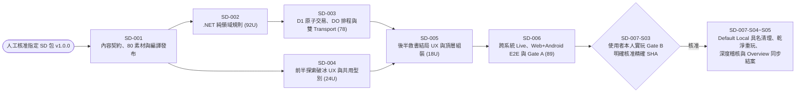

# SPEC-001-RainBookshopV4 — SD 總覽

**功能 ID**：`SPEC-001-RainBookshopV4`  
**來源 MVP／SPEC／BDD／TDD**：[MVP-001-LoveGameDatingApp.md](../../../../../requirements/MVP-001-LoveGameDatingApp.md)、[rain-bookshop-v4-draft.json](../../../../../requirements/rain-bookshop-v4-draft.json)、[SPEC-001-RainBookshopV4.md](../../../../../specs/SPEC-001-RainBookshopV4.md)、[SPEC-001-RainBookshopV4-RiskAudit.md](../../../../../specs/SPEC-001-RainBookshopV4-RiskAudit.md)、[SPEC-001-RainBookshopV4-BDD.md](../../../../../bdd/SPEC-001-RainBookshopV4-BDD.md)、[SPEC-001-RainBookshopV4-TDD.md](../../../../../tdd/SPEC-001-RainBookshopV4-TDD.md)  
**AI／模型／資訊依據**：AI：`Antigravity`（依據：系統 `<identity>` 明載 `You are Antigravity` 及執行環境 `antigravity-cli`）／模型：`未提供`（依據：執行環境未注入公開模型型號字串，依 `SD-contract-v2` 規範如實標示為未提供，不臆測型號）  
**批次／文件包路徑**：`20261125-2312-01`／`datinghigh/docs/sd/SPEC-001-RainBookshopV4/candidates/antigravity-model-unprovided/20261125-2312-01/`  
**契約版本**：`SD-contract-v2`  
**設計版本／優先級／狀態／最後更新**：`1.0.0`／高／`Awaiting approval`（完整設計與逐項桌面稽核通過，等待使用者人工核准；未開發）／2026-11-26  
**主責人／最終驗收責任**：DatingHigh 開發主責人（技術實作與 Gate A 驗收）／使用者本人（需求核准、設計核准與實玩 Gate B 最終簽認）

## 來源、程式與設計基準

| 類型 | 精確路徑／工作區 | 版本／commit／SHA-256 | 確認或觀察依據 | 相關未提交改動／影響 |
|---|---|---|---|---|
| MVP 來源 | `datinghigh/docs/requirements/MVP-001-LoveGameDatingApp.md` | bytes=`91175` sha256=`9f1e2d488ddf20d00cb54b3731363cd2d9b62c06660f426f86acb610af75b4a1` | `TDD#規劃交接紀錄`（2026-11-25 已確認 `AC-005-36`～`46`） | 無未提交改動；原文未動 |
| V4 作者草案（唯一文案權威） | `datinghigh/docs/requirements/rain-bookshop-v4-draft.json` | bytes=`150743` sha256=`b5c18f6762c87e25e1e83deb5769d19dc170c94a69bd6c1cdb15fe34b6809d95` | `SPEC §3.6` 明載之唯一劇本／文案權威 SHA | 無未提交改動；原文一字不動 |
| SPEC（SDD 技術方案與決策） | `datinghigh/docs/specs/SPEC-001-RainBookshopV4.md` | bytes=`45124` sha256=`78dd9c2202de603070846715454fca6b4cd94cc959fe1eac9937c6654f084843` | `SPEC §6.2`～`§6.4`（`RQ-01`～`04=A`、`RA-Q1`～`Q4=A`、倒數可配置化已確認） | 無未提交改動 |
| 實作前風險與缺漏稽核 | `datinghigh/docs/specs/SPEC-001-RainBookshopV4-RiskAudit.md` | bytes=`13146` sha256=`987a83f8201cfb20f7756e5226e908bf76d0a39ab8e73f2882d3aaa1c159e577` | `RA-01`～`RA-12` 與 `G01`～`G16` 全部確認回寫 | 無未提交改動 |
| BDD 場景規格 | `datinghigh/docs/bdd/SPEC-001-RainBookshopV4-BDD.md` | bytes=`30223` sha256=`72a0ce6703e94235c3fb8e26b4cd49cec52a6a51c1b8b9a4ef5f55786ab6f2d8` | 58 場景（含 42 個 `@frontend` 與 1 個 `@manual`），0 完成 | 無未提交改動 |
| TDD 測試清單與規劃交接 | `datinghigh/docs/tdd/SPEC-001-RainBookshopV4-TDD.md` | bytes=`176543` sha256=`edbfc1dd391d724ddd79ffe031b05cd75731553501d0dbfca94ccf7a36676cda` | 337 案例（175U/57I/18A/87E），0 完成；交接狀態 `Ready for well-done` | 無未提交改動 |
| 驗證紀錄 | `datinghigh/docs/verification/SPEC-001-RainBookshopV4-Verification.md` | bytes=`776` sha256=`7f23e9c13a98fffe0c3891a387bc39f1d9cbb6dd3eca911cb64fc53acbda6ffc` | 尚未開發／驗證基線 | 無未提交改動 |
| 程式與測試工作樹 | Git 根：`C:\GitProjects\gamenenstyle` 應用工作區：`C:\GitProjects\gamenenstyle\datinghigh`（無巢狀 `.git`） | `HEAD` commit：`c5add81bfc38045664297b8087c78f5b2e258a44`（`main`） | 2026-11-25～26 實地掃描 `git status` 與檔案雜湊 | 1. `datinghigh/` 下所有已追蹤產品程式碼、測試、migration、契約與 `overview/` **0 筆未提交改動**； 2. `datinghigh/docs/sd/` 下並存另一未追蹤兄弟候選包 `candidates/chatgpt-gpt-6.2/20261125-2221-01/`（`00-overview.md` `356ada85...`、`01-system-design.md` `0dbfe29c...`、`02-traceability.md` `9593a5f0...` 及 `plans/SD-001`～`007`），**本輪完整保留未動**； 3. 父層工作區（`datinghigh/` 之外）有 `.agents/skills/{carefully-done,design-decision,fantastic-design}/*`（13 檔）與 `tools/chatgpt-local-mcp/src/*`（3 檔）未提交改動，屬方法技能與外部 MCP 工具演進，不影響 `datinghigh/` 應用程式碼基準，本輪依現行工作樹之 `SD-contract-v2` 規範產出並完整保護既有改動。 |

**核准設計內容清單與可還原快照**：本候選包設計版本 `1.0.0` 之核准邊界涵蓋本總覽核定之完成契約及下表全部 9 份設計文件的完整內容（系統設計 `SYS-001`～`010` 與 `CORE-01`～`05`、正向 337 列與 58 列 BDD／畫面稽核及單一寫入反向矩陣、7 份分項之 `F-ID`／`D-ID`／`I-ID`／`V-ID` 與全部 38 個 `SD-NNN-SXX` 步驟順序／案例／斷言／命令／通過與停止條件），各檔案之實際內容直接保存於本批次目錄且對應可驗證 SHA-256 快照如下：

| 本包設計檔案（版本 `1.0.0`） | 位元組數 | SHA-256 內容指紋（可還原核准基準） |
|---|---:|---|
| [01-system-design.md](01-system-design.md) | `87374` | `ce515fb9df69929de5d8dacb83bd6c1e9b5a126f75cb07caa92591e08a148ed0` |
| [02-traceability.md](02-traceability.md) | `312118` | `bd248bbb7f1055d1a633ea7753f7e9ee7ac858cb23714fa9232d717e5aec5895` |
| [plans/SD-001-V4內容契約與作者草案編譯器.md](plans/SD-001-V4內容契約與作者草案編譯器.md) | `80683` | `3d8502eae1a19525344d627be9e8d6fc3b14bb23acdf4f7403d6cf29c080aab1` |
| [plans/SD-002-雙軌破冰與限時救書領域規則.md](plans/SD-002-雙軌破冰與限時救書領域規則.md) | `70660` | `48bdd79830370d80e2f327a3711be706c85ae35d980d692d264c0fc8fc77e3c1` |
| [plans/SD-003-權威計時交易與房間排程同步.md](plans/SD-003-權威計時交易與房間排程同步.md) | `70444` | `227e2690cc1a023a5344b0ccf3db95225a7da11c9374706e9cd5ac80031cc5eb` |
| [plans/SD-004-去按鈕化探索書牆與雙向破冰前端UX.md](plans/SD-004-去按鈕化探索書牆與雙向破冰前端UX.md) | `58585` | `feba7792f35f7c06d0264f7bdab9060bfb7feda3f4818684c7a12e4865816159` |
| [plans/SD-005-暴雨救書協作與四結局借閱小票前端UX.md](plans/SD-005-暴雨救書協作與四結局借閱小票前端UX.md) | `51938` | `d127e5dd34c353ad53fa10608bf9ee39aa3a515a1cfb6e8c19e791974f2c96cb` |
| [plans/SD-006-跨系統整合雙平台E2E與技術GateA驗收.md](plans/SD-006-跨系統整合雙平台E2E與技術GateA驗收.md) | `54018` | `c9b196d60908b8dd1b0a6315491021e25c155ec2f280991d516d4d1e401285f8` |
| [plans/SD-007-實玩GateB與Local清理結案交付.md](plans/SD-007-實玩GateB與Local清理結案交付.md) | `56273` | `640e6ca84710a31c940af44aa64a6343c3d42ccfad19325933ba8e712bf03460` |

**歷史／取代關係**：未取代任何批次；目前 `docs/sd/SPEC-001-RainBookshopV4/candidates/` 下共有 **2 個有效完整候選批次**：（1）`chatgpt-gpt-6.2/20261125-2221-01`、（2）本批次 `antigravity-model-unprovided/20261125-2312-01`，尚無 `final/`。兩者完整並存供使用者直接指定核准或選用 `design-decision` 比較整合。

## 前置與完成契約

| 前置項 | 實際查核結果／證據 | 阻斷／恢復條件 |
|---|---|---|
| agent 指示、README、方法與跨工作區資訊 | 已完整讀取 `datinghigh/AGENTS.md`、`README.md`、`overview/01`～`04` 全數 11 份架構與契約文件，以及 `.agents/skills/fantastic-design`（含 `SD-contract-v2`、`planning-rules`、`step-design`、四份範本）與 `bdd-frontend-ux-implementation` | 無阻斷（查核通過） |
| TDD 原交接 `Ready for well-done` | [SPEC-001-RainBookshopV4-TDD.md#規劃交接紀錄](../../../../../tdd/SPEC-001-RainBookshopV4-TDD.md#規劃交接紀錄) 明載狀態為 `Ready for well-done`（最後確認日期：2026-11-25），「不得進入開發的阻斷項：無」 | 無阻斷（保持原交接不變） |
| 已確認風險、缺漏回寫與注意事項 | SDD `RQ-01`～`04=A`、倒數配置化（`SPEC §6.2`、`§6.4`）與 RiskAudit `RA-Q1`～`Q4=A`（`RA-01`～`12` 及 `G01`～`G16` → `RB4-T-322`～`337`）均已回寫至 `MVP`、`SPEC`、`BDD`、`TDD` 正文，注意事項全數納入各包步驟 | 無阻斷（查核通過） |
| 實際程式、測試、build／DB／前端／部署與工作樹 | 已逐檔盤點 `.NET 10` 四層、`cloudflare/src/` 與 `0005`/`0007` SQL、`frontend/client/`、`tools/`、`package.json` 實際腳本（`npm test`、`test:server`、`test:worker`、`test:client`、`test:live`、`export:web`、`build:e2e-host`、`test:web`、`test-android.ps1`）；已識別 `test-android.ps1` 搬移前路徑限制並納入 `SD-006-S02` 修復 | 無設計阻斷；執行期若缺 Android 裝置則依 P7 如實記 `Deferred` 不代簽 |
| 各分項有序步驟與 Todo／檔案／驗證映射 | 7 份 SD 共 30 個 `D`、36 個 `I`、38 個 `S` 步驟；每個 `S` 唯一對應 1 個 `I`，具備具體輸入輸出、核心分支、正常／錯誤／臨界測試值、可執行命令與停止／恢復條件；全包檔案 100% 單一寫入者 | 無阻斷（桌面稽核通過） |

| 產品實作與 BDD／畫面分解 | 全部 15 項 SPEC AC、58 個 BDD Scenario（含 42 個 `@frontend` 雙平台畫面與 1 個 `@manual` Gate B）、337 項 TDD 與 2,245 行原稿 JSON 均已映射至實際產品檔案／類別／函式／UI 元件與手勢狀態機，零僅映射測試檔項目；非 UI 場景均逐條載明證據與不適用理由（詳見 [02-traceability.md](02-traceability.md#bdd-行為與畫面完整性稽核)） | 無缺項（完整設計涵蓋 100.0%，可交付 `Awaiting approval`） |

**本次成果、範圍及排除範圍**：本次交付 `SPEC-001-RainBookshopV4` 完整可執行 SD 候選文件包（設計階段不修改任何產品程式、測試、設定或資料庫）；實作範圍涵蓋 V4 `scene-event.v3` 契約與 80 素材、雙軌破冰與 90 秒可配置雙向手勢救書、四結局與借閱小票、雙端 Gate A、本人實玩 Gate B、具名 Local 清理與乾淨重玩結案；明確排除 iOS（`D-052`）、無障礙專項（`D-051`）、完整 Puppet 骨架、其餘九場劇情與 `AffectionAndFeedback`。  
**整體驗收條件**：（1）原稿逐 scalar 100% 保留且 80 素材與 16 經典／音訊權利核實；（2）337/337 TDD（含真 Miniflare D1/R2/DO、HTTP/WS、正式 Web 與真實 Android 雙端獨立 E2E）全數 `Verified` 通過技術 Gate A；（3）使用者本人親自試玩並明確核准精確 V4 SHA 通過 Gate B；（4）已知 default local 完成具名舊版與測試輪清理、保護資料指紋 100% 不變並通過雙端 `CleanReplay` 回歸；（5）完成全案深度稽核、`Verification.md` 與 `overview/` 同步且 `git diff --check` 零錯誤。  
**預算／期限／估計依據**：使用者未指定金額預算或硬性截止日；規劃已預留真 D1 時鐘可行性驗證（`SD-003-S01`）、Android 腳本路徑修復與雙端序列實測（`SD-006`）、條件式修補重驗、本人 Gate B 審核等待及 Local 備份清理（`SD-007`）之完整工時與重試緩衝，不捏造節省比例或硬期限。

## 開發進度總覽

### 整體進度

各分項 Todo 葉節點為唯一 SD 計數來源；以下由各分項分子／分母直接相加計算（不平均百分比）。

| 指標 | 完成／總數 | 進度條／百分比 | 查核依據 |
|---|---|---|---|
| 設計完成度（D） | 30 / 30 | `[████████████████████] 100.0%` | `SD-001`(4) + `SD-002`(5) + `SD-003`(5) + `SD-004`(4) + `SD-005`(4) + `SD-006`(4) + `SD-007`(4) |
| SPEC 設計涵蓋率 | 15 / 15 | `[████████████████████] 100.0%` | [02-traceability.md 來源清冊](02-traceability.md#來源清冊與計數)（`RB4-AC-001`～`015`） |
| BDD 設計涵蓋率 | 58 / 58 | `[████████████████████] 100.0%` | [02-traceability.md BDD 行為與畫面完整性稽核](02-traceability.md#bdd-行為與畫面完整性稽核)（`RB4-BDD-001`～`058`） |
| TDD 設計涵蓋率 | 337 / 337 | `[████████████████████] 100.0%` | [02-traceability.md 全量正向追溯](02-traceability.md#全量正向追溯)（`RB4-T-001`～`337`） |
| 實作驗證完成度（I） | 0 / 36 | `[░░░░░░░░░░░░░░░░░░░░] 0.0%` | 設計階段未開發；`SD-001`(5)+`002`(6)+`003`(6)+`004`(4)+`005`(4)+`006`(6)+`007`(5) 皆待實測驗收 |

**結構映射與完整性區分**：僅具結構 ID／測試檔映射而缺產品核心邏輯或畫面設計之項目數為 **`0`**；真正同時具備來源行為條件與結果、實際產品檔案／符號與核心分支、適用 Web／Android 雙端畫面手勢狀態及驗證安排之完整設計數為 **SPEC `15 / 15`、BDD `58 / 58`（含 `@frontend` `42 / 42`、`@manual` `1 / 1`）、TDD `337 / 337`**。

### 分項／分組進度追蹤

| SD／分組 | D 完成／總數 | I 完成／總數 | 執行狀態 | 驗收狀態 | 證據／阻斷 |
|---|---|---|---|---|---|
| [SD-001-V4內容契約與作者草案編譯器](plans/SD-001-V4內容契約與作者草案編譯器.md) | 4 / 4 | 0 / 5 | `Planned` | `Incomplete` | 設計就緒（20 TDD / 6 步驟）；等待本包人工核准 |
| [SD-002-雙軌破冰與限時救書領域規則](plans/SD-002-雙軌破冰與限時救書領域規則.md) | 5 / 5 | 0 / 6 | `Planned` | `Incomplete` | 設計就緒（92 TDD / 6 步驟）；依賴核准與 `SD-001` |
| [SD-003-權威計時交易與房間排程同步](plans/SD-003-權威計時交易與房間排程同步.md) | 5 / 5 | 0 / 6 | `Planned` | `Incomplete` | 設計就緒（78 TDD / 7 步驟）；依賴 `SD-001`、`SD-002` |
| [SD-004-去按鈕化探索書牆與雙向破冰前端UX](plans/SD-004-去按鈕化探索書牆與雙向破冰前端UX.md) | 4 / 4 | 0 / 4 | `Planned` | `Incomplete` | 設計就緒（24 TDD / 4 步驟）；依賴 `SD-001` |
| [SD-005-暴雨救書協作與四結局借閱小票前端UX](plans/SD-005-暴雨救書協作與四結局借閱小票前端UX.md) | 4 / 4 | 0 / 4 | `Planned` | `Incomplete` | 設計就緒（18 TDD / 4 步驟）；依賴 `SD-003`、`SD-004` |
| [SD-006-跨系統整合雙平台E2E與技術GateA驗收](plans/SD-006-跨系統整合雙平台E2E與技術GateA驗收.md) | 4 / 4 | 0 / 6 | `Planned` | `Incomplete` | 設計就緒（89 TDD / 6 步驟）；依賴 `SD-001`～`SD-005` |
| [SD-007-實玩GateB與Local清理結案交付](plans/SD-007-實玩GateB與Local清理結案交付.md) | 4 / 4 | 0 / 5 | `Planned` | `Incomplete` | 設計就緒（16 TDD / 5 步驟）；依賴 `SD-006` Gate A 與本人 Gate B |

### 當前 Sprint 狀態

| 當前階段／分項／葉節點／步驟 ID | Red–Green–Refactor 子階段 | 負責者／開始條件 | 下一步 ID／最後更新 |
|---|---|---|---|
| Phase 6 設計交付／全候選包待審／尚未進入 `SD-001-I01` | 不適用（`fantastic-design` 只設計不開發） | 使用者審閱核准（或選用 `design-decision` 整合候選包） | 取得 `Ready for carefully-done` 核准後啟動 `SD-001-S01`／2026-11-26 |

### 里程碑

以下引用原 Todo ID，不另計數。

| 里程碑 | 所需 SD／葉節點／依賴 | 整合條件與驗證 | 狀態／證據 |
|---|---|---|---|
| M0：SD 候選設計交付與人工核准 | `SD-001`～`007` 全部 30 個 `D` 葉節點 | 完整設計涵蓋 100%、單一寫入責任與步驟稽核通過，提交使用者確認 | 設計已完成（`Awaiting approval`） |
| M1：正式 V4 內容包與 80 素材就緒 | `SD-001-I01`～`I05` | 原稿逐 scalar 零差異、50,000 guard 內全可達、80 資產解碼與 90/120s 發布釘選通過 | `Incomplete` |
| M2：後端權威計時與雙端全場 UX 完成 | `SD-002-I01`～`I06`、`SD-003-I01`～`I06`、`SD-004-I01`～`I04`、`SD-005-I01`～`I04` | `npm test`、`test:server`、`test:worker`、`test:client` 與 `export:web` 全數通過 | `Incomplete` |
| M3：跨系統真環境整合與技術 Gate A | `SD-006-I01`～`I06` | `check:foundation`、`test:live`、正式 Web E2E、真實 Android E2E、效能與權利總檢核 100% 通過 | `Incomplete` |
| M4：本人實玩 Gate B、Local 清理與最終結案交付 | `SD-007-I01`～`I05` | 本人明確簽認精確 SHA → default local 安全清理且保護指紋一致 → 雙端 `CleanReplay` → 深度稽核 337/337 與 `overview/` 同步 | `Incomplete` |

### 關鍵指標

| 指標 | 已確認目標／依據 | 當前值 | 證據或待驗原因 |
|---|---|---|---|
| 來源需求完整設計涵蓋率 | SPEC 15/15、BDD 58/58、TDD 337/337、原稿 JSON 100%（`SD-contract-v2`） | `100.0%` | [02-traceability.md](02-traceability.md) |
| 資料庫與架構邊界約束 | 21 表、0 新欄、0 Trigger、0 新公開 HTTP 路由、Graph `<= 50,000`、JSON `<= 16,384`（`SPEC §6.2`、`RA-10`） | 設計 100% 符合；執行期實測待跑 | 待 `SD-001-S06` 與 `SD-003-S01` 真環境實測 |
| 產品實作與驗收通過數 | TDD 337/337、BDD `@frontend` 42/42（Web + Android 雙端）、本人 Gate B 1/1 | `0 / 337 (0.0%)` | 設計階段未開發，待核准後由 `carefully-done` 執行 |

### 每日進度記錄

依工作區 `AGENTS.md` 基本規範，禁止維護每日／批次歷史進度流水帳；以下僅就地保留當前設計交付事實。

| 日期 | 完成與證據 | 剩餘／阻斷 | 下一步／負責者 |
|---|---|---|---|
| 2026-11-26 | 完成候選包 `antigravity-model-unprovided/20261125-2312-01` 設計版本 `1.0.0`（系統設計、7 份分項、38 個步驟、全量 337 列追溯矩陣與桌面稽核，`D` `30/30`） | 實作 `I` `0/36`；等待使用者明確核准指定包與設計版本 | 使用者審閱核准（或執行 `design-decision` 比較兩份候選包），核准後啟動 `carefully-done` |

## 系統設計與分項索引

- 系統設計：[01-system-design.md](01-system-design.md)
- 追溯矩陣：[02-traceability.md](02-traceability.md)
- 設計決策：不適用（本目錄為 `candidates/` 候選設計包；若後續使用 `design-decision` 產出 `final/` 時才建立 `03-design-decision.md`）

| SD ID／文件 | 可交付成果／來源 | 執行／整合／驗收責任 | 可寫範圍／排除 | 依賴／契約版本 | 驗收／證據位置 |
|---|---|---|---|---|---|
| [SD-001](plans/SD-001-V4內容契約與作者草案編譯器.md) | `scene-event.v3` 契約、62 新素材＋18 V3 重用核驗、16 經典權利、原稿無損編譯器、50,000 內有界可達性、90/120s 不可變發布（`RB4-AC-002`,`008`,`011`,`012`,`015`；20 TDD） | `SD-001` 執行者／整合 `SD-006` | `cloudflare/src/scene-event-{presentation-schema,stage-content,track-content,track-graph}.ts`、`tools/{rain-bookshop-v4-policy,scene-event-content-policy,scene-event-publish-policy}.mjs`、`contracts/{rain-bookshop-v4.json,scene-event-content.json,story-assets/*}` 及對應 3 測試檔；排除原稿 JSON 與 V3 舊檔 | 無前置 SD／`CNT-001` (`scene-event.v3`) | `SD-001 V-001`～`V-005` 及 `Verification.md` |
| [SD-002](plans/SD-002-雙軌破冰與限時救書領域規則.md) | `.NET 10` 純領域雙軌 28 節點、盲書與興趣貼紙隔離、霧窗見證、提問卡、導演、15s 暫緩自動恢復、4 步救書＋三扣重置、書籤 20 scalar、4 結局與借閱小票（`RB4-AC-001`～`011`；92 TDD） | `SD-002` 執行者／整合 `SD-003`、`SD-006` | `backend/src/DatingHigh.Domain/{SceneEventV4Policy,SceneEventTrackPolicy,SceneEventStageProjection,SceneBookProjection,SceneAudioProjection}.cs` 與 Domain 單元測試 2 檔；排除 Application/Worker/前端 | 依賴 `SD-001`／`CNT-001` | `SD-002 V-001`～`V-006` 及 `Verification.md` |
| [SD-003](plans/SD-003-權威計時交易與房間排程同步.md) | Application／Api 私有 `system.reconcile`、真 D1 同批共同 guard 與毫秒時鐘 guard、`NULL` actor 冪等、`GameRoomSocket` 最早排程與多分頁連線聚合、HTTP/WS 對稱契約與零洩密（`RB4-AC-002`～`012`；78 TDD） | `SD-003` 執行者／整合 `SD-005`、`SD-006` | `backend/src/DatingHigh.Application/{SceneEventFrameworkService,StoryPayload}.cs`、`Api/Program.cs`、`cloudflare/src/{scene-event-track-commands,scene-event-commands,scene-event-read,scene-event-authorization,room-socket,platform}.ts` 及對應 4 測試檔；0 新公開路由、0 migration | 依賴 `SD-001`、`SD-002`／`CNT-002`～`004` | `SD-003 V-001`～`V-006` 及 `Verification.md` |
| [SD-004](plans/SD-004-去按鈕化探索書牆與雙向破冰前端UX.md) | 共用 `scene-event.v3` 前端完整型別、去按鈕化導覽／小地圖暖金點、呼吸光長按、手勢護欄、5 區書牆橫滑／盲書撕封、空間彩蛋／擦霧見證、面紙近遠／提問卡／8×3 聊天建議（`RB4-AC-001`～`006`；24 TDD） | `SD-004` 執行者／組裝 `SD-005`、雙端驗收 `SD-006` | `frontend/client/src/types/scene-event-track.ts`、`components/{BookshopMinimapOverlay,ShelfCloseupDrawer,AmbientInteractableModal,EmbeddedSceneStage,SceneWorldObjects,SceneBook,SceneEventActions}.tsx` 與前半單元測試 1 檔；排除 `StoryExperienceScreen.tsx` | 依賴 `SD-001`／`CNT-003` | `SD-004 V-001`～`V-004` 及 `Verification.md` |
| [SD-005](plans/SD-005-暴雨救書協作與四結局借閱小票前端UX.md) | 暴雨 7 步過場、手電筒 Ready、單調倒數、4 水位、雙向救書手勢與快捷泡泡、書籤儀式、四結局、結局 2 翻書、借閱小票、背景停播、有界快取與 `StoryExperienceScreen` 頂層組裝（`RB4-AC-006`～`012`,`014`；18 TDD） | `SD-005` 執行者／雙端驗收 `SD-006` | `frontend/client/src/components/{TimedRescueOverlay,BookmarkAndEndingPanel,SceneWeather,SceneStoryMotion,StoryAudio}.tsx`、`services/RealtimeRoomClient.ts`、`screens/StoryExperienceScreen.tsx` 與後半單元測試 1 檔 | 依賴 `SD-003`、`SD-004`／`CNT-002`、`003` | `SD-005 V-001`～`V-004` 及 `Verification.md` |
| [SD-006](plans/SD-006-跨系統整合雙平台E2E與技術GateA驗收.md) | 修復 `test-android.ps1` 路徑、真本地 Live 整合、正式 Web 與真實 Android 全場景雙真人視角 E2E、重複閒置恢復、效能基線對照與技術 Gate A 總檢核（`RB4-AC-001`～`012`；89 TDD） | `SD-006` 執行者／移交 `SD-007` | `tools/{test-android.ps1,test-scene-web.mjs,rain-bookshop-v4-gate-a-audit.mjs}`、`tools/tests/rain-bookshop-v4-gate-a.test.mjs`、`tests/integration/rain-bookshop-v4-live.mjs`、`tests/e2e/web/scene-event-v4.spec.ts`、`tests/e2e/android/scene-event-v4.mjs` | 依賴 `SD-001`～`SD-005` 全數完成 | `SD-006 V-001`～`V-006` 及 `Verification.md` |
| [SD-007](plans/SD-007-實玩GateB與Local清理結案交付.md) | 具名 Local 清理引擎（含混合輪阻斷與保護指紋）、彙整 Gate A 並等待**使用者本人實玩 Gate B**、實際清理與舊 V3 無用檔移除、雙端 `CleanReplay`、全案深度稽核與 `Verification`/`SPEC`/`BDD`/`TDD`/`overview` 最終同步（`RB4-AC-013`～`015`；16 TDD） | `SD-007` 執行者＋使用者本人（Gate B）／主責人最終查核 | `tools/{rain-bookshop-v4-cleanup-policy.mjs,local.mjs}`、`tools/tests/rain-bookshop-v4-cleanup-policy.test.mjs`、`cloudflare/tests/scene-event-local-upgrade.integration.test.ts`、Gate B 後具名舊 V3 刪除、`Verification.md`、來源規格與受影響 `overview/` | 依賴 `SD-006` Gate A 與本人 Gate B 明確核准 | `SD-007 V-001`～`V-005` 及 `Verification.md` |

## 完整執行順序與整合

| 工作／條件分支 | 起始條件 | 安全並行或循序理由 | 共用契約／環境控制 | 完成條件／主責 |
|---|---|---|---|---|
| 階段 1：`SD-001` 契約與正式內容建置 | 使用者明確核准本包 `v1.0.0` | 必須循序先行，以鎖定 `contracts/rain-bookshop-v4.json` 與 `scene-event.v3` 結構供全案共用 | 唯一寫入 `contracts/` 與內容 parser；隔離執行 Node / Miniflare | `SD-001-I01`～`I05` 全綠／`SD-001` |
| 階段 2：`SD-002`（後端領域）與 `SD-004`（前端前半） | `SD-001` 完成 | **安全並行**（若有分工授權）：可寫檔案 100% 不重疊、契約已由 `SD-001` 鎖定、`dotnet test` 與前端單元測試環境完全隔離 | 共用唯讀 `contracts/rain-bookshop-v4.json` | `SD-002` 92U 與 `SD-004` 24U 各自全綠 |
| 階段 3：`SD-003`（D1/Worker/DO/API） | `SD-002` 完成（可與 `SD-004` 並行） | 依賴 `SD-002` 領域類別；與 `SD-004` 無寫入或測試環境重疊；`S01` 先驗真 D1 時鐘可行性 | 隔離 Miniflare D1/R2/DO 與 `.NET` API 測試 | `SD-003` 78 項 TDD 全綠／`SD-003` |
| 階段 4：`SD-005`（後半 UX 與全畫面組裝） | `SD-003` 與 `SD-004` 皆完成 | 必須循序於 `SD-003`、`SD-004` 之後，唯一寫入 `StoryExperienceScreen.tsx` 組裝全場並驗證 `export:web` | 唯讀引用 `SD-004` `scene-event-track.ts` 與前半元件 | `SD-005` 18U 與 `export:web` 全綠／`SD-005` |
| 階段 5：`SD-006` 跨系統整合、雙端 E2E 與 Gate A | `SD-001`～`SD-005` 全部完成並停止寫入 | **嚴格單一序列執行**：獨佔本地 `8787` 平台、故障／重啟與 Android ADB，嚴禁並行搶埠 | 先 `check:foundation` → `test:live` → Web E2E → Android E2E → Gate A 檢核 | `SD-006` 89 項通過且 `gateAReady: true`／`SD-006` |
| 條件分支：整合／深度稽核發現實作缺陷 | `SD-006` 或 `SD-007-S05` 發現未達來源條件之實作瑕疵 | 依 P1/P6 確認無並行寫入後，在原唯一檔案負責包核准設計範圍內修補，重跑受影響單元／整合與雙端 E2E；若涉及改已記載設計則立即停止走人工確認 | 維持單一檔案寫入責任，不預造假缺陷 checkbox | 受影響測試與回歸重新取得 `Verified`／主責人 |
| 階段 6：`SD-007` 本人 Gate B、Local 清理與最終交付 | `SD-006` Gate A 完成；`S04` 清理硬性依賴 `S03` 使用者本人明確核准精確 SHA | **硬性循序關卡**：未獲本人核准絕不清理；清理時先停寫備份並獨佔 default local，再跑雙端 `CleanReplay`、深度稽核與文件同步 | `tools/local.mjs` wrapper、禁 `--remote`、保護資料指紋前後核對 | 全案 15 AC / 58 BDD / 337 TDD 與 36 `I` 100% `Verified`／主責人＋使用者本人 |

## 風險、變更與決策

| ID | 原設計／證據／白話影響 | 負責者／觸發條件 | 處置／替代／成本時程影響 | 決策與受影響版本／成果／重驗 |
|---|---|---|---|---|
| `RQ-01` + `RA-01` | 15 秒斷線／閒置暫緩若拒所有操作將永久卡死；晚到 alarm 若用當下時間算會多扣秒 | `SD-002`、`003`、`005`、`006`／救書暫緩與恢復時觸發 | 閒置方實際互動或斷線方回前景可操作畫面即自動恢復（無額外按鈕，首次恢復只同步不計分）；晚到 alarm 依 `min(pauseDueAt, deadlineAt)` 計算 | 已確認 `RQ-01=A`、`RA-Q1=A`（納入 `v1.0.0`；由 `RB4-T-322`～`324` 驗證） |
| `RA-02` | SQLite `NULL UNIQUE` 不去重系統事件；真 D1 毫秒時鐘 guard 與同批零部分寫入須實測證明 | `SD-003`／`SD-003-S01` 啟動即觸發實測 | 私有 `story.framework.system.reconcile`＋同批共同前置 guard＋`unixepoch('now','subsec')`＋`operationIdentity`；若真 D1 實測不足立即停止提出最小方案 | 已確認 `RA-Q4=A`（納入 `v1.0.0`；由 `RB4-T-187`、`325`、`326` 驗證） |
| `SPEC §6.4` + `RA-03` | `durationSeconds` 配置化若縮短越界會使 75s 水位或 30s 稱號不可達 | `SD-001`、`002`、`003`／內容編譯與發布時觸發 | 同一釘選版本管理全部時間門檻並於發版強制校驗單調性與數字文案一致；以 90s/120s 雙版本實證舊場次不熱改 | 已確認 `SPEC §6.4`、`RA-Q4=A`（納入 `v1.0.0`；由 `RB4-T-327`、`328` 驗證） |
| `RA-04` + `RA-05` | `set-a` 兩本書同在 `shelves`；第 4 本三扣按錯順序與暫緩重連持物保存未明定時易丟進度 | `SD-001`、`002`、`003`、`005`／編譯與第 3、4 步救書觸發 | 四書台為四取書位置，保留原稿不動；錯扣僅重置 `latchIndex=0`，已放書與已救數保留，重連權威還原中間狀態 | 已確認 `RA-Q2=A`、`RA-Q3=A`（納入 `v1.0.0`；由 `RB4-T-329`～`331` 驗證） |
| `RQ-02/03` + `RA-06/07` | 霧窗背景輪詢誤發印章、`X/4` 跨輪混入 V3、盲書／問答／書籤短語外洩或進小票 | `SD-002`～`005`／全場讀取、回放與結算觸發 | `S_fast >= 30000ms`；`X/4` 限同 pair 當前 Round 同版 V4；霧窗限夥伴前景 `window` 實際渲染見證；白名單投影且小票零個資零自由輸入 | 已確認 `RQ-02=A`、`RQ-03=A`、`RA-Q4=A`（納入 `v1.0.0`；由 `RB4-T-332`、`333` 驗證） |
| `RQ-04` + `RA-08`～`12` | DO 新連線覆蓋排程、Graph 超過 50,000、Android 舊路徑、16 經典與音樂權利、Local 清理誤刪共用 SHA 或混合輪 | `SD-001`、`003`、`006`、`007`／發布、Gate A、Gate B 與清理觸發 | 最早到期排程；有界商狀態折疊；修 `test-android.ps1`；逐本與音樂權利核驗；本人 Gate B 後具名 FK 清理＋R2 `RetainedShas`＋保護指紋 | 已確認 `RQ-04=A`、`RA-Q4=A`（納入 `v1.0.0`；由 `RB4-T-295`、`334`～`337` 驗證） |

## 檢查點與續作交接

| 日期／任務／執行者 | 已驗收成果／證據 | 剩餘／停止原因 | 寫入權／共享資源狀態 | 恢復條件／查核結果 | 續作啟動結果／下一步 |
|---|---|---|---|---|---|
| 2026-11-26／`fantastic-design` 候選包交付／Antigravity | 完成本候選包全部設計與逐項桌面稽核（`D` `30/30`、涵蓋率 `100.0%`、`git diff --check` 通過） | 實作驗證 `I` `0/36` 未開始；依 `fantastic-design` 契約於設計交付後停止等待人工確認 | 未寫入任何產品程式、測試或設定檔；本地 `8787` 與資料庫未改動 | 使用者明確核准指定包與版本（或完成 `design-decision` 並核准 `final`），開工前核對來源與快照 SHA 無漂移 | 尚未啟動實作；核准後由 `carefully-done` 從 `SD-001-S01` 啟動 |

**失效證據與重驗範圍**：無（目前尚無產品實作證據，既有 `SceneEventFramework` 基線保持有效）  
**目前步驟／子階段與副作用／清理現況**：停於設計交付完成點，零產品副作用、零臨時髒資料（參見各分項檢查點）  
**下一整合里程碑、用時／重試與策略**：下一關卡為 M0（人工核准設計版本 `1.0.0`），核准後首個技術里程碑為 M1（`SD-001` 正式 V4 內容與 80 素材建置驗證）

## SD 人工確認與交接

**交接狀態**：`Awaiting approval`  
**鎖定文件包／設計版本／核准快照**：`datinghigh/docs/sd/SPEC-001-RainBookshopV4/candidates/antigravity-model-unprovided/20261125-2312-01/`／設計版本 `1.0.0`／核准快照見上方「本包設計檔案 SHA-256 內容指紋表」  
**使用者明確確認、日期與依據**：待確認（尚未取得針對本候選包 `v1.0.0` 的使用者明確核准）  
**核准邊界及已失效部分**：待確認範圍涵蓋 `00-overview.md`、`01-system-design.md`、`02-traceability.md` 及 `plans/SD-001`～`SD-007` 版本 `1.0.0` 全文；目前已失效部分：無  
**待確認事項／阻斷／恢復條件**：無上游需求衝突阻斷；唯一待確認事項為請使用者審閱並決定採用哪一份設計包與版本（注意目前 `candidates/` 下並存 `chatgpt-gpt-6.2/20261125-2221-01` 與本包 `antigravity-model-unprovided/20261125-2312-01` 共 2 份候選包，因此單說「開始開發」不足以自動推定唯一候選，需明確指定候選包路徑＋版本或先整合成 `final/` 並核准）  
**選用下一步**：
1. **直接核准本候選包開工**：若直接確認採用本包，請明確核准 `candidates/antigravity-model-unprovided/20261125-2312-01`（版本 `1.0.0`），隨後即可使用 `/carefully-done` 按步驟實作與驗收；
2. **多候選比較整合（選用）**：若想逐細項比較既有 `chatgpt-gpt-6.2/20261125-2221-01` 與本包 `antigravity-model-unprovided/20261125-2312-01` 的優缺點並整合成單一 `final/` 設計包，可呼叫 `/design-decision`（完成後核准 `final/` 再執行 `/carefully-done`）。

TDD 的 `Ready for well-done` 保持原樣；SD 設計完成或涵蓋 100% 不代表產品已完成。

## 最終驗收與交付

| 完成契約項／來源 | 目前產物與版本 | 實際命令／操作／環境／結果 | 證據位置 | 驗收狀態 | 等價依據或恢復條件 |
|---|---|---|---|---|---|
| 1. SD 候選設計包與逐項桌面稽核（`SD-contract-v2`） | 本包 `00`、`01`、`02` 與 `plans/SD-001`～`007`（`v1.0.0`） | 桌面逐項對照 15 AC / 58 BDD / 337 TDD / 2,245 行原稿 JSON、連結檢查與 `git diff --check` | 本文件與 [02-traceability.md](02-traceability.md) | `Verified`（僅限桌面設計稽核，非產品驗證） | 等待使用者核准設計版本 `1.0.0` |
| 2. V4 正式內容編譯、80 素材、16 經典權利與有界可達性（`RB4-AC-002`,`008`,`011`,`015`） | 尚未開發（規劃於 `SD-001`） | 待核准後執行 `SD-001-S01`～`S06` | 待回填至 `SD-001` 與 `Verification.md` | `Incomplete` | 待人工核准設計後開工 |
| 3. 雙軌破冰、可配置 90s 權威計時、D1 CAS、DO 排程與雙 Transport 隔離（`RB4-AC-001`～`012`） | 尚未開發（規劃於 `SD-002`、`SD-003`） | 待核准後執行 `SD-002`、`SD-003` | 待回填至 `SD-002`、`SD-003` 與 `Verification.md` | `Incomplete` | 待人工核准設計後開工 |
| 4. Web／Android 共用去按鈕化探索、雙向手勢救書、四結局與借閱小票 UX（`RB4-AC-001`～`012`） | 尚未開發（規劃於 `SD-004`、`SD-005`） | 待核准後執行 `SD-004`、`SD-005` | 待回填至 `SD-004`、`SD-005` 與 `Verification.md` | `Incomplete` | 待人工核准設計後開工 |
| 5. 跨系統真環境整合、正式 Web／真實 Android 雙端 E2E 與技術 Gate A（`RB4-AC-012`） | 尚未開發（規劃於 `SD-006`） | 待核准後序列執行 `SD-006-S01`～`S06` | 待回填至 `SD-006` 與 `Verification.md` | `Incomplete` | 待人工核准設計並備妥本地平台與 Android 驗收環境 |
| 6. 使用者本人實玩 Gate B、Default Local 具名安全清理、乾淨重玩與全案同步結案（`RB4-AC-013`,`014`） | 尚未開發（規劃於 `SD-007`） | 待 Gate A 後由使用者本人實玩簽認精確 SHA，再執行 `SD-007-S04`～`S05` | 待回填至 `SD-007` 與 [Verification.md](../../../../../verification/SPEC-001-RainBookshopV4-Verification.md) | `Incomplete` | 硬性依賴 Gate A 通過及使用者本人 Gate B 明確核准 |

原定產品實作、整合驗證、本人 Gate B、Local 清理與最終深度稽核均尚未執行（`0/36` `I` 葉節點），在全部必要項目達成 `Verified` 前絕不結案。

## 相關文檔與生成資訊

- 本候選包文件：[01-system-design.md](01-system-design.md)、[02-traceability.md](02-traceability.md)、[SD-001](plans/SD-001-V4內容契約與作者草案編譯器.md)、[SD-002](plans/SD-002-雙軌破冰與限時救書領域規則.md)、[SD-003](plans/SD-003-權威計時交易與房間排程同步.md)、[SD-004](plans/SD-004-去按鈕化探索書牆與雙向破冰前端UX.md)、[SD-005](plans/SD-005-暴雨救書協作與四結局借閱小票前端UX.md)、[SD-006](plans/SD-006-跨系統整合雙平台E2E與技術GateA驗收.md)、[SD-007](plans/SD-007-實玩GateB與Local清理結案交付.md)
- 同需求其他候選批次（完整保留）：[chatgpt-gpt-6.2 / 20261125-2221-01](../../chatgpt-gpt-6.2/20261125-2221-01/00-overview.md)
- 上游需求與驗證文件：[MVP-001](../../../../../requirements/MVP-001-LoveGameDatingApp.md)、[作者草案 JSON](../../../../../requirements/rain-bookshop-v4-draft.json)、[SPEC-001-RainBookshopV4](../../../../../specs/SPEC-001-RainBookshopV4.md)、[RiskAudit](../../../../../specs/SPEC-001-RainBookshopV4-RiskAudit.md)、[BDD](../../../../../bdd/SPEC-001-RainBookshopV4-BDD.md)、[TDD](../../../../../tdd/SPEC-001-RainBookshopV4-TDD.md)、[Verification](../../../../../verification/SPEC-001-RainBookshopV4-Verification.md)
- 專案開發與架構入口：[AGENTS.md](../../../../../../AGENTS.md)、[README.md](../../../../../../README.md)、[01-system-overview](../../../../../../overview/01-architecture/01-system-overview.md)、[04-module-map](../../../../../../overview/01-architecture/04-module-map.md)、[03-ai-workflow-stages](../../../../../../overview/02-development-guidelines/03-ai-workflow-stages.md)、[01-api-contracts](../../../../../../overview/03-contracts/01-api-contracts.md)、[02-data-contracts](../../../../../../overview/03-contracts/02-data-contracts.md)

**生成者／最後更新／狀態**：Antigravity（模型：未提供）／2026-11-26／`Awaiting approval`（設計版本 `1.0.0`）
