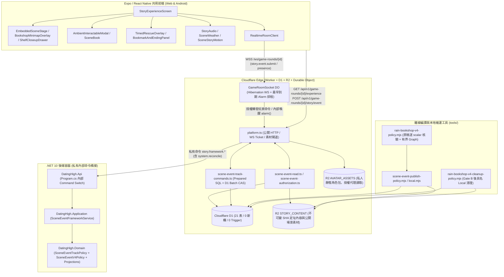
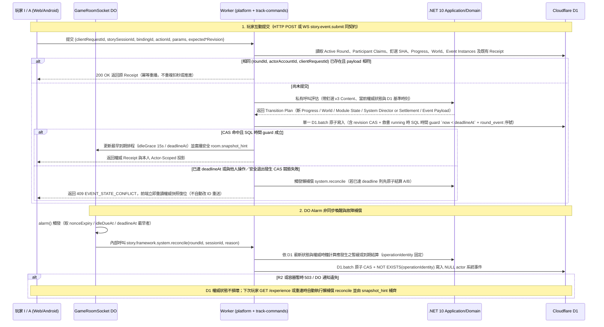
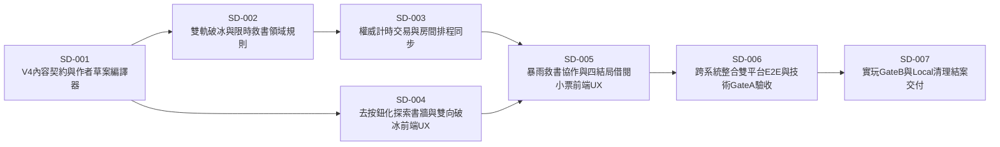

# SPEC-001-RainBookshopV4 — 系統設計

**來源 MVP／SPEC／BDD／TDD**：[MVP-001-LoveGameDatingApp.md](../../../../../requirements/MVP-001-LoveGameDatingApp.md)、[rain-bookshop-v4-draft.json](../../../../../requirements/rain-bookshop-v4-draft.json)、[SPEC-001-RainBookshopV4.md](../../../../../specs/SPEC-001-RainBookshopV4.md)、[SPEC-001-RainBookshopV4-RiskAudit.md](../../../../../specs/SPEC-001-RainBookshopV4-RiskAudit.md)、[SPEC-001-RainBookshopV4-BDD.md](../../../../../bdd/SPEC-001-RainBookshopV4-BDD.md)、[SPEC-001-RainBookshopV4-TDD.md](../../../../../tdd/SPEC-001-RainBookshopV4-TDD.md)  
**文件包／AI／模型／批次／設計版本**：`docs/sd/SPEC-001-RainBookshopV4/candidates/antigravity-model-unprovided/20261125-2312-01`／AI：`Antigravity`（依據：系統 `<identity>` 明載）／模型：`未提供`（依據：執行環境未注入公開模型型號字串，依 `SD-contract-v2` 如實標示）／批次：`20261125-2312-01`／設計版本：`1.0.0`  
**優先級／狀態／最後更新**：高／`Awaiting approval`（系統設計已完成，等待人工確認；未開發）／2026-11-25  
**來源與程式基準／核准範圍**：見 [00-overview.md 來源、程式與設計基準](00-overview.md#來源程式與設計基準)

## 目標、範圍與現況差異

### 業務目標與範圍

本設計承接已確認的 [SPEC-001-RainBookshopV4.md](../../../../../specs/SPEC-001-RainBookshopV4.md)（`RB4-AC-001`～`RB4-AC-015`，對應 MVP `AC-005-36`～`AC-005-46` 及 `AC-005-14`、`AC-005-22`、`AC-005-23`）與唯一劇情／文案權威 [rain-bookshop-v4-draft.json](../../../../../requirements/rain-bookshop-v4-draft.json)（SHA-256：`b5c18f6762c87e25e1e83deb5769d19dc170c94a69bd6c1cdb15fe34b6809d95`），將現行 V3（`rain-bookshop/v3` + `rain-bookshop-before-rain-stops/v1`，按鈕式 ADV）升級為第一人稱去按鈕化空間探索、五區 20 本書（16 本公有領域原創自譯經典＋4 本撕封牛皮紙盲書）、非阻塞空間彩蛋、雙向破冰與雨天提問卡、伺服器主動暴雨進水中斷、雙人手電筒就位後可配置 90 秒跨乾燥區手勢救書（含 15 秒斷線／閒置水位暫緩與自動恢復）、S/A/B 三級動態結算、牛皮書籤儀式、四種實質差異結局與零個資《雨聲書店・今日借閱小票》，並涵蓋技術 Gate A、使用者實玩 Gate B、Gate B 後具名 Local 舊版與驗收測試輪清理及乾淨重玩結案。

**明確排除範圍（不納入本輪設計與實作）**：
- 依使用者決策 `D-051`／`D-052`：無障礙專項不納入整個遊戲 MVP；iOS 暫緩，僅驗證 Web 與 Android。
- 不以完整 Puppet 多部件骨架（已取消之 `AC-005-35`）為前置，沿用既有 16 款免費全身靜態角色與已核准 AI 私人靜態套組（4 姿態×5 表情）。
- 不提前開發其餘九場劇情、`AffectionAndFeedback`（好感度／問卷／名片解鎖）、AI 動態主線生成或 History housekeeping。
- 不新增公開 HTTP API 路由、不新增資料庫表／欄位／SQL Trigger（維持 `0007_scene_event_tracks.sql` 之 21 張表、零 Trigger）、不引入 SignalR／EF Core／獨立計時微服務或額外 Durable Object 類別。

### 現況差異與改動總表

| 設計 ID | 來源需求／現況檔案與位置 | 沿用／調整／新增 | 必要性與白話理由 | 回歸影響／分項 SD |
|---|---|---|---|---|
| `SYS-001` | `RB4-AC-002`、`RB4-AC-008`、`RB4-AC-015`／`cloudflare/src/scene-event-track-content.ts`、`scene-event-stage-content.ts`、`scene-event-presentation-schema.ts`、`tools/scene-event-content-policy.mjs`、`tools/scene-event-publish-policy.mjs` | 調整＋新增 `tools/rain-bookshop-v4-policy.mjs`、`contracts/rain-bookshop-v4.json` | 現行 parser 與 publisher 寫死 `schemaVersion === 'scene-event.v2'`、speaker 僅允許 `旁白`／`店員・NPC`、params 僅允許固定 ID。必須擴充 `scene-event.v3` 支援 `阿澄・店長`、20 本書結構、7 個共享模組、可配置 `durationSeconds` 與逐 JSON path／scalar 原文完整性校驗，同時保留 `v2` 讀取相容至 Gate B。 | 既有 V3 測試與舊場次 SHA 完全保持相容；由 [SD-001](plans/SD-001-V4內容契約與作者草案編譯器.md) 負責 |
| `SYS-002` | `RB4-AC-015`、`RA-10`／`cloudflare/src/scene-event-track-graph.ts` (`MAX_VISITED_STATES = 50000`) | 調整 | 現行可達性直接展開所有提交組合；V4 含 20 本書預覽／撕封、黑膠切換、霧窗符號與快捷呼喊等可重複非阻塞互動，若直接展開笛卡兒積會觸發狀態爆炸。需以有界等價狀態抽象合併純呈現／非阻塞事實，在不放寬 50,000 guard 下證明 28 節點、兩題組與 4 結局無死鎖且唯一可達。 | 保留 50,000 state、16,384 JSON、512KiB/4MiB 全部安全護欄；由 [SD-001](plans/SD-001-V4內容契約與作者草案編譯器.md) 負責 |
| `SYS-003` | `RB4-AC-001`～`006`／`backend/src/DatingHigh.Domain/SceneEventTrackPolicy.cs`、`SceneBookProjection.cs`、`SceneAudioProjection.cs`、`SceneEventStageProjection.cs` | 調整＋新增 `SceneEventV4Policy.cs` | 現行 Domain 只處理單次 binding choice 覆寫與固定 `narrative.suggestions`；需新增雙軌 28 節點匯合（同／異書、近／遠面紙、留白與 A 反向主動、真退讓）、盲書揭封隔離、本人／雙方公開興趣貼紙映射、霧窗符號見證、4 題提問卡種子抽選與同時揭曉、8×3 動態聊天建議篩選與 6 個受控樣板 token 插值。 | v2 路徑維持原行為；v3 規則集中於純領域層，零 I/O 依賴；由 [SD-002](plans/SD-002-雙軌破冰與限時救書領域規則.md) 負責 |
| `SYS-004` | `RB4-AC-007`～`011`、`RQ-01`～`03`、`RA-01`、`RA-03`～`07`／`backend/src/DatingHigh.Domain/SceneEventV4Policy.cs` | 新增 | 實作伺服器主動一次暴雨中斷、手電筒雙 Ready Gate、釘選 `durationSeconds` 倒數、15 秒斷線／閒置暫緩與無按鈕自動恢復（首次恢復只同步不計分）、雙題組 4 步跨區救書＋反轉墊底＋三態鎖扣錯序重置、S/A/B 結算、阿澄 4 組致謝、書籤 0–20 Unicode scalar 過濾、3×3 最終意願、4 結局與借閱小票（含 `S_fast >= 30000ms`、4 印章、同 Round 同版 V4 `X/4`）。 | 純函式可決定性單元測試全部毫秒與字元邊界；由 [SD-002](plans/SD-002-雙軌破冰與限時救書領域規則.md) 負責 |
| `SYS-005` | `RB4-AC-007`～`009`、`RB4-AC-011`、`RB4-AC-012`、`RA-02`／`backend/src/DatingHigh.Application/SceneEventFrameworkService.cs`、`StoryPayload.cs`、`Api/Program.cs`、`cloudflare/src/scene-event-track-commands.ts`、`scene-event-commands.ts`、`scene-event-read.ts`、`scene-event-authorization.ts` | 調整 | 現行 `executeTrackAction` 要求每筆交易必有真人 `actor_account_id` 與單一 instance 提交，無法執行無玩家的系統超時結算或暫緩轉移，且 SQLite `UNIQUE(round_id, NULL, NULL)` 不去重。需擴充多 instance 同批 CAS、真 D1 時間原子 guard `now < deadlineAt`、私有命令 `story.framework.system.reconcile`（以 `operationIdentity`＋CAS 保證冪等）、`GET /experience` 補償 reconcile 與嚴格 Actor-Scoped 投影／回放隔離。 | 0 新公開路由、0 新表／欄／Trigger；退出命令優先搶占並回滾敗方；由 [SD-003](plans/SD-003-權威計時交易與房間排程同步.md) 負責 |
| `SYS-006` | `RB4-AC-008`、`RB4-AC-009`、`RA-09`／`cloudflare/src/room-socket.ts`、`platform.ts` | 調整 | 現行 `GameRoomSocket` 在每次 WS 連線都直接 `setAlarm(Date.now() + 31000)` 覆蓋舊排程，且 `alarm()` 只清 `nonce:*`。需改為計算 `min(earliestNonceExpiry, idleDueAt, rescueDeadlineAt)` 的最早到期排程，聚合跨分頁／權杖刷新的 role 有效連線與前景狀態，喚醒時經內部信任邊界呼叫 `story.framework.system.reconcile` 並廣播安全 `room.snapshot_hint`。 | 保留 Hibernation WebSocket 票券單次兌換與撤銷隔離；由 [SD-003](plans/SD-003-權威計時交易與房間排程同步.md) 負責 |
| `SYS-007` | `RB4-AC-001`～`005`／`frontend/client/src/types/scene-event-track.ts`、`EmbeddedSceneStage.tsx`、`SceneWorldObjects.tsx`、`SceneBook.tsx`、`SceneEventActions.tsx` 及新增 `BookshopMinimapOverlay.tsx`、`ShelfCloseupDrawer.tsx`、`AmbientInteractableModal.tsx` | 調整＋新增 | 現行前端顯示平鋪移動按鈕列且 `SceneBook` 寫死「心動迴路原創試讀」。V4 需徹底去按鈕化：提供門把／傘桶、左右極簡導引＋可收合手繪小地圖（暖金微光點）、首次入區 1 次呼吸光、長按掃視、手勢衝突護欄、主書牆橫滑特寫、右滑撕盲書、20 本原稿全文／推薦卡／末頁字條／興趣貼紙／共鳴、黑膠／黑板／留言冊／擦霧留符號與前景見證、近遠拖面紙、留白與反向主動、提問卡翻牌及 8×3 聊天建議草稿。 | Web／Android 共用單一組件樹與座標轉換；V3 舊版內容仍相容；由 [SD-004](plans/SD-004-去按鈕化探索書牆與雙向破冰前端UX.md) 負責 |
| `SYS-008` | `RB4-AC-006`～`011`／`frontend/client/src/screens/StoryExperienceScreen.tsx`、`SceneWeather.tsx`、`SceneStoryMotion.tsx`、`StoryAudio.tsx`、`RealtimeRoomClient.ts` 及新增 `TimedRescueOverlay.tsx`、`BookmarkAndEndingPanel.tsx` | 調整＋新增 | 實作暴雨 7 步過場（閃電、停電、黑膠驟停、漫水、cue fence 防重播）、手電筒 Ready Gate、權威倒數與 4 階段水痕、15 秒暫緩呼吸橫幅與無按鈕前景重入／操作恢復、雙向救書手勢（濕清單、跨區抽書上滑、防潮袋、上下層格位、三態鎖扣、快捷泡泡）、阿澄事後致謝、牛皮書籤（3 句＋20 字安全純文字）、3×3 意願、4 結局（含結局 2 原位翻對方書）與零個資借閱小票、背景停播與離開快取釋放。 | 維持聊天室、雙同意下一場與任意階段安全退出優先可用；由 [SD-005](plans/SD-005-暴雨救書協作與四結局借閱小票前端UX.md) 負責 |
| `SYS-009` | `RB4-AC-012`、`RA-11`、`RA-12`／`tools/test-scene-web.mjs`、`tools/test-android.ps1`、新增 `tests/e2e/web/scene-event-v4.spec.ts`、`tests/e2e/android/scene-event-v4.mjs`、`tests/integration/rain-bookshop-v4-live.mjs` | 調整＋新增 | 修正 `test-android.ps1` 搬移前殘留路徑引用以恢復可重跑能力；在真本地平台（真 D1/R2/DO＋.NET 10 Host）執行 Web 與 Android 全 42 個 `@frontend` 場景雙端獨立驗收、靜態化身零重產／真供應商必要證據核對、效能與記憶體對照 V3 基線量測，以及 80 素材解碼與 16 經典／音樂／封面權利核實，完成技術 Gate A。 | 不關閉既有 `check:foundation` 回歸；UI 測試關閉影片／trace，Android XML 僅記憶體處理；由 [SD-006](plans/SD-006-跨系統整合雙平台E2E與技術GateA驗收.md) 負責 |
| `SYS-010` | `RB4-AC-013`、`RB4-AC-014`、`RQ-04`、`RA-08`／`tools/local.mjs`、新增 `tools/rain-bookshop-v4-cleanup-policy.mjs`、`cloudflare/tests/scene-event-local-upgrade.integration.test.ts`、`docs/verification/SPEC-001-RainBookshopV4-Verification.md` | 調整＋新增＋移除舊 V3 無用資產 | Gate A 後提交使用者實玩 Gate B（精確版本／SHA 人工簽認，絕不代簽）；核准後僅針對已知 default local 停寫、備份、計算保護指紋，依 FK 拓樸清除具名 V1/V2/V3 與 V4 驗收測試輪（拒絕混合非驗收輪或不明環境）、清除無剩餘引用之舊 R2 key 與工作樹舊 V3 專屬檔案，再執行全新配對重玩回歸、深度稽核與 `overview/` 契約同步。 | 嚴格保護帳號、個資、真人照片、化身與共用 R2 SHA；禁止 `--remote`；由 [SD-007](plans/SD-007-實玩GateB與Local清理結案交付.md) 負責 |

## 架構與資料流

### 現況與目標分層架構

系統維持現行「Expo 共用前端 ↔ Cloudflare Edge Worker（D1 / 私人與公開內容定址 R2 / `GameRoomSocket` Hibernation DO）↔ 私有信任邊界 `.NET 10` 四層容器（Api → Application → Domain ← Infrastructure）」單向依賴架構。公開網際網路與客戶端只能存取既有公開 `/api/v1/*`、`/ws/game-rounds/{id}` 與內容定址公開故事素材 `/story-content/assets/{sha256}`；系統時間推進與超時結算一律走 Worker 對 Container 的私有內部命令 `story.framework.system.reconcile`，再落入同一套 D1 CAS 交易管線。



### 同步操作、非同步排程與失敗復原流程



## DDD、業務耦合與資料權威

| 通用語言／業務邊界 | Aggregate／不變條件 | 資料權威與寫入責任 | 跨業務互動／一致性 | 對應設計 ID |
|---|---|---|---|---|
| **配對回合與章節場次**（`GameRound` / `StorySession`） | `GameRound` 為生命週期根：同一活躍配對同時僅一個 active `StorySession`；`scene_id`/`scene_version`/`scene_sha256` 與 `story_id`/`story_version`/`story_sha256` 於開局釘選後不可變更；任一方執行安全退出（`end`）立即終止 Round、寫入永久排除並撤銷後續一切寫入與資源讀取權。 | D1 `game_rounds`、`game_story_sessions`、`game_participant_claims`；由 Worker 固定 prepared SQL batch 在 `.NET` Application 規劃下唯一寫入。 | 退出優先於救書倒數、暫緩與結局選擇；與救書提交同毫秒競態時，以 `game_rounds.status='active'` 及 `session_revision` CAS 線性化，敗方零副作用。 | `SYS-005`、`SYS-008` |
| **雙軌個人進度與探索記憶**（`ParticipantTrack`：Inviter `I` / Acceptor `A`） | 兩名參與者各持獨立 `current_node_id`、`current_area_id` 與 `track_revision`；預覽翻書、橫滑書牆、擦霧純呈現、長按掃視與觀看小黑板／留言冊絕不推進主線；盲書未完成右滑撕封前絕不公開書名與內頁；未提交選書前不代選、不向對方洩露。 | D1 `game_story_participant_progress`＋個人 scope 之 `game_event_instances`；僅本人合法提交或明確定義之雙軌匯合條件可在同批推進。 | 讀取本人已儲存 `Profile` 興趣與雙方公開分享設定（唯讀引用 `AvatarAndPreferences` 既有契約），於 `SceneBookProjection` 即時計算本人推薦貼紙，不寫回業務個資表。 | `SYS-003`、`SYS-007` |
| **共享書店世界與感官狀態**（`BookshopWorld`） | 共享黑膠曲目（3 首）、霧窗當前符號（4 種，帶版本、作者 role 與建立世代）、導演暴雨狀態（`waterline`、停電暗景、水痕階段 `0..4`）與公開舞台呼喊泡泡受 `shared_revision` CAS 保護；霧窗見證必須本人非作者、當前位於 `window` 前景實際渲染對應符號版本，重送只記一次事實。 | D1 `game_story_sessions.world_state_json`（嚴守 `<= 16384` 字元，只存有限狀態碼與版本，不存全文或私密答案）。 | 黑膠共享曲目變更只同步權威曲目 ID 與提示文案，絕不覆寫另一端本地靜音／播放開關；背景失焦強制停播。 | `SYS-003`、`SYS-005`、`SYS-007` |
| **雨天提問卡與雙向破冰**（`IcebreakAndQuestionCard`） | 僅 `act2Route == 'warm-track'` 開啟 `sv4-question-card`；題目由場次確定性種子自 4 題釘選 1 題，重連不重抽；首位提交答案僅本人可見，第二位提交同批揭曉同頻／反差並推進至 `iv4-warm`／`av4-warm`；`quiet-track` 直達 `iv4-respect`／`av4-quiet`，零假聊天。 | D1 共享 `game_event_instances`（`binding_id = 'narrative:rain-bookshop-before-rain-stops:sv4-question-card'`），由 `Actor-Scoped Projection` 按揭曉狀態過濾欄位。 | 真人聊天室（`game_chat_messages`）完全獨立：8×3 動態聊天建議只作客戶端輸入框選填草稿，快捷呼喊只進舞台短暫泡泡，絕不偽造真人聊天訊息。 | `SYS-003`、`SYS-004`、`SYS-007` |
| **導演中斷與可配置限時雙向救書**（`DirectorAndTimedRescue`） | 當且僅當 `I in {iv4-warm, iv4-respect}` 且 `A in {av4-warm, av4-quiet}` 時恰好觸發一次導演事件進入 `ready`；雙人皆點手電筒才依釘選 `durationSeconds`（初版 90 秒）建立唯一 UTC `deadlineAt` 與釘選題組（`set-a-starlight` 或 `set-b-rainlight`）；嚴格 `now < deadlineAt` 完成第 4 本三態鎖扣（`left-latch → right-latch → seal-strip`）即刻結算 `S`，`now >= deadlineAt` 按已救數結算 `2..3 -> A`、`0..1 -> B`；單方無有效操作或斷線滿 15 秒自動暫緩並保存 `pausedRemainingMs`，閒置方實際操作或斷線方回前景可操作畫面即自動恢復（首次恢復只同步不計分，無次數上限）。 | D1 共享 `game_event_instances`（`sv4-director-flood`、`sv4-rescue-ready`、`sv4-rescue-coop`）＋`game_round_events`（系統事件 `actor_account_id IS NULL`，以 `operationIdentity`＋CAS 保證唯一）。 | `GameRoomSocket` DO 僅負責最早到期喚醒與連線存活聚合，不持有獨立遊戲計分狀態；DO 重啟或冷啟動完全由 D1 狀態重建。 | `SYS-004`、`SYS-005`、`SYS-006`、`SYS-008` |
| **收尾書籤、最終意願與借閱小票**（`AftermathEndingAndReceipt`） | `B` 級強制直進 `ev4-04-eaves-shelter` 且禁止再入積水／救書區；`S`/`A` 依序完成阿澄致謝、`sv4-bookmark-pick`（所選書 3 句之一＋選填 `0..20` 安全 Unicode scalar 短語）與雙方私密 `sv4-final-wish`，依 3×3 矩陣唯一判定 `ev4-01`／`ev4-02`／`ev4-03`；僅 `ev4-02` 結局完成後授權對方翻開桌上書讀取書籤與 `note`；借閱小票永不含真實個資或玩家自由輸入 `note`，`X/4` 僅計同 pair 當前 Round 同版 V4 已完成之相異結局數（含本場，`1..4`）。 | D1 `game_event_instances`（`sv4-bookmark-pick`、`sv4-final-wish`）、`game_story_sessions.status='completed'` 及同 `round_id` 歷史已完成 `game_story_sessions` 查詢。 | 章節自然完成後維持 `GameRound` 為 `active`，開放自由聊天、雙方同意開啟下一場（清理舊場投影與 cue）與安全退出。 | `SYS-004`、`SYS-005`、`SYS-008` |

## 發展彈性與共用界線

1. **可共用的受控平台能力（供後續九場劇情與小遊戲重用，但不預先開發其他劇本）**：
   - `scene-event.v3` 的版本化內容分派機制（`v2` / `v3` 並存讀取）、有界狀態空間可達性抽象框架、多步有限模組狀態 CAS 提交管線、私有 `story.framework.system.reconcile` 時間推進入口、`GameRoomSocket` 最早到期多源排程器，以及前端手勢互斥護欄（tap / long-press / horizontal-pan / drag-drop / upward-swipe 座標與 pending 鎖）。
   - `timedCoopRescue.durationSeconds`、`idleGraceSeconds`、`waterlineAnnouncements` 與 `S_fast` 門檻全數收斂為釘選 Narrative 版本配置（`SPEC §6.4`），調整秒數（如 90 秒與 120 秒）僅需修改內容配置並通過發布校驗升版，零業務程式碼修改、零熱改既有場次。
2. **不可共用的業務語意（避免錯誤耦合與安全越界）**：
   - **舞台快捷呼喊 vs 真人聊天室**：快捷呼喊僅透過場景事件公開狀態投影為短暫舞台泡泡，絕不共用 `POST /chat/messages` 或寫入 `game_chat_messages`；動態聊天建議僅填入本地聊天輸入草稿，必須由真人明確按送出才走聊天契約。
   - **系統 Reconcile vs 玩家事件入口**：系統超時與暫緩轉移嚴格走私有容器橋接 `story.framework.system.reconcile`，絕不偽造玩家 `actor_account_id`，也絕不在公開 `/story/event` 開放系統動作參數。
   - **個人私密事實 vs 公開世界狀態**：盲書未撕封內文、本人共鳴獨白、提問卡首位答案、最終意願首位選擇與未授權書籤 `note` 嚴格存於受角色隔離投影的 module instance state，絕不寫入公開 `world_state_json` 或共用未過濾 `event feed`。
   - **禁止散落 `storyId === 'rain-bookshop-before-rain-stops'` 硬編碼**：前端 renderer 全面依 `scene.sceneCapabilities`（如 `multi-zone-books`、`shelf-closeup`、`vinyl-sync`、`foggy-window`、`timed-coop-rescue`）與投影之型別化模組欄位驅動畫面，不散落故事 ID 特例判斷。

## 基礎設施與平台

| 執行平台／版本依據 | 儲存／快取／訊息／網路／外部服務 | 平台限制／容量／成本 | 部署責任／依賴／備援 |
|---|---|---|---|
| **Cloudflare Workers + Containers + Workerd / Miniflare**（`cloudflare/package.json` Wrangler `^4.20.0`、`compatibility_date: 2026-04-01`） | **D1**（`DB`：21 張表，WAL / 線性化 batch 交易）；**R2** `STORY_CONTENT`（公開內容定址 `/story-content/assets/{sha256}`，`immutable` 快取 1 年）與 `AVATAR_ASSETS`（私人化身資產，經授權端點 `no-store` 讀取）；**Durable Object** `GameRoomSocket`（Hibernation WebSocket + 單一 `storage.setAlarm`）。 | D1 `world_state_json` 與 `state_json` 皆有 SQL `CHECK(length(...) <= 16384)`；單份 JSON 內容上限 `512 KiB`、四層合計上限 `4 MiB`；單一媒體資產上限 `8 MiB`（`8,388,608` bytes）；Graph 驗證上限 `50,000` visited states、DSL 深度 `8`、節點數 `64`、每組條件 `32`。 | 本地開發與驗收統一透過 `npm run dev:platform`（`tools/local.mjs` wrapper 指向已知 default local 實例 `http://127.0.0.1:8787` 與 `.NET` bridge）；嚴禁對生產／遠端執行 `--remote` 清理或未授權發布。 |
| **.NET 10 四層後端**（`backend/`：`DatingHigh.Domain` / `Application` / `Infrastructure` / `Api`） | 無狀態容器程序，不直連外部 DB，所有持久化事實由 Worker 讀取後傳入並由 Worker 執行固定 prepared SQL CAS batch；`LocalEmailVerification` 僅本地開發驗收使用。 | 零新增 NuGet 套件，零 EF Core／Identity；純記憶體計算單次請求延遲 `< 10ms`；Gemini 影像供應商僅在既有私人靜態化身初次生成路徑使用，V4 場景切換姿態／鏡位／重連**零呼叫 Gemini**。 | 容器故障或 R2 讀取異常時回傳既有 `503`，保留 D1 已提交狀態，前端保留聊天與安全退出可用並支援重試恢復。 |
| **Expo / React Native 雙平台客戶端**（`frontend/client/`：Expo SDK 54 / RN `0.81` / React `19.1`，目標平台：**Web** 與 **Android**；iOS 依 `D-052` 暫緩） | 狀態快取僅保存當前活躍 `storySessionId` 與當前鏡位鄰接預載之有界圖片／音訊資源；Web 使用標準 Pointer/Touch + HTMLAudio/WebAudio 受控封裝，Android 使用 RN `PanResponder` + 原生音訊生命週期與 `AppState` 監聽。 | 離開場景、切換下一場或 `401/403` 失權時立即釋放圖片 URI、音訊實例、私有書籤與舊 cue；背景／失焦立即停止播放且回前景不自動重播；UI 自動化測試強制關閉錄影與 trace，Android `uiautomator` XML 僅在記憶體解析不落盤。 | Web E2E 先執行 `export:web` 與 `build:e2e-host` 後跑 `test-scene-web.mjs`；Android E2E 經修正路徑後的 `tools/test-android.ps1` 驅動 APK 與 ADB。 |

## 框架核心與重要邏輯

### CORE-01：`scene-event.v3` 作者草案無損編譯、逐字完整性核驗與有界可達性引擎

- **責任、來源及目標檔案／區段**：承接 `SPEC §3.6`、`RB4-AC-002`、`RB4-AC-015`、`RA-03`、`RA-04`、`RA-07`、`RA-10`、`RA-12`；實作於 `tools/rain-bookshop-v4-policy.mjs`、`cloudflare/src/scene-event-track-content.ts`、`cloudflare/src/scene-event-stage-content.ts`、`cloudflare/src/scene-event-presentation-schema.ts`、`cloudflare/src/scene-event-track-graph.ts`。
- **輸入／輸出、前後置條件與錯誤語意**：
  - 輸入：唯讀 `docs/requirements/rain-bookshop-v4-draft.json`（驗證原始檔案 SHA-256 必為 `b5c18f6762c87e25e1e83deb5769d19dc170c94a69bd6c1cdb15fe34b6809d95`）、正式素材目錄 `contracts/story-assets/` 與權利核驗設定（16 本經典作者逝世年份＋法域公有領域聲明＋原創自譯聲明＋62 項新圖音原創／授權來源）。
  - 輸出：正式四層編譯產物 `contracts/rain-bookshop-v4.json`（`schemaVersion: "scene-event.v3"`，Scene `rain-bookshop/v4`，Narrative `rain-bookshop-before-rain-stops/v2`，附每項資產真實 `sha256`、`byteLength`、`mimeType`、像素尺寸、物件 `bounds` 與 `hitMask`）及機器可檢核的完整性報告。
  - 錯誤語意：任一原始 JSON path／ID 缺失、任一玩家可見字串出現單一 Unicode scalar 差異（不允許 trim、改標點、換 speaker 或改題組區域）、任一書籍或音訊權利欄位缺失、任一 `durationSeconds` 與水位門檻（如 `75/50/30/15` 及 `S_fast=30`）越界或與廣播數字文案不一致、或單檔／總量／Graph 超出既有 guard，一律拋出結構化錯誤並拒絕產出與發布（fail closed）。
- **演算法／決策表／必要偽碼**：
  ```text
  function compileAndVerifyRainBookshopV4(draftRawBytes, assetFiles, rightsManifest, overrideConfig?):
    assert sha256(draftRawBytes) == "b5c18f6762c87e25e1e83deb5769d19dc170c94a69bd6c1cdb15fe34b6809d95"
    draft = parseJsonStrict(draftRawBytes)
    // 1. 逐項結構與權利核驗
    assert draft.scene.areas.length == 8 && draft.scene.cameras.length == 8
    assert draft.scene.assetManifestPlan.length == 80 // 18 reuseFromV3 + 62 new; 1 image-set, 58 image, 21 audio
    assert draft.scene.books.length == 20 // 16 classic + 4 blind
    for book in draft.scene.books:
      if book.kind == "classic":
        verifyPublicDomainAndOriginalTranslation(book, rightsManifest) // 驗逝世年份、TW/US 公有領域及自譯聲明
      mappedProfileCodes = mapAuthorInterestTagsToProfileCatalog(book.interestTags)
      // 保留原始 book.interestTags 供逐字核驗，並附決定性 mappedProfileCodes 供執行期貼紙比對

    // 2. 時間配置與門檻一致性驗證 (SPEC §6.4 / RA-03)
    rescue = applyOptionalDurationOverride(draft.narrative.sharedModules.timedCoopRescue, overrideConfig)
    assert isSafePositiveInt(rescue.durationSeconds) && rescue.durationSeconds * 1000 <= MAX_SAFE_DURATION_MS
    prev = rescue.durationSeconds
    for item in rescue.waterlineAnnouncements: // 預設 75 -> 50 -> 30 -> 15
      assert isSafePositiveInt(item.remainingSeconds) && item.remainingSeconds < prev
      assert numericMentionsInTextMatchConfig(item.text, item.remainingSeconds)
      prev = item.remainingSeconds
    assert fastThresholdSeconds (30) < rescue.durationSeconds && fastThresholdSeconds > 0

    // 3. 題組區域與取書位置驗證 (RA-04)
    // set-a-starlight: step1 classic-little-prince(shelves, slot L-mid) 與 step3 classic-pride-prejudice(shelves, slot R-low) 保留同 Area 不同 objectId/hotspot
    // set-b-rainlight: shelves, counter, reading-corner, window 四個不同 Area 原樣保留
    verifyTargetSetsMatchBooksAndPositions(rescue.targetSets, draft.scene.books)

    // 4. 逐 Unicode scalar 雙向可逆對照
    bundle = emitSceneEventV3Bundle(draft, assetFiles, rescue)
    assert extractAllAuthorVisibleScalars(bundle) === extractAllAuthorVisibleScalars(draft) // 零字元差異

    // 5. 有界狀態空間可達性驗證 (RA-10，保留 MAX_VISITED_STATES = 50000)
    // 將純呈現與非阻塞重複探索折疊為與主線相關之有限商狀態 (Quotient State)：
    //   - 20 本書具體 ID 折疊為 equivalence class: {unselected, selected_A, selected_B_same, selected_B_diff}（同時另做 20 本書逐本獨立選擇與共鳴可達單元檢查）
    //   - 重複切黑膠折疊為 boolean vinylChangedAtLeastOnce
    //   - 霧窗擦拭與 4 符號折疊為 {none, drawn_unseen, seen_by_partner}
    //   - 救書倒數折疊為離散結算分支 {gradeS_fast, gradeS_normal, gradeA, gradeB} × 兩題組 4 步線性推進
    graphReport = validateV3BoundedReachability(bundle, { maxVisitedStates: 50000 })
    assert graphReport.reachableInviterNodes.size == 15 && graphReport.reachableAcceptorNodes.size == 13
    assert graphReport.reachableEndings.size == 4 && graphReport.deadlockCount == 0
    return bundle
  ```
- **狀態轉換、非法轉換及失敗恢復**：編譯與發布前全部在記憶體完成校驗；發布寫入 R2 採內容 SHA256 key（`story-content/assets/{sha}` 與 `story-content/json/{sha}`），若中途 R2 或 D1 寫入失敗，不更新正式 Catalog 指向，重跑具備完整冪等性，絕不覆寫既有 V3 SHA。
- **重要替代方案、採用理由與驗證**：不採用「提高 `MAX_VISITED_STATES` 至百萬」或「刪除可重複彩蛋節點」，因為前者違反 `RA-10` 不拆 guard 原則且拖慢每次驗證，後者違反原稿完整性；採用「商狀態等價類折疊＋20 書／4 題／2 題組獨立全覆蓋枚舉」可在 `< 5,000` 個商狀態內完成 100% 數學等價可達與無死鎖證明。

### CORE-02：雙軌 28 節點破冰協調、6 受控樣板插值與雨天提問卡引擎

- **責任、來源及目標檔案／區段**：承接 `RB4-AC-001`～`006`、`RB4-BDD-001`～`020`；實作於 `backend/src/DatingHigh.Domain/SceneEventTrackPolicy.cs`、`SceneEventV4Policy.cs`、`SceneBookProjection.cs`、`SceneEventStageProjection.cs`。
- **輸入／輸出、前後置條件與錯誤語意**：
  - 輸入：釘選 `SceneTrackV3Content`、雙方 `ParticipantProgress`、當前共享 `WorldState`、各模組 `EventInstanceState`、本人認證角色（`inviter` / `acceptor`）、本人儲存之興趣／話題／價值觀代碼與雙方公開可見欄位集合，以及玩家請求 `TrackActionRequest(BindingId, ActionId, Params)`。
  - 輸出：純領域 `V4EvaluationResult`（含更新後雙軌節點、個人與共享 instance 狀態、公開 world 更新、是否觸發導演事件，或明確拒絕碼 `INVALID_STORY_REQUEST` / `EVENT_STATE_CONFLICT`）。
- **演算法／決策表／必要偽碼**：
  1. **入店與獨立進度**：
     - `I` 在 `iv4-01`（`street-view`）執行 `iv4-enter-door` → `I` 進 `iv4-02`（`entrance`），`A` 維持原節點不動；`I` 完成 `iv4-greet-clerk`（`humor` | `rain` | `habit`）→ 進 `iv4-03`。
     - `A` 在 `av4-01`（`street-view`）執行推門與點傘桶 `av4-enter-umbrella` → `A` 進 `av4-02`（`entrance`），`I` 維持原節點不動；`A` 完成 `av4-greet-clerk`（`detour` | `pause` | `nostalgia`）→ 進 `av4-03`。
  2. **選書、盲書揭封與共鳴匯合**：
     - 盲書揭封（`blind-unseal`，參數 `bookId` 限 4 本盲書）：記錄於本人個人探索狀態 `unsealedBlindBookIds`；未在本人 `unsealedBlindBookIds` 內的盲書，`SceneBookProjection` 僅返回 `blindTags`（3 枚標籤）、`blindSealedPrompt` 與 `sealedAssetId: "prop-blind-kraft-v4"`，**絕不返回 `title`、`author`、`pages`、`clerkHandwrittenCard`、`previousReaderNote`、`resonanceOptions`、`bookmarkQuote` 或撕封後 `coverAssetId`**。
     - `A` 提交 `av4-pick-book(bookId)`（若選盲書須本人已揭封）→ `A` 進 `av4-04` → 提交 `av4-resonance(optionId)`（限所選書之 3 個 `resonanceOptions`）→ `A` 進 `av4-05`。
     - `I` 提交 `iv4-pick-book(bookId)`（若選盲書須本人已揭封）：記錄 `inviterBookId`；當且僅當 `inviterBookId != null` 且 `A` 已進入 `av4-05` 時，同一評估批次自動比對 `inviterBookId == acceptorBookId`，將 `I` 推進至 `iv4-04-same`（同書）或 `iv4-04-diff`（異書）。任何一方未提交前，絕不向另一方揭露書名，亦不代選。
  3. **閱讀角接近、面紙距離、留白與反向主動決策表**：

     | I 在 `iv4-04-*` 的手勢動作 | I 下一節點 | A 從 `av4-05` 轉入節點 | A 可用互動與後續分支 |
     |---|---|---|---|
     | `tissue-near`（拖面紙至近距區） | `iv4-wait-tissue-near` | `av4-06-tissue-near` | 可選 `av4-tissue-decision`（`accept-tissue` / `decline-tissue`，僅更新面紙互動狀態與回應提示，不改聊天路線）＋必選 `av4-reply-approach` |
     | `tissue-far`（拖面紙至桌角遠距區） | `iv4-wait-tissue-far` | `av4-06-tissue-far` | 同上，`av4-tissue-decision` 與 `av4-reply-approach` 完全解耦 |
     | `approach-book`（點書搭話） | 同書：`iv4-wait-book-same`；異書：`iv4-wait-book-diff` | 同書：`av4-06-book-same`；異書：`av4-06-book-diff` | `av4-reply-approach`：`open-up` / `books-only` → `warm-track`（開啟 `sv4-question-card`）；`decline` → `quiet-track`（I 進 `iv4-respect`、A 進 `av4-quiet`） |
     | `give-space`（輕推回滑落書籤退開） | `iv4-give-space`（轉 `shelves`） | `av4-06-space` | `av4-reverse-initiate`：`a-initiate-book` → I 進 `iv4-receive-a-init-book`＋開啟 `sv4-question-card`；`a-initiate-music` → I 進 `iv4-receive-a-init-music`＋開啟 `sv4-question-card`；`a-stay-quiet` → `quiet-track`（I 進 `iv4-respect`、A 進 `av4-quiet`） |

  4. **雨天提問卡（`sv4-question-card`）**：
     - 題目釘選：`questionIndex = uint32FromSha256(storySessionId + ":sv4-question-card") % 4`，寫入該 instance state，重連絕不重抽。
     - 答案隔離：第一位回答時僅保存 `answers[role] = optionId`，對提交者投影 `waitingLine`，對未提交者僅顯示 `hasPartnerSubmitted: true` 而不含對方 `optionId`；第二位提交同批計算 `answers.inviter == answers.acceptor ? matchReveal : diffReveal`，設定 `revealed = true`，並將雙方同步推進至 `iv4-warm` 與 `av4-warm`。`quiet-track` 下送任何 `sv4-question-card` 請求一律回 `400 INVALID_STORY_REQUEST` 且不改 revision。
  5. **6 個受控樣板 Token 插值器**：
     - 僅解析固定白名單：`{{trackTitle}}`、`{{selectedBookTitle}}`、`{{inviterBookTitle}}`、`{{acceptorBookTitle}}`、`{{selectedResonanceMonologue}}`、`{{bookTitle}}`；若條件尚未授權（例如對方尚未正式到達揭露節點），對應變數不解析也不提前輸出該節點文案。
  6. **8×3 動態聊天建議篩選器**：
     - 依權威狀態決定當前情境鍵：`act4_eaves`（結局 4）＞ `act4_coffee`（S/A 收尾或結局 1～3）＞ `act3_rescue`（導演觸發後至救書結算前）＞ `act2_after_card`（提問卡已揭曉）＞ `act2_same_book`（雙方選同書且進閱讀角破冰）＞ `act2_diff_book`（雙方選異書且進閱讀角破冰）＞ `act1_vinyl_changed`（前半場且 `vinylChangedAtLeastOnce == true`）＞ `act1_browse`（預設前半探索），精確返回原稿對應的 3 句建議。

### CORE-03：導演主動暴雨中斷、可配置 90 秒權威倒數、15 秒暫緩保護與雙向救書引擎

- **責任、來源及目標檔案／區段**：承接 `SPEC §3.2`、`§3.7`、`§6.2`～`§6.4`、`RB4-AC-007`～`009`、`RA-01`～`RA-05`；實作於 `backend/src/DatingHigh.Domain/SceneEventV4Policy.cs`、`cloudflare/src/scene-event-track-commands.ts`、`cloudflare/src/room-socket.ts`。
- **狀態機全景圖**：
  ```mermaid
  stateDiagram-v2
    [*] --> Act1And2_DualTrack
    Act1And2_DualTrack --> DirectorInterrupted_Ready : I in (iv4-warm, iv4-respect)\nAND A in (av4-warm, av4-quiet)\n[同批原子建立恰好一次]
    DirectorInterrupted_Ready --> DirectorInterrupted_Ready : 單方接手電筒\n(readyMask 單邊，不扣秒)
    DirectorInterrupted_Ready --> Rescue_Running : 雙方皆接手電筒\n[釘選 setId + deadlineAt = now + durationSeconds*1000]
    Rescue_Running --> Rescue_Paused : 任一 role 無有效操作 >= 15000ms\n或無有效授權連線 >= 15000ms\n(且 pauseBoundaryAt < deadlineAt)
    Rescue_Paused --> Rescue_Running : 閒置方執行場景互動 或 斷線方回前景可操作畫面\n[重建 deadlineAt = now + pausedRemainingMs；首次恢復不計分]
    Rescue_Running --> Settled_S : step==4 完成 seal-strip\n且 D1 交易時刻 now < deadlineAt (rescuedCount=4)
    Rescue_Running --> Settled_A : now >= deadlineAt\n且 rescuedCount in (2, 3)
    Rescue_Running --> Settled_B : now >= deadlineAt\n且 rescuedCount in (0, 1)
    Settled_S --> Aftermath_Bookmark_Wish : 同批進 iv4-after-coffee / av4-after-coffee
    Settled_A --> Aftermath_Bookmark_Wish : 同批進 iv4-after-coffee / av4-after-coffee
    Aftermath_Bookmark_Wish --> Completed_Endings_1_to_3 : 雙方完成書籤 + 雙方提交 finalWish (3x3)
    Settled_B --> Completed_Ending_4_Eaves : 強制撤離進 ev4-04-eaves-shelter (跳過書籤與意願)
  ```
- **關鍵時間、暫緩、恢復與鎖扣演算法**：
  1. **雙 Ready 原子啟動與配置時長（`SPEC §6.4`）**：
     - 單方點擊 `sv4-rescue-ready` 時僅更新 `readyRoles` 集合（例如 `["inviter"]`），回傳 `waitingPartnerCopy`，`deadlineAt` 為 `null`；
     - 第二方點擊時，在同一 D1 交易內讀取本場釘選 Narrative 的 `durationMs = timedCoopRescue.durationSeconds * 1000`（初版 `90000`），設定 `phase = "running"`、`startedAt = nowMs`、`deadlineAt = nowMs + durationMs`、`roleLastActiveAt = { inviter: nowMs, acceptor: nowMs }`、`roleDisconnectedSince = { inviter: null, acceptor: null }`，並以 `uint32FromSha256(storySessionId + ":sv4-rescue-set") % 2` 釘選 `set-a-starlight` 或 `set-b-rainlight`。
  2. **15 秒斷線／閒置暫緩與晚到 Alarm 最早邊界（`RQ-01` + `RA-01`）**：
     - 每個 role 的暫緩門檻時刻：`rolePauseDueAt(r) = min(roleLastActiveAt[r] + idleGraceMs, roleDisconnectedSince[r] != null ? roleDisconnectedSince[r] + idleGraceMs : +∞)`（其中 `idleGraceMs = disconnectProtection.idleGraceSeconds * 1000 = 15000`；`presence.ping` 與背景 `GET /experience` **絕不更新 `roleLastActiveAt`**）。
     - 整體最早暫緩時刻：`earliestPauseDueAt = min(rolePauseDueAt(inviter), rolePauseDueAt(acceptor))`。
     - 當系統 reconcile 或請求補償在 `nowMs` 執行且 `phase == "running"` 時：
       - 若 `deadlineAt <= earliestPauseDueAt` 且 `nowMs >= deadlineAt`：**結算優先**（不得因晚到 alarm 把已到期的場次誤轉為暫緩！），立即依當前 `rescuedCount` 結算為 `A`（2–3 本）或 `B`（0–1 本）。
       - 若 `earliestPauseDueAt < deadlineAt` 且 `nowMs >= earliestPauseDueAt`：轉為 `phase = "paused"`，**以應暫緩門檻時刻扣算剩餘時間**：`pausedRemainingMs = deadlineAt - earliestPauseDueAt`（確保晚到 alarm 不多扣玩家半毫秒！），記錄 `pausedReasons = { inviter: nowMs >= rolePauseDueAt(inviter), acceptor: nowMs >= rolePauseDueAt(acceptor) }` 與遞增 `pauseGeneration`。
  3. **無額外按鈕的自動恢復（`RA-Q1=A`）**：
     - 在 `phase == "paused"` 期間：
       - 若某 role 因斷線觸發暫緩，當該 role 重新建立有效授權連線且前端回報前景可操作狀態（`story.event.submit` 之受控動作 `resume-foreground` 或實際場景互動）時，清除該 role 的暫緩原因；
       - 若某 role 因閒置 15 秒觸發暫緩，當該 role 執行任何合法場景互動時，清除該 role 的暫緩原因（**仍保持活動的另一方無須額外操作；若雙方皆因閒置／斷線列於 `pausedReasons`，則雙方皆須各自重新參與**）。
       - **關鍵防偷跑規則**：觸發解除暫緩的那一次玩家互動，只執行同步與狀態轉移（若所有 `pausedReasons` 均已解除且雙端目前皆有有效連線，則設 `phase = "running"`、`deadlineAt = nowMs + pausedRemainingMs`、重設雙方 `roleLastActiveAt = nowMs`），**不推進救書抽書／傳遞／裝櫃／鎖扣進度**，並回傳最新權威快照讓雙端同步繼續倒數；允許單場無限次重複暫緩與恢復。
  4. **雙題組 4 步協作、反轉線索與三態鎖扣（`RA-04` + `RA-05`）**：
     - 維護有限狀態：`currentStep`（`1..4`）、`stepStage`（`"searching"` | `"passed"` | `"bagged"` | `"shelved"`）、`heldBookId`、`placedSlot`（`"upper"` | `"lower"` | `null`）、`latchIndex`（`0..3`）、`clueSharedByAcceptor`（`bool`）、`reverseClueSharedByInviter`（`bool`）、`rescuedCount`（`0..4`）。
     - 第 1～4 步共通：`A` 可讀取本步 `acceptorWetListText` 並點擊分享（公開 `acceptorShareCardText`）；`I` 在乾燥區（`entrance`、`shelves`、`reading-corner`、`counter`、`window`；`street-view` 與積水門檻非取書目標）抽取書籍：
       - 若 `bookId != target.targetBookId` 或所在 Area 不符：不改變 `stepStage` 或 `rescuedCount`，回傳該書專屬 `books[bookId].wrongRescueFeedback` 原文供前端呈現吐槽並復位。
       - 若正確且 `I` 執行上滑傳遞（`pass-book`）：轉為 `stepStage = "passed"`，`heldBookId = targetBookId`（持物權移交 `A`）。
     - 第 1、2 步（`storageRule == "any-dry-slot"`）：`A` 拖入防潮袋並放入任一乾燥高櫃格位（`bag-and-shelve`）→ `rescuedCount += 1`，推進 `currentStep += 1`、重設本步子狀態，發送 `stepSuccessToast`。
     - 第 3 步（`storageRule == "bottom-shelf-slot"`）：`I` 在對應區域可拾取並分享 `inviterReverseClue`；`A` 裝袋上架時若選 `"upper"`，回傳 `wrongSlotFeedback`，保持 `heldBookId` 不丟書、不加分；選 `"lower"` 才令 `rescuedCount = 3` 並推進至 `currentStep = 4`。
     - 第 4 步（`storageRule == "top-shelf-and-lock-sequence"`）：`A` 裝袋放入 `"upper"` 後轉為 `stepStage = "shelved"`、`latchIndex = 0`（書已穩妥放置！）；隨後 `A` 依序點擊鎖扣 `["left-latch", "right-latch", "seal-strip"]`：
       - 點擊符合 `lockSequence[latchIndex]`：`latchIndex += 1`；當 `latchIndex == 3` 且 D1 SQL 時間 guard `now < deadlineAt` 成立時，`rescuedCount = 4`、立即轉為 `phase = "settled"`、`grade = "S"`、`settledRemainingMs = deadlineAt - nowMs`！
       - 點擊順序錯誤（例如先點 `right-latch` 或 `seal-strip`）：依 `RA-Q3=A` **僅將 `latchIndex` 重置為 `0`**，`stepStage` 仍維持 `"shelved"`（已放置的第 4 本書與前 3 本 `rescuedCount = 3` 完全保留！），不額外扣秒，回傳 `wrongLockFeedback` 原文供立即重試。

### CORE-04：真 D1 原子交易、系統 NULL Actor 冪等與 `GameRoomSocket` 最早排程核心

- **責任、來源及目標檔案／區段**：承接 `SPEC §3.7`、`§3.8`、`RA-02`、`RA-09`；實作於 `cloudflare/src/scene-event-track-commands.ts`、`cloudflare/src/room-socket.ts`、`cloudflare/src/platform.ts`、`backend/src/DatingHigh.Application/SceneEventFrameworkService.cs`。
- **交易邊界、併發、排序、冪等與重試**：
  1. **真 D1 時間 Guard**：救書 `running` 期間之玩家進度提交，SQL `UPDATE game_event_instances` 條件強制包含：
     ```sql
     WHERE story_session_id = ?1
       AND binding_id = 'narrative:rain-bookshop-before-rain-stops:sv4-rescue-coop'
       AND revision = ?2
       AND json_extract(state_json, '$.phase') = 'running'
       AND MAX(?3, CAST(ROUND(unixepoch('now', 'subsec') * 1000) AS INTEGER)) < CAST(json_extract(state_json, '$.deadlineAt') AS INTEGER)
     ```
     搭配同批 `UPDATE game_rounds SET updated_at = updated_at WHERE id = ? AND status = 'active'` 作為活躍回合鎖，確保最後 1 毫秒與超時結算或玩家安全退出跨 Worker 並行時，嚴格只有一個交易成功提交，敗方 `changes == 0` 整批原子回滾。
  2. **系統 `NULL` Actor 冪等（不依賴 `NULL UNIQUE`）**：
     - 私有 `story.framework.system.reconcile` 產生的系統事件（如暫緩世代 `pause:gen-1`、超時結算 `settle:deadline`），其 `actor_account_id` 與 `client_request_id` 皆為 `NULL`，並在 `payload_json` 寫入決定性 `operationIdentity`（例如 `"sys:sv4-rescue-coop:settle:" + storySessionId` 或 `"sys:sv4-rescue-coop:pause:" + storySessionId + ":" + pauseGeneration`）。
     - D1 批次同時以 `game_event_instances.revision = expectedRevision` CAS 及 `INSERT INTO game_round_events ... SELECT ... WHERE NOT EXISTS (SELECT 1 FROM game_round_events WHERE round_id = ? AND actor_account_id IS NULL AND json_extract(payload_json, '$.operationIdentity') = ?)` 雙重防護；重複 DO alarm、跨 Worker 同時 reconcile 與 `GET /experience` 補償並發時，**保證只產生唯一一筆 `event_seq` 與唯一一次結算**。
  3. **`GameRoomSocket` 最早到期排程與多分頁 Role 連線聚合**：
     - 在 DO storage 維護：`nonce:{id} -> expiresAt`、當前活躍場次提示 `sessionTiming -> { storySessionId, phase, deadlineAt, inviterIdleDueAt, acceptorIdleDueAt, inviterDisconnectedDueAt, acceptorDisconnectedDueAt, generation }`。
     - Role 連線聚合：透過 `ctx.getWebSockets()` 檢視所有未過期且未撤銷權杖（核對帳號 `sessionId` 狀態與票券有效期）之連線；同一玩家開啟兩個分頁時，只要任一分頁持有有效授權連線且處於前景，該 role 即視為在線；只有當該 role 最後一條有效授權連線關閉或權杖撤銷時，才記錄 `disconnectedSince = nowMs` 並排定 `nowMs + 15000` 喚醒。
     - 每次寫入 nonce、WS 開閉、收到合法事件更新或 `alarm()` 執行完畢後，統一呼叫 `rescheduleEarliestAlarm()`，計算所有待辦時間點的最小值 `nextDueAt = min(allNonceExpiries, activeSessionTimingDues)` 並呼叫 `storage.setAlarm(nextDueAt)`，**絕不允許新 WS 連線的 `+31000ms` 覆蓋更早的救書 deadline 或 15 秒暫緩檢查點**。

### CORE-05：收尾書籤過濾、霧窗前景見證、借閱小票 `X/4` 與具名 Local 清理引擎

- **責任、來源及目標檔案／區段**：承接 `SPEC §3.10`、`§5`、`RQ-02`～`04`、`RA-06`～`08`；實作於 `backend/src/DatingHigh.Domain/SceneEventV4Policy.cs`、`cloudflare/src/scene-event-read.ts`、`tools/rain-bookshop-v4-cleanup-policy.mjs`。
- **核心規則**：
  1. **書籤 `note` 安全驗證**：`sv4-bookmark-pick` 參數 `{ quoteIndex: 0|1|2, customNote?: string }`；`customNote` 先依 NFC 與前後空白 trim，若為空字串視為不附短語（0 scalar 合法）；若非空，逐 Unicode Rune（scalar value）計數須 `1 <= runeCount <= 20`，拒絕任何控制字元（`C0`/`C1`、換行、零寬控制碼）、孤立 surrogate、`<` 或 `>` HTML 標籤字元（非法輸入立即回 `400 INVALID_STORY_REQUEST` 且不寫入）。其他所有 action 的 `params` 維持嚴格 `[a-z0-9_-]{1,64}` ID 格式。
  2. **書籤讀取授權與小票零個資**：提交後未結局前，`customNote` 僅本人可見；結局為 `ev4-01`、`ev4-03`、`ev4-04` 時，對方永遠無法透過 HTTP、WS、歷史事件或素材端點讀到本人 `customNote`；**僅當結局為 `ev4-02-book-recommendation`** 且本人完成最終意願結案後，`SceneBookProjection` 才在木桌夥伴書本視圖向對方開放所選金句與 `customNote`。《今日借閱小票》只取虛構劇情欄位（黑膠標題、雙方所選書標題、救書本數與等級、4 級拍檔稱號、`X/4`、4 枚成立印章、阿澄結局註腳），**永不包含真實姓名、Email、真人照片、私密 Profile 或玩家自由輸入 `customNote`**。
  3. **霧窗前景見證（`RA-06`）**：當玩家 A 在 `window` 點留符號 `doodleId` 時，公開狀態寫入 `{ doodleId, authorRole, doodleVersion: sharedRevision }`；只有當另一方玩家 B 實際切換至前景 `window` 區域且畫面完成渲染該 `doodleVersion` 時，客戶端才發送 `witness-fog-doodle({ doodleVersion })`；伺服器驗證 `actorRole != authorRole && actorCurrentArea == 'window' && currentDoodle.doodleVersion == doodleVersion && phase in ('act1_2')`，通過後將布林事實 `foggyWindowDoodleSeenByPartner = true` 持久化於本場狀態（即便之後符號被替換或暴雨轉場清除窗上可見符號，該成立事實仍保留至小票結算；自我見證、背景 `GET`、錯區或過期版本見證一律拒絕發章）。
  4. **同 Round 同版 V4 `X/4` 統計（`RQ-02`）**：查詢 `SELECT DISTINCT json_extract(world_state_json, '$.completedEndingId') FROM game_story_sessions WHERE round_id = ?1 AND status = 'completed' AND story_id = 'rain-bookshop-before-rain-stops' AND story_version = 'v2' AND story_sha256 = ?2`，聯集本場剛完成的 `endingId`，計算基數 `1..4`（同結局重玩不重複加計，跨 Round、跨 pair、V3 舊版或未完成場次一律排除）。
  5. **Gate B 後具名 Local 清理（`RQ-04` + `RA-08`）**：
     - 前置鎖：必備（a）`Verification.md` 已記錄使用者本人針對精確 V4 SHA 的 Gate B 核准、（b）目標環境經 `local-policy.mjs` 驗證為已知 default local（非 `--remote`、非未知目錄）、（c）寫入已暫停且已完成 SQLite 一致性備份與保護資料表指紋（`accounts`、`user_profiles`、`profile_photos`、`avatar_packages` 等筆數與內容雜湊）。
     - 預覽與衝突阻斷：掃描待清理之 V1/V2/V3 舊版輪次與具名 V4 驗收測試輪次；若任一目標 `GameRound` 混有非驗收資料或未知故事引用，立即中止並輸出衝突報告，不執行部分盲刪。
     - FK 拓樸刪除順序（單一本地受控交易）：`game_round_events` → `game_chat_messages` → `game_event_instances` → `game_story_area_visits` → `game_story_participant_progress` → `game_story_sessions` → `game_participant_claims` → `game_pair_exclusions`（僅具名驗收測試 pair）→ `game_invitations`（關聯測試邀請）→ `game_rounds` → 舊版 `story_event_definitions` / `story_scene_definitions`。
     - R2 引用計數清理：計算清理後 D1 所有剩餘 `story_scene_definitions`、`story_event_definitions` 與 `game_story_sessions` 仍引用的全部資產與 JSON SHA 集合 `RetainedShas`，僅刪除 `story-content/` 下不在 `RetainedShas` 內的孤立物件（V4 沿用的 18 項共用素材 SHA 必在 `RetainedShas` 中，100% 受保護不誤刪）；最後重新計算保護資料表指紋確認分毫不差。

## 契約與資料設計

### HTTP / WebSocket 與內容契約表

| 契約 ID／版本 | API／DTO／schema／事件與欄位 | 驗證／錯誤／權限 | 相容性與使用端 | 資料權威／責任 SD |
|---|---|---|---|---|
| `CNT-001` / `scene-event.v3` | 四層不可變內容包：`scene`（8 `areas`、8 `cameras`、80 `assets`、3 `vinylTracks`、20 `books`、4 `ambientInteractables`、1 `npc`）、`narrative`（雙軌 `15+13` 節點、9 `personalBindings`、7 `sharedModules`、4 `endings`、8×3 `dynamicChatSuggestions`、`memoryReceipt`、`uiCopy`）、`pool`、`definitions`。 | 嚴格 Zod + Domain 雙重解析；拒絕未知欄位、腳本字串、越界時長、壞 SHA 或未核准 speaker。 | 與 `scene-event.v2` 並存讀取至 Gate B 後清理；供 Publisher、Worker 與 `.NET` Domain 共用。 | R2 `STORY_CONTENT` + D1 Catalog／[SD-001](plans/SD-001-V4內容契約與作者草案編譯器.md) |
| `CNT-002` / 公開遊戲命令（零新路由） | `POST /api/v1/game-rounds/{id}/story/event` 與 WS `story.event.submit`：`{ clientRequestId, storySessionId, bindingId, actionId, params, expectedTrackRevision, expectedSharedRevision?, expectedEventRevision? }`。V4 合法 `actionId` 白名單涵蓋：`enter-store`、`greet-clerk`、`unseal-blind-book`、`select-book`、`select-resonance`、`switch-vinyl`、`view-ambient`、`draw-fog-doodle`、`witness-fog-doodle`、`casual-chat-clerk`、`approach-partner`、`decide-tissue`、`reply-approach`、`reverse-initiate`、`answer-question-card`、`ready-flashlight`、`share-wet-clue`、`pull-and-pass-book`、`share-reverse-clue`、`bag-and-shelve-book`、`click-box-latch`、`quick-callout`、`resume-participation`、`submit-bookmark`、`submit-final-wish`、`open-partner-book`。 | 本人認證 session／WS 票券＋活躍 Round 參與者角色校驗；`params` 除 `submit-bookmark.customNote`（`0..20` 安全 scalar）外全為嚴格 ID；錯誤維持 `400 INVALID_STORY_REQUEST`、`401 SESSION_REVOKED`、`403 RESOURCE_FORBIDDEN`、`409 EVENT_STATE_CONFLICT`、`503 INVALID_STORY_CONTENT`。 | 100% 沿用既有公開路由與 envelope，HTTP 與 WS 產生完全一致之 D1 結果與 receipt。 | D1 CAS 交易／[SD-003](plans/SD-003-權威計時交易與房間排程同步.md) |
| `CNT-003` / Actor-Scoped Experience DTO | `GET /api/v1/game-rounds/{id}/experience` 回傳既有欄位並針對 `scene-event.v3` 投影：`schemaVersion: 'scene-event.v3'`、`minimap`（僅本人合法鄰接與未探索暖金點）、`booksInArea`（未撕盲書隱去真書資訊；貼紙僅本人或雙方公開共同興趣）、`ambientView`（黑膠當前曲目、霧窗當前符號與本人是否可送見證）、`questionCardView`（未揭曉前隱藏對方答案）、`directorCue`、`timedRescue`（`phase`、`serverNow`、`durationSeconds`、`deadlineAt` 或 `pausedRemainingMs`、`waterStage`、`rescuedCount`、本人角色專屬線索與當前持物／槽位／鎖扣進度、最近呼喊泡泡）、`aftermathView`、`bookmarkView`（僅結局 2 結案後含夥伴授權書籤與 `note`）、`endingView`、`memoryReceiptView`、`suggestions`（當前情境 3 句）、`uiCopy`。 | `Cache-Control: no-store`；嚴格以請求者 `accountId` 與對應 `role` 過濾，禁止回傳原始 `targetSets` 完整解答、未揭封盲書、未公開答案或未授權 `note`。 | 既有 V3 場次仍回 `scene-event.v2` 投影；Web 與 Android 共用 `frontend/client/src/types/scene-event-track.ts`。 | `.NET` Application + Worker 投影／[SD-002](plans/SD-002-雙軌破冰與限時救書領域規則.md)、[SD-003](plans/SD-003-權威計時交易與房間排程同步.md)、[SD-004](plans/SD-004-去按鈕化探索書牆與雙向破冰前端UX.md) |
| `CNT-004` / 私有系統 Reconcile 命令 | Worker ↔ Container 內部命令 `story.framework.system.reconcile`：輸入 `{ roundId, storySessionId, reason: 'alarm_deadline' | 'alarm_idle' | 'disconnect_grace' | 'lazy_read', observedNowMs }`；輸出原子系統轉移計畫或 `noop`。 | 僅限 Worker 對私有 Container bridge 呼叫，公開 HTTP 路由與公開 WS 訊息一律拒絕；內部仍驗 active Round、雙 claims、釘選版本、phase 與 revision。 | 新增內部 command name，不影響既有 `story.framework.*` 命令。 | Worker + `.NET` Api/Application／[SD-003](plans/SD-003-權威計時交易與房間排程同步.md) |

### 資料模型、容量預算與遷移／回復策略

- **零 Schema Migration**：完全沿用 `0005_story_dialogue_exit.sql` 與 `0007_scene_event_tracks.sql` 共 21 張資料表、既有主外鍵與索引（`idx_game_story_sessions_round_id`、`idx_game_event_instances_session`、`idx_game_round_events_round_seq`），**0 新表、0 新欄、0 SQL Trigger**。
- **JSON 容量實測預算（嚴守 `<= 16,384` chars 上限）**：
  - `game_story_sessions.world_state_json`：僅存公開 `objects`（門、傘桶、水線階段 `0..4`、高櫃外觀）、`vinylTrackId`、`vinylChanged`、`fogDoodle`（`id`, `authorRole`, `version`）、`fogWitnessed`、`directorTriggered`、`publicCallout`（最近一則 ID 與角色）及 `completedEndingId`，序列化後預估 **`450～900` bytes**（`< 6%` 上限）。
  - 各 `game_event_instances.state_json`：最複雜之 `sv4-rescue-coop` 僅存 `setId`、`phase`、`readyRoles`、`durationSeconds`、`deadlineAt`、`pausedRemainingMs`、`pauseGeneration`、`roleLastActiveAt`、`roleDisconnectedSince`、`currentStep`、`stepStage`、`heldBookId`、`placedSlot`、`latchIndex`、`clueFlags`、`rescuedCount`、`grade`、`settledAt`、`settledRemainingMs`、`announcedStageMask`，序列化後預估 **`650～1,200` bytes**（`< 8%` 上限）；個人探索與書籤（最多 20 Unicode scalars ≈ 80 UTF-8 bytes）亦遠低於 `16,384` 上限，並於 `RB4-T-336` 以最壞合法重複序列實測驗證。
- **發布遷移與回復（Rollback）**：
  - Gate B 前採不可變並存發布：V4 使用全新版本號（`rain-bookshop/v4`、`rain-bookshop-before-rain-stops/v2`）與全新內容定址 SHA，既有進行中或歷史 V3 場次依各自釘選 SHA 原樣讀取；若 Gate A 或 Gate B 發現問題，只需將預設首場索引指回 V3 SHA 即可零資料損失回復。
  - Gate B 核准後之 Local 清理強制先停寫並建立完整本地目錄快照備份；若清理中途發生故障，還原只建立新目錄核驗或依冪等重試清單補償，絕不破壞備份。

## 品質與維運

| 面向 | 已確認需求／限制 | 具體設計 | 實際驗證方法／預期結果 | 負責 SD |
|---|---|---|---|---|
| **安全／權限／隱私** | `RB4-AC-002`、`005`、`010`、`011`、`012`、`RA-06`、`RA-07`；不洩露秘密、對方未公開興趣、未撕盲書、未揭曉答案或未授權 `note`；小票零個資。 | 1. 所有體驗與事件端點強制驗本人有效 session／單次 WS ticket 與活躍 Round claim。<br>2. 投影層採欄位白名單建構（非黑名單刪減），歷史 `game_round_events` 逐筆依能見度過濾私密 payload。<br>3. `/story-content/assets/{sha256}` 僅供應公開場景靜態資產（且未撕盲書不在預覽 DTO 暴露撕封後封面 SHA 與書名）；私人化身資產僅經授權路由供應。<br>4. 書籤 `customNote` 嚴格 0–20 安全 scalar、禁控制碼與 HTML，且永不進借閱小票。<br>5. 日誌與錯誤回應絕不輸出 token、Cookie、密碼或個資。 | `RB4-T-032`～`038`、`RB4-T-219`～`223`、`RB4-T-267`～`271`、`RB4-T-332`、`RB4-T-333`：跨帳號讀取、歷史回放、R2 直連、注入 21 字／HTML／孤立 surrogate 全數攔截且無寫入。 | [SD-002](plans/SD-002-雙軌破冰與限時救書領域規則.md)、[SD-003](plans/SD-003-權威計時交易與房間排程同步.md)、[SD-006](plans/SD-006-跨系統整合雙平台E2E與技術GateA驗收.md) |
| **韌性／效能／容量** | `RB4-AC-008`、`009`、`012`、`RA-01`、`RA-02`、`RA-09`～`11`；最後 1ms 競態、DO 冷啟動、R2 故障、Web/Android 記憶體與幀率不退化。 | 1. D1 同批 CAS＋SQL 時間 guard 線性化所有倒數、暫緩與退出競態。<br>2. DO alarm 遺失或冷啟動由 D1 狀態與 `GET /experience` 懶補償兜底，不重設 90 秒。<br>3. R2 缺檔或損壞時 fail closed 回 `503`，不以 placeholder 假圖冒充，同時保持聊天室與安全退出按鈕可點擊。<br>4. 前端僅預載當前 Area 與相鄰 Area 資產，離開／失權立即卸載圖片與音訊；背景失焦立即停止音訊播放。 | `RB4-T-184`～`188`、`RB4-T-207`～`211`、`RB4-T-272`～`278`、`RB4-T-285`～`290`、`RB4-T-323`～`326`、`RB4-T-335`、`RB4-T-336`：真 Miniflare 故障注入與 Web/Android 實機基線量測。 | [SD-001](plans/SD-001-V4內容契約與作者草案編譯器.md)、[SD-003](plans/SD-003-權威計時交易與房間排程同步.md)、[SD-005](plans/SD-005-暴雨救書協作與四結局借閱小票前端UX.md)、[SD-006](plans/SD-006-跨系統整合雙平台E2E與技術GateA驗收.md) |
| **可觀測性／可測試性／部署** | `AGENTS.md` 工作流命令、`RB4-AC-012`～`015`、`RA-08`、`RA-11`、`RA-12`。 | 1. 編譯器輸出確定性 JSON path 追溯與權利清單核對結果。<br>2. 時間相關 Domain 與真 D1 整合測試支援受控時間基準驗證 `14999/15000ms`、`deadline-1/0/+1ms`、`29999/30000/30001ms` 與 `90s/120s` 雙版本釘選。<br>3. 修復 `tools/test-android.ps1` 路徑引用，確保 Web 與 Android E2E 可重跑。<br>4. Local 清理強制透過 `tools/local.mjs` wrapper 執行 `preview` → 備份指紋 → `apply`，嚴禁觸碰其他專案或 remote。 | `npm test`、`npm run test:server`、`npm run test:worker`、`npm run test:client`、`npm run test:live`、Web E2E、Android E2E、Gate A、本人 Gate B 與清理後乾淨重玩全鏈路留證於 `Verification.md`。 | [SD-001](plans/SD-001-V4內容契約與作者草案編譯器.md)、[SD-006](plans/SD-006-跨系統整合雙平台E2E與技術GateA驗收.md)、[SD-007](plans/SD-007-實玩GateB與Local清理結案交付.md) |

## 前端 UX

### SPEC 與 BDD 前端需求全量交叉比對（依 `bdd-frontend-ux-implementation` 設計期檢核）

已逐一交叉比對 `SPEC-001-RainBookshopV4.md`（§2、§3.5、§3.8、§3.9、§4、§6.2～6.4）與 `SPEC-001-RainBookshopV4-BDD.md` 全部 58 個 Scenario（其中 42 個標記 `@frontend`，涵蓋探索 12、破冰 7、救書 12、結局／小票 7、平台／清理 4）：**15/15 項 SPEC AC 之前端行為均已有明確 BDD Scenario 覆蓋，SPEC vs BDD 前端缺漏數為 0**。所有畫面文案 100% 取自 `rain-bookshop-v4-draft.json`（含 `uiCopy`、`sceneGuidance`、`interestBadgeCopy`、書籍／彩蛋／模組／結局／小票原文）或既有平台標準錯誤契約，零自創劇本文案。

### 畫面、區域、元件與狀態總表

| 頁面／元件責任與來源 | 操作／導覽／成功狀態 | Loading／空／錯誤／禁用狀態 | 平台差異／無障礙要求 | 實際操作驗證／SD |
|---|---|---|---|---|
| **書店舞台與去按鈕化導覽**<br>`StoryExperienceScreen.tsx`、`EmbeddedSceneStage.tsx`、`BookshopMinimapOverlay.tsx`<br>（`RB4-AC-001`／`BDD-001`～`004`） | `I` 點玻璃門把、`A` 點木門與傘桶入店；畫面左右邊緣提供極簡 `向左逛`／`向右逛` 切換合法相鄰 Area；右上可收合《書店平面圖》手繪小地圖，僅對本人合法新事件或未探索彩蛋顯示暖金微光圓點；首次進入任一 Area 對可互動物件播放 **1 次**柔和邊緣呼吸光；長按空白處短暫浮現可互動物件輪廓，放開即隱去；徹底移除平鋪移動按鈕海與漂浮星號。 | **Loading**：切換鏡位時維持上一合法畫面過渡，手勢提交 `pending` 期間鎖定重複送出並顯示細微進度指示；**禁用**：非相鄰區與危險積水入口禁止導覽；**錯誤**：`409` 自動重讀權威狀態復位，網路未知結果以原 `clientRequestId` 重查 receipt，拖出目標區取消復位。 | Web（滑鼠點擊／長按 pointerdown／拖曳）與 Android（單指觸控 tap／longPress／PanResponder）共用同一套鏡頭縮放 `cameraTransform` 與正規化 `hitMask` 命中計算；依 `D-051`/`D-052` 不做無障礙專項與 iOS。 | Web Playwright `scene-event-v4.spec.ts` + Android `scene-event-v4.mjs` 雙端實測／[SD-004](plans/SD-004-去按鈕化探索書牆與雙向破冰前端UX.md)、[SD-005](plans/SD-005-暴雨救書協作與四結局借閱小票前端UX.md)、[SD-006](plans/SD-006-跨系統整合雙平台E2E與技術GateA驗收.md) |
| **五區融圖書本、橫滑書牆、盲書撕封與原位閱讀**<br>`ShelfCloseupDrawer.tsx`、`SceneBook.tsx`、`SceneWorldObjects.tsx`<br>（`RB4-AC-002`／`BDD-005`～`008`） | 入口展台(3)、主書牆(6經典+2盲書，點擊進入 `bg-shelves-closeup-v4` 第一人稱左右橫滑書脊並點抽)、閱讀角低櫃(3)、櫃檯平台(2經典+2盲書)、窗邊木台(2) 共 20 本與 `prop-display-shadow-v4` 接地融圖；盲書沿牛皮紙虛線往右滑達門檻才送 `unseal-blind-book` 撕封；開書顯示阿澄推薦卡、3–4 頁原創自譯、末頁匿名讀者字條、本人興趣溫柔貼紙；合書復位不推進主線，明確按確認鍵才提交選書；`A` 選書後於沙發呈現專屬 3 選 1 共鳴與內心獨白。 | **未揭封態**：盲書僅顯示 3 枚 `#標籤` 與右滑提示，滑動未過半放開平滑彈回不誤提交；**無貼紙空態**：無興趣命中時不顯示空白貼紙框；**禁用／權限**：他人未公開興趣絕不顯示，素材缺損時 fail closed 阻斷舞台互動但保留聊天與退出。 | 橫滑書牆（水平 pan）與抽書／撕封手勢設角度與位移門檻互斥，防止在 Android 觸控與 Web 觸控板滾動時誤抽書或連點雙送。 | 20 本書逐本開合、4 盲書撕封／取消／重連、興趣貼紙隔離雙端驗證／[SD-004](plans/SD-004-去按鈕化探索書牆與雙向破冰前端UX.md)、[SD-006](plans/SD-006-跨系統整合雙平台E2E與技術GateA驗收.md) |
| **空間感官共振與非阻塞等待彩蛋**<br>`AmbientInteractableModal.tsx`、`StoryAudio.tsx`<br>（`RB4-AC-003`、`006`／`BDD-009`～`012`、`020`） | 黑膠唱片機點擊切換 3 曲（慢爵士／木吉他／獨奏鋼琴），播放唱針微沙聲並同步雙端權威曲目與提示（不強制對方取消靜音）；點擊小黑板查看 4 款特調與限量布丁伏筆；閱讀角翻閱 5 則訪客留言冊（含排水倒灌伏筆）；櫃檯找阿澄聊 3 個話題；落地窗手指滑動擦霧觀看 3 階段街景（純本地呈現不誤提交），點選 4 種霧氣符號（☔／☕／🐱／☺）才提交共享，另一方在前景窗區實際渲染該符號時自動回報合法見證。 | **等待夥伴態**：主線等待對方時底部溫和顯示 `waitingPartnerGentle`，五項彩蛋隨時可開啟與關閉、不鎖死畫面；**音訊保護**：App 退背景或瀏覽器分頁 `visibilitychange -> hidden` 立即停播，回前景保持停止直到使用者互動，絕不自動突發播放。 | Web 受瀏覽器 Autoplay 政策限制、Android 受 `AppState` 控制，雙端一致採「本人明確互動啟用本地音訊＋背景強制停播」契約。 | 黑膠雙端同步、背景停播、擦霧不誤送與前景見證雙端驗證／[SD-004](plans/SD-004-去按鈕化探索書牆與雙向破冰前端UX.md)、[SD-005](plans/SD-005-暴雨救書協作與四結局借閱小票前端UX.md)、[SD-006](plans/SD-006-跨系統整合雙平台E2E與技術GateA驗收.md) |
| **閱讀角雙向破冰、雨天提問卡與動態聊天建議**<br>`EmbeddedSceneStage.tsx`、`AmbientInteractableModal.tsx`、`SceneEventActions.tsx`<br>（`RB4-AC-004`、`005`／`BDD-013`～`019`） | 同書／異書差異鏡位與旁白；`I` 可將面紙拖放至近處手邊或遠處桌角、點書搭話、或點桌緣書籤輕推回桌面留白退開；`A` 對面紙可獨立點選收下／不用，並於 `av4-reply-approach` 選聊感觸／聊書／婉拒獨處，或在 `I` 留白時於 `av4-reverse-initiate` 反客為主聊書／聊音樂／維持安靜；`warm-track` 彈出雨天提問卡盒，蓋牌等待對方後雙端同時翻牌揭曉；聊天抽屜依 8 情境顯示 3 句建議，點擊填入輸入框由真人送出。 | **蓋牌等待態**：提問卡本人先答後鎖定選項並顯示 `waitingLine`，未揭曉前不顯示對方選擇；**安靜退讓態**：選 `decline` 或 `a-stay-quiet` 後不彈提問卡、不塞任何假聊天訊息；**錯誤**：拖面紙落於合法區外自動彈回原位。 | 近／遠兩個拖放熱區在 Web 與 Android 皆以場景正規化座標（`0..1`）定義並附柔和目標高亮回饋，不受螢幕長寬比裁切偏移影響。 | 同異書、近遠面紙、反向主動、婉拒退讓、提問卡與 8×3 建議雙端驗證／[SD-004](plans/SD-004-去按鈕化探索書牆與雙向破冰前端UX.md)、[SD-006](plans/SD-006-跨系統整合雙平台E2E與技術GateA驗收.md) |
| **主動暴雨過場、手電筒就位與 90 秒雙向手勢救書**<br>`SceneWeather.tsx`、`SceneStoryMotion.tsx`、`TimedRescueOverlay.tsx`<br>（`RB4-AC-007`～`009`／`BDD-021`～`037`） | 伺服器主動觸發 7 步暴雨演出（慘白閃光→炸雷→`storm-crisis` 冷鏡→黑膠滋聲停轉→傾盆大雨音→漫水音效→地板 `waterline: seeping`＋阿澄防洪託付）；雙方點擊接過防水手電筒（單方亮燈顯示 `waitingPartnerCopy` 不扣秒，雙亮燈啟動倒數）；HUD 顯示權威 `ceil` 秒數、已救 `X/4` 與 75/50/30/15 秒四階段水痕擴展；`A` 檢視並傳送淋濕清單線索、接收書籍拖進防潮袋、放入高櫃下層（第 3 本墊底）／上層（第 4 本）並依序點 `左扣→右扣→封條`；`I` 跨乾燥區抽書向上滑動傳給 `A`、後半拾取並傳送擺放／鎖扣反轉規則卡；雙方側邊各有 6 句快捷呼喊泡泡。 | **暫緩呼吸保護態**：任一方斷線或無有效操作滿 15 秒，倒數凍結並浮現 `慢節奏呼吸保護中` 與 `pausedNotice`，閒置方再次操作場景或斷線方回到前景可操作畫面即無縫恢復（無確認按鈕，首次操作僅同步）；**錯抽／錯槽／錯扣回饋**：顯示原稿專屬提示並將書／鎖扣平滑復位（錯扣僅歸零三扣進度，已放書與已救數保持）；**重連態**：依權威 `cueFence` 還原當前持物、格位、鎖扣與剩餘秒數，不重播過期閃電或水位廣播。 | 上滑傳書（垂直負向 swipe 位移＋速度門檻）與防潮袋拖曳在 Web 滑鼠與 Android 觸控統一封裝；前景可見偵測同時綁定 Web `document.visibilityState` 與 Android `AppState === 'active'`。 | 暴雨過場、Ready Gate、雙題組 4 步、錯抽／錯扣復位、15s 暫緩反覆恢復與最後毫秒結算雙端驗證／[SD-005](plans/SD-005-暴雨救書協作與四結局借閱小票前端UX.md)、[SD-006](plans/SD-006-跨系統整合雙平台E2E與技術GateA驗收.md) |
| **書籤儀式、四結局差異化演出與今日借閱小票**<br>`BookmarkAndEndingPanel.tsx`、`SceneBook.tsx`、`StoryExperienceScreen.tsx`<br>（`RB4-AC-010`、`011`、`014`／`BDD-038`～`046`、`055`） | `B` 級強制撤離至 `eaves-corridor`（`eaves-shelter` 鏡位、保溫瓶熱茶毛巾、鎖死低處積水區）直進結局 4；`S`/`A` 播放阿澄 `S/A × warm/quiet` 致謝（S 手沖＋私藏焦糖布丁，A 拿鐵＋乾毛巾），接著執行牛皮書籤儀式（所選書 3 句金句點選＋選填 0–20 字純文字輸入框）與最終意願 3 選 1（私密蓋牌，雙交後進結局 1 `coffee-talk`／結局 2 `coffee-books`／結局 3 `warm-entry`）；結局 2 完成後點擊木桌上對方留下的書，原位翻開滑出牛皮書籤與授權短語；最後展開出紙音效與復古鋸齒《今日借閱小票》（黑膠、雙書、救書統計、4 稱號、`X/4`、成立之隱藏印章、阿澄註腳），下方保留自由聊天、雙同意下一場（單方同意可收回）與安全退出確認對話框。 | **輸入即時防護**：書籤短語即時顯示剩餘字數（`0..20` Unicode scalars），含控制碼或 `< >` 時禁用送出並提示純文字規則；**意願等待態**：顯示 `waitingPartnerCopy` 同時允許打開聊天室；**未成立印章**：不顯示灰色佔位捏造已解鎖；**安全退出**：於任何階段確認退出後立即終止連線、清空畫面與本地快取返回大廳。 | 結局 2 翻書與小票捲動在窄螢幕 Android 手機與寬螢幕 Web 視窗均保持完整可讀、不被底部系統導覽列遮擋。 | 4 結局鏡位與素材、書籤 0/20/21 字邊界、結局 2 翻對方書、小票稱號與印章、自然完成／重玩／退出雙端驗證／[SD-005](plans/SD-005-暴雨救書協作與四結局借閱小票前端UX.md)、[SD-006](plans/SD-006-跨系統整合雙平台E2E與技術GateA驗收.md) |

### 80 項素材與權利驗收設計

- **沿用 V3 素材（18 項，`reuseFromV3: true`）**：`avatar-player-static-poses`（1 項 `image-set`：16 款免費四姿態×五表情＋既有 AI 私人靜態包）、`clerk-stand`、`clerk-hold`、7 張基礎場景背景（`bg-street-view`、`bg-entrance`、`bg-shelves`、`bg-reading-corner`、`bg-counter`、`bg-window`、`bg-safe-storage`）、4 項基礎道具（`prop-tissue`、`prop-box`、`prop-coffee`、`prop-water`）、4 項基礎音訊（`rain-steady`、`vinyl-jazz`、`fx-doorbell`、`fx-page-turn`）——全數核對既有檔案 SHA256 與解碼尺寸，零重複複製。
- **V4 新增正式素材（62 項，`reuseFromV3: false`：45 張圖片＋17 首音訊）**：涵蓋 `bg-eaves-corridor-v4`、`bg-shelves-closeup-v4`、`prop-display-shadow-v4`、16 張經典專屬立體書封與書脊、`prop-blind-kraft-v4`、4 張撕封後盲書封面、18 張互動道具／水痕／鎖扣／飲品甜點／書籤貼圖、3 張小地圖與小票印章 UI 貼圖，以及 17 首雨勢／黑膠吉他鋼琴／救書弦樂／撕紙擦霧炸雷漫水倒數鎖扣出紙音效。每項必須具備真實 PNG/WebP/WAV 二進位檔、通過像素／音訊頭解碼、`byteLength <= 8,388,608`、對應 `hitMask` 非空且與鏡頭座標對齊，嚴禁以純色塊或 V3 舊圖冒充。
- **16 本經典與音樂／封面權利核實（`RA-12`）**：發布工具逐本核對 16 位原著作者逝世年份（1817～1948 年，均逾 76 年以上，於台灣及主要使用法域屬公有領域），確認書內摘錄 100% 為專案原創自譯意象文字、封面與黑膠／弦樂音訊 100% 為專案原創或具明確商用授權證據；任一項目權利來源欄位缺失即阻斷發布並回報人工確認。

## 改動合理性、整合與驗證

### 最小必要改動與單一寫入責任設計

本設計嚴格遵守「共用檔案單一寫入責任（Strict Single-Writer per File）」原則，全候選包 7 份分項計畫之間**零檔案寫入重疊**：
1. **[SD-001](plans/SD-001-V4內容契約與作者草案編譯器.md)** 唯一負責 `cloudflare/src/scene-event-*-content.ts`、`presentation-schema.ts`、`track-graph.ts`、`tools/rain-bookshop-v4-policy.mjs`、`tools/scene-event-*-policy.mjs`、`contracts/rain-bookshop-v4.json`、`contracts/scene-event-content.json` 與 V4 新增素材檔。
2. **[SD-002](plans/SD-002-雙軌破冰與限時救書領域規則.md)** 唯一負責 `.NET` 純領域層 `backend/src/DatingHigh.Domain/SceneEvent*.cs`、`SceneBookProjection.cs`、`SceneAudioProjection.cs` 與領域單元測試。
3. **[SD-003](plans/SD-003-權威計時交易與房間排程同步.md)** 唯一負責 `.NET` `Application`／`Api` 與 Worker 執行期命令／讀取／授權／`room-socket.ts`／`platform.ts` 及真 D1／WS／API 測試。
4. **[SD-004](plans/SD-004-去按鈕化探索書牆與雙向破冰前端UX.md)** 唯一負責共用前端型別 `frontend/client/src/types/scene-event-track.ts`（一次定義完整 v3 前端型別供 `SD-005` 唯讀引用）及前半場探索、書牆、盲書、空間彩蛋、雙向破冰與提問卡元件。
5. **[SD-005](plans/SD-005-暴雨救書協作與四結局借閱小票前端UX.md)** 唯一負責後半場暴雨、90 秒救書、書籤、四結局、借閱小票、天氣／音訊擴充，以及頂層容器 `StoryExperienceScreen.tsx` 與 `RealtimeRoomClient.ts` 的唯一整合寫入。
6. **[SD-006](plans/SD-006-跨系統整合雙平台E2E與技術GateA驗收.md)** 唯一負責 `tools/test-scene-web.mjs`、`tools/test-android.ps1`、`tests/e2e/web/scene-event-v4.spec.ts`、`tests/e2e/android/scene-event-v4.mjs` 與 `tests/integration/rain-bookshop-v4-live.mjs` 之跨系統整合與雙端 Gate A 實測。
7. **[SD-007](plans/SD-007-實玩GateB與Local清理結案交付.md)** 唯一負責使用者實玩 Gate B 關卡簽認、`tools/rain-bookshop-v4-cleanup-policy.mjs`、`tools/local.mjs`、`cloudflare/tests/scene-event-local-upgrade.integration.test.ts`、舊 V3 無用檔案清理，以及權威文件 `SPEC-001-RainBookshopV4-Verification.md`、來源 checkbox 與受影響 `overview/` 文件之最終同步交付。

### 關鍵依賴鏈與並行／循序規則



- **安全並行視窗**：當 `SD-001` 完成並鎖定 `scene-event.v3` 正式 JSON 與契約後，`SD-002`（`.NET` Domain + `dotnet test`）與 `SD-004`（Expo 前半元件 + 前端單元測試）可寫入範圍與測試環境 100% 獨立，具備安全並行條件；`SD-003` 與 `SD-004` 亦無寫入重疊。
- **強制循序與環境互斥關卡**：`SD-005` 依賴 `SD-003`（權威 DTO 與 WS 契約）與 `SD-004`（共用型別與前半舞台元件）；`SD-006` 依賴 `SD-001`～`SD-005` 全數整合，且使用本地 `8787` 平台、故障／重啟與 Android ADB 時必須單一序列執行（嚴禁與其他共享 `8787` 任務並行）；`SD-007` 嚴格以 `SD-006` Gate A 通過及**使用者本人完成實玩 Gate B 明確核准精確 SHA** 為硬性前置關卡。

## 風險與人工確認紀錄

| 風險／設計變更 | 證據與白話案例 | 選項／建議／影響來源及 SD | 使用者決策／版本 | 失效證據與恢復條件 |
|---|---|---|---|---|
| `RQ-01` + `RA-01`：15 秒斷線／閒置暫緩與自動恢復死鎖／晚到 alarm 多扣秒風險 | 若暫緩期間拒絕一切操作又要求有效操作才能恢復，玩家將永久卡死；若 DO alarm 延遲 3 秒才觸發暫緩，直接用當下時間算剩餘秒數會偷扣玩家 3 秒。 | 允許閒置方實際操作場景或斷線方回到前景可操作畫面即自動恢復（無額外確認按鈕，仍活動方免操作，首次恢復只同步不計分）；晚到 alarm 取 `min(pauseDueAt, deadlineAt)` 先後計算。影響 `SPEC §6.2/6.3`、`BDD-031`～`033`/`037`、`SD-002`/`003`/`005`/`006`。 | 已確認 `RQ-01=A`、`RA-Q1=A`（2026-11-25 回寫上游；納入本包 `v1.0.0`） | 無失效證據；實作時須通過 `RB4-T-322`～`324` 雙端實測。 |
| `RA-02`：系統 `NULL` actor 事件於 SQLite `UNIQUE` 無法自動去重與最後 1ms 競態 | `0007` 表 `UNIQUE(round_id, actor_account_id, client_request_id)` 對兩欄皆 `NULL` 在 SQLite 視為不相等，重複 alarm 可能寫入兩筆結算事件。 | 走固定私有 `story.framework.system.reconcile`，在單一 D1 batch 內結合 instance `revision` CAS、SQL 時間 guard `now < deadlineAt` 與 `NOT EXISTS(operationIdentity)`。影響 `SPEC §6.3`、`BDD-033`/`037`/`046`、`SD-003`。 | 已確認 `RA-Q4=A`（納入本包 `v1.0.0`） | 若真 Miniflare D1 實測無法滿足毫秒級 SQL 時間 guard，立即停止並回報使用者討論最小方案，絕不私自降標。 |
| `SPEC §6.4` + `RA-03`：倒數秒數配置化與水位／稱號門檻越界風險 | 若未來把 `durationSeconds` 縮短至 60 秒卻保留 75 秒水位廣播，該廣播永遠不會觸發且與台詞數字衝突。 | 將 `durationSeconds`、水位廣播秒數與 `S_fast` 門檻統一置於釘選 Narrative 版本並在發版時強制校驗單調遞減與文案數字一致；以 90s 與 120s 雙版本驗證舊場次不熱改。影響 `BDD-024`/`030`/`042`、`SD-001`～`003`。 | 已確認 `SPEC §6.4`、`RA-Q4=A`（納入本包 `v1.0.0`） | 發版校驗失敗立即阻斷發布。 |
| `RA-04`：題組 A 第 1、3 本同在 `shelves` 與導演台詞「四個乾燥書台」語意對齊 | 原稿 `set-a-starlight` 的《小王子》與《傲慢與偏見》皆位於 `shelves` 的不同層架位置；若程式硬性檢查四個不同 `areaId` 會迫使改動原稿題組。 | 四個乾燥書台定義為四個不同取書位置（`objectId`/hotspot），完整保留原稿兩題組區域與文字不動。影響 `BDD-025`/`027`/`056`、`SD-001`/`002`。 | 已確認 `RA-Q2=A`（納入本包 `v1.0.0`） | 無失效證據；由 `RB4-T-329` 驗證。 |
| `RA-05`：第 4 本三態鎖扣按錯順序與暫緩／重連中持物狀態保存 | 原稿要求錯扣後再試，需明確界定已放入高櫃的書與已救本數是否保留。 | 錯扣僅重置 `latchIndex = 0`，已上架之第 4 本與前 3 本 `rescuedCount` 完全保留、不額外扣秒；暫緩與重連由權威狀態還原 `heldBookId`/`placedSlot`/`latchIndex`。影響 `BDD-027`/`028`/`032`、`SD-002`/`003`/`005`。 | 已確認 `RA-Q3=A`（納入本包 `v1.0.0`） | 無失效證據；由 `RB4-T-330`、`331` 驗證。 |
| `RQ-02`、`RQ-03`、`RA-06`、`RA-07`：小票稱號、`X/4` 範圍、霧窗前景見證與私密資料隔離 | 背景輪詢不應誤發霧窗印章；跨 Round 或 V3 舊場不應混入 `X/4`；盲書／問答／書籤短語不得由旁路外洩。 | `S_fast` 定為剩餘 `>= 30000ms`；`X/4` 限同 pair 當前 Round 同版 V4 已完成相異結局；霧窗須對方前景窗區實際渲染當前符號版本才送授權見證；全路徑白名單投影且小票不含自由輸入。影響 `SD-002`～`005`。 | 已確認 `RQ-02=A`、`RQ-03=A`、`RA-Q4=A`（納入本包 `v1.0.0`） | 無失效證據；由 `RB4-T-332`、`333` 驗證。 |
| `RQ-04` + `RA-08`～`12`：Gate B 人工關卡、具名 Local 清理、DO 排程、有界 Graph、原生重跑路徑與著作權核實 | 自動測試不能代替真人試玩體驗；清理若用 prefix 盲刪會誤傷共用素材或混合輪次；Android 腳本有搬移前舊路徑。 | 強制先過 Gate A 與本人實玩 Gate B 精確 SHA，才以具名清單＋FK 拓樸＋R2 剩餘引用集清理 default local；有界商狀態驗證 Graph；先修 `test-android.ps1` 路徑並逐項核驗 80 素材與 16 經典權利。影響 `SD-001`/`003`/`006`/`007`。 | 已確認 `RQ-04=A`、`RA-Q4=A`（納入本包 `v1.0.0`） | Gate B 未獲使用者明確核准前，`SD-007` 清理步驟強制保持 `Blocked`/待授權停止，絕不自動執行。 |

## 相關文檔與生成資訊

- [SD 總覽](00-overview.md)
- [追溯矩陣](02-traceability.md)
- 分項實作設計：
  - [SD-001-V4內容契約與作者草案編譯器](plans/SD-001-V4內容契約與作者草案編譯器.md)
  - [SD-002-雙軌破冰與限時救書領域規則](plans/SD-002-雙軌破冰與限時救書領域規則.md)
  - [SD-003-權威計時交易與房間排程同步](plans/SD-003-權威計時交易與房間排程同步.md)
  - [SD-004-去按鈕化探索書牆與雙向破冰前端UX](plans/SD-004-去按鈕化探索書牆與雙向破冰前端UX.md)
  - [SD-005-暴雨救書協作與四結局借閱小票前端UX](plans/SD-005-暴雨救書協作與四結局借閱小票前端UX.md)
  - [SD-006-跨系統整合雙平台E2E與技術GateA驗收](plans/SD-006-跨系統整合雙平台E2E與技術GateA驗收.md)
  - [SD-007-實玩GateB與Local清理結案交付](plans/SD-007-實玩GateB與Local清理結案交付.md)
- 上游與架構契約：[MVP-001](../../../../../requirements/MVP-001-LoveGameDatingApp.md)、[作者草案 JSON](../../../../../requirements/rain-bookshop-v4-draft.json)、[SPEC-001-RainBookshopV4](../../../../../specs/SPEC-001-RainBookshopV4.md)、[RiskAudit](../../../../../specs/SPEC-001-RainBookshopV4-RiskAudit.md)、[BDD](../../../../../bdd/SPEC-001-RainBookshopV4-BDD.md)、[TDD](../../../../../tdd/SPEC-001-RainBookshopV4-TDD.md)、[Verification](../../../../../verification/SPEC-001-RainBookshopV4-Verification.md)、[API 契約](../../../../../../overview/03-contracts/01-api-contracts.md)、[資料契約](../../../../../../overview/03-contracts/02-data-contracts.md)

**生成者／最後更新／狀態**：Antigravity（模型：未提供）／2026-11-25／`Awaiting approval`（設計版本 `1.0.0`）
