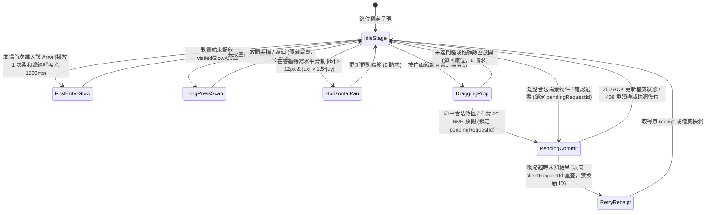

# SD-004-去按鈕化探索書牆與雙向破冰前端UX — 分項實作設計

**功能／工作包 ID**：`SD-004-去按鈕化探索書牆與雙向破冰前端UX`  
**完整 SPEC 名稱／來源 MVP／SPEC／BDD／TDD**：`SPEC-001-RainBookshopV4`／[MVP-001](../../../../../../requirements/MVP-001-LoveGameDatingApp.md)、[作者草案 JSON](../../../../../../requirements/rain-bookshop-v4-draft.json)、[SPEC-001-RainBookshopV4](../../../../../../specs/SPEC-001-RainBookshopV4.md)、[RiskAudit](../../../../../../specs/SPEC-001-RainBookshopV4-RiskAudit.md)、[BDD](../../../../../../bdd/SPEC-001-RainBookshopV4-BDD.md)、[TDD](../../../../../../tdd/SPEC-001-RainBookshopV4-TDD.md)  
**文件包／AI／模型／批次**：`docs/sd/SPEC-001-RainBookshopV4/candidates/antigravity-model-unprovided/20261125-2312-01`／AI：`Antigravity`／模型：`未提供`／批次：`20261125-2312-01`  
**設計版本／契約版本／優先級**：`1.0.0`／`SD-contract-v2`／高（前半場沉浸探索與破冰 UX）  
**執行狀態／驗收狀態／最後更新**：`Planned`／`Incomplete`（設計階段已完成，產品尚未開發）／2026-11-25  
**執行／整合／驗收責任**：唯一寫入與前端元件單元驗證責任：`SD-004` 執行者；`StoryExperienceScreen` 頂層組裝整合責任：[SD-005](SD-005-暴雨救書協作與四結局借閱小票前端UX.md)；Web／Android 真機雙端 E2E 驗收責任：[SD-006](SD-006-跨系統整合雙平台E2E與技術GateA驗收.md)  
**來源與程式碼基準、核准設計快照**：見 [SD 總覽 — 來源、程式與設計基準](../00-overview.md#來源程式與設計基準)

## 開發進度總覽

### 整體進度

只計本文件「實現檢查清單／Todo」中的唯一葉節點；摘要、里程碑及引用不再計數。設計與實作驗證分開，設計完成不勾選產品完成。

| 指標 | 完成／總數 | 進度條與百分比 | 依據 |
|---|---|---|---|
| 設計完成度（D） | 4 / 4 | `[████████████████████] 100.0%` | 本包 `SD-004-D01`～`SD-004-D04` 已完成畫面、手勢與步驟一致性查核 |
| 本包 BDD 設計涵蓋率 | 19 / 19 | `[████████████████████] 100.0%` | 完整涵蓋前半「探索 12＋破冰 7」共 19 個 `@frontend` BDD Scenario（`RB4-BDD-001`～`017`、`019`、`020`）之 UI 元件設計 |
| 本包 TDD 設計涵蓋率 | 24 / 24 | `[████████████████████] 100.0%` | 本包唯一負責執行驗證之 24 項前端 Unit TDD 已全數映射至步驟與 V-ID |
| 實作驗證完成度（I） | 0 / 4 | `[░░░░░░░░░░░░░░░░░░░░] 0.0%` | 本包 `SD-004-I01`～`SD-004-I04` 待核准及 `SD-001` 完成後實作驗證 |

### 分層／分組進度追蹤

| 唯一分組／層 | D 完成／總數 | I 完成／總數 | 進行中／待開始 | 執行狀態 | 驗收狀態／證據 |
|---|---|---|---|---|---|
| 設計（共用 v3 前端型別、去按鈕化導覽／手勢護欄、五區書牆／盲書、空間彩蛋與雙向破冰 UX） | 4 / 4 | 0 / 0 | 0 / 0 | `Accepted`（桌面設計稽核通過） | 設計完成，等待人工核准 |
| UX + Unit（Expo Web／Android 共用前半場景元件與手勢單元驗證） | 0 / 0 | 0 / 4 | 0 / 4 | `Planned` | `Incomplete`（待回填） |

### 當前 Sprint 狀態

| 當前階段／Todo ID／步驟 ID | Red–Green–Refactor 子階段 | 負責者 | 開始／預計完成及依據 | 下一步 ID／最後更新 |
|---|---|---|---|---|
| 設計交付待審／無執行中 I／待 `SD-001` 完成後啟動 `SD-004-S01` | 不適用（設計階段不開發） | Antigravity／待指派執行者 | 依賴本包核准及 `SD-001` 交付正式 V4 內容契約與素材 | `SD-004-S01`／2026-11-25 |

### 里程碑

僅引用 Todo ID，不建立第二套可計數 checkbox。

| 里程碑 | 必要葉節點／前置 SD | 驗收與整合條件 | 狀態／證據 |
|---|---|---|---|
| M4-1：前半畫面與手勢設計就緒 | `SD-004-D01`～`SD-004-D04` | 19 個前半 `@frontend` 場景全數映射至具體元件、handler、狀態機與資產 | 設計完成（待人工核准） |
| M4-2：去按鈕化導覽、手勢護欄與五區 20 書通過 | `SD-004-I01`、`SD-004-I02`（前置 `SD-001`） | 小地圖暖金點、單次呼吸光、長按掃視、橫滑書牆、右滑撕盲書與原位開合測試通過 | `Incomplete` |
| M4-3：空間彩蛋、雙向破冰、提問卡與聊天建議通過 | `SD-004-I03`、`SD-004-I04` | 本包 24 項前端 Unit TDD 與 `npm run test:client` 全綠，移交 `SD-005` 頂層組裝 | `Incomplete` |

### 關鍵指標

| 指標 | 已確認目標與來源 | 當前值 | 實際驗證／證據或限制 |
|---|---|---|---|
| 前半 `@frontend` BDD 畫面設計覆蓋 | 19 / 19（探索 12 + 破冰 7，`SPEC-001-RainBookshopV4-BDD.md`） | 19 / 19 設計涵蓋；0 / 19 實作通過 | 元件單元測試於本包執行；Web/Android 真畫面 E2E 於 `SD-006` 驗收 |
| 手勢防呆與零誤提交保護 | 預覽翻書、橫滑書牆、擦霧、長按掃視、拖出取消 0 次誤送主線；連點最多 1 次提交（`RB4-BDD-003`～`006`、`011`） | 已納入狀態機斷言 | 由 `V-001`～`V-003` 單元與 `SD-006` 雙端觸控驗證 |

### 每日進度記錄

依工作區 `AGENTS.md` 規範，禁止維護每日／批次歷史進度流水帳；本表僅就地保留當前設計基準狀態。

| 日期 | 完成 Todo／有效證據 | 阻斷／剩餘 | 下一步／責任 |
|---|---|---|---|
| 2026-11-25 | 完成 `SD-004-D01`～`SD-004-D04` 設計與桌面稽核；實作 Todo `0/4` | 等待使用者核准本包 `v1.0.0` 及 `SD-001` 完成 | 啟動 `SD-004-S01`／`SD-004` 執行者 |

## 功能概述

本分項負責 Expo／React Native（Web 與 Android 共用場景組件樹）的前半場全套去按鈕化探索、五區 20 本書互動、空間感官彩蛋與雙向破冰 UX，同時**一次完整定義全前端共用的 `scene-event.v3` TypeScript 型別檔 `frontend/client/src/types/scene-event-track.ts`**（涵蓋前半與後半全部 DTO 型別，供 `SD-005` 直接唯讀引用，確保單一檔案寫入權）：
1. **去按鈕化導覽與零盲點探索**：移除表單式移動按鈕海與漂浮星號；提供門把／傘桶原位點擊、`向左逛`／`向右逛` 極簡邊緣導引、可收合《書店平面圖》（僅顯示本人合法新事件／未探索彩蛋暖金微光圓點）、每區首次進入 **1 次**柔和邊緣呼吸光、長按畫面空白處短暫浮現可互動物件輪廓，以及縮放／點擊／長按／橫滑／拖放互斥與 pending 防連點、409 重同步、未知結果同 ID 查 receipt 護欄。
2. **五區融圖 20 本書與盲書撕封**：5 個區塊書籍與 `prop-display-shadow-v4` 接地融圖；主木質書牆點擊展開 `ShelfCloseupDrawer`（`bg-shelves-closeup-v4` 左右橫滑書脊並點擊抽出）；4 本牛皮紙盲書顯示 3 枚 `#標籤` 並支援沿虛線往右滑撕開（滑動未達門檻放開平滑彈回不誤提交）；`SceneBook` 移除固定 V3 標題，完整呈現阿澄手寫推薦卡、3–4 頁原創自譯、末頁匿名讀者字條、本人興趣溫柔貼紙與 A 端 3 選 1 共鳴獨白，合書回原位不誤推進主線。
3. **空間等待彩蛋**：黑膠轉盤切換 3 曲、櫃檯今日特調小黑板、閱讀角 5 則訪客留言冊、阿澄 3 話題閒聊，以及落地窗手指滑動擦霧看 3 階段街景（純本地呈現不誤提交）＋點留 4 種霧氣小符號＋夥伴於前景窗區實際渲染時自動回報合法見證。
4. **雙向破冰、雨天提問卡與動態聊天建議**：同書／異書演出、面紙近／遠兩處正規化熱區拖放與 A 獨立點選收下／不用、扶回滑落書籤留白與 A 反客為主搭話、婉拒獨處零假聊天、4 題雨天提問卡蓋牌等待與同步翻牌動畫，以及 8 情境×3 句聊天建議點擊填入聊天輸入框草稿（未點不發送，由真人送出）。

- **明確排除**：後半場暴雨過場、手電筒 Ready Gate、90 秒救書 HUD、書籤儀式、四結局、借閱小票、`StoryAudio` 背景停播整合與 `StoryExperienceScreen.tsx` 頂層組裝均由 [SD-005](SD-005-暴雨救書協作與四結局借閱小票前端UX.md) 唯一寫入。

## 功能需求與來源追溯

| MVP／SPEC 項目 | BDD Scenario（19 個 `@frontend`） | TDD 測試項（本包唯一負責之 24 項前端 Unit） | 系統設計 ID／本包 Todo／步驟 ID | 驗收條件 | 跨包共同成果與整合責任 |
|---|---|---|---|---|---|
| `AC-005-36` / `RB4-AC-001` | `RB4-BDD-001`～`004` | `RB4-T-006`～`008`、`011`～`013`、`016`～`018`（9 項） | `SYS-007`／`D01`、`D02`、`I01`／`S01` | 左右導引與小地圖暖金點正確、無平鋪移動按鈕海或漂浮星號；首次入區呼吸光僅 1 次、長按短暫輪廓不推進；手勢互斥、pending 單次提交、取消復位、409 重讀與同 ID 查 receipt | 入店領域規則歸 `SD-002`（`001`～`003`），頂層組裝歸 `SD-005`，Web/Android E2E 歸 `SD-006`（`004`、`005`、`009`、`010`、`014`、`015`、`019`、`020`） |
| `AC-005-37` / `RB4-AC-002` | `RB4-BDD-005`～`008` | 元件層於 `S02` 搭配領域投影驗證開合、橫滑與右滑撕封手勢 | `SYS-007`／`D02`、`I02`／`S02` | 5 區 20 書融圖與主書牆橫滑特寫、盲書右滑過門檻才送撕封（半途放開復位）、開書完整顯示推薦卡／全文／末頁字條／本人興趣貼紙／共鳴選項、合書不誤提交 | 內容歸 `SD-001`、投影隔離歸 `SD-002`/`003`、雙端 E2E 歸 `SD-006` |
| `AC-005-38`、`41` / `RB4-AC-003`、`006` | `RB4-BDD-009`～`012`、`020` | `RB4-T-044`～`046`、`050`～`052`、`055`～`057`（9 項） | `SYS-007`／`D03`、`I03`／`S03` | 黑膠轉盤切歌提示且不強制對方開聲音；小黑板（布丁伏筆）、5 留言、阿澄 3 話題非阻塞；擦霧純本地不誤送、點選 4 符號才送共享、前景窗區實際渲染才觸發一次見證回報 | 音訊底層停播與頂層掛載協同 `SD-005`；後端見證防護歸 `SD-002`/`003`；雙端 E2E 歸 `SD-006` |
| `AC-005-39`、`40` / `RB4-AC-004`、`005` | `RB4-BDD-013`～`017`、`019` | `RB4-T-072`～`074`、`101`～`103`（6 項） | `SYS-007`／`D04`、`I04`／`S04` | 近／遠面紙拖放熱區與錯區復位、A 收面紙與聊天選擇分離、扶書籤留白與反向主動選項、提問卡蓋牌等待與同步翻牌、8×3 聊天建議點選填草稿（未點不發送、不冒充 NPC） | 領域與持久化歸 `SD-002`/`003`；雙端 E2E 歸 `SD-006` |

### BDD 行為與產品實作分解

| BDD Scenario／條件或 Examples | 角色／Given | When／操作 | Then／And／But 各結果與副作用 | 實際產品 F-ID／符號／核心分支 | 必要 S／I／V／跨包成果 |
|---|---|---|---|---|---|
| `RB4-BDD-001`～`004`（入店、導覽、發現物件、手勢護欄） | 雙端玩家在 `street-view` 及店內各 Area | 點門把／傘桶、左右邊緣與小地圖跳區、首次進區看呼吸光、長按空白掃視、連點／拖出／409 | 鄰接合法跳區、暖金點僅本人新事件／未探彩蛋、無按鈕海；呼吸光每區每場 1 次、長按僅顯示輪廓不送請求；pending 鎖單次提交、409 重同步 | `F-02` `BookshopMinimapOverlay`、`F-05` `EmbeddedSceneStage`（`useGestureFence`、`useAreaBreathingOnce`）、`F-08` `SceneEventActions` | `SD-004-S01`／`I01`／`V-001`；跨包 `SD-005`、`SD-006` |
| `RB4-BDD-005`～`008`（20 書目錄、盲書撕封、興趣貼紙、共鳴） | 玩家在 5 個放書 Area | 點主書牆橫滑抽書、右滑盲書封條（完成與中途取消）、翻至末頁看字條、看本人興趣貼紙、A 選共鳴 | 橫滑與抽書不衝突；盲書右滑 `>= 0.65` 寬度才送 `unseal-blind-book`，取消彈回；卡片／全文／末頁字條／貼紙忠實呈現原稿，關閉不推進 | `F-03` `ShelfCloseupDrawer`、`F-06` `SceneWorldObjects`、`F-07` `SceneBook` | `SD-004-S02`／`I02`／`V-002`；跨包 `SD-002`、`SD-003`、`SD-005`、`SD-006` |
| `RB4-BDD-009`～`012`、`020`（黑膠、小黑板、留言冊、擦霧與見證、阿澄話題） | 玩家等待夥伴或自由逛店 | 切黑膠 3 曲、開小黑板／留言冊／阿澄閒聊、滑動擦霧看雨勢、點留 4 符號、夥伴於前景 `window` 看見符號 | 彩蛋隨時可開關不阻塞；擦霧畫布純本地繪製不發 API，點選符號才送 `draw-fog-doodle`；夥伴前景窗區渲染符號後發一次 `witness-fog-doodle` | `F-04` `AmbientInteractableModal`（含 `FoggyWindowCanvas` 與 `useForegroundDoodleWitness`） | `SD-004-S03`／`I03`／`V-003`；跨包 `SD-002`、`SD-003`、`SD-005`、`SD-006` |
| `RB4-BDD-013`～`017`、`019`（同異書、近遠面紙、留白反向主動、婉拒、提問卡、8×3 聊天建議） | 進入閱讀角破冰與 `warm-track`／聊天抽屜 | 拖面紙至近／遠熱區或拖出界、A 點收／不收面紙與回覆／反向主動、答提問卡、點聊天建議 | 面紙依熱區送 `tissue-near`／`tissue-far`，出界彈回；提問卡先蓋牌等待後雙翻牌；聊天建議點擊寫入本地草稿列，不自動送出 | `F-04` `QuestionCardPanel`、`F-05` `TissueDropZones`、`F-08` `SceneEventActions` | `SD-004-S04`／`I04`／`V-004`；跨包 `SD-002`、`SD-003`、`SD-005`、`SD-006` |

## 用戶故事

- 作為**不喜歡填問卷式按鈕列表的玩家**，我想要直接推門、收傘、橫滑木質書牆抽書、親手撕開牛皮紙盲書、擦開落地窗霧氣畫小貓，並用有分寸的動作（放近或放遠面紙、推回滑落書籤）與對方自然破冰。

## 畫面操作／系統處理流程

### 畫面、元件與互動分解（適用時）

| 畫面／區域／角色／BDD | 實際頁面、元件、handler／F-ID | 布局、內容、素材與操作／手勢 | 狀態、導覽、禁用／錯誤／重試 | API／事件、權威狀態與平台差異 | 必要 S／I／V、可重現操作與視覺驗收 |
|---|---|---|---|---|---|
| **8 區導覽、小地圖與探索引導** （`I` & `A`／`BDD-001`～`004`） | `F-02` `BookshopMinimapOverlay`、`F-05` `EmbeddedSceneStage`（`handleStageTap`、`handleBlankLongPress`） | 左右邊緣半透明膠囊 `向左逛`／`向右逛`；右上角《書店平面圖》按鈕展開 `ui-bookshop-minimap-v4`，相鄰區可點、本人新事件／未探彩蛋顯示暖金圓點；門把與 `prop-umbrella-stand-v4` 原位點擊。 | 非相鄰區灰階不可點；首次入區 `visitedGlowAreas` 播 1 次呼吸光；長按空白顯輪廓；`pending` 時鎖住二次觸發；`409` 觸發 `onResyncRequired`。 | 導覽切換本地檢視 Area 或提交場景移動／入店動作；Web pointer 與 Android touch 統一走 `story-stage-geometry` 座標換算。 | `SD-004-S01`／`I01`／`V-001`；雙端視覺驗收於 `SD-006` |
| **五區融圖書本、主書牆特寫與盲書撕封** （`I` & `A`／`BDD-005`～`008`） | `F-03` `ShelfCloseupDrawer`、`F-06` `SceneWorldObjects`、`F-07` `SceneBook`（`handleBlindSealPan`、`handleConfirmSelectBook`） | 5 區書本疊加 `prop-display-shadow-v4`；點 `shelves` 書架開 `bg-shelves-closeup-v4` 橫滑抽屜（6 經典立體書脊＋2 牛皮盲書）；盲書顯示 `prop-blind-kraft-v4` 與 3 枚 `#標籤` 及虛線右滑軌道；開書呈現 `prop-handwritten-card-v4`、3–4 頁翻頁、末頁 `prop-reader-note-v4`、興趣溫柔貼紙與共鳴 3 選 1。 | 翻頁與合書純本地狀態不送 API；盲書滑動 `< 65%` 彈回，`>= 65%` 送 `unseal-blind-book` 並播 `fx-paper-tear`；僅按確認鍵才送 `select-book`。 | 讀取 `booksInArea` 白名單投影（未撕盲書無真書名）；Web 滑鼠拖曳／滾輪與 Android 橫向 `ScrollView`／`PanResponder` 手勢方向分離。 | `SD-004-S02`／`I02`／`V-002`；20 本逐本翻閱於 `SD-006` |
| **黑膠、小黑板、留言冊、阿澄閒聊與起霧雨窗** （`I` & `A`／`BDD-009`～`012`、`020`） | `F-04` `AmbientInteractableModal`（`VinylSubpanel`、`ChalkboardSubpanel`、`GuestbookSubpanel`、`FoggyWindowSubpanel`、`ClerkCasualSubpanel`） | 點擊 `prop-vinyl-player-v4` 切換 3 色標唱片；`prop-chalkboard-v4` 顯示 4 款飲品甜點與布丁售罄伏筆；`prop-guestbook-v4` 翻閱 5 則留言；`prop-fog-overlay-v4` 手指塗抹擦開霧氣顯示 `act1`/`act2`/`postStorm` 街景並可點留 4 符號（☔／☕／🐱／☺）。 | 隨時可關閉不卡主線；擦霧不送請求；點符號送 `draw-fog-doodle`；當 `isForeground && areaId === 'window' && canWitnessDoodle` 渲染完成後自動送一次 `witness-fog-doodle`。 | 同步 `ambientView` 權威狀態；背景或非 `window` 區絕不發送見證請求。 | `SD-004-S03`／`I03`／`V-003`；雙端同步驗收於 `SD-006` |
| **閱讀角面紙拖放、留白反向主動、提問卡與聊天建議** （`I` & `A`／`BDD-013`～`017`、`019`） | `F-05` `EmbeddedSceneStage`、`F-04` `QuestionCardSubpanel`、`F-08` `SceneEventActions` | `I` 拖 `prop-tissue` 至近處（手邊桌角）或遠處（外側桌緣）高亮區、點夥伴書本、或點滑落書籤推回桌面；`A` 獨立點面紙收／不收並選回覆或反向主動；`prop-question-card-v4` 正反翻牌；聊天列上方橫向呈現當前情境 3 句建議膠囊。 | 拖離熱區放開彈回；提問卡本人答後顯示蓋牌等待，雙交後播放 `fx-card-flip` 同時揭曉；點聊天建議僅呼叫 `onDraftSuggestionChange(text)` 填入輸入框。 | 提交 `approach-partner`、`decide-tissue`、`reply-approach`、`reverse-initiate`、`answer-question-card`；正規化熱區在 Web 與 Android 一致。 | `SD-004-S04`／`I04`／`V-004`；雙端驗收於 `SD-006` |

## 技術規範與實作設計

### 架構、DDD 與責任

- 所屬層級：`frontend/client/src/`（TypeScript + React Native 跨平台視圖層）。
- 嚴守前端純呈現與意圖發送原則：前端絕不自行判定是否同書、不自行抽提問卡、不自行拼湊未授權盲書內容，一切以權威投影 DTO 為準。

### 重要函式、核心邏輯與狀態

| 核心 ID／目標類別或函式 | 輸入／輸出與前後置條件 | 演算法／分支／偽碼 | 交易／併發／冪等／重試 | 錯誤語意／驗證 |
|---|---|---|---|---|
| `C04-1`：`isTrackV3Experience` 與完整 V4 前端型別（`F-01`） | 輸入體驗 DTO；輸出 TypeScript 型別守衛 | 擴充 `isTrackExperience` 支援 `'scene-event.v2' | 'scene-event.v3'`，並定義 `SceneV3BookView`、`MinimapView`、`AmbientView`、`QuestionCardView`、`TimedRescueView`、`BookmarkRitualView`、`EndingView`、`MemoryReceiptView`（一次涵蓋 `SD-004` 與 `SD-005` 所需全部型別）。 | 純型別與判別函式。 | 嚴格區分未撕與已撕盲書型別聯集。 |
| `C04-2`：`useGestureFence`（`F-05`） | 輸入手勢回呼與當前 `pendingActionKey`；輸出互斥受控手勢 handlers | 維護單一活躍手勢鎖 `activeGesture: 'none' | 'tap' | 'longPress' | 'horizontalPan' | 'drag' | 'upwardSwipe'`；當 `pendingRequest != null` 時拒絕新提交；收到 `409` 清除本地樂觀拖拽偏移並呼叫 `refreshExperience()`；網路不明錯誤保留同一 `clientRequestId` 供重試查 receipt。 | 客戶端防抖與同 ID 重試保護。 | `RB4-T-016`～`018` 驗證。 |
| `C04-3`：`useForegroundDoodleWitness`（`F-04`） | 輸入 `{ areaId, isAppForeground, fogDoodle, hasWitnessedVersion, onWitness }` | 僅當 `isAppForeground === true && areaId === 'window' && fogDoodle != null && fogDoodle.canWitness === true && hasWitnessedVersion !== fogDoodle.version` 且實際圖層 `onLayout` 完成渲染時，記錄 `hasWitnessedVersion` 並送出一次 `witness-fog-doodle({ doodleVersion: fogDoodle.version })`。 | 本地版本記憶避免同一符號版本重複發送請求。 | 背景或自我符號絕不觸發。 |

### 契約、資料與平台

- Web 與 Android 共用 `PanResponder` 與指標事件正規化，不使用僅單一平台支援的瀏覽器專屬 DOM API（媒體／可見度狀態由 `SD-005` 頂層以 `Platform.OS` + `AppState` 安全傳入 `isAppForeground` prop）。

### 共用與改動合理性

- 由 `SD-004` 唯一建立並完整定義 `frontend/client/src/types/scene-event-track.ts`，讓 `SD-005` 直接 import 現成型別而無須二次修改同一檔案，實現 100% 零跨包寫入衝突。

## 檔案改動設計

### F-01：`frontend/client/src/types/scene-event-track.ts`

- 改動類型：修改
- 目標類別／函式／區段與現況證據：擴充 `isTrackExperience`（現行只認 `'scene-event.v2'`）並新增完整 `scene-event.v3` 前端 DTO 型別（同時包含前半探索破冰與後半救書／結局／小票全部介面）。
- 對應 SYS／SPEC／BDD／TDD／Todo／負責步驟：`SYS-007`、`SYS-008`、`CNT-003`／`RB4-AC-001`～`011`／`SD-004-D01`、`I01`／`SD-004-S01`
- 改動要點與必要核心邏輯：保留既有 `v2` 型別相容，新增 `SceneTrackV3Experience` 及所有子模組型別與判別守衛。
- 此檔案的責任與白話設計原因：提供 `SD-004` 與 `SD-005` 共享的單一權威前端型別來源，避免重複定義或跨包改同一檔。
- 輸入／輸出、介面及契約限制：與 `SD-003` `StoryPayload.cs` 欄位 1:1 對齊。
- 前置依賴：`SD-001` 契約欄位定案。
- 寫入責任、共用責任與可寫區段：`SD-004` 唯一寫入；`SD-005` 唯讀引用。
- 驗證方式與預期結果：`npm run test:client` 與 TypeScript 編譯零錯誤。
- 實際證據回填位置：`V-001`（待回填）。

### F-02：`frontend/client/src/components/BookshopMinimapOverlay.tsx`

- 改動類型：新增
- 目標類別／函式／區段與現況證據：全新可收合手繪平面小地圖與左右極簡邊緣導覽元件。
- 對應 SYS／SPEC／BDD／TDD／Todo／負責步驟：`SYS-007`／`RB4-AC-001`／`RB4-BDD-002`／`RB4-T-006`～`008`／`SD-004-D01`、`I01`／`S01`
- 改動要點與必要核心邏輯：渲染 `ui-bookshop-minimap-v4`、合法相鄰區點擊導覽、本人未探彩蛋／新事件暖金微光圓點與 `uiCopy.mapGlowLegend`，絕不渲染平鋪移動按鈕列或漂浮星號。
- 此檔案的責任與白話設計原因：以書店平面圖與左右極簡方向切換取代舊版表單按鈕海。
- 輸入／輸出、介面及契約限制：接收 `MinimapView`、`uiCopy` 與 `onNavigateArea(areaId)`。
- 前置依賴：`F-01`。
- 寫入責任、共用責任與可寫區段：`SD-004` 唯一寫入。
- 驗證方式與預期結果：`RB4-T-006`～`008` 單元測試通過。
- 實際證據回填位置：`V-001`（待回填）。

### F-03：`frontend/client/src/components/ShelfCloseupDrawer.tsx`

- 改動類型：新增
- 目標類別／函式／區段與現況證據：全新主木質書牆第一人稱橫滑特寫與牛皮紙盲書右滑撕封抽屜元件。
- 對應 SYS／SPEC／BDD／TDD／Todo／負責步驟：`SYS-007`／`RB4-AC-001`、`002`／`RB4-BDD-005`、`006`／`SD-004-D02`、`I02`／`S02`
- 改動要點與必要核心邏輯：以 `bg-shelves-closeup-v4` 呈現橫向可捲動木架，區分水平捲動與點擊抽書；對未揭封盲書渲染 `prop-blind-kraft-v4`、3 枚 `blindTags` 與沿虛線右滑手勢（`>= 65%` 觸發 `onUnsealBlindBook`，未滿彈回）。
- 此檔案的責任與白話設計原因：實現第一人稱逛書牆與親手撕開牛皮紙盲書的核心沉浸感。
- 輸入／輸出、介面及契約限制：未揭封前 DOM/RN 節點絕不含真實書名屬性。
- 前置依賴：`F-01`。
- 寫入責任、共用責任與可寫區段：`SD-004` 唯一寫入。
- 驗證方式與預期結果：`V-002` 橫滑互斥與盲書撕封／取消復位單元測試通過。
- 實際證據回填位置：`V-002`（待回填）。

### F-04：`frontend/client/src/components/AmbientInteractableModal.tsx`

- 改動類型：新增
- 目標類別／函式／區段與現況證據：全新空間彩蛋（黑膠轉盤、特調小黑板、訪客留言冊、起霧雨窗擦拭與 4 符號及前景見證、阿澄閒聊）與雨天提問卡翻牌彈層元件。
- 對應 SYS／SPEC／BDD／TDD／Todo／負責步驟：`SYS-007`／`RB4-AC-003`、`005`、`006`／`RB4-BDD-009`～`012`、`017`、`020`／`RB4-T-044`～`046`、`050`～`052`、`055`～`057`／`SD-004-D03`、`D04`、`I03`、`I04`／`S03`、`S04`
- 改動要點與必要核心邏輯：實作五項非阻塞等待彩蛋視圖、純本地擦霧畫布（零誤送請求）、4 符號點選提交、`useForegroundDoodleWitness` 前景實際渲染見證回報，以及雨天提問卡蓋牌等待與同步翻牌動畫。
- 此檔案的責任與白話設計原因：讓等待夥伴的時間變成充滿細節與伏筆的自由探索體驗。
- 輸入／輸出、介面及契約限制：黑膠切歌只呼叫 `onSwitchVinyl(trackId)`，不改動本地靜音開關。
- 前置依賴：`F-01`。
- 寫入責任、共用責任與可寫區段：`SD-004` 唯一寫入。
- 驗證方式與預期結果：`RB4-T-044`～`046`、`050`～`052`、`055`～`057` 通過。
- 實際證據回填位置：`V-003`、`V-004`（待回填）。

### F-05：`frontend/client/src/components/EmbeddedSceneStage.tsx` 與 `F-06`：`SceneWorldObjects.tsx`

- 改動類型：修改兩檔
- 目標類別／函式／區段與現況證據：擴充既有場景舞台與世界物件層，加入 V4 單次入區柔和邊緣呼吸光、長按空白掃視輪廓、`useGestureFence` 手勢互斥護欄、5 區書籍 `prop-display-shadow-v4` 融圖與閱讀角面紙近／遠雙熱區拖放。
- 對應 SYS／SPEC／BDD／TDD／Todo／負責步驟：`SYS-007`／`RB4-AC-001`、`002`、`004`／`RB4-BDD-001`、`003`、`004`、`014`／`RB4-T-011`～`013`、`016`～`018`、`072`～`074`／`SD-004-D01`、`D04`、`I01`、`I04`／`S01`、`S04`
- 改動要點與必要核心邏輯：維持既有鏡頭 `story-stage-geometry` 與 `hitMask` 命中，新增 `visitedAreaIds` 單次呼吸光記憶、長按空白 380ms 輪廓遮罩、pending 單次提交鎖與面紙 `near`/`far` 正規化目標區判定（拖出界自動復位）。
- 此檔案的責任與白話設計原因：在共用底層舞台統一處理 Web/Android 座標與手勢防呆，確保所有物件點擊與拖放穩定精準。
- 輸入／輸出、介面及契約限制：保持 V3 舊場景渲染 100% 相容。
- 前置依賴：`F-01`。
- 寫入責任、共用責任與可寫區段：`SD-004` 唯一寫入；`SD-005` 於 `StoryExperienceScreen` 掛載使用。
- 驗證方式與預期結果：`RB4-T-011`～`013`、`016`～`018`、`072`～`074` 通過。
- 實際證據回填位置：`V-001`、`V-004`（待回填）。

### F-07：`frontend/client/src/components/SceneBook.tsx`

- 改動類型：修改
- 目標類別／函式／區段與現況證據：移除現行硬編碼「心動迴路原創試讀」標題，擴充支援 V4 原稿書封、阿澄手寫推薦卡、3–4 頁翻頁、末頁匿名讀者字條、本人興趣溫柔貼紙、A 端 3 選 1 共鳴選項，並預留結局 2 夥伴授權牛皮書籤滑出展示插槽供 `SD-005` 傳入顯示。
- 對應 SYS／SPEC／BDD／TDD／Todo／負責步驟：`SYS-007`、`SYS-008`／`RB4-AC-002`、`010`／`RB4-BDD-005`～`008`、`038`／`SD-004-D02`、`I02`／`S02`
- 改動要點與必要核心邏輯：開合與翻頁全為純本地 UI 狀態（`onClose` 合回原位不發提交命令）；僅點擊明確 `confirmButtonLabel` 才觸發 `onSelectBook`，點擊共鳴選項才觸發 `onSelectResonance`。
- 此檔案的責任與白話設計原因：忠實呈現 20 本書的全部原創文字、卡片與字條細節，並由單一書籍元件同時支援探索閱讀與結局 2 翻閱夥伴書籤。
- 輸入／輸出、介面及契約限制：保持 V3 舊書籍 props 向後相容。
- 前置依賴：`F-01`。
- 寫入責任、共用責任與可寫區段：`SD-004` 唯一寫入；`SD-005` 唯讀傳入 `partnerBookmarkReveal` prop。
- 驗證方式與預期結果：`V-002` 單元測試與既有 `SceneBook` 測試全綠。
- 實際證據回填位置：`V-002`（待回填）。

### F-08：`frontend/client/src/components/SceneEventActions.tsx`

- 改動類型：修改
- 目標類別／函式／區段與現況證據：在 `scene-event.v3` 模式下隱藏舊版平鋪區域移動按鈕列，僅渲染當前合法浮動對話選項（如阿澄招呼、A 回覆／反向主動）、8×3 動態聊天建議草稿膠囊、雙同意下一場與安全退出入口。
- 對應 SYS／SPEC／BDD／TDD／Todo／負責步驟：`SYS-007`／`RB4-AC-001`、`004`、`005`、`011`／`RB4-BDD-002`、`015`、`016`、`019`／`RB4-T-008`、`101`～`103`／`SD-004-D01`、`D04`、`I01`、`I04`／`S01`、`S04`
- 改動要點與必要核心邏輯：聊天建議點擊只執行 `onFillChatDraft(suggestion.text)`，絕不直接呼叫送出訊息 API；等待對方時溫和顯示 `uiCopy.waitingPartnerGentle`。
- 此檔案的責任與白話設計原因：消除舊版表單感，同時保留真人自然對話輔助與隨時可退出的安全感。
- 輸入／輸出、介面及契約限制：V3 模式保持原樣。
- 前置依賴：`F-01`。
- 寫入責任、共用責任與可寫區段：`SD-004` 唯一寫入。
- 驗證方式與預期結果：`RB4-T-008`、`101`～`103` 通過。
- 實際證據回填位置：`V-001`、`V-004`（待回填）。

### F-09：`frontend/client/tests/unit/scene-event-v4-act1-act2.test.tsx`

- 改動類型：新增
- 目標類別／函式／區段與現況證據：新增前半探索、書牆、彩蛋與破冰全部 24 項前端 Unit TDD 測試套件。
- 對應 SYS／SPEC／BDD／TDD／Todo／負責步驟：`SYS-007`／`RB4-T-006`～`008`、`011`～`013`、`016`～`018`、`044`～`046`、`050`～`052`、`055`～`057`、`072`～`074`、`101`～`103`／`SD-004-I01`～`I04`／`S01`～`S04`
- 改動要點與必要核心邏輯：使用正式 `contracts/rain-bookshop-v4.json` 投影資料測試元件渲染、手勢觸發／取消、背景停播信號、前景見證與錯誤復原。
- 此檔案的責任與白話設計原因：獨立驗證前半所有 UI 元件與手勢護欄行為，不依賴長耗時 E2E 才能發現互動問題。
- 輸入／輸出、介面及契約限制：遵循既有 `npm run test:client` 測試執行器規範。
- 前置依賴：隨 `S01`～`S04` Red-Green 撰寫。
- 寫入責任、共用責任與可寫區段：`SD-004` 唯一寫入。
- 驗證方式與預期結果：`npm run test:client` 100% 通過。
- 實際證據回填位置：`V-001`～`V-004`（待回填）。

## 有序實作與驗證步驟

### 步驟順序與起始關卡

| 步驟 ID／成果 | 唯一負責 I-ID／來源 | 前置步驟及所需結果／跨包契約 | F-ID／V-ID | 通過後可開始的下一步／條件 | 執行狀態／證據位置 |
|---|---|---|---|---|---|
| `SD-004-S01`：共用 v3 前端型別、去按鈕化導覽／小地圖、單次呼吸光、長按掃視與手勢衝突護欄 | `SD-004-I01`／`RB4-BDD-001`～`004`、`RB4-T-006`～`008`、`011`～`013`、`016`～`018` | `SD-001` 完成並交付 `contracts/rain-bookshop-v4.json` | `F-01`、`F-02`、`F-05`、`F-08`、`F-09`／`V-001` | `SD-004-S02`（9 項導覽與手勢護欄 Unit 全綠） | `Planned`；待回填 |
| `SD-004-S02`：五區融圖書本、主書牆橫滑特寫、牛皮紙盲書右滑撕封與原位閱讀共鳴元件 | `SD-004-I02`／`RB4-BDD-005`～`008` | `SD-004-S01` 通過 | `F-03`、`F-06`、`F-07`、`F-09`／`V-002` | `SD-004-S03`（20 書原稿呈現、盲書撕封／彈回與合書零誤送通過） | `Planned`；待回填 |
| `SD-004-S03`：黑膠同步提示、小黑板、留言冊、阿澄閒聊與起霧雨窗擦拭／4 符號／前景見證元件 | `SD-004-I03`／`RB4-BDD-009`～`012`、`020`、`RB4-T-044`～`046`、`050`～`052`、`055`～`057` | `SD-004-S02` 通過 | `F-04`、`F-09`／`V-003` | `SD-004-S04`（9 項空間彩蛋與擦霧見證 Unit 全綠） | `Planned`；待回填 |
| `SD-004-S04`：閱讀角面紙近遠拖放、留白反向主動、雨天提問卡翻牌與 8×3 動態聊天建議草稿 | `SD-004-I04`／`RB4-BDD-013`～`017`、`019`、`RB4-T-072`～`074`、`101`～`103` | `SD-004-S03` 通過 | `F-04`、`F-05`、`F-08`、`F-09`／`V-004` | 本包全部完成，移交 `SD-005` 進行頂層組裝 | `Planned`；待回填 |

### SD-004-S01：共用 v3 前端型別、去按鈕化導覽／小地圖、單次呼吸光、長按掃視與手勢衝突護欄

**對應成果與責任**：唯一負責 `SD-004-I01`；來源 `RB4-AC-001`、`RB4-BDD-001`～`004`、`RB4-T-006`～`008`、`011`～`013`、`016`～`018`；檔案 `F-01`、`F-02`、`F-05`、`F-08`、`F-09`；驗證 `V-001`。  
**開始條件與前置證據**：`SD-001` 已完成；雙端真畫面 E2E 留待 `SD-006` 驗證。  
**必讀工作範圍**：`frontend/client/src/types/scene-event-track.ts`、`EmbeddedSceneStage.tsx`、`SceneEventActions.tsx`、`story-stage-geometry.ts`。  
**可寫檔案／符號及禁止改動**：`F-01`、`F-02`、`F-05`、`F-08`、`F-09`；禁止修改 `StoryExperienceScreen.tsx`（屬 `SD-005`）。  
**產品改動與 BDD／畫面關聯**：建立完整 v3 型別、`BookshopMinimapOverlay`、首次進區單次呼吸光、長按空白掃視輪廓、`useGestureFence` 與隱藏舊移動按鈕海。  
**具體行為與核心邏輯**：依畫面狀態機實作；同區二次進入不再觸發自動呼吸光；長按空白放開不發送任何網路命令；連點或拖出界只允許最多 1 次合法提交或 0 次提交復位；收到 409 觸發重讀、未知結果以同 `clientRequestId` 重查。  
**允許自行決定的局部細節**：呼吸光與輪廓過渡曲線動畫數值。

#### 測試資料與預期結果

| 案例 ID／來源與類型 | fixture／輸入及初始狀態 | 預期輸出／錯誤／狀態 | 必要斷言與副作用 | V-ID／測試位置 |
|---|---|---|---|---|
| `C04-S01-1`／`RB4-T-006`～`008` 導覽與暖金點 | `entrance` 投影含相鄰區與未探彩蛋標記 | 合法相鄰可切換、非相鄰禁用、暖金點僅出現在本人合法新事件／未探區、畫面無舊移動按鈕列表或星號 | 小地圖可展開與收合 | `V-001`／`scene-event-v4-act1-act2.test.tsx` |
| `C04-S01-2`／`RB4-T-011`～`013` 呼吸光與長按掃視 | 首次進入 `shelves` 後離開再進入；長按空白 400ms 後放開及中途取消 | 呼吸光僅第 1 次播放；長按期間顯示合法物件輪廓、放開隱去，`onSubmitEvent` 呼叫次數為 `0` | 重連不誤送主線 | `V-001`／同上 |
| `C04-S01-3`／`RB4-T-016`～`018` 手勢衝突護欄 | 鏡頭 scale `1.24` 下快速連點 5 次、拖出目標區放開、模擬回傳 `409` 與網路超時重試 | 連點僅送 1 次請求；拖出界復位送 0 次；409 觸發 `onResync` 不自動換 ID 重送；未知超時維持原 `clientRequestId` | 座標縮放命中精確 | `V-001`／同上 |

#### 本步操作次序與判定

| 順序／子階段 | 操作與目標符號 | 工作目錄 | 命令／測試選擇器或畫面操作 | 預期結果與判定 | 實際結果／證據回填位置 |
|---|---|---|---|---|---|
| 1／Red | 新增 `scene-event-v4-act1-act2.test.tsx` 前 9 項測試 | `C:\GitProjects\gamenenstyle\datinghigh` | `npm run test:client -- scene-event-v4-act1-act2` | 因新元件與手勢護欄尚未實作而失敗 | 待回填 |
| 2／Green | 實作 `F-01`、`F-02`、`F-05`、`F-08` | `C:\GitProjects\gamenenstyle\datinghigh` | `npm run test:client -- scene-event-v4-act1-act2` | 9 項案例全數通過 | 待回填 |
| 3／必要 Refactor 與回歸 | 跑完整前端測試套件確認 V3 零回歸 | `C:\GitProjects\gamenenstyle\datinghigh` | `npm run test:client` | 100% 通過，完成 `SD-004-I01` | 待回填 |

**本步通過條件**：`RB4-T-006`～`008`、`011`～`013`、`016`～`018` 與既有 client 測試全綠。  
**必須停止的情況與回報內容**：無。  
**可在本步修正的範圍**：`F-01`、`F-02`、`F-05`、`F-08`、`F-09`。  
**下一步與起始條件**：`SD-004-S02`。  
**實際執行狀態／目前子階段／證據**：待回填。  
**中斷與恢復資訊**：無外部副作用。

### SD-004-S02：五區融圖書本、主書牆橫滑特寫、牛皮紙盲書右滑撕封與原位閱讀共鳴元件

**對應成果與責任**：唯一負責 `SD-004-I02`；來源 `RB4-AC-002`、`RB4-BDD-005`～`008`；檔案 `F-03`、`F-06`、`F-07`、`F-09`；驗證 `V-002`。  
**開始條件與前置證據**：`SD-004-S01` 通過。  
**必讀工作範圍**：`SceneWorldObjects.tsx`、`SceneBook.tsx`、`contracts/rain-bookshop-v4.json` 之 `books`。  
**可寫檔案／符號及禁止改動**：`F-03`、`F-06`、`F-07`、`F-09`。  
**產品改動與 BDD／畫面關聯**：實作 `ShelfCloseupDrawer`、牛皮紙盲書虛線右滑撕封／半途取消復位、5 區陰影融圖與 `SceneBook` 原稿完整欄位渲染（推薦卡、3–4 頁、末頁字條、興趣貼紙、共鳴選項、結局 2 夥伴書籤插槽）。  
**具體行為與核心邏輯**：翻閱全部頁面再關閉書本，`onSubmitEvent` 呼叫數必為 `0`；右滑盲書封條 `< 65%` 放開彈回不發請求，`>= 65%` 發一次 `unseal-blind-book`。  
**允許自行決定的局部細節**：翻頁過渡微動畫時間。

#### 測試資料與預期結果

| 案例 ID／來源與類型 | fixture／輸入及初始狀態 | 預期輸出／錯誤／狀態 | 必要斷言與副作用 | V-ID／測試位置 |
|---|---|---|---|---|
| `C04-S02-1`／20 書原稿渲染與預覽無副作用 | 傳入 16 經典與已揭封／未揭封 4 盲書投影，逐頁翻至末頁後關閉 | 推薦卡、每頁內文、末頁讀者字條、本人興趣貼紙與共鳴選項逐字呈現（無舊版固定試讀字樣）；關閉後不觸發選書提交 | 未揭封盲書僅顯示 3 枚 `blindTags` | `V-002`／`scene-event-v4-act1-act2.test.tsx` |
| `C04-S02-2`／主書牆橫滑與盲書右滑撕封邊界 | 在 `ShelfCloseupDrawer` 橫滑捲動、對盲書右滑 `40%` 放開取消、右滑 `75%` 放開完成 | 橫滑不誤抽書；`40%` 彈回送 `0` 次請求；`75%` 精確送 `1` 次 `unseal-blind-book` | 結局 2 `partnerBookmarkReveal` prop 傳入時正確滑出牛皮書籤 | `V-002`／同上 |

#### 本步操作次序與判定

| 順序／子階段 | 操作與目標符號 | 工作目錄 | 命令／測試選擇器或畫面操作 | 預期結果與判定 | 實際結果／證據回填位置 |
|---|---|---|---|---|---|
| 1／Red | 於 `scene-event-v4-act1-act2.test.tsx` 新增書牆橫滑、盲書撕封與 `SceneBook` v4 原稿測試 | `C:\GitProjects\gamenenstyle\datinghigh` | `npm run test:client -- scene-event-v4-act1-act2` | 因 `ShelfCloseupDrawer` 未建且 `SceneBook` 仍為舊標題而失敗 | 待回填 |
| 2／Green | 實作 `F-03`、`F-06`、`F-07` | `C:\GitProjects\gamenenstyle\datinghigh` | `npm run test:client -- scene-event-v4-act1-act2` | 新增測試與既有 `SceneBook` 測試全數通過 | 待回填 |
| 3／必要 Refactor 與回歸 | 執行完整前端測試套件 | `C:\GitProjects\gamenenstyle\datinghigh` | `npm run test:client` | 100% 通過，完成 `SD-004-I02` | 待回填 |

**本步通過條件**：`V-002` 與 `npm run test:client` 全綠。  
**必須停止的情況與回報內容**：無。  
**可在本步修正的範圍**：`F-03`、`F-06`、`F-07`、`F-09`。  
**下一步與起始條件**：`SD-004-S03`。  
**實際執行狀態／目前子階段／證據**：待回填。  
**中斷與恢復資訊**：無外部副作用。

### SD-004-S03：黑膠同步提示、小黑板、留言冊、阿澄閒聊與起霧雨窗擦拭／4 符號／前景見證元件

**對應成果與責任**：唯一負責 `SD-004-I03`；來源 `RB4-AC-003`、`006`、`RB4-BDD-009`～`012`、`020`、`RB4-T-044`～`046`、`050`～`052`、`055`～`057`；檔案 `F-04`、`F-09`；驗證 `V-003`。  
**開始條件與前置證據**：`SD-004-S02` 通過。  
**必讀工作範圍**：`contracts/rain-bookshop-v4.json` 之 `ambientInteractables`、`audio`、`npcs`、本包 `C04-3`。  
**可寫檔案／符號及禁止改動**：`F-04`、`F-09`。  
**產品改動與 BDD／畫面關聯**：實作 `AmbientInteractableModal` 內黑膠 3 曲轉盤、今日特調小黑板、訪客留言冊 5 則、阿澄 3 話題、起霧雨窗擦拭畫布（3 階段街景）＋4 符號點選＋`useForegroundDoodleWitness` 前景實際渲染見證回報。  
**具體行為與核心邏輯**：擦霧滑動僅更新本地遮罩透明度顯示街景文字，不發送任何命令；點選 4 符號之一才送 `draw-fog-doodle`；夥伴在背景、非 `window` 區或對本人畫的符號絕不發送見證，僅在前景 `window` 實際渲染對方當前符號版本時發送一次 `witness-fog-doodle`。  
**允許自行決定的局部細節**：擦霧軌跡視覺筆刷半徑。

#### 測試資料與預期結果

| 案例 ID／來源與類型 | fixture／輸入及初始狀態 | 預期輸出／錯誤／狀態 | 必要斷言與副作用 | V-ID／測試位置 |
|---|---|---|---|---|
| `C04-S03-1`／`RB4-T-044`～`046`、`050`～`052` 黑膠與等待彩蛋 | 雙端不同本地靜音偏好下切換 3 首黑膠、退背景再回前景；開啟小黑板、5 留言與阿澄 3 話題 | 權威曲目與提示文字同步，不強制開啟靜音方喇叭，背景停播且回前景不自動播放；小黑板布丁伏筆與全部留言／話題原文完整且隨時可關 | 探索彩蛋完全不阻塞主線 | `V-003`／`scene-event-v4-act1-act2.test.tsx` |
| `C04-S03-2`／`RB4-T-055`～`057` 擦霧、留符號與前景見證 | 滑動擦霧查看 `act1`/`act2`/`postStorm` 街景、點選 4 種符號、測試背景 `isAppForeground=false` vs 前景 `window` 渲染夥伴符號 | 純擦霧送 `0` 次請求；點符號送 `draw-fog-doodle`；背景不送見證、前景 `window` 精確送 `1` 次 `witness-fog-doodle` | 轉場或替換後依投影更新可見符號 | `V-003`／同上 |

#### 本步操作次序與判定

| 順序／子階段 | 操作與目標符號 | 工作目錄 | 命令／測試選擇器或畫面操作 | 預期結果與判定 | 實際結果／證據回填位置 |
|---|---|---|---|---|---|
| 1／Red | 新增 `RB4-T-044`～`046`、`050`～`052`、`055`～`057` 共 9 項測試 | `C:\GitProjects\gamenenstyle\datinghigh` | `npm run test:client -- scene-event-v4-act1-act2` | 因 `AmbientInteractableModal` 尚未建立而失敗 | 待回填 |
| 2／Green | 實作 `F-04` 空間彩蛋與霧窗擦拭／見證邏輯 | `C:\GitProjects\gamenenstyle\datinghigh` | `npm run test:client -- scene-event-v4-act1-act2` | 9 項案例全數通過 | 待回填 |
| 3／必要 Refactor 與回歸 | 跑完整前端測試套件 | `C:\GitProjects\gamenenstyle\datinghigh` | `npm run test:client` | 100% 通過，完成 `SD-004-I03` | 待回填 |

**本步通過條件**：9 項單元案例與既有測試全綠。  
**必須停止的情況與回報內容**：無。  
**可在本步修正的範圍**：`F-04`、`F-09`。  
**下一步與起始條件**：`SD-004-S04`。  
**實際執行狀態／目前子階段／證據**：待回填。  
**中斷與恢復資訊**：無外部副作用。

### SD-004-S04：閱讀角面紙近遠拖放、留白反向主動、雨天提問卡翻牌與 8×3 動態聊天建議草稿

**對應成果與責任**：唯一負責 `SD-004-I04`；來源 `RB4-AC-004`、`005`、`RB4-BDD-013`～`017`、`019`、`RB4-T-072`～`074`、`101`～`103`；檔案 `F-04`、`F-05`、`F-08`、`F-09`；驗證 `V-004`。  
**開始條件與前置證據**：`SD-004-S03` 通過。  
**必讀工作範圍**：`EmbeddedSceneStage.tsx`、`SceneEventActions.tsx`、`contracts/rain-bookshop-v4.json` 之 `personalBindings`、`questionCard`、`dynamicChatSuggestions`。  
**可寫檔案／符號及禁止改動**：`F-04`、`F-05`、`F-08`、`F-09`。  
**產品改動與 BDD／畫面關聯**：實作閱讀角面紙近／遠雙熱區拖放、書籤輕推留白點擊、A 獨立收受面紙與回覆／反向主動選項、雨天提問卡蓋牌等待與同步翻牌面板，以及 8 情境×3 句聊天建議點擊寫入本地草稿。  
**具體行為與核心邏輯**：面紙拖至近熱區送 `tissue-near`、遠熱區送 `tissue-far`、空白處放開彈回不送；A 收下面紙不自動觸發聊天回覆；聊天建議未點不發送，點擊僅呼叫草稿 callback 交由真人按送出鍵提交。  
**允許自行決定的局部細節**：翻牌 3D/縮放動畫曲線。

#### 測試資料與預期結果

| 案例 ID／來源與類型 | fixture／輸入及初始狀態 | 預期輸出／錯誤／狀態 | 必要斷言與副作用 | V-ID／測試位置 |
|---|---|---|---|---|
| `C04-S04-1`／`RB4-T-072`～`074` 面紙近遠拖放與破冰分離 | `I` 在 `reading-corner` 拖面紙至近區、遠區、區外與錯 Area；`A` 點收面紙後選 `decline`；另測留白反向主動與提問卡蓋牌／揭曉 | 近／遠精確送對應參數，區外復位 0 請求；收面紙不等於聊天，選 `decline` 無假聊天；提問卡首答蓋牌保密、雙交顯示揭曉原文 | 重送相同動作被護欄阻擋 | `V-004`／`scene-event-v4-act1-act2.test.tsx` |
| `C04-S04-2`／`RB4-T-101`～`103` 8×3 動態聊天建議 | 依序傳入 8 種情境之 `suggestions` 投影，打開聊天列不點、點其中 1 則、自由輸入送出 | 8 情境各精確顯示原稿 3 句；未點絕不送訊息；點擊只填入輸入框草稿且發送者恆為本人（不冒充 NPC 或夥伴） | 全階段聊天室正常可用 | `V-004`／同上 |

#### 本步操作次序與判定

| 順序／子階段 | 操作與目標符號 | 工作目錄 | 命令／測試選擇器或畫面操作 | 預期結果與判定 | 實際結果／證據回填位置 |
|---|---|---|---|---|---|
| 1／Red | 新增 `RB4-T-072`～`074`、`101`～`103` 及提問卡／反向主動元件測試 | `C:\GitProjects\gamenenstyle\datinghigh` | `npm run test:client -- scene-event-v4-act1-act2` | 因面紙雙熱區、提問卡翻牌與 v4 草稿建議尚未完成而失敗 | 待回填 |
| 2／Green | 完成 `F-04`、`F-05`、`F-08` 實作 | `C:\GitProjects\gamenenstyle\datinghigh` | `npm run test:client -- scene-event-v4-act1-act2` | 本包全部 24 項 Unit TDD 全數通過 | 待回填 |
| 3／必要 Refactor 與回歸 | 執行完整前端測試套件 | `C:\GitProjects\gamenenstyle\datinghigh` | `npm run test:client` | 100% 通過，完成 `SD-004` 全部 `I01`～`I04` | 待回填 |

**本步通過條件**：本包 24/24 項前端 Unit TDD 與 `npm run test:client` 全部通過，`git status` 確認僅改動 `F-01`～`F-09`。  
**必須停止的情況與回報內容**：無。  
**可在本步修正的範圍**：`F-01`～`F-09`。  
**下一步與起始條件**：移交 `F-01`～`F-08` 完整前半元件與共用 v3 型別供 [SD-005](SD-005-暴雨救書協作與四結局借閱小票前端UX.md) 組裝進 `StoryExperienceScreen.tsx`。  
**實際執行狀態／目前子階段／證據**：待回填。  
**中斷與恢復資訊**：重跑 `npm run test:client` 即可確認狀態。

## 測試計劃與實際驗證方式

| 驗證 ID／來源 Todo／步驟 ID | 層級／行為／平台 | 環境與前置資料／案例 ID | 工作目錄與實際命令或畫面操作 | 預期結果／斷言 | 實作／測試位置 | 實際結果、時間、log／畫面證據 | 驗收狀態／等價依據或恢復條件 |
|---|---|---|---|---|---|---|---|
| `V-001`／`SD-004-I01`／`S01` | UX+Unit／去按鈕化導覽、小地圖、呼吸光、長按掃視與手勢護欄／Client Test | V4 投影 fixtures／`RB4-T-006`～`008`、`011`～`013`、`016`～`018` | `C:\GitProjects\gamenenstyle\datinghigh` `npm run test:client -- scene-event-v4-act1-act2` | 9 項全綠，無舊移動按鈕海、連點最多 1 次提交 | `F-01`、`F-02`、`F-05`、`F-08`／`F-09` | 待回填 | `Incomplete` |
| `V-002`／`SD-004-I02`／`S02` | UX+Unit／五區融圖書本、橫滑書牆、盲書右滑撕封與原位閱讀／Client Test | 20 本書正式資料 | 同上 | 橫滑與抽書不衝突、盲書 `<65%` 彈回 `>=65%` 撕封、合書 0 誤送 | `F-03`、`F-06`、`F-07`／`F-09` | 待回填 | `Incomplete` |
| `V-003`／`SD-004-I03`／`S03` | UX+Unit／黑膠同步、等待彩蛋與起霧雨窗擦拭／見證／Client Test | 彩蛋投影／`RB4-T-044`～`046`、`050`～`052`、`055`～`057` | 同上 | 9 項全綠，擦霧 0 誤送、僅前景 `window` 送一次見證 | `F-04`／`F-09` | 待回填 | `Incomplete` |
| `V-004`／`SD-004-I04`／`S04` | UX+Unit／面紙近遠拖放、留白反向主動、提問卡與 8×3 聊天建議／Client Test | 破冰與建議投影／`RB4-T-072`～`074`、`101`～`103` | `C:\GitProjects\gamenenstyle\datinghigh` `npm run test:client` | 6 項與全套件 100% 通過，建議未點不送出 | `F-04`、`F-05`、`F-08`／`F-09` | 待回填 | `Incomplete` |

## 依賴關係與執行順序

| 任務／交付物 | 唯一執行／整合／驗收責任 | 前置／契約版本／開始條件 | 可寫範圍及排除 | 共享環境／隔離／互斥 | 安全並行或循序理由 | 完成及回傳條件 |
|---|---|---|---|---|---|---|
| `SD-004` 前半探索書牆與雙向破冰前端元件及共用 v3 型別 | `SD-004` 執行者／由 `SD-005` 頂層組裝，`SD-006` 雙端 E2E 驗收 | `SD-001` 完成 `contracts/rain-bookshop-v4.json` | 僅限本包 `F-01`～`F-09`；排除 `StoryExperienceScreen.tsx`、後端與 Worker | 純前端單元測試環境，不佔用 `8787`、D1 或 Android ADB | 可與 `SD-002`、`SD-003` 安全並行；必須先於 `SD-005` 完成以交付 `F-01` 共用型別與前半元件 | 回傳 `F-01`～`F-09` 改動與 24/24 項前端 Unit 全綠證據 |

## 風險、設計變更與人工確認紀錄

| ID／原設計版本 | 發現證據與為何不能照案實作 | 白話實務情境／功能影響 | 建議／替代與影響 SD／BDD／TDD | 負責者／觸發／成本時程 | 使用者決策／核准範圍／新版本 | 失效證據／重驗與恢復條件 |
|---|---|---|---|---|---|---|
| `RA-06`、`RA-07`／`v1.0.0` | 擦霧與翻書若每幀發送請求會造成誤提交；背景輪詢若觸發見證會誤發霧窗印章 | 玩家只是隨手擦玻璃或翻書看看，不該被當成做決定 | 純本地呈現與明確提交分離；`useForegroundDoodleWitness` 綁定前景 `window` 實際渲染 | `SD-004` 執行者／`S02`、`S03` | 上游 `RQ-03=A`、`RA-Q4=A` 已確認；等待本 SD 包 `v1.0.0` 核准 | 無失效證據 |

## 實現檢查清單／Todo

### D：設計葉節點

- [x] **SD-004-D01** 完成共用 `scene-event.v3` 前端型別、去按鈕化導覽／小地圖暖金點、單次呼吸光、長按掃視與手勢衝突護欄設計
  - 類型／唯一分組：D／設計（共用 v3 前端型別、去按鈕化導覽／手勢護欄、五區書牆／盲書、空間彩蛋與雙向破冰 UX）
  - 來源／責任／依賴：`RB4-AC-001`、`RB4-BDD-001`～`004`／`SD-004`／依賴 `SD-001-D01`
  - 完成條件／設計證據：已明定於畫面狀態機、`F-01`、`F-02`、`F-05`、`F-08` 及步驟 `S01`
- [x] **SD-004-D02** 完成五區陰影融圖書本、主書牆第一人稱橫滑特寫、牛皮紙盲書虛線右滑撕封與 `SceneBook` 原稿完整呈現設計
  - 類型／唯一分組：D／設計（共用 v3 前端型別、去按鈕化導覽／手勢護欄、五區書牆／盲書、空間彩蛋與雙向破冰 UX）
  - 來源／責任／依賴：`RB4-AC-002`、`RB4-BDD-005`～`008`／`SD-004`／依賴 `SD-004-D01`
  - 完成條件／設計證據：已明定於 `F-03`、`F-06`、`F-07` 及步驟 `S02`
- [x] **SD-004-D03** 完成黑膠 3 曲轉盤、今日特調小黑板、訪客留言冊、阿澄閒聊與起霧雨窗擦拭／4 符號／前景實際渲染見證設計
  - 類型／唯一分組：D／設計（共用 v3 前端型別、去按鈕化導覽／手勢護欄、五區書牆／盲書、空間彩蛋與雙向破冰 UX）
  - 來源／責任／依賴：`RB4-AC-003`、`006`、`RQ-03`、`RA-06`、`RB4-BDD-009`～`012`、`020`／`SD-004`／依賴 `SD-004-D01`
  - 完成條件／設計證據：已明定於 `C04-3`、`F-04` 及步驟 `S03`
- [x] **SD-004-D04** 完成閱讀角面紙近／遠雙熱區拖放、書籤留白與反向主動、雨天提問卡蓋牌翻牌及 8×3 動態聊天建議草稿設計
  - 類型／唯一分組：D／設計（共用 v3 前端型別、去按鈕化導覽／手勢護欄、五區書牆／盲書、空間彩蛋與雙向破冰 UX）
  - 來源／責任／依賴：`RB4-AC-004`、`005`、`RB4-BDD-013`～`017`、`019`／`SD-004`／依賴 `SD-004-D03`
  - 完成條件／設計證據：已明定於畫面分解表、`F-04`、`F-05`、`F-08` 及步驟 `S04`

### I：實作驗證葉節點

- [ ] **SD-004-I01** 實作並驗證共用 v3 型別、去按鈕化導覽／小地圖、單次呼吸光、長按掃視與手勢衝突護欄（9 項 Unit）
  - 類型／唯一分組：I／UX + Unit（Expo Web／Android 共用前半場景元件與手勢單元驗證）
  - 來源／責任／依賴：`RB4-BDD-001`～`004`、`RB4-T-006`～`008`、`011`～`013`、`016`～`018`／`SD-004` 執行者／依賴 `SD-001`
  - 全部必要步驟／指定整合驗證：`SD-004-S01`（頂層組裝於 `SD-005`，雙端真畫面 E2E 於 `SD-006`）
  - 驗收條件／驗證 ID：`V-001` 9 項單元案例與型別編譯全通過
  - 產物與實際證據／驗收狀態：待回填／`Incomplete`
- [ ] **SD-004-I02** 實作並驗證五區融圖書本、主書牆橫滑特寫、牛皮紙盲書右滑撕封與 `SceneBook` 原位開合閱讀
  - 類型／唯一分組：I／UX + Unit（Expo Web／Android 共用前半場景元件與手勢單元驗證）
  - 來源／責任／依賴：`RB4-BDD-005`～`008`／`SD-004` 執行者／依賴 `SD-004-I01`
  - 全部必要步驟／指定整合驗證：`SD-004-S02`（雙端真畫面 20 本翻閱 E2E 於 `SD-006`）
  - 驗收條件／驗證 ID：`V-002` 橫滑互斥、盲書撕封／取消復位與 20 書原稿渲染測試全通過
  - 產物與實際證據／驗收狀態：待回填／`Incomplete`
- [ ] **SD-004-I03** 實作並驗證黑膠同步提示、等待彩蛋與起霧雨窗擦拭／4 符號／前景實際渲染見證（9 項 Unit）
  - 類型／唯一分組：I／UX + Unit（Expo Web／Android 共用前半場景元件與手勢單元驗證）
  - 來源／責任／依賴：`RB4-BDD-009`～`012`、`020`、`RB4-T-044`～`046`、`050`～`052`、`055`～`057`／`SD-004` 執行者／依賴 `SD-004-I02`
  - 全部必要步驟／指定整合驗證：`SD-004-S03`（雙端真畫面 E2E 於 `SD-006`）
  - 驗收條件／驗證 ID：`V-003` 9 項單元案例全通過
  - 產物與實際證據／驗收狀態：待回填／`Incomplete`
- [ ] **SD-004-I04** 實作並驗證閱讀角面紙近／遠拖放、留白反向主動、雨天提問卡翻牌與 8×3 動態聊天建議草稿（6 項 Unit）
  - 類型／唯一分組：I／UX + Unit（Expo Web／Android 共用前半場景元件與手勢單元驗證）
  - 來源／責任／依賴：`RB4-BDD-013`～`017`、`019`、`RB4-T-072`～`074`、`101`～`103`／`SD-004` 執行者／依賴 `SD-004-I03`
  - 全部必要步驟／指定整合驗證：`SD-004-S04`（雙端真畫面 E2E 於 `SD-006`）
  - 驗收條件／驗證 ID：`V-004` 6 項單元案例及 `npm run test:client` 全數通過
  - 產物與實際證據／驗收狀態：待回填／`Incomplete`

## 檢查點與續作交接

| 日期／任務／執行者 | 已完成並驗收／證據 | 尚未驗收／停止原因 | 寫入責任與共享資源現況 | 所需決策／恢復條件與查核 | 續作對象、實際啟動結果／下一步 |
|---|---|---|---|---|---|
| 2026-11-25／`SD-004` 設計交付／Antigravity | `SD-004-D01`～`D04` 設計完成 | `SD-004-I01`～`I04` 未開始；等待核准及 `SD-001` 完成 | 未寫入任何檔案；`F-01`～`F-09` 鎖定歸本包唯一寫入 | 核准 `v1.0.0` 且 `SD-001` 完成後可與 `SD-002`／`SD-003` 並行啟動 | 待 `carefully-done` 階段啟動 `SD-004-S01` |

**鎖定文件包／版本／核准依據**：`docs/sd/SPEC-001-RainBookshopV4/candidates/antigravity-model-unprovided/20261125-2312-01`／`1.0.0`／待使用者確認  
**目前 I-ID／步驟 ID／子階段／已發生副作用**：尚未進入實作（無副作用）  
**需重驗成果與不受影響成果**：無  
**關鍵依賴鏈／下個里程碑／用時與重試策略**：`SD-001` → `SD-004`（M4-3）→ `SD-005` → `SD-006`  
**責任移交前停止寫入的證據**：不適用

## 相關文檔

- [SD 總覽](../00-overview.md)
- [系統設計](../01-system-design.md)
- [追溯矩陣](../02-traceability.md)
- 前置與後續分項：[SD-001](SD-001-V4內容契約與作者草案編譯器.md) → **本包 SD-004** → [SD-005](SD-005-暴雨救書協作與四結局借閱小票前端UX.md) → [SD-006](SD-006-跨系統整合雙平台E2E與技術GateA驗收.md)
- 上游文件：[SPEC-001-RainBookshopV4](../../../../../../specs/SPEC-001-RainBookshopV4.md)、[BDD](../../../../../../bdd/SPEC-001-RainBookshopV4-BDD.md)、[TDD](../../../../../../tdd/SPEC-001-RainBookshopV4-TDD.md)

## 生成者、最後更新與狀態

**生成者／AI／模型／批次**：Antigravity／模型：未提供／`20261125-2312-01`  
**最後更新／設計版本**：2026-11-25／`1.0.0`  
**執行狀態／驗收狀態／剩餘事項**：`Planned`／`Incomplete`／等待人工核准及 `SD-001` 完成後執行 `SD-004-S01`～`SD-004-S04`
