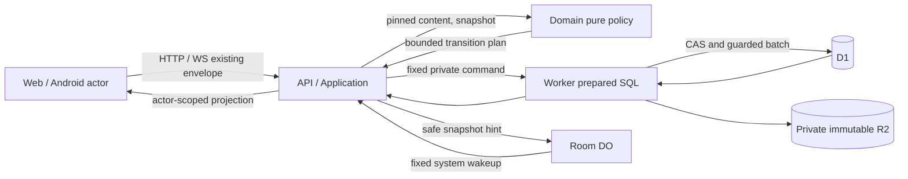
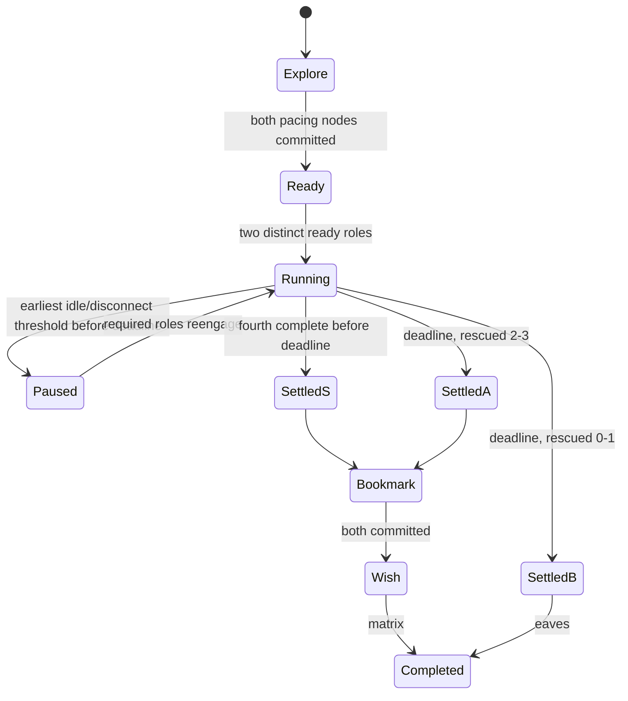

# SPEC-001-RainBookshopV4 — 系統設計

**文件包**：ChatGPT／GPT-6.2／20261125-2221-01；設計 v2、SD-contract-v2；Draft（尚未核准）。
**來源基準**：[SPEC](../../../../../specs/SPEC-001-RainBookshopV4.md)、[BDD](../../../../../bdd/SPEC-001-RainBookshopV4-BDD.md)、[TDD](../../../../../tdd/SPEC-001-RainBookshopV4-TDD.md)、[作者原稿](../../../../../requirements/rain-bookshop-v4-draft.json)、[RiskAudit](../../../../../specs/SPEC-001-RainBookshopV4-RiskAudit.md)；SHA 及工作樹見[總覽](00-overview.md)。

## 目標、範圍與現況差異

承接已確認的第六份 SPEC，交付完整 V4 第一人稱雙人書店；保留 V3 已核准角色、雙 Track、配對與安全退出。原稿字串與 ID 對應逐 scalar 不改；8 Area、20 書、28 節點、9 personal bindings、4 題、2 題組各 4 本、4 結局、80 素材項、8×3 建議及小票均由原稿唯一權威控制。排除其他九場、好感度、名片、問卷、History、iOS、無障礙專項、Puppet 全套。21 表、0 新欄、0 Trigger、0 新公開 API。若現行能力不足先證明問題及最小提案，不自行擴範圍。

| 代號 | 現況與差異 |
|---|---|
| SYS-01 | Worker Zod v2、Domain Compile v2；改正式 v3 discriminated reader/compiler，v2 保持直到 Gate B。作者 draft 不是 runtime schema。 |
| SYS-02 | SceneEventTrackPolicy.Apply 現有單人 fact；分離 repeatable typed state 與一次性提交，合法手勢意圖與角色、節點、區域、狀態皆由權威驗證。 |
| SYS-03 | SceneEventFrameworkService.Content/State/Project/CommandAsync 現行 actor 路徑；抽取純轉移／actor projection，固定私有 system reconcile，不造 CurrentUser。 |
| SYS-04 | planTrackAction 現有單 instance CAS；限定多 instance 原子 commit，D1 線性化時刻、NULL actor 系統事件 identity、DO 最早 alarm。 |
| SYS-05 | TrackExperienceFields/isTrackExperience 只 v2，EmbeddedSceneStage/SceneWorldObjects/SceneBook 支援有限原位互動；以內容能力擴充 v3，不散落 storyId 分支。 |
| SYS-06 | 發布工具 V3 first-story 特例、現有 local 升級工具；新增版本分派、精確清理集合與引用核對，Gate B 前不刪舊版。 |
| SYS-07 | 真 Web/Android 雙人流程、完整追溯、Gate A/B 與具名 local 清理；技術重放不代簽使用者。 |

## 架構與資料流

Request -> 驗授權與釘選 Session -> reconcile 應已發生的時間轉移 -> 載權威狀態 -> 依 actor/area/binding/revisions 驗意圖 -> Domain plan -> D1 batch guard（active Round、claims、session、revision、db time、identity）-> 更新 state、eventSeq、receipt 同批 -> actor-only 重讀/通知。失敗 rollback，已知 409 重讀，不發新 request；未知結果沿同 ID receipt。DO 不持有遊戲真相，reconcile 不代玩家操作；UI local animation 不授予權限。Private R2 內容只透過授權可見 projection 或白名單資產讀取。

## DDD、業務耦合與資料權威

Round / StorySession 為既有 aggregate 邊界，ParticipantProgress 僅兩個角色，D1 事實唯一權威。TrackState/TrackInstance 作 Domain 值物件，typed module state 不接受任意腳本。Read models 依本人狀態和合法 disclosure；共享 world 只放公開 ID/flag/物件/curve stage，不保存全文、私密 profile、未揭封內容及答覆。選擇題組/雨卡只在合法觸發時由 server 以釘選 seed 決定並持久化；重連不抽。退出是原 Round 生命週期優先權，不受 timer/assets 卡住。Pair X/4 只計同一 Round、同版 V4 合法完成 Session 的 distinct ending，含本次；不改配對永久排除邏輯。

## 發展彈性與共用界線

v2/v3 共同使用授權、revision、immutable R2、receipt、chat、next、end、camera/hitMask 與現行 renderer；新能力以受控 module discriminator/gesture enum、typed action params 和 presentation step union 表示。不得把作者自然語言條件直接 eval，也不另造引擎。重複互動（換曲、擦霧、喊話）用有界目前狀態與事件序號，非新增每次 occurrence。一次性選書/提交仍由既有 binding guard 保護。共用 avatar 靜態套組，禁止重新生圖；只有現行已授權真 provider 驗證需要時才使用，不調用新供應商。新 story 尚不實作，僅設計共用能力。

## 基礎設施與平台

Cloudflare Worker / D1 / private R2 / 既有 Room DO，.NET 10 Application/Domain、Expo RN Web/Android。無新 infra、表、欄、Trigger、公開 endpoint。容量既有 16,384 字元 JSON、512KiB content、4MiB aggregate、8MiB asset、50,000 graph states、DSL 深度與計數保持；實測失敗 fail closed，不能刪原文。D1 同批 DB 時鐘能力須先用 Miniflare 證實毫秒及 rollback；候選 SQL unixepoch('subsec') 換算毫秒僅是待測候選，不宣稱環境支援；不支持則提出最小替代方案並暫停依賴實作。不要用 HTTP time 取代交易時刻。既有 local wrapper 與已知實例保護，禁止 remote 清理。

## 框架核心與重要邏輯

### SYS-01：作者編譯／版本與可達性

buildSceneEventTrackBundle -> version dispatch -> V4 compiler 讀原稿完整 JSON；逐 JSON pointer 保存可逆 ID mapping，string scalar equality（不 trim）、技術欄位白名單；asset manifest 實際 bytes SHA/MIME/length/decode/dimensions/hitMask，reuse 依既有 immutable SHA，new 素材與逐書權利有證據才可正式發版。Zod/Domain Compile 共認 v3，v2 原驗證不放寬。Graph 對純呈現（翻頁、聲音、動畫、重覆預覽）採等價狀態商，保留全部會改可達性、權限、結局、角色節奏、救書數、ready、pause、holder、latch 的狀態與最壞合法序列；比較 28 節點、4 ending、兩題組可達，不能靠跳過 guard。發布 staged/immutable 完整校驗後才切 catalog，舊 Session 仍讀原 pin；90/120合法時長測試，整數、毫秒溢位、75/50/30/15 遞減且小於總長、fast 門檻可達及原文數字一致，非法拒發。編譯保留 4 個取書位置，set A shelves 兩位置允許重區，不改原稿。

### SYS-02：雙 Track 與重複互動

SceneEventTrackPolicy.Compile/Initial/ValidateCondition/Evaluate/Activate/Apply/Available 原入口保留；擴充 v3 discriminated state dispatch（新符號名稱為提案）。輸入 content/state/actor/action/revisions；輸出 bounded transition/changedProgress/sharedChanged/steps/ending。檢查 actor 只能動本人 Track，公開進展須合法共同條件；I/A entry 分別門把/傘桶，導航只鄰接合法 area；原位閱讀不推進，揭封成功才投影全文。興趣由本人最新已儲存資料得到貼紙，不能回他人 tags。換曲同步選曲 ID，不改個人播放開關；霧窗符號寫入及另一角色前景實際渲染 witness 分離，server 驗版本/author/區域/phase/授權，GET 不算。接近/借書/面紙/留白按作者雙 Track 條件，拒絕不自動發聊天；warm 隨機一題，雙方提交前各自私密，兩答到齊才 reveal 及達節奏點，quiet 不開題。8 情境 24 句建議僅篩選合法原句當草稿，真人發送才寫聊天；快捷喊話為 scene cue，非 chat。

### SYS-03：導演／救書狀態機與結局

任何非終止狀態均允許已確認 end；end 優先拒絕後續事件。Director 只在 I warm/respect、A warm/quiet 且 warm 卡已完成時由最後提交同批觸發一次。7 步原稿 cue；Ready mask 兩個不同角色全到才啟動。state 欄位 setId, phase, readyMask, deadlineAt/pausedRemainingMs (互斥), activityAt by role, pause generation, pending role mask, step, stage, holder, slot, latchIndex, rescuedCount, water mask, grade, settledAt；有限 schema，拒非法轉移。角色有效連線/foreground 狀態由 DO 證據聚合；閒置合法操作與斷線回可操作畫面兩類恢復證據，兩方皆需要才要求兩方，仍活動方不要求重做。第一次恢復操作只同步不計救書。時間演算：D = deadline，I = earliest eligible idle/disconnect + 15,000ms；當 I < D 且 now >= I 先暫緩，remaining = D-I；D <= I 且 now >= D 先結算，不能逆轉。暫緩保留所有持物/已放書/lock，恢復時 deadline = authoritative now + remaining，重建 activity；反覆不限。交易中 now < D 才能計合法完成；now == D 或 > D 先結算。S 第四本完成立即；A/B 到期。每本按原題組 role/area/object/holder/slot/stage，含後半角色反轉與 bottom/top；wrong book/slot 不加分，wrong latch 僅 latchIndex=0、既有書及 rescuedCount 保留，無額外扣秒。顯示 ceil 毫秒/1000；75/50/30/15 一次投影，遲到不追播。S_fast 剩餘 >=30000ms 其餘 S_normal；A/B 原稱號。S/A bookmark 本人三句或選填短語，安全 0..20 Unicode scalar，HTML/control 拒絕，兩份 wish 以前不得 reveal；任一 quiet -> ev4-03，兩 keep -> ev4-01，無 quiet 且至少一 share -> ev4-02。B -> ev4-04 直接安全屋簷，無書籤/wish。小票只合法事實，四 stamp 依原條件，無任何玩家自由輸入/真實個資。完成 Session 仍 active Round，聊天、雙同意新場、確認退出維持既有流程。

### SYS-04：D1 線性化、system reconcile、DO 與投影

Application 統一 actor/privileged-system transition 計畫；不接受任意 caller plan。固定內部命令 story.framework.system.reconcile（提案），只以服務身分驗 round/session/version/phase/revision/operation identity，NULL actor/client_request_id；不依 NULL UNIQUE 去重。以 CAS 串接 eventSeq 及 receipt、system event payload 的安全 identity（例如 session/binding/phase/generation/transition boundary），同 batch guard 所有預期舊值且每個寫入同條件，敗方無副作用。涉及 director 最後 actor 提交與共享 instance/雙 progress 時同一原子 plan；不得先寫私人再另交易導演。DB 時間 guard 必須由真 D1 證明邊界與失敗 rollback，不能只依 precheck。DO scheduler = min(nonceGC, deadline, role idle/disconnect due)；新 ticket/refresh/multitab 不覆蓋較早 due；alarm 只喚醒，依 D1/授權連線重建，過期 session/generation/已退出 no-op，重送不多事件。合法 GET 與 action 做同一時間補償，GET 不算活動/答案/見證。故障 503，D1保持、重試同 identity；通知 safe snapshot_hint，actor-scoped read 補漏，不送私密 payload。

### SYS-05：呈現與 transport

新增 v3 discriminated projection (map/gesture/books/question/timedModule/bookmark/receipt/cue)；既有 envelope 不增加公開路由。HTTP 與 WS 同嚴格參數；v3 預設 ID，僅 bookmark note 允許安全文字。Server 不接受 client 時間、結果、role、對方答案；版本、actor、area、revisions/authorized asset guard 均保留。前端以 content capabilities 選 renderer，camera transform / hitMask / pointer gesture 仲裁；tap、long press、horizontal swipe、drag、seal tear、rub、upward pass 互斥，pointer cancel/no legal action 不提交；map warmth 只顯示本人合法事件；一次呼吸光不常駐，空白長按短掃描，不漂浮卡片。書/封條/窗/面紙等與場景整合；本地預覽與 commit 分開，ACK 或 refresh 後顯權威；重連依 snapshot 復原 holder/latch/timer/ending。資產缺失 fail closed，保留聊天/退出/重讀；cue fence 按 session/eventSeq，背景停止音訊、前景不自動播放，切歌同步不強播，失權清圖、cue、private data。共用角色四姿態五表情，不重產。Web/Android 各真雙人操作、尺寸/記憶體/延遲與 V3 基準比較。

### SYS-06：清理與交付

Gate A 真完整證據（含合法素材及權利、Web/Android、必要真 Gemini、graph/D1）→使用者 Gate B 核准精確版本 SHA→具名 local 清理 dry plan（固定目標 instance、round IDs/版本/pairs、FK 順序與保護指紋）→備份/停寫→原子 D1 刪已核准輪及對應歷史/占用/邀請/測試排除，拒非測試混合 round/未知引用；清 R2 僅無存活引用的 immutable key，失敗重試清單不刪共用 SHA→切 V4-only catalog 並乾淨配對重驗 Web/Android。拒絕/未核准 Gate B 不清舊，禁止 remote。詳分項；不把舊 V3 既有驗收數冒充 V4。

## 契約與資料設計

| 位置 | 型別／權威與相容 |
|---|---|
| scene/narrative/event definitions | v3 schema discriminated union；author draft 透過編譯，v2 reader 原契約維持。 |
| game_story_participant_progress | 既有 role/node/area/revision，另一人僅合法共享轉移可變。 |
| game_story_sessions.world_state_json | 公開 ID/flags/object/cue/water stage，shared revision；禁止 private fields。 |
| game_event_instances.state_json | v2 保持，v3 typed module by discriminator；rescue finite state；各 instance CAS。 |
| game_round_events | 既有 eventSeq/receipt；system NULL actor/request，identity 及 CAS；可見性過濾。 |
| HTTP/WS | existing story/event, story.event.submit；binding/action/params/expected revisions、clientRequestId，no new public route。 |
| projection | schemaVersion scene-event.v3，serverNow、deadline 或 pausedRemainingMs、grade/role hints、authorized asset refs；未揭封/答案/note/interest 不下發。 |
| schema migration | 無（21表/0欄/0Trigger），僅在真 D1/容量證明失敗後另提使用者確認。 |

錯誤：400 INVALID_STORY_REQUEST；401 SESSION_REVOKED；403 RESOURCE_FORBIDDEN；409 EVENT_STATE_CONFLICT；503 INVALID_STORY_CONTENT／DEPENDENCY_UNAVAILABLE 依既有契約。No-store、token/真實資料不記錄。不可新增任意 command、公開 R2、未確認 SQL 變更。

## 品質與維運

| 項目 | 驗證與停止條件 |
|---|---|
| 安全／隱私 | 角色互換、舊 session、token revoke、raw HTTP/WS/R2/event feed、未揭封、private note/answer；有一漏即阻 Gate A。 |
| 韌性／容量 | 重送、延遲 alarm、跨Worker／退出競態、真 D1 rollback、DO重啟及資產故障；不得 mock 代簽。 |
| 效能 | 既有 guard 實測、Web/Android 真裝置量測載入/記憶體/延遲/動畫，比 V3 baseline；未定新數字門檻，不擅加。 |
| 可觀測／測試 | 去敏 trace／SHA／eventSeq／revision/命令結果；UI影片/trace禁用；原生 XML RAM only。Verification 唯一證據。 |
| 部署 | local known instance；無 production 部署授權。版更／rollback 保留 pinned V3 到 Gate B，禁止 hot mutate。 |

## 前端 UX

| 責任 | 操作／成功 | loading／空／錯誤與平台 |
|---|---|---|
| 舞台／導航 | 同鏡位 hitMask、左右相鄰、收合地圖、首次呼吸/掃視 | 不合法隱藏，不使用舊按鈕牆；RN Web/native 同 transform。 |
| 書牆／雨窗／彩蛋 | 横滑、開合、撕封、擦霧／符號、黑膠、訪客冊 | 取消不提交，private content 僅合法 projection，音訊本人同意。 |
| 破冰／提問 | 遠近面紙、退讓、反客、雙提交 reveal | pending 禁重送，拒絕非假聊天；對方慢步調仍可探索。 |
| 導演／救書 | flash/blackout/waterline/ready/拖放/上滑/鎖扣 | server deadline、paused 顯權威剩餘、首次恢復不計、409 refresh。 |
| 結局／小票 | 四鏡位/合法翻書、S/A書籤與意願、B撤離 | 聊天／next／end保留，失權清除，兩平台獨立。 |

各畫面及互動的產品責任詳 [SD-004](plans/SD-004-共用前端與手勢.md)：42 個 frontend Scenario 逐項列出既有元件／符號、Green 行為及驗證；共用 `ADVStage.tsx` 與 `scene-stage.ts` 的舞台狀態及座標責任納入，避免只規劃測試。完整 58 個 BDD 的跨層責任見 [矩陣](02-traceability.md)。SD-005 為真平台整合驗證，不重複產品修改。

## 改動合理性、整合與驗證

先完成可行性門檻與編譯契約，再 Domain 純政策，Application/Worker 原子提交、DO 與投影，再共用 UI 與雙平台整合。所有檔案唯一寫入責任由各 SD；同一 DB、8081/8084/8787/ADB 裝置互斥，不能並行破壞環境。源測試先 Red、Green、必要 Refactor、回歸。全量 337 TDD、58 BDD、15 AC 按個別來源斷言追溯；單元測試與真平台證據不得混用。全量稽核後修補/重驗，Gate A/B 後具名清理、乾淨回歸、同步權威進度與受影響 overview。設計阶段不跑產品測試、不修改產品或驗收狀態。

## 風險與人工確認紀錄

RA-Q1～04 全 A（來源 RiskAudit），RQ-01～04 全 A。未經確認的最小技術調整不得替換原稿；真 D1 交易時鐘、graph/JSON、權利、正式素材、native runner、清理混合輪皆為真驗證 gate。若證據缺少記具體缺項與恢復條件。候選僅設計 v2；尚無使用者對此 SD 版本的核准。

## 相關文檔與生成資訊

- [SD 總覽](00-overview.md)
- [追溯矩陣](02-traceability.md)
- [SPEC](../../../../../specs/SPEC-001-RainBookshopV4.md)／[RiskAudit](../../../../../specs/SPEC-001-RainBookshopV4-RiskAudit.md)／[Verification](../../../../../verification/SPEC-001-RainBookshopV4-Verification.md)

ChatGPT／GPT-6.2，2026-11-25，v2 Draft。所有設計為待實作提案，未取得產品實測證據。