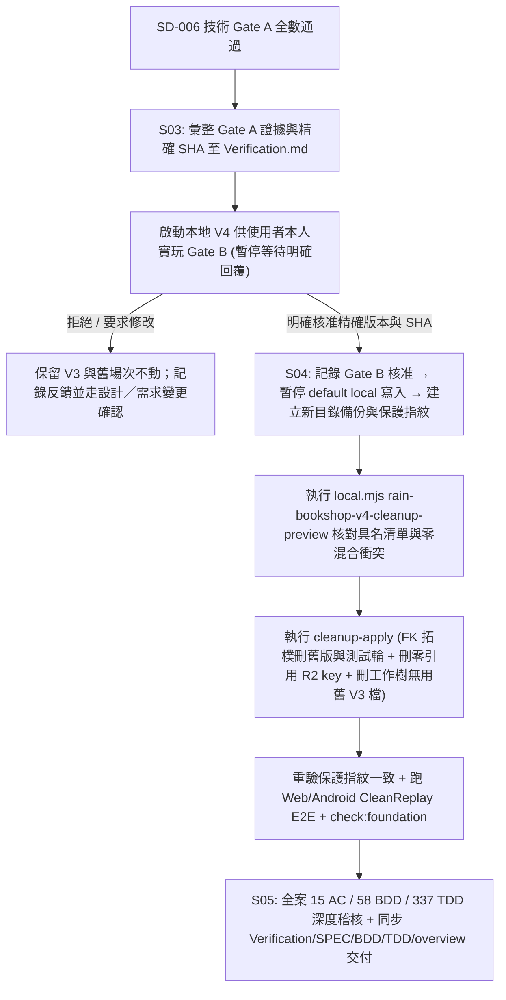

# SD-007-實玩GateB與Local清理結案交付 — 分項實作設計

**功能／工作包 ID**：`SD-007-實玩GateB與Local清理結案交付`
**完整 SPEC 名稱／來源 MVP／SPEC／BDD／TDD**：`SPEC-001-RainBookshopV4`／[MVP-001](../../../../requirements/MVP-001-LoveGameDatingApp.md)、[作者草案 JSON](../../../../requirements/rain-bookshop-v4-draft.json)、[SPEC-001-RainBookshopV4](../../../../specs/SPEC-001-RainBookshopV4.md)、[RiskAudit](../../../../specs/SPEC-001-RainBookshopV4-RiskAudit.md)、[BDD](../../../../bdd/SPEC-001-RainBookshopV4-BDD.md)、[TDD](../../../../tdd/SPEC-001-RainBookshopV4-TDD.md)
**文件包／AI／模型／批次**：`docs/sd/SPEC-001-RainBookshopV4/final`／AI：`ChatGPT`／模型：`GPT-6.2`／批次：`20261126`
**設計版本／契約版本／優先級**：`0.2.0-draft`／`SD-contract-v2`／高（人工 Gate B 關卡、具名 Local 安全清理與最終結案交付）
**執行狀態／驗收狀態／最後更新**：`Planned`／`Incomplete`（整合設計待稽核，產品尚未開發）／2026-11-25
**執行／整合／驗收責任**：唯一寫入、清理工具驗證、全需求深度稽核與最終交付主責：`SD-007` 執行者／DatingHigh 開發主責人；**Gate B 實玩簽認唯一權限：使用者本人（AI 與自動測試嚴禁代簽）**
**來源與程式碼基準、核准設計快照**：見 [SD 總覽 — 來源、程式與設計基準](../00-overview.md#來源程式與設計基準)

## 開發進度總覽

### 整體進度

| 指標 | 完成／總數 | 狀態 |
|---|---:|---|
| 設計 D | 0 / 4 | Draft，待逐項稽核 |
| 本分項主要 TDD 結構映射 | 16 / 16 | 非完整設計涵蓋 |
| 實作驗證 I | 0 / 5 | 0.0% |

### 分層／分組進度追蹤

D、I 唯一來源為本文件 Todo；S 細步不計數。

### 當前 Sprint 狀態

Draft、無產品開發或測試；Gate A、本人 Gate B 及清理均未執行。

### 里程碑

隔離清理驗證準備 → Gate A 精確 SHA → 本人 Gate B → default local 停寫/備份/具名清理 → 乾淨重玩 → 深度稽核與文件同步。

### 關鍵指標

T295 為本人 Gate B；T296～309 及 T334 共15項為清理與乾淨重玩階段；與 Gate A 321項合計337項。最終無降標。

### 每日進度記錄

不適用，驗證證據只放 Verification，不記流水帳。

## 功能概述

本分項負責 `SPEC-001-RainBookshopV4` 的最後三道關鍵關卡（`SPEC §5`、`RB4-AC-013`～`014`、`RQ-04`、`RA-08`）：
1. **具名 Local 安全清理引擎（隔離開發與測試）**：建立 `tools/scene-event-local-policy.mjs` 並掛載至 `tools/local.mjs`（僅限已知 default local，嚴禁 `--remote`），支援 `preview` 與 `apply`：強制檢查 Gate B 核准 SHA、停寫狀態與本地備份存在性；計算受保護表（`accounts`、`user_profiles`、`profile_photos`、`avatar_packages` 等）內容指紋；精確盤點 V1/V2/V3 舊版及具名 V4 驗收測試 Round（若遇到混有非驗收資料或不明引用的混合輪次立即阻斷拒清）；按嚴格 FK 拓樸刪除關聯紀錄（含測試 pair 永久排除與邀請占用，不留孤立聊天或死鎖配對），並以剩餘引用集合 `RetainedShas` 精準刪除無引用的舊 R2 物件（100% 保護 V4 沿用的 18 項共用素材 SHA）。
2. **使用者本人實玩 Gate B 硬性關卡（`RB4-BDD-052` / `RB4-T-295`）**：在 `SD-006` 完成技術 Gate A 後，將完整技術證據與精確 V4 Scene/Narrative SHA 寫入 `docs/verification/SPEC-001-RainBookshopV4-Verification.md`，啟動本地平台供使用者親自試玩，並**強制停止等待使用者本人針對該精確版本與 SHA 給出明確核准**（若使用者拒絕或要求調整，完整保留 V3 與舊場次，絕不自動執行清理，絕不以自動測試代簽）。
3. **實際執行清理、雙端乾淨重玩回歸、全案深度稽核與權威文件同步交付**：取得本人 Gate B 核准後，對 default local 執行停寫→備份→預覽→清理→移除工作樹無用舊 V3 專屬檔案→重啟平台執行 Web 與 Android `CleanReplay`（`RB4-T-308`、`309`）與 `check:foundation` 回歸→執行 `spec-bdd-implementation-deep-audit` 等級之全量逐項比對（若有條件式補漏需求依原責任修補並重驗）→同步更新 `Verification.md`、`SPEC`、`BDD`、`TDD` 唯一進度與受影響之 `overview/` 架構／契約文件（並檢核 Overview 同步矩陣）。

## 功能需求與來源追溯

| MVP／SPEC 項目 | BDD Scenario | TDD 測試項（本包唯一負責之 16 項：9U + 4I + 3E） | 系統設計 ID／本包 Todo／步驟 ID | 驗收條件 | 跨包共同成果與整合責任 |
|---|---|---|---|---|---|
| `RB4-AC-013` | `RB4-BDD-052` GateB（`@manual`） | `RB4-T-295`（1 項人工實玩 E2E） | `SYS-010`／`D02`、`I03`／`S03` | Gate A 完成且有精確 SHA 後由使用者親自遊玩確認；未確認或拒絕時保留 V3 與舊場次；自動測試絕不代簽 | 前置為 `SD-006` Gate A 100% 通過 |
| `AC-005-14`、`22`、`RQ-04`、`RA-08` / `RB4-AC-013` | `RB4-BDD-053` CleanupScope、`RB4-BDD-054` CleanupAtomicity | Unit：`RB4-T-296`～`298`、`300`～`302`（6 項）；Integration：`RB4-T-299`、`303`、`334`（3 項） | `SYS-010`／`D01`、`I01`、`I02`／`S01`、`S02` | 不明環境／未授權／無備份／非驗收混合輪次拒清；FK 拓樸無孤兒、測試 pair 排除與占用不殘留、R2 共用 SHA 不刪、故障可補償重試且保護指紋不變 | 隔離測試於 `S01`～`S02` 執行；真實 local 應用於 `S04`（Gate B 後） |
| `AC-005-14`、`22` / `RB4-AC-014` | `RB4-BDD-055` CleanReplay | Unit：`RB4-T-304`～`306`（3 項）；Integration：`RB4-T-307`（1 項）；E2E：`RB4-T-308`（Web）、`RB4-T-309`（Android）（2 項） | `SYS-010`／`D03`、`D04`、`I01`、`I02`、`I04`、`I05`／`S01`、`S02`、`S04`、`S05` | 清理後正式索引只剩 V4、舊版不可選無舊歷史恢復；新配對→進場→結局→聊天→重玩→退出在雙端完整可用；全部 Gate 證據齊全並完成文件同步才結案 | 呼叫 `SD-006` 已建置之 `CleanReplay` Web/Android E2E 腳本驗證全系統最終狀態 |

### BDD 行為與產品實作分解

| BDD Scenario／條件或 Examples | 角色／Given | When／操作 | Then／And／But 各結果與副作用 | 實際產品 F-ID／符號／核心分支 | 必要 S／I／V／跨包成果 |
|---|---|---|---|---|---|
| `RB4-BDD-052` GateB（`@manual`） | 使用者本人／Gate A 已完成且具備精確 V4 SHA | 使用者實際遊玩完整體驗並明確回覆核准或拒絕 | 明確核准該精確 SHA 才解鎖 `S04` 清理；拒絕或待確認時 100% 保留 V3 檔案與舊場次、保持停止等待 | `F-06` `SPEC-001-RainBookshopV4-Verification.md`（Gate B 簽認紀錄）＋`F-01` `assertGateBApprovalMatchesBundle` | `SD-007-S03`／`I03`／`V-003`；前置 `SD-006` |
| `RB4-BDD-053` CleanupScope & `RB4-BDD-054` CleanupAtomicity | 本地維運執行者／Gate B 已核准、已知 default local 已停寫並備份 | 執行預覽、注入未知環境／混合輪次／D1 或 R2 故障並重試清理 | 未知環境、無備份、未核准 SHA 或混合非驗收輪立即拒清並列衝突；合法具名集合依 FK 順序刪除零孤兒、清除測試 pair 排除、僅刪零剩餘引用之 R2 物件、保護指紋分毫不差 | `F-01` `previewRainBookshopV4Cleanup`、`applyRainBookshopV4Cleanup`、`F-02` `tools/local.mjs` | `SD-007-S01`、`S02`、`S04`／`I01`、`I02`、`I04`／`V-001`、`V-002`、`V-004` |
| `RB4-BDD-055` CleanReplay | 雙真人玩家／清理完成且正式索引只剩 V4 | 重新配對、進場、完成結局、聊天、雙同意重玩與安全退出 | 舊版不可選、無舊 SHA 殘留；Web 與 Android 完整可玩；全案 15 AC / 58 BDD / 337 TDD 證據齊備才結案 | `F-01`、`F-03`（移除舊 V3 無用檔）、`F-06`、`F-07`（搭配 `SD-006` `CleanReplay` runner） | `SD-007-S01`、`S02`、`S04`、`S05`／`I01`、`I02`、`I04`、`I05`／`V-001`、`V-002`、`V-004`、`V-005` |

## 用戶故事

- 作為**專案負責人與真實試玩者**，我想要親自試玩確認 V4 的節奏、溫度與細節完全滿意後才親手簽准上線取代舊版，並在清理測試與舊版垃圾資料時 100% 確保帳號、個資、照片、化身與共用素材毫髮無傷。

## 畫面操作／系統處理流程

### 畫面、元件與互動分解（適用時）

本包不新增產品 UI 元件；`RB4-BDD-055`（`CleanReplay`）之正式 Web 與 Android 畫面體驗直接建立在 `SD-004`、`SD-005` 已交付的 `StoryExperienceScreen` 組件樹上，並透過 `SD-006` 建置之雙端 E2E 腳本於清理後實際執行驗收。

## 技術規範與實作設計

### 架構、DDD 與責任

- 所屬層級：本地安全維運工具層（`tools/`）＋跨模組本地升級整合測試（`cloudflare/tests/`）＋權威驗證與架構文件層（`docs/`、`overview/`）。

### 重要函式、核心邏輯與狀態

| 核心 ID／目標類別或函式 | 輸入／輸出與前後置條件 | 演算法／分支／偽碼 | 交易／併發／冪等／重試 | 錯誤語意／驗證 |
|---|---|---|---|---|
| `C07-1`：`computeProtectedDataFingerprint`（`F-01`） | 輸入唯讀 D1/SQLite 連線與 R2 共用 SHA 列表；輸出確定性指紋物件 | 查詢並雜湊 `accounts`、`account_credentials`、`auth_session_families`、`user_profiles`、`profile_photos`、`avatar_packages`、`avatar_assets` 全部列（不含執行期臨時票券），並核對 V4 正式包引用的全部 80 項 R2 物件（含 18 項 V3 共用 SHA）存在且 SHA 相符。 | 純唯讀快照比對。 | 清理前後指紋任一欄不一致立即拋出嚴重阻斷錯誤。 |
| `C07-2`：`previewRainBookshopV4Cleanup` & `applyRainBookshopV4Cleanup`（`F-01`、`F-02`） | 輸入 `{ localEnv, approvedV4SceneSha, approvedV4StorySha, namedTestRoundIds, backupDir, verificationDocText }` | 1. 呼叫 `local-policy.mjs` 確認目標為已知 default local（拒 `--remote` 或未知路徑），確認寫入已停、備份目錄非空且 `verificationDocText` 含該精確 SHA 之本人 Gate B 核准記錄； 2. 掃描含舊版 `rain-bookshop`（`v1`/`v2`/`v3`）之 Rounds 及 `namedTestRoundIds`：若發現某 Round 同時含非驗收帳號／其他未知故事且未列於具名清單，立即阻斷並回傳衝突報告； 3. `apply` 時依系統設計 `CORE-05` 第 5 點之 實際 FK 拓樸順序於交易內刪除 D1 紀錄（只含具名、無其他引用的 match_invitations；排除狀態沿既有 round／invitation，不創造額外資料表）； 4. 計算剩餘引用 `RetainedShas`，只刪具名 preview 所列且不在 RetainedShas 的舊物件，記錄重試清單支援中斷續跑冪等完成； 5. 再次執行 `computeProtectedDataFingerprint` 確認 100% 相等。 | D1 交易原子性＋R2 剩餘引用差集冪等重試（R2 中途失敗保留待刪清單，重跑可安全完成且不假報成功）。 | `RB4-T-296`～`307`、`334` 完整覆蓋。 |

### 契約、資料與平台

- **嚴守本地與備份規範（`AGENTS.md`）**：本地命令只能經 `tools/local.mjs` wrapper 指向已知 local instance；備份前先暫停寫入，還原驗證只建新目錄，**絕對禁止把 local 操作換成 `--remote` 旗標，絕對禁止修改其他專案的程序或資料**。
- **Overview 同步矩陣核對（`S05` 必做）**：
  - `overview/01-architecture/04-module-map.md`：同步新增之 Domain `SceneEventV4Policy`、前端 V4 舞台／書牆／彩蛋／救書／小票元件與 `tools/rain-bookshop-v4-*` 模組職責。
  - `overview/03-contracts/01-api-contracts.md`：同步 `GET /experience` 與 `POST /story/event` 之 `scene-event.v3` 白名單 action／Actor-Scoped 投影結構及內部私有 `story.framework.system.reconcile` 說明。
  - `overview/03-contracts/02-data-contracts.md`：同步 `scene-event.v3` JSON state 結構、可配置 `durationSeconds`、書籤 0–20 scalar 規則與 V4 為唯一首場正式版本說明。
  - 其餘未受影響之 overview 文件（`01-system-overview`、`02-layer-boundary`、`03-runtime-flow`、`05-dependency-map`、`02-development-guidelines`、`04-deployment` — 因維持 21 表 0 新欄、0 新公開路由、0 新套件、0 新環境變數）於交付時逐項核對並明確說明無影響原因。

### 共用與改動合理性

- 將所有權威文件（`Verification.md`、`SPEC`、`BDD`、`TDD`、`overview/`）的最終同步寫入集中在本包唯一處理，徹底杜絕多包並行搶寫同一份 Markdown 造成的覆寫或計數不一致。

### 實際 SQLite FK、local wrapper 與補償契約

本包使用現有 0004–0007 migration 及既有 tools/local.mjs 的 publisher/cleanup 共用執行界線，F02 **只負責新增 V4 清理分支**；SD001 F13 只改 scene-publish 分支，兩者不可覆寫同一處。舊名 game_round_participants 已改為 game_active_round_claims；game_interaction_instances 已於 0007 DROP，不能假設還存在。

1. preview 僅對 validateSceneEventTarget 已知 default local；讀取 Gate A SHA、本人體驗同一 SHA 核准證據、正式 V4 scene/narrative pinned IDs、具名 acceptance round IDs。列出 V1/V2/V3 舊 catalog、每個 round 所有 session／scene visit／events／claim／invitation；混合含其他非測試內容或不明 reference 整體阻斷，不以 prefix 或 player identity 廣刪。確認列出的舊版／具名驗收 round 與實際 catalog 引用完全一致。輸出唯一預覽 manifest SHA（只寫 Verification 或既有備份位置，不另造日誌）。
2. apply 先 withPausedWrites＋backupPath 備份及重讀 preview，同一 manifest SHA 和 Gate B 核准、目標、完整 FK 清冊與 protected fingerprint 一致才可做破壞性動作。逐表白名單由 PRAGMA foreign_key_list 與 0004–0007 驗證：game_event_instances、game_story_participant_progress、game_scene_visits 先於 game_story_sessions；game_round_events、game_active_round_claims 與 sessions 先於 game_rounds；具名舊 round 確認後其 invitation 才能刪 match_invitations（不得清其他邀請或無關配對）。舊 content_story_catalog 無剩餘 session 引用才可清除；content_scene_category_links 及 scene catalog 依 FK／剩餘引用清理，categories 共用則保留。不刪 auth_accounts、user profile、match_conditions 或其他業務資料。D1 以現有批次/guard 機制驗 rows 與 FK，差異即 rollback。
3. R2 不是 D1 同一交易：DB 成功提交後重新核對完整保留版本的 asset/manifest SHA 引用與保護 key 集合；只刪無引用且 preview 精確列名的舊 STORY_CONTENT blobs；FILES 私有素材保持原 fingerprint，禁止 prefix delete。若 R2 部分失敗，保留 D1 已完成狀態與尚未完成 key 清單、僅重試剩餘無引用清除；不可稱跨 D1/R2 atomic。失敗停止不放行 Gate B 後驗收。
4. F01/F02 新增固定 rain-bookshop-v4-cleanup-preview/apply；沿用 local.mjs 實際命令解析和 target validator，apply 只接受明確的 preview SHA 與具名確認，不接受遠端 target 或任意 SQL。F04/F05 unit 與隔離真 D1/R2 測缺 Gate B、SHA 變更、錯目標、混合輪次、未知 FK、回滾及補償重試；S04 才可實際 default local 清除。
5. 清除後真 default local 讀回無目標 round/receipt/claim/舊 catalog 引用，保護資料指紋完全一致，新增非驗收的全新合法配對能正常啟動 V4；SD006 runner 的 CleanReplay T308/309 各真平台通過；只有全量 337 TDD 實證才完成 15 AC／58 BDD／結案。任何缺驗收須停止，不重複刪除。

## 檔案改動設計

### F-01：`tools/scene-event-local-policy.mjs` 與 `F-02`：`tools/local.mjs`

- 改動類型：新增 `F-01`＋修改 `F-02`
- 目標類別／函式／區段與現況證據：建立 V4 具名 Local 安全清理核心策略並在 `tools/local.mjs` 註冊 `rain-bookshop-v4-cleanup-preview` 與 `rain-bookshop-v4-cleanup-apply` 子命令。
- 對應 SYS／SPEC／BDD／TDD／Todo／負責步驟：`SYS-010`／`RB4-AC-013`、`014`、`RQ-04`、`RA-08`／`RB4-BDD-052`～`055`／`RB4-T-296`～`307`、`334`／`SD-007-D01`、`I01`、`I02`、`I04`／`S01`、`S02`、`S04`
- 改動要點與必要核心邏輯：實作 `C07-1`、`C07-2`，強制驗 Gate B 簽認、default local、備份存在、混合輪阻斷、FK 拓樸刪除、R2 剩餘引用保護與結案閘門檢查。
- 此檔案的責任與白話設計原因：確保舊版與驗收測試垃圾清除 100% 安全可控、可預覽、可重試且絕不傷及個資與共用資產。
- 輸入／輸出、介面及契約限制：傳入 `--remote` 或未知環境參數時立即拋錯退出。
- 前置依賴：`SD-001` 發布結構定案。
- 寫入責任、共用責任與可寫區段：`SD-007` 唯一寫入。
- 驗證方式與預期結果：`V-001`、`V-002` 隔離測試與 `V-004` 實際預覽清理通過。
- 實際證據回填位置：`V-001`、`V-002`、`V-004`（待回填）。

### F-03：移除僅舊版 V3 使用之無用內容、腳本與未引用舊素材（Gate B 核准後專屬步驟）

- 改動類型：刪除（精確具名範圍：`contracts/rain-bookshop-before-rain-stops.json`、`tools/rain-bookshop-v3-policy.mjs`，以及 `contracts/story-assets/` 下經 `RetainedShas` 比對確認**未被 `contracts/rain-bookshop-v4.json` 或任何保留測試／化身契約引用**之舊 V3 專屬素材；V4 `reuseFromV3: true` 之 18 項資產 100% 保留！）
- 目標類別／函式／區段與現況證據：現行工作樹存有舊版 V3 內容包與建置腳本；依 `SPEC §5` 第 4 點於 Gate B 核准後清理，並同步清理殘留僅測舊版已被廢止之無用 fixture 引用（保留通用可重用框架測試與 `docs/alldonejobs/` 歷史文件不動）。
- 對應 SYS／SPEC／BDD／TDD／Todo／負責步驟：`SYS-010`／`RB4-AC-013`、`014`／`RB4-BDD-053`～`055`／`SD-007-D03`、`I04`／`S04`
- 改動要點與必要核心邏輯：以程式引用掃描確認零剩餘引用後才移除，嚴禁按檔名 wildcard 盲刪。
- 此檔案的責任與白話設計原因：讓 V4 成為唯一首場正式可玩版本，不留無用舊劇本與死資產。
- 輸入／輸出、介面及契約限制：**硬性約束：未取得使用者本人 Gate B 明確核准前，絕對禁止觸碰此項刪除！**
- 前置依賴：`SD-007-S03` 使用者本人 Gate B 核准完成。
- 寫入責任、共用責任與可寫區段：`SD-007` 唯一執行。
- 驗證方式與預期結果：刪除後 `npm run check:foundation`、`npm test`、`npm run test:server`、`npm run test:worker`、`npm run test:client` 及雙端 `CleanReplay` 100% 通過。
- 實際證據回填位置：`V-004`（待回填）。

### F-04：`tools/tests/rain-bookshop-v4-cleanup-policy.test.mjs` 與 `F-05`：`cloudflare/tests/scene-event-local-upgrade.integration.test.ts`

- 改動類型：新增 `F-04`＋修改 `F-05`
- 目標類別／函式／區段與現況證據：實作本包負責之 9 項清理與結案閘門 Unit TDD（`RB4-T-296`～`298`、`300`～`302`、`304`～`306`）與 4 項真 Miniflare D1/R2 升級清理 Integration TDD（`RB4-T-299`、`303`、`307`、`334`）。
- 對應 SYS／SPEC／BDD／TDD／Todo／負責步驟：`SYS-010`／`RB4-AC-013`、`014`／`RB4-BDD-053`～`055`／`SD-007-I01`、`I02`／`S01`、`S02`
- 改動要點與必要核心邏輯：在隔離測試資料庫與模擬 R2 上完整注入未知環境、未簽 Gate B、無備份、混合非驗收輪次、共享 R2 SHA、D1/R2 中途故障與重試、以及清理後乾淨配對重玩。
- 此檔案的責任與白話設計原因：在真正對 default local 執行清理前，先用 100% 自動化故障注入證明清理程式絕對安全無誤。
- 輸入／輸出、介面及契約限制：純隔離實例執行，不影響本機開發庫。
- 前置依賴：隨 `S01`、`S02` Red-Green 撰寫。
- 寫入責任、共用責任與可寫區段：`SD-007` 唯一寫入。
- 驗證方式與預期結果：`npm test` 與 `npm --prefix cloudflare test -- scene-event-local-upgrade` 全綠。
- 實際證據回填位置：`V-001`、`V-002`（待回填）。

### F-06：`docs/verification/SPEC-001-RainBookshopV4-Verification.md` 與 `F-07`：來源規格／`overview/` 同步更新

- 改動類型：修改（`F-06`：`docs/verification/SPEC-001-RainBookshopV4-Verification.md`；`F-07`：`docs/specs/SPEC-001-RainBookshopV4.md`、`docs/bdd/SPEC-001-RainBookshopV4-BDD.md`、`docs/tdd/SPEC-001-RainBookshopV4-TDD.md`、`overview/01-architecture/04-module-map.md`、`overview/03-contracts/01-api-contracts.md`、`overview/03-contracts/02-data-contracts.md`）
- 目標類別／函式／區段與現況證據：就地回寫全案真實測試與實作行號證據、Gate A 報告、使用者本人 Gate B 簽認、Local 清理保護指紋、全部已驗證 checkbox 與受影響之 `overview/` 架構契約。
- 對應 SYS／SPEC／BDD／TDD／Todo／負責步驟：`SYS-010`／`RB4-AC-012`～`015`、`AGENTS.md`／`SD-007-D02`、`D04`、`I03`、`I05`／`S03`、`S05`
- 改動要點與必要核心邏輯：嚴守 `AGENTS.md` 零歷史流水帳規則（保持 `TDD` 與 `BDD` 只有唯一現行進度區段，通過 `auditDevelopmentDocuments` 規則檢查），每項 `verified` 均附真實實作檔與測試檔精確路徑行號；未驗項絕不勾選。
- 此檔案的責任與白話設計原因：集中提供單一權威驗收證據鏈並保持專案 `overview/` 與最新正式實作 100% 同步。
- 輸入／輸出、介面及契約限制：執行 `git diff --check` 與連結存在性掃描零錯誤。
- 前置依賴：`S03`（Gate A 完成）寫入前半；`S05`（Gate B 與清理重玩全部完成）寫入最終結案。
- 寫入責任、共用責任與可寫區段：`SD-007` 唯一寫入。
- 驗證方式與預期結果：`git diff --check` 與全量追溯稽核 100% 通過。
- 實際證據回填位置：`V-003`、`V-005`（待回填）。

### Gate 分界與既有工具唯一寫入

沿用 `tools/scene-event-local-policy.mjs` 的 `validateSceneEventTarget`、`planSceneEventUpgrade`、`applySceneEventUpgrade` 既有 local 邊界；新增明確 V4 preview/apply helper 不破壞既有遷移責任；`tools/local.mjs` 固定具名命令、不新建平行 wrapper、不接受 remote。SD-006 Gate A 321 個唯一 TDD ID 通過後啟用同一精確 SHA；SD-007 T295 本人 Gate B 核准之前不得實際停寫或清理 default local。S01/S02 可在隔離真 D1/R2 建立測試，但不得拿隔離證據代簽實際清理後的完整來源條件；T296～309/334 是後段 15 個 ID。最終 337/337。

## 有序實作與驗證步驟

### 步驟順序與起始關卡

| 步驟 ID／成果 | 唯一負責 I-ID／來源 | 前置步驟及所需結果／跨包契約 | F-ID／V-ID | 通過後可開始的下一步／條件 | 執行狀態／證據位置 |
|---|---|---|---|---|---|
| `SD-007-S01`：具名 Local 清理範圍、保護指紋、FK 拓樸與結案閘門規則單元實作 | `SD-007-I01`／`RB4-BDD-053`～`055`、`RB4-T-296`～`298`、`300`～`302`、`304`～`306` | `SD-006` Gate A 完成（或隔離先行準備單元邏輯） | `F-01`、`F-02`、`F-04`／`V-001` | `SD-007-S02`（9 項清理 Unit 全綠） | `Planned`；待回填 |
| `SD-007-S02`：混合輪次阻斷、D1/R2 故障重試補償、共用 SHA 保護與隔離乾淨重玩整合測試 | `SD-007-I02`／`RB4-BDD-053`～`055`、`RB4-T-299`、`303`、`307`、`334` | `SD-007-S01` 通過 | `F-01`、`F-05`／`V-002` | `SD-007-S03`（4 項真 Miniflare 升級清理整合全綠） | `Planned`；待回填 |
| `SD-007-S03`：寫入 Gate A 完整證據至 `Verification.md`、啟動本地體驗並**暫停等待使用者本人實玩 Gate B 核准** | `SD-007-I03`／`RB4-AC-012`、`013`、`RB4-BDD-052`、`RB4-T-295` | `SD-006` Gate A 與 `SD-007-S02` 全部通過 | `F-06`／`V-003` | `SD-007-S04`（**硬性關卡：必須取得使用者本人對精確 V4 SHA 的明確核准訊息**） | `Planned`；待回填 |
| `SD-007-S04`：執行已知 Default Local 停寫備份、具名清理、舊 V3 無用檔移除與 Web／Android 乾淨重玩回歸 | `SD-007-I04`／`RB4-AC-013`、`014`、`RB4-BDD-053`～`055`、`RB4-T-308`、`309` | `SD-007-S03` 已取得使用者本人明確核准精確 V4 SHA | `F-01`、`F-02`、`F-03`、`F-06`／`V-004` | `SD-007-S05`（保護指紋一致、雙端 `CleanReplay` 與全基礎測試通過） | `Planned`；待回填 |
| `SD-007-S05`：全需求 15 AC／58 BDD／337 TDD 深度稽核、條件式補漏檢核與 `Verification`/`SPEC`/`BDD`/`TDD`/`overview` 最終同步交付 | `SD-007-I05`／全案收尾與 Overview 同步矩陣 | `SD-007-S04` 通過 | `F-06`、`F-07`／`V-005` | `SPEC-001-RainBookshopV4` 100% 正式結案交付（可進入下一份 `AffectionAndFeedback`） | `Planned`；待回填 |

### SD-007-S01：具名 Local 清理範圍、保護指紋、FK 拓樸與結案閘門規則單元實作

**對應成果與責任**：唯一負責 `SD-007-I01`；來源 `RB4-AC-013`、`014`、`RB4-BDD-053`～`055`、`RB4-T-296`～`298`、`300`～`302`、`304`～`306`（9 項 Unit）；檔案 `F-01`、`F-02`、`F-04`；驗證 `V-001`。
**開始條件與前置證據**：`SD-006` 完成。
**必讀工作範圍**：`tools/local.mjs`、`tools/local-policy.mjs`、`tools/scene-event-local-policy.mjs`、`SPEC-001-RainBookshopV4.md` §5、§6.2（`RQ-04`）、§6.3（`RA-08`）。
**可寫檔案／符號及禁止改動**：`F-01`、`F-02`、`F-04`；此步驟絕不對真實本機環境執行刪除。
**產品改動與 BDD／畫面關聯**：實作 `previewRainBookshopV4Cleanup`、`applyRainBookshopV4Cleanup`、`computeProtectedDataFingerprint` 與結案守門檢查器。
**具體行為與核心邏輯**：拒絕 `--remote`、未知目錄、無備份或無本人 Gate B 核准 SHA；精確輸出 10 張關聯表刪除拓樸與 R2 `RetainedShas` 差集。
**允許自行決定的局部細節**：預覽 JSON 欄位排版。

#### 測試資料與預期結果

| 案例 ID／來源與類型 | fixture／輸入及初始狀態 | 預期輸出／錯誤／狀態 | 必要斷言與副作用 | V-ID／測試位置 |
|---|---|---|---|---|
| `C07-S01-1`／`RB4-T-296`～`298`、`300`～`302`、`304`～`306` 清理與結案單元驗證 | 傳入 `--remote`、未知路徑、缺備份、缺 Gate B、含共用 SHA 之 R2 清單、故障補償清單與缺 Gate 證據之結案請求 | 非法條件 100% 拒絕；FK 順序無孤兒、測試 pair 排除列入清除、共用 SHA 與帳號個資化身 100% 保護、缺任何 Gate 證據禁止結案 | 9 項單元斷言全命中 | `V-001`／`tools/tests/rain-bookshop-v4-cleanup-policy.test.mjs` |

#### 本步操作次序與判定

| 順序／子階段 | 操作與目標符號 | 工作目錄 | 命令／測試選擇器或畫面操作 | 預期結果與判定 | 實際結果／證據回填位置 |
|---|---|---|---|---|---|
| 1／Red | 新增 `F-04` 9 項單元案例 | `C:\GitProjects\gamenenstyle\datinghigh` | `node --test tools/tests/rain-bookshop-v4-cleanup-policy.test.mjs` | 因 `F-01` 尚未建立而失敗 | 待回填 |
| 2／Green | 實作 `F-01` 與 `F-02` 子命令接線 | `C:\GitProjects\gamenenstyle\datinghigh` | `node --test tools/tests/rain-bookshop-v4-cleanup-policy.test.mjs` | 9 項案例全通過 | 待回填 |
| 3／必要 Refactor 與回歸 | 跑根目錄工具測試 | `C:\GitProjects\gamenenstyle\datinghigh` | `npm test` | 100% 通過，完成 `SD-007-I01` | 待回填 |

**本步通過條件**：`RB4-T-296`～`298`、`300`～`302`、`304`～`306` 全綠。
**必須停止的情況與回報內容**：前置、必要環境或驗收斷言不成立而需改設計時停止，不降低規格。
**可在本步修正的範圍**：`F-01`、`F-02`、`F-04`。
**下一步與起始條件**：`SD-007-S02`。
**實際執行狀態／目前子階段／證據**：待回填。
**中斷與恢復資訊**：無外部狀態變更。

### SD-007-S02：混合輪次阻斷、D1/R2 故障重試補償、共用 SHA 保護與隔離乾淨重玩整合測試

**對應成果與責任**：唯一負責 `SD-007-I02`；來源 `RB4-BDD-053`～`055`、`RB4-T-299`、`303`、`307`、`334`（4 項真 Miniflare Integration）；檔案 `F-01`、`F-05`；驗證 `V-002`。
**開始條件與前置證據**：`SD-007-S01` 通過。
**必讀工作範圍**：`cloudflare/tests/scene-event-local-upgrade.integration.test.ts`、`RiskAudit` `G13`。
**可寫檔案／符號及禁止改動**：`F-01`、`F-05`。
**產品改動與 BDD／畫面關聯**：在真 Miniflare D1（開啟 `PRAGMA foreign_keys = ON`）與模擬 R2 上驗證混合非驗收輪阻斷、D1/R2 故障注入後重試完成、18 項共用素材 SHA 保護不刪，以及清理後新配對只能選到 V4 並完整玩完。
**具體行為與核心邏輯**：確保清理後 `PRAGMA foreign_key_check` 回傳 `0` 筆違規，且保護資料指紋前後完全一致。
**允許自行決定的局部細節**：測試 seed 輔助函式。

#### 測試資料與預期結果

| 案例 ID／來源與類型 | fixture／輸入及初始狀態 | 預期輸出／錯誤／狀態 | 必要斷言與副作用 | V-ID／測試位置 |
|---|---|---|---|---|
| `C07-S02-1`／`RB4-T-299`、`303`、`307`、`334` 隔離升級清理全驗證 | 真 Miniflare D1+R2：含帳號／個資／照片／化身、V1～V3 舊輪、具名 V4 測試輪、非測試混合輪及 R2 故障注入 | 混合輪次精確阻斷拒清；合法具名集合清理後無 FK 孤兒、測試排除不殘留、18 共用 SHA 保留、保護指紋相等，隨後新配對 V4 開局→結局→聊天→重玩→退出全通 | 故障重試冪等成功不假報 | `V-002`／`scene-event-local-upgrade.integration.test.ts` |

#### 本步操作次序與判定

| 順序／子階段 | 操作與目標符號 | 工作目錄 | 命令／測試選擇器或畫面操作 | 預期結果與判定 | 實際結果／證據回填位置 |
|---|---|---|---|---|---|
| 1／Red | 於 `F-05` 新增 `RB4-T-299`、`303`、`307`、`334` | `C:\GitProjects\gamenenstyle\datinghigh` | `npm --prefix cloudflare test -- scene-event-local-upgrade` | 針對細部 SQLite/R2 補償先行驗證紅燈 | 待回填 |
| 2／Green | 完善 `F-01` 交易與補償細節通過全部整合案例 | `C:\GitProjects\gamenenstyle\datinghigh` | `npm --prefix cloudflare test -- scene-event-local-upgrade` | 4 項與既有升級測試全綠 | 待回填 |
| 3／必要 Refactor 與回歸 | 跑完整 Worker 測試套件 | `C:\GitProjects\gamenenstyle\datinghigh` | `npm run test:worker` | 100% 通過，完成 `SD-007-I02` | 待回填 |

**本步通過條件**：`RB4-T-299`、`303`、`307`、`334` 全綠。
**必須停止的情況與回報內容**：前置、必要環境或驗收斷言不成立而需改設計時停止，不降低規格。
**可在本步修正的範圍**：`F-01`、`F-05`。
**下一步與起始條件**：`SD-007-S03`。
**實際執行狀態／目前子階段／證據**：待回填。
**中斷與恢復資訊**：Miniflare 隔離測試，本機 default local 尚未觸碰。

### SD-007-S03：寫入 Gate A 完整證據至 `Verification.md`、啟動本地體驗並暫停等待使用者本人實玩 Gate B 核准

**對應成果與責任**：唯一負責 `SD-007-I03`；來源 `RB4-AC-012`、`013`、`RB4-BDD-052`（`@manual`）、`RB4-T-295`；檔案 `F-06`；驗證 `V-003`。
**開始條件與前置證據**：`SD-006` Gate A 與 `SD-007-S02` 已 100% 通過。
**必讀工作範圍**：`docs/verification/SPEC-001-RainBookshopV4-Verification.md`、`AGENTS.md` Gate B 必守規則（「劇情 Gate B 必須由使用者人工試玩確認……自動測試與技術回放不能代替人工確認」）。
**可寫檔案／符號及禁止改動**：僅更新 `F-06`（寫入 Gate A 全部實測證據與精確 V4 Scene/Narrative SHA，將 `RB4-BDD-052`/`RB4-T-295` 標示為 `gate` 等待使用者實玩）；**嚴禁執行任何舊版刪除或勾選 `RB4-T-295`**。
**產品改動與 BDD／畫面關聯**：人工實玩審驗關卡（`RB4-BDD-052`）。
**具體行為與核心邏輯**：確認本地平台（`npm run dev:platform`）已發布並運行該精確 V4 SHA，向使用者清楚呈報精確版本、Scene SHA256、Narrative SHA256、試玩入口與 Gate A 報告連結，然後**立即停止呼叫後續寫入工具，等待使用者本人實際遊玩後回覆**。
**允許自行決定的局部細節**：無。

#### 測試資料與預期結果

| 案例 ID／來源與類型 | fixture／輸入及初始狀態 | 預期輸出／錯誤／狀態 | 必要斷言與副作用 | V-ID／測試位置 |
|---|---|---|---|---|
| `C07-S03-1`／`RB4-T-295` 使用者本人實玩 Gate B | 本地運行中之精確 V4 版本與 SHA | 使用者本人明確回覆核准該精確版本與 SHA → 寫入 `Verification.md` 核准日期、對話依據與精確 SHA；若使用者未確認或提出修改意見 → 保持 V3 與舊場次完整不動並停止清理 | 絕不由 runner、subagent 或沉默代簽 | `V-003`／`docs/verification/SPEC-001-RainBookshopV4-Verification.md` |

#### 本步操作次序與判定

| 順序／子階段 | 操作與目標符號 | 工作目錄 | 命令／測試選擇器或畫面操作 | 預期結果與判定 | 實際結果／證據回填位置 |
|---|---|---|---|---|---|
| 1／寫入 Gate A 報告與啟動試玩環境 | 更新 `F-06` Gate A 證據並確認本地平台運行精確 V4 SHA | `C:\GitProjects\gamenenstyle\datinghigh` | `npm run dev:platform` | 平台健康運行，輸出精確 SHA 供使用者核對 | 待回填 |
| 2／人工關卡暫停與回填 | 停止等待使用者實玩回覆；收到明確核准後將核准依據寫入 `F-06` | `C:\GitProjects\gamenenstyle\datinghigh` | 使用者本人實玩並於對話明確核准精確版本／SHA | 取得明確核准紀錄後 `SD-007-I03` 方為 `Verified` | 待回填 |

**本步通過條件**：`Verification.md` 已完整記錄使用者本人對當前精確 V4 SHA 的明確 Gate B 核准。
**必須停止的情況與回報內容**：**尚未收到使用者本人明確核准前，本步強制保持暫停（`Blocked` / 等待人工確認），嚴禁進入 `SD-007-S04`！** 若使用者試玩後要求修改劇情或設計，依 P5 保存回饋並走確認流程。
**可在本步修正的範圍**：僅 `F-06` 文件記錄格式。
**下一步與起始條件**：取得本人 Gate B 明確核准後啟動 `SD-007-S04`。
**實際執行狀態／目前子階段／證據**：待回填。
**中斷與恢復資訊**：恢復時先核對使用者最新回覆與 `Verification.md` 中記錄的待審 SHA 是否與現行 `contracts/rain-bookshop-v4.json` 一致。

### SD-007-S04：執行已知 Default Local 停寫備份、具名清理、舊 V3 無用檔移除與 Web／Android 乾淨重玩回歸

**對應成果與責任**：唯一負責 `SD-007-I04`；來源 `RB4-AC-013`、`014`、`RB4-BDD-053`～`055`、`RB4-T-308`（Web）、`RB4-T-309`（Android）；檔案 `F-01`、`F-02`、`F-03`、`F-06`；驗證 `V-004`。
**開始條件與前置證據**：`SD-007-S03` 已取得使用者本人對精確 V4 SHA 的明確 Gate B 核准並寫入 `Verification.md`。
**必讀工作範圍**：`SPEC-001-RainBookshopV4.md` §5、`AGENTS.md` 本地備份與 wrappers 規範。
**可寫檔案／符號及禁止改動**：透過 `tools/local.mjs` 操作已知 default local 備份與清理，並刪除 `F-03` 具名舊 V3 無用檔案；嚴禁 `--remote`、嚴禁觸碰帳號／個資／照片／化身／共用素材。
**產品改動與 BDD／畫面關聯**：完成舊版與驗收測試輪實際清理，使 V4 成為唯一首場正式版本，並在乾淨環境雙端重驗配對→進場→結局→聊天→重玩→退出。
**具體行為與核心邏輯**：1. 暫停本地平台寫入並建立本地備份與保護指紋；2. 執行 `cleanup-preview` 核對無混合輪衝突；3. 執行 `cleanup-apply` 並確認保護指紋 100% 相等、`PRAGMA foreign_key_check` 無孤兒；4. 移除 `F-03` 無用舊檔；5. 重啟本地平台執行 `check:foundation`、Web `CleanReplay`（`RB4-T-308`）與 Android `CleanReplay`（`RB4-T-309`）。
**允許自行決定的局部細節**：本地備份時間戳子目錄名稱（依 `tools/local.mjs` 既有慣例）。

#### 測試資料與預期結果

| 案例 ID／來源與類型 | fixture／輸入及初始狀態 | 預期輸出／錯誤／狀態 | 必要斷言與副作用 | V-ID／測試位置 |
|---|---|---|---|---|
| `C07-S04-1`／Default Local 實際清理與保護指紋核對 | 已停寫並備份之已知 default local | 舊版 V1～V3 與具名 V4 驗收測試輪完整清除；帳號、個資、照片、化身與 18 項共用 R2 SHA 保護指紋前後 100% 一致 | 混合非驗收資料若存在則立即中止回報 | `V-004`／`tools/local.mjs` 輸出與 `Verification.md` |
| `C07-S04-2`／`RB4-T-308`、`309` 清理後雙端乾淨重玩與全套回歸 | 清理後僅剩 V4 正式索引之乾淨本地環境 | 舊版不可選、無舊歷史恢復；Web 與 Android 全新配對→進場→結局→聊天→雙同意重玩→安全退出全部通過；`check:foundation` 全綠 | 證明移除 `F-03` 後全系統無任何殘留舊引用斷裂 | `V-004`／`scene-event-v4.spec.ts` + `scene-event-v4.mjs` |

#### 本步操作次序與判定

| 順序／子階段 | 操作與目標符號 | 工作目錄 | 命令／測試選擇器或畫面操作 | 預期結果與判定 | 實際結果／證據回填位置 |
|---|---|---|---|---|---|
| 1／停寫、備份與預覽 | 暫停本地寫入、備份並執行清理預覽 | `C:\GitProjects\gamenenstyle\datinghigh` | `node tools/local.mjs rain-bookshop-v4-cleanup-preview` | 輸出精確待清清單、衝突數為 `0`、保護指紋已記錄 | 待回填 |
| 2／執行清理與移除無用舊檔 | 執行本地清理並移除 `F-03` 僅舊版使用之檔案 | `C:\GitProjects\gamenenstyle\datinghigh` | `node tools/local.mjs rain-bookshop-v4-cleanup-apply` | 清理成功、FK 檢查 `0` 錯誤、前後保護指紋 100% 相等 | 待回填 |
| 3／乾淨重玩與全系統回歸（序列執行） | 重建匯出並依序跑全模組回歸、Web `CleanReplay` 與 Android `CleanReplay` | `C:\GitProjects\gamenenstyle\datinghigh` | `npm --prefix frontend/client run export:web && npm run build:e2e-host && npm run check:foundation && node tools/test-scene-web.mjs --grep CleanReplay && pwsh -File tools/test-android.ps1 -Grep CleanReplay` | 全部命令退出碼 `0`，完成 `SD-007-I04` | 待回填 |

**本步通過條件**：清理前後保護指紋完全一致、`check:foundation`、`RB4-T-308`（Web）與 `RB4-T-309`（Android）100% 通過。
**必須停止的情況與回報內容**：若 `cleanup-preview` 發現混合非驗收輪次或保護指紋出現任何差異，立即停止並報告使用者，嚴禁強制刪除或覆寫備份。
**可在本步修正的範圍**：若有殘留舊測試引用已刪除之 `F-03` 舊檔，依 `SPEC §5` 同步清理無用舊引用（不刪可重用框架測試）。
**下一步與起始條件**：`SD-007-S05`。
**實際執行狀態／目前子階段／證據**：待回填。
**中斷與恢復資訊**：備份完整保留於獨立目錄；若需還原只建立新目錄核驗。

### SD-007-S05：全需求 15 AC／58 BDD／337 TDD 深度稽核、條件式補漏檢核與 `Verification`/`SPEC`/`BDD`/`TDD`/`overview` 最終同步交付

**對應成果與責任**：唯一負責 `SD-007-I05`；來源全案最終深度稽核、`RB4-AC-014`、`015`、`AGENTS.md` 完成前檢查與 Overview 同步矩陣；檔案 `F-06`、`F-07`；驗證 `V-005`。
**開始條件與前置證據**：`SD-007-S04` 通過，全部 337 項 TDD 均已取得真實有效驗收證據。
**必讀工作範圍**：`AGENTS.md` 完成前檢查與 Overview 同步矩陣、`F-06`、`F-07` 所列全部文件、本 final 包 `00-overview.md` 與 `02-traceability.md`。
**可寫檔案／符號及禁止改動**：就地同步更新 `F-06`、`F-07` 及本 SD 包執行證據與狀態；禁止新增任何旁支進度報告 Markdown 或歷史流水帳章節。
**產品改動與 BDD／畫面關聯**：純最終深度稽核與權威文件同步交付（若深度稽核發現任何遺漏缺陷，觸發條件式修補分支：回到原唯一檔案負責包修補並重跑對應測試後再回到本步）。
**具體行為與核心邏輯**：1. 逐項比對 15 SPEC AC、58 BDD（42 `@frontend` + 1 `@manual` + 15 後端／內容）、337 TDD 與 `Verification.md` 內之真實檔案行號證據 1:1 吻合；2. 同步勾選 `SPEC`、`BDD`、`TDD` 與本 SD 包之有效完成項；3. 同步更新 `overview/01-architecture/04-module-map.md`、`overview/03-contracts/01-api-contracts.md`、`overview/03-contracts/02-data-contracts.md` 並記錄未受影響文件之原因；4. 執行 `git diff --check`、相對連結掃描與敏感字串掃描確認零錯誤、零秘密外洩。
**允許自行決定的局部細節**：無。

#### 測試資料與預期結果

| 案例 ID／來源與類型 | fixture／輸入及初始狀態 | 預期輸出／錯誤／狀態 | 必要斷言與副作用 | V-ID／測試位置 |
|---|---|---|---|---|
| `C07-S05-1`／全案深度稽核與文件／連結／格式檢查 | 更新完成後之 `F-06`、`F-07` 與本 SD 包全部文件 | SPEC 15/15、BDD 58/58、TDD 337/337 證據行號全數有效解析；無歷史流水帳章節；`git diff --check` 退出碼 `0`；所有相對連結存在 | 確認所有寫入者已停止，無未驗項冒充完成 | `V-005`／`Verification.md` + `git diff --check` |

#### 本步操作次序與判定

| 順序／子階段 | 操作與目標符號 | 工作目錄 | 命令／測試選擇器或畫面操作 | 預期結果與判定 | 實際結果／證據回填位置 |
|---|---|---|---|---|---|
| 1／深度稽核與就地同步 | 逐項核對 337 案例實作與測試行號並同步更新 `F-06`、`F-07` 與本包進度 | `C:\GitProjects\gamenenstyle\datinghigh` | 執行連結、行號與無流水帳規則自動核對腳本 | `indexed: 410 (15+58+337)` 全數 `verified`，無格式違規 | 待回填 |
| 2／最終文件與空白字元檢查 | 執行 Git 格式與工作樹乾淨度檢查 | `C:\GitProjects\gamenenstyle\datinghigh` | `git diff --check` | 退出碼 `0`，零空白錯誤或衝突標記，完成 `SD-007-I05` | 待回填 |

**本步通過條件**：全案 15 AC、58 BDD、337 TDD 與 SD 全部 `I` 葉節點均具真實 `Verified` 證據，Overview 同步矩陣完成，`git diff --check` 零錯誤。
**必須停止的情況與回報內容**：若有任一 `Deferred` 或 `Incomplete` 項目，如實保留未完成狀態回報使用者，不得宣告全案結案。
**可在本步修正的範圍**：`F-06`、`F-07` 文件連結與行號修正。
**下一步與起始條件**：本步為 `SPEC-001-RainBookshopV4` 最後一步；完成後向使用者正式交付結案摘要（之後才可依規劃推進下一份 `AffectionAndFeedback`）。
**實際執行狀態／目前子階段／證據**：待回填。
**中斷與恢復資訊**：純文件同步，重跑稽核與 `git diff --check` 即可確認。

### 細步執行清冊

群組 S01～S05 為共同契約、具體 fixture 與整合關卡，不與細步重複實作。下表依序執行，全部必要細步及原群組驗收成立才勾 I。

| 群組 | 細步順序 | 唯一 I |
|---|---|---|
| SD-007-S01 | SD-007-S153 → SD-007-S154 → SD-007-S155 | SD-007-I01 |
| SD-007-S02 | SD-007-S253 → SD-007-S254 → SD-007-S255 | SD-007-I02 |
| SD-007-S03 | SD-007-S352 | SD-007-I03 |
| SD-007-S04 | SD-007-S455 | SD-007-I04 |
| SD-007-S05 | SD-007-S551 深度稽核 → SD-007-S552 條件式補漏與重驗 → SD-007-S553 權威文件同步及最終交付 | SD-007-I05 |

#### SD-007-S153：`RB4-BDD-053` CleanupScope (`RB4-AC-013`；@error-handling @critical)

**唯一 I／群組／F-V**：SD-007-I01／SD-007-S01／`F-01`、`F-02`、`F-04`／`V-001`。**來源**：RB4-BDD-053；RB4-T-296、RB4-T-297、RB4-T-298。

**可觀察成果**：`RB4-BDD-053` CleanupScope (`RB4-AC-013`；@error-handling @critical)；Given Gate B已核准且已知local停寫 / When 預覽具名V1/V2/V3及V4測試輪與引用、模擬不明環境 / Then 不明環境／未授權／無備份拒清理 / And 精確Round/Session/Invitation/claim/event/catalog及R2引用清單 / And 保護帳號、個資、化身與其他故事或資產 / And 混有非驗收遊玩資料或未知引用的輪次拒清並列衝突。**檔案與核心邏輯**：`tools/scene-event-local-policy.mjs` (`computeProtectedDataFingerprint`, `previewRainBookshopV4Cleanup`, `applyRainBookshopV4Cleanup`), `tools/local.mjs`。不適用直接 UI 場景（無 `@frontend` 標籤）：純本地維運安全清理、混合輪阻斷、FK 拓樸與保護資料指紋及 R2 `RetainedShas` 核對。僅使用本群組 F 的可寫範圍，其他包的 runner 唯讀執行。

**操作**：工作目錄 datinghigh；依本群組的 fixture、命令和停止條件。隔離 fixture Red→Green→回歸，驗 guard、FK、保護指紋及 failure/retry；不操作 default local。

- `RB4-T-296`：不明環境／未授權／無備份拒清理。；測試 `tools/tests/rain-bookshop-v4-cleanup-policy.test.mjs`
- `RB4-T-297`：精確Round/Session/Invitation/claim/event/catalog及R2引用清單。；測試 `tools/tests/rain-bookshop-v4-cleanup-policy.test.mjs`
- `RB4-T-298`：保護帳號、個資、化身與其他故事或資產。；測試 `tools/tests/rain-bookshop-v4-cleanup-policy.test.mjs`

**通過／停止**：本細步實際成果與相關斷言成立才進下一細步，最後執行 SD-007-S01 群組整合關卡；缺本人核准、精確 SHA、備份、known local 或真平台則停止。證據只回填 Verification；無產品驗證結果。

#### SD-007-S154：`RB4-BDD-054` CleanupAtomicity (`RB4-AC-013`；@error-handling @critical)

**唯一 I／群組／F-V**：SD-007-I01／SD-007-S01／`F-01`、`F-02`、`F-04`／`V-001`。**來源**：RB4-BDD-054；RB4-T-300、RB4-T-301、RB4-T-302。

**可觀察成果**：`RB4-BDD-054` CleanupAtomicity (`RB4-AC-013`；@error-handling @critical)；Given 已確認清理範圍與備份 / When 故障注入D1交易或R2清理並重試 / Then FK依賴及保護指紋正確、無孤兒 / And 測試pair排除與占用不殘留 / And R2只刪無剩餘引用、故障可補償且不假成功 / And 共用 R2 SHA 有剩餘引用不可刪；保護指紋及失敗補償可核證。**檔案與核心邏輯**：`tools/scene-event-local-policy.mjs` (`computeProtectedDataFingerprint`, `previewRainBookshopV4Cleanup`, `applyRainBookshopV4Cleanup`), `tools/local.mjs`。不適用直接 UI 場景（無 `@frontend` 標籤）：純本地維運安全清理、混合輪阻斷、FK 拓樸與保護資料指紋及 R2 `RetainedShas` 核對。僅使用本群組 F 的可寫範圍，其他包的 runner 唯讀執行。

**操作**：工作目錄 datinghigh；依本群組的 fixture、命令和停止條件。隔離 fixture Red→Green→回歸，驗 guard、FK、保護指紋及 failure/retry；不操作 default local。

- `RB4-T-300`：FK依賴及保護指紋正確、無孤兒。；測試 `tools/tests/rain-bookshop-v4-cleanup-policy.test.mjs`
- `RB4-T-301`：測試pair排除與占用不殘留。；測試 `tools/tests/rain-bookshop-v4-cleanup-policy.test.mjs`
- `RB4-T-302`：R2只刪無剩餘引用、故障可補償且不假成功。；測試 `tools/tests/rain-bookshop-v4-cleanup-policy.test.mjs`

**通過／停止**：本細步實際成果與相關斷言成立才進下一細步，最後執行 SD-007-S01 群組整合關卡；缺本人核准、精確 SHA、備份、known local 或真平台則停止。證據只回填 Verification；無產品驗證結果。

#### SD-007-S155：`RB4-BDD-055` CleanReplay (`RB4-AC-014`；@happy-path @critical @frontend)

**唯一 I／群組／F-V**：SD-007-I01／SD-007-S01／`F-01`、`F-02`、`F-04`／`V-001`。**來源**：RB4-BDD-055；RB4-T-304、RB4-T-305、RB4-T-306。

**可觀察成果**：`RB4-BDD-055` CleanReplay (`RB4-AC-014`；@happy-path @critical @frontend)；Given 清理完成且正式索引只剩V4 / When 新配對、進場、結局、聊天、重玩與退出 / Then 舊版不可選、無舊SHA或歷史恢復 / And V4完整可玩、配對/聊天/退出維持 / And 所有Gate證據齊全才可結案與進下一SPEC。**檔案與核心邏輯**：`tools/scene-event-local-policy.mjs`, `contracts/scene-event-content.json`, `frontend/client/src/screens/StoryExperienceScreen.tsx`。`StoryExperienceScreen`（清理後雙端乾淨重玩）：舊版不可選、無舊歷史恢復，Web 與 Android 全新配對→進場→結局→聊天→雙同意重玩→安全退出完整可用。僅使用本群組 F 的可寫範圍，其他包的 runner 唯讀執行。

**操作**：工作目錄 datinghigh；依本群組的 fixture、命令和停止條件。隔離 fixture Red→Green→回歸，驗 guard、FK、保護指紋及 failure/retry；不操作 default local。

- `RB4-T-304`：舊版不可選、無舊SHA或歷史恢復。；測試 `tools/tests/rain-bookshop-v4-cleanup-policy.test.mjs`
- `RB4-T-305`：V4完整可玩、配對/聊天/退出維持。；測試 `tools/tests/rain-bookshop-v4-cleanup-policy.test.mjs`
- `RB4-T-306`：所有Gate證據齊全才可結案與進下一SPEC。；測試 `tools/tests/rain-bookshop-v4-cleanup-policy.test.mjs`

**通過／停止**：本細步實際成果與相關斷言成立才進下一細步，最後執行 SD-007-S01 群組整合關卡；缺本人核准、精確 SHA、備份、known local 或真平台則停止。證據只回填 Verification；無產品驗證結果。

#### SD-007-S253：`RB4-BDD-053` CleanupScope (`RB4-AC-013`；@error-handling @critical)

**唯一 I／群組／F-V**：SD-007-I02／SD-007-S02／`F-01`、`F-05`／`V-002`。**來源**：RB4-BDD-053；RB4-T-299、RB4-T-334。

**可觀察成果**：`RB4-BDD-053` CleanupScope (`RB4-AC-013`；@error-handling @critical)；Given Gate B已核准且已知local停寫 / When 預覽具名V1/V2/V3及V4測試輪與引用、模擬不明環境 / Then 不明環境／未授權／無備份拒清理 / And 精確Round/Session/Invitation/claim/event/catalog及R2引用清單 / And 保護帳號、個資、化身與其他故事或資產 / And 混有非驗收遊玩資料或未知引用的輪次拒清並列衝突。**檔案與核心邏輯**：`tools/scene-event-local-policy.mjs` (`computeProtectedDataFingerprint`, `previewRainBookshopV4Cleanup`, `applyRainBookshopV4Cleanup`), `tools/local.mjs`。不適用直接 UI 場景（無 `@frontend` 標籤）：純本地維運安全清理、混合輪阻斷、FK 拓樸與保護資料指紋及 R2 `RetainedShas` 核對。僅使用本群組 F 的可寫範圍，其他包的 runner 唯讀執行。

**操作**：工作目錄 datinghigh；依本群組的 fixture、命令和停止條件。隔離 fixture Red→Green→回歸，驗 guard、FK、保護指紋及 failure/retry；不操作 default local。

- `RB4-T-299`：不明環境／未授權／無備份拒清理；精確Round/Session/Invitation/claim/event/catalog及R2引用清單；保護帳號、個資、化身與其他故事或資產；使用實際 D1/R2/DO 或真 bridge、故障注入及前後狀態對照，依責任不以fixture冒充。。；測試 `cloudflare/tests/scene-event-local-upgrade.integration.test.ts`
- `RB4-T-334`：非測試輪混合版本或未知引用拒清，具名測試清理保護FK及R2共享SHA；拒清衝突；已授權具名測試輪清理後FK／保護指紋相符、剩餘R2引用不刪。；測試 `cloudflare/tests/scene-event-local-upgrade.integration.test.ts`

**通過／停止**：本細步實際成果與相關斷言成立才進下一細步，最後執行 SD-007-S02 群組整合關卡；缺本人核准、精確 SHA、備份、known local 或真平台則停止。證據只回填 Verification；無產品驗證結果。

#### SD-007-S254：`RB4-BDD-054` CleanupAtomicity (`RB4-AC-013`；@error-handling @critical)

**唯一 I／群組／F-V**：SD-007-I02／SD-007-S02／`F-01`、`F-05`／`V-002`。**來源**：RB4-BDD-054；RB4-T-303。

**可觀察成果**：`RB4-BDD-054` CleanupAtomicity (`RB4-AC-013`；@error-handling @critical)；Given 已確認清理範圍與備份 / When 故障注入D1交易或R2清理並重試 / Then FK依賴及保護指紋正確、無孤兒 / And 測試pair排除與占用不殘留 / And R2只刪無剩餘引用、故障可補償且不假成功 / And 共用 R2 SHA 有剩餘引用不可刪；保護指紋及失敗補償可核證。**檔案與核心邏輯**：`tools/scene-event-local-policy.mjs` (`computeProtectedDataFingerprint`, `previewRainBookshopV4Cleanup`, `applyRainBookshopV4Cleanup`), `tools/local.mjs`。不適用直接 UI 場景（無 `@frontend` 標籤）：純本地維運安全清理、混合輪阻斷、FK 拓樸與保護資料指紋及 R2 `RetainedShas` 核對。僅使用本群組 F 的可寫範圍，其他包的 runner 唯讀執行。

**操作**：工作目錄 datinghigh；依本群組的 fixture、命令和停止條件。隔離 fixture Red→Green→回歸，驗 guard、FK、保護指紋及 failure/retry；不操作 default local。

- `RB4-T-303`：FK依賴及保護指紋正確、無孤兒；測試pair排除與占用不殘留；R2只刪無剩餘引用、故障可補償且不假成功；使用實際 D1/R2/DO 或真 bridge、故障注入及前後狀態對照，依責任不以fixture冒充。。；測試 `cloudflare/tests/scene-event-local-upgrade.integration.test.ts`

**通過／停止**：本細步實際成果與相關斷言成立才進下一細步，最後執行 SD-007-S02 群組整合關卡；缺本人核准、精確 SHA、備份、known local 或真平台則停止。證據只回填 Verification；無產品驗證結果。

#### SD-007-S255：`RB4-BDD-055` CleanReplay (`RB4-AC-014`；@happy-path @critical @frontend)

**唯一 I／群組／F-V**：SD-007-I02／SD-007-S02／`F-01`、`F-05`／`V-002`。**來源**：RB4-BDD-055；RB4-T-307。

**可觀察成果**：`RB4-BDD-055` CleanReplay (`RB4-AC-014`；@happy-path @critical @frontend)；Given 清理完成且正式索引只剩V4 / When 新配對、進場、結局、聊天、重玩與退出 / Then 舊版不可選、無舊SHA或歷史恢復 / And V4完整可玩、配對/聊天/退出維持 / And 所有Gate證據齊全才可結案與進下一SPEC。**檔案與核心邏輯**：`tools/scene-event-local-policy.mjs`, `contracts/scene-event-content.json`, `frontend/client/src/screens/StoryExperienceScreen.tsx`。`StoryExperienceScreen`（清理後雙端乾淨重玩）：舊版不可選、無舊歷史恢復，Web 與 Android 全新配對→進場→結局→聊天→雙同意重玩→安全退出完整可用。僅使用本群組 F 的可寫範圍，其他包的 runner 唯讀執行。

**操作**：工作目錄 datinghigh；依本群組的 fixture、命令和停止條件。隔離 fixture Red→Green→回歸，驗 guard、FK、保護指紋及 failure/retry；不操作 default local。

- `RB4-T-307`：舊版不可選、無舊SHA或歷史恢復；V4完整可玩、配對/聊天/退出維持；所有Gate證據齊全才可結案與進下一SPEC；使用實際 D1/R2/DO 或真 bridge、故障注入及前後狀態對照，依責任不以fixture冒充。。；測試 `cloudflare/tests/scene-event-local-upgrade.integration.test.ts`

**通過／停止**：本細步實際成果與相關斷言成立才進下一細步，最後執行 SD-007-S02 群組整合關卡；缺本人核准、精確 SHA、備份、known local 或真平台則停止。證據只回填 Verification；無產品驗證結果。

#### SD-007-S352：`RB4-BDD-052` GateB (`RB4-AC-013`；@alternative-path @critical @manual)

**唯一 I／群組／F-V**：SD-007-I03／SD-007-S03／`F-06`／`V-003`。**來源**：RB4-BDD-052；RB4-T-295。

**可觀察成果**：`RB4-BDD-052` GateB (`RB4-AC-013`；@alternative-path @critical @manual)；Given Gate A已完成且有精確版本SHA / When 使用者實際遊玩並確認或拒絕 / Then 只有明確核准精確版本才可清理 / And 拒絕或未確認保留V3及舊場次 / And 自動測試不能代簽。**檔案與核心邏輯**：`docs/verification/SPEC-001-RainBookshopV4-Verification.md` + `tools/scene-event-local-policy.mjs` (`assertGateBApprovalMatchesBundle`)。人工實玩關卡（`@manual`）：使用者本人於本地正式畫面上實際遊玩並確認精確版本與 SHA，AI／自動測試嚴禁代簽。僅使用本群組 F 的可寫範圍，其他包的 runner 唯讀執行。

**操作**：工作目錄 datinghigh；依本群組的 fixture、命令和停止條件。由使用者實際操作、記錄精確 SHA 與明確核准或拒絕，不由 AI 代簽。

- `RB4-T-295`：只有明確核准精確版本才可清理；拒絕或未確認保留V3及舊場次；自動測試不能代簽；只由使用者實玩核准。。；測試 `docs/verification/SPEC-001-RainBookshopV4-Verification.md` (人工 Gate B)

**通過／停止**：本細步實際成果與相關斷言成立才進下一細步，最後執行 SD-007-S03 群組整合關卡；缺本人核准、精確 SHA、備份、known local 或真平台則停止。證據只回填 Verification；無產品驗證結果。

#### SD-007-S455：`RB4-BDD-055` CleanReplay (`RB4-AC-014`；@happy-path @critical @frontend)

**唯一 I／群組／F-V**：SD-007-I04／SD-007-S04／`F-01`、`F-02`、`F-03`、`F-06`／`V-004`。**來源**：RB4-BDD-055；RB4-T-308、RB4-T-309。

**可觀察成果**：`RB4-BDD-055` CleanReplay (`RB4-AC-014`；@happy-path @critical @frontend)；Given 清理完成且正式索引只剩V4 / When 新配對、進場、結局、聊天、重玩與退出 / Then 舊版不可選、無舊SHA或歷史恢復 / And V4完整可玩、配對/聊天/退出維持 / And 所有Gate證據齊全才可結案與進下一SPEC。**檔案與核心邏輯**：`tools/scene-event-local-policy.mjs`, `contracts/scene-event-content.json`, `frontend/client/src/screens/StoryExperienceScreen.tsx`。`StoryExperienceScreen`（清理後雙端乾淨重玩）：舊版不可選、無舊歷史恢復，Web 與 Android 全新配對→進場→結局→聊天→雙同意重玩→安全退出完整可用。僅使用本群組 F 的可寫範圍，其他包的 runner 唯讀執行。

**操作**：工作目錄 datinghigh；依本群組的 fixture、命令和停止條件。本次才允許對已知 default local 停寫、備份、具名預覽／清理、保護指紋核對，依 SD-006 已建立的雙平台 runner 乾淨重玩。

- `RB4-T-308`：舊版不可選、無舊SHA或歷史恢復；V4完整可玩、配對/聊天/退出維持；所有Gate證據齊全才可結案與進下一SPEC；兩真人正式畫面及權威狀態相符，無fixture代簽。。；測試 `tests/e2e/web/scene-event-v4.spec.ts` (`CleanReplay`)
- `RB4-T-309`：舊版不可選、無舊SHA或歷史恢復；V4完整可玩、配對/聊天/退出維持；所有Gate證據齊全才可結案與進下一SPEC；兩真人正式畫面及權威狀態相符，無fixture代簽。。；測試 `tests/e2e/android/scene-event-v4.mjs` (`CleanReplay`)

**通過／停止**：本細步實際成果與相關斷言成立才進下一細步，最後執行 SD-007-S04 群組整合關卡；缺本人核准、精確 SHA、備份、known local 或真平台則停止。證據只回填 Verification；無產品驗證結果。

#### SD-007-S551：全量深度稽核

I05、S05、F-06/F-07、V-005。逐一對照 15 AC、58 BDD、337 TDD 與實際產品、測試、真平台證據，含原稿、素材、授權、無副作用、Gate B 及清理結果；每項證據可定位行號，不按名稱推定。缺項保留未驗；不得直接更新完成 checkbox。工作目錄 datinghigh，按 S05 稽核程序及 `git diff --check`，輸出精確缺漏至 Verification。若有缺項進 S552。

#### SD-007-S552：條件式修補與重驗

I05、S05、F-06/F-07、V-005。僅在 S551 發現具體缺陷時，由原唯一 F owner 按核准設計修正，確認其他寫入者停止，重驗受影響 Unit/Integration/API/E2E 及整合；需改設計則停止並走重新核准。無缺陷記不適用，不捏造修補。完成後才 S553。

#### SD-007-S553：來源與 Overview 同步及最終交付

I05、S05、F-06/F-07、V-005。僅依有效證據就地更新原有 SPEC/BDD/TDD checkbox、唯一進度、Verification，依 AGENTS 影響矩陣更新實際受影響的 overview，不寫 README 功能進度，不留每日流水帳。確認 337/337、15/15、58/58、各 I 與真平台證據齊備，連結、diff 與工作樹檢查通過，所有寫入者停止。缺項保留未完成，不進下一需求。工作目錄 datinghigh；`git diff --check`、相對連結及現況掃描，證據回填 Verification。

## 測試計劃與實際驗證方式

| 驗證 ID／來源 Todo／步驟 ID | 層級／行為／平台 | 環境與前置資料／案例 ID | 工作目錄與實際命令或畫面操作 | 預期結果／斷言 | 實作／測試位置 | 實際結果、時間、log／畫面證據 | 驗收狀態／等價依據或恢復條件 |
|---|---|---|---|---|---|---|---|
| `V-001`／`SD-007-I01`／`S01` | Unit／具名清理範圍、保護指紋、FK 拓樸與結案閘門／Node | `RB4-T-296`～`298`、`300`～`302`、`304`～`306` | `C:\GitProjects\gamenenstyle\datinghigh` `node --test tools/tests/rain-bookshop-v4-cleanup-policy.test.mjs` | 9 項全綠，拒 `--remote`／未授權／無備份 | `F-01`、`F-02`／`F-04` | 待回填 | `Incomplete` |
| `V-002`／`SD-007-I02`／`S02` | Integration／混合輪阻斷、故障重試、共用 SHA 保護與隔離乾淨重玩／Miniflare | 真 Miniflare D1+R2／`RB4-T-299`、`303`、`307`、`334` | `C:\GitProjects\gamenenstyle\datinghigh` `npm --prefix cloudflare test -- scene-event-local-upgrade` | 4 項全綠，無 FK 孤兒、共用 SHA 不刪 | `F-01`／`F-05` | 待回填 | `Incomplete` |
| `V-003`／`SD-007-I03`／`S03` | Manual Gate B／使用者本人實際試玩核准精確 V4 SHA／Human | `RB4-BDD-052`、`RB4-T-295` | 使用者本人實玩本地 V4 並於對話明確核准精確 SHA | 取得本人明確核准並寫入 `Verification.md`（嚴禁自動代簽） | `F-06` | 待回填 | `Incomplete` |
| `V-004`／`SD-007-I04`／`S04` | Local Cleanup + Web/Android E2E／實際清理與雙端乾淨重玩／Local + Web + Android | 已核准 Gate B 之 default local／`RB4-T-308`、`309` | `C:\GitProjects\gamenenstyle\datinghigh` `node tools/local.mjs rain-bookshop-v4-cleanup-apply` + `check:foundation` + Web/Android `CleanReplay` | 保護指紋 100% 相等、舊版不可選、雙端 V4 重玩全通 | `F-01`～`F-03`、`SD-006` E2E | 待回填 | `Incomplete` |
| `V-005`／`SD-007-I05`／`S05` | Deep Audit + Docs／全案 337 項深度稽核與權威文件同步／Repo | 全案產物與證據 | `C:\GitProjects\gamenenstyle\datinghigh` `git diff --check` + 追溯行號稽核 | 15 AC / 58 BDD / 337 TDD 100% 可追溯核實，Overview 同步完成 | `F-06`、`F-07` | 待回填 | `Incomplete` |

## 依賴關係與執行順序

| 任務／交付物 | 唯一執行／整合／驗收責任 | 前置／契約版本／開始條件 | 可寫範圍及排除 | 共享環境／隔離／互斥 | 安全並行或循序理由 | 完成及回傳條件 |
|---|---|---|---|---|---|---|
| `SD-007` 實玩 Gate B、具名 Local 清理與最終結案交付 | `SD-007` 執行者＋使用者本人（Gate B） | `SD-006` 技術 Gate A 100% 通過；`S04` 清理強制依賴 `S03` 本人 Gate B 核准 | 僅限本包 `F-01`～`F-07`；嚴禁 `--remote` 與其他專案 | `S04` 獨佔 default local 並先停寫備份，與所有平台程序嚴格互斥 | 收尾清理與權威文件寫入必須在全技術驗收與本人簽認後單一序列完成 | 回傳 Gate B 核准依據、清理前後保護指紋報告、雙端 `CleanReplay` 綠燈與全案 100% 同步交付清單 |

## 風險、設計變更與人工確認紀錄

| ID／原設計版本 | 發現證據與為何不能照案實作 | 白話實務情境／功能影響 | 建議／替代與影響 SD／BDD／TDD | 負責者／觸發／成本時程 | 使用者決策／核准範圍／新版本 | 失效證據／重驗與恢復條件 |
|---|---|---|---|---|---|---|
| `RQ-04`、`RA-08`／`v0.2.0-draft` | 若在 Gate B 前刪舊版將導致試玩退回無路可走；若用 prefix 刪 R2 會刪掉 V4 沿用的 18 項共用資產；若留下測試 pair 排除會害測試帳號無法再配對 | 直接危及本地帳號資產與後續重玩驗收 | 強制鎖定在本人 Gate B 核准後，採具名清單＋FK 拓樸＋R2 `RetainedShas` 差集＋保護指紋核對 | `SD-007` 執行者／`S03`、`S04` | 上游 `RQ-04=A`、`RA-Q4=A` 已確認；等待本 SD 包 `v0.2.0-draft` 核准 | Gate B 未簽認或發現混合非驗收輪次時強制停止保留現況 |

## 實現檢查清單／Todo

### D：設計葉節點

- [ ] **SD-007-D01** 完成具名 Default Local 清理範圍、混合輪次衝突阻斷、實際 FK 拓樸、保護資料指紋與 R2 `RetainedShas` 差集保護設計
  - 類型／唯一分組：D／設計（具名清理策略、保護指紋、人工 Gate B 關卡、乾淨重玩與 Overview 同步交付）
  - 來源／責任／依賴：`RB4-AC-013`、`RQ-04`、`RA-08`、`RB4-BDD-053`、`054`／`SD-007`／依賴 `SD-001-D04`
  - 完成條件／設計證據：已明定於系統設計 `CORE-05` 第 5 點、本包 `C07-1`、`C07-2`、`F-01`、`F-02` 及步驟 `S01`、`S02`
- [ ] **SD-007-D02** 完成 Gate A 證據彙整與使用者本人實玩 Gate B 硬性暫停關卡設計（嚴禁自動代簽）
  - 類型／唯一分組：D／設計（具名清理策略、保護指紋、人工 Gate B 關卡、乾淨重玩與 Overview 同步交付）
  - 來源／責任／依賴：`RB4-AC-012`、`013`、`RB4-BDD-052`、`RB4-T-295`／`SD-007`／依賴 `SD-006-D04`
  - 完成條件／設計證據：已明定於 `F-06` 及步驟 `S03`
- [ ] **SD-007-D03** 完成 Gate B 後實際停寫備份清理、無用舊 V3 檔案移除與 Web／Android 乾淨重玩回歸流程設計
  - 類型／唯一分組：D／設計（具名清理策略、保護指紋、人工 Gate B 關卡、乾淨重玩與 Overview 同步交付）
  - 來源／責任／依賴：`RB4-AC-013`、`014`、`RB4-BDD-055`、`RB4-T-308`、`309`／`SD-007`／依賴 `SD-007-D01`、`D02`
  - 完成條件／設計證據：已明定於 `F-03` 及步驟 `S04`
- [ ] **SD-007-D04** 完成全案 15 AC／58 BDD／337 TDD 深度稽核、條件式補漏規則與 `Verification`/`SPEC`/`BDD`/`TDD`/`overview` 就地同步交付設計
  - 類型／唯一分組：D／設計（具名清理策略、保護指紋、人工 Gate B 關卡、乾淨重玩與 Overview 同步交付）
  - 來源／責任／依賴：`RB4-AC-014`、`015`、`AGENTS.md` Overview 同步矩陣／`SD-007`／依賴 `SD-007-D03`
  - 完成條件／設計證據：已明定於契約章節 Overview 同步說明、`F-06`、`F-07` 及步驟 `S05`

### I：實作驗證葉節點

- [ ] **SD-007-I01** 實作並通過具名 Local 清理範圍、保護指紋、FK 拓樸與結案閘門規則單元驗證（9 項 Unit）
  - 類型／唯一分組：I／Unit + Integration（具名 Local 清理工具、混合輪阻斷、FK 拓樸與 R2 共用 SHA 保護隔離測試）
  - 來源／責任／依賴：`RB4-T-296`～`298`、`300`～`302`、`304`～`306`／`SD-007` 執行者／依賴 `SD-006`
  - 全部必要步驟／指定整合驗證：`SD-007-S01`；細步 SD-007-S153、SD-007-S154、SD-007-S155
  - 驗收條件／驗證 ID：`V-001` 9 項單元測試全通過
  - 產物與實際證據／驗收狀態：待回填／`Incomplete`
- [ ] **SD-007-I02** 實作並通過混合輪阻斷、D1/R2 故障重試、共用 SHA 保護與隔離乾淨重玩真 Miniflare 整合驗證（4 項 Integration）
  - 類型／唯一分組：I／Unit + Integration（具名 Local 清理工具、混合輪阻斷、FK 拓樸與 R2 共用 SHA 保護隔離測試）
  - 來源／責任／依賴：`RB4-T-299`、`303`、`307`、`334`／`SD-007` 執行者／依賴 `SD-007-I01`
  - 全部必要步驟／指定整合驗證：`SD-007-S02`；細步 SD-007-S253、SD-007-S254、SD-007-S255
  - 驗收條件／驗證 ID：`V-002` 4 項整合測試全通過
  - 產物與實際證據／驗收狀態：待回填／`Incomplete`
- [ ] **SD-007-I03** 彙整 Gate A 證據至 `Verification.md` 並取得使用者本人對精確 V4 SHA 之實玩 Gate B 明確核准（`RB4-T-295`）
  - 類型／唯一分組：I／Manual Gate B（彙整 Gate A 證據至 `Verification.md` 並等待使用者本人實玩核准精確 SHA）
  - 來源／責任／依賴：`RB4-BDD-052`、`RB4-T-295`／使用者本人實玩簽認（`SD-007` 執行者準備與記錄）／依賴 `SD-006-I06`、`SD-007-I02`
  - 全部必要步驟／指定整合驗證：`SD-007-S03`；細步 SD-007-S352
  - 驗收條件／驗證 ID：`V-003` 具備使用者本人針對該精確 SHA 之明確核准紀錄
  - 產物與實際證據／驗收狀態：待回填／`Incomplete`
- [ ] **SD-007-I04** 完成 Default Local 停寫備份、具名清理、無用舊 V3 檔案移除並通過 Web／Android 乾淨重玩回歸（`RB4-T-308`、`309`）
  - 類型／唯一分組：I／Local Apply + E2E + 最終稽核交付（實際執行 Local 清理、雙端乾淨重玩回歸、深度稽核與權威文件同步）
  - 來源／責任／依賴：`RB4-BDD-053`～`055`、`RB4-T-308`、`309`／`SD-007` 執行者／**硬性依賴 `SD-007-I03` 本人 Gate B 已核准**
  - 全部必要步驟／指定整合驗證：`SD-007-S04`；細步 SD-007-S455
  - 驗收條件／驗證 ID：`V-004` 保護指紋 100% 不變、`check:foundation` 與雙端 `CleanReplay` 全通過
  - 產物與實際證據／驗收狀態：待回填／`Incomplete`
- [ ] **SD-007-I05** 完成全需求 15 AC／58 BDD／337 TDD 深度稽核與 `Verification`/`SPEC`/`BDD`/`TDD`/`overview` 最終同步結案交付
  - 類型／唯一分組：I／Local Apply + E2E + 最終稽核交付（實際執行 Local 清理、雙端乾淨重玩回歸、深度稽核與權威文件同步）
  - 來源／責任／依賴：`RB4-AC-014`、`015`、`AGENTS.md`／`SD-007` 執行者（主責人最終查核）／依賴 `SD-007-I04`
  - 全部必要步驟／指定整合驗證：`SD-007-S05`（含觸發條件式修補後之重驗）；細步 SD-007-S551、SD-007-S552（條件式）、SD-007-S553
  - 驗收條件／驗證 ID：`V-005` 全量追溯 100% `Verified`、Overview 同步完成、`git diff --check` 退出碼 `0`
  - 產物與實際證據／驗收狀態：待回填／`Incomplete`

## 檢查點與續作交接

Draft／Planned／Incomplete。未寫產品、未觸碰 local DB、未取得 Gate B。final 版本 0.2.0-draft 未核准；待全量設計稽核與使用者核准後依總覽順序執行。遇混合輪、未知引用、保護指紋異常、備份失敗、缺平台或精確 SHA 核准不成立立即停止；不得操作 remote、不得擴大清理。

## 相關文檔

- [SD 總覽](../00-overview.md)
- [系統設計](../01-system-design.md)
- [追溯矩陣](../02-traceability.md)
- 前置分項：[SD-001](SD-001-V4內容契約與作者草案編譯器.md)～[SD-006](SD-006-跨系統整合雙平台E2E與技術GateA驗收.md) → **本包 SD-007**
- 權威與架構文件：[Verification](../../../../verification/SPEC-001-RainBookshopV4-Verification.md)、[模組地圖](../../../../../overview/01-architecture/04-module-map.md)、[API 契約](../../../../../overview/03-contracts/01-api-contracts.md)、[資料契約](../../../../../overview/03-contracts/02-data-contracts.md)

## 生成者、最後更新與狀態

ChatGPT GPT-6.2／2026-11-26／0.2.0-draft；尚未開發，禁止 carefully-done。
