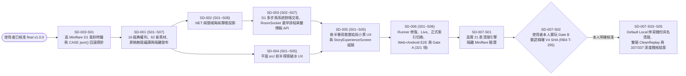

# SPEC-001-RainBookshopV4 — SD 總覽

**功能 ID**：`SPEC-001-RainBookshopV4`
**來源 MVP／SPEC／BDD／TDD**：[MVP-001-LoveGameDatingApp.md](../../../requirements/MVP-001-LoveGameDatingApp.md)、[rain-bookshop-v4-draft.json](../../../requirements/rain-bookshop-v4-draft.json)、[SPEC-001-RainBookshopV4.md](../../../specs/SPEC-001-RainBookshopV4.md)、[SPEC-001-RainBookshopV4-RiskAudit.md](../../../specs/SPEC-001-RainBookshopV4-RiskAudit.md)、[SPEC-001-RainBookshopV4-BDD.md](../../../bdd/SPEC-001-RainBookshopV4-BDD.md)、[SPEC-001-RainBookshopV4-TDD.md](../../../tdd/SPEC-001-RainBookshopV4-TDD.md)、[SPEC-001-RainBookshopV4-Verification.md](../../../verification/SPEC-001-RainBookshopV4-Verification.md)
**AI／模型／資訊依據**：AI：`Antigravity`／模型：`Gemini 4 Carbon (High)`（依據：當前執行對話環境系統宣告之實際 AI 助手與人類可讀模型標識）
**批次／文件包路徑**：`final`／`datinghigh/docs/sd/SPEC-001-RainBookshopV4/final/`
**契約版本**：`SD-contract-v2`
**設計版本／優先級／狀態／最後更新**：`1.0.0`／高／`Ready for carefully-done`（完整設計與全量桌面稽核通過，已獲使用者明確核准；尚未開發，可開始實作）／2026-11-26
**主責人／最終驗收責任**：DatingHigh 開發主責人（技術實作、Gate A 321 項驗收、具名清理與深度稽核）／**使用者本人**（`final` 設計已核准、後續 `RB4-T-295` 實玩 Gate B 最終簽認）

## 來源、程式與設計基準

| 類型 | 精確路徑／工作區 | 版本／commit／SHA-256 | 確認或觀察依據 | 相關未提交改動／影響 |
|---|---|---|---|---|
| MVP 需求來源 | `datinghigh/docs/requirements/MVP-001-LoveGameDatingApp.md` | sha256=`9f1e2d488ddf20d00cb54b3731363cd2d9b62c06660f426f86acb610af75b4a1` | `TDD#規劃交接紀錄`（已確認 `AC-005-36`～`46`） | 無未提交改動 |
| V4 作者原稿（唯一文案權威） | `datinghigh/docs/requirements/rain-bookshop-v4-draft.json` | bytes=`150743` sha256=`b5c18f6762c87e25e1e83deb5769d19dc170c94a69bd6c1cdb15fe34b6809d95` | `SPEC §3.6` 鎖定之唯一劇本與文案權威 | 無未提交改動；原文一字不動 |
| SPEC（SDD 技術方案） | `datinghigh/docs/specs/SPEC-001-RainBookshopV4.md` | sha256=`78dd9c2202de603070846715454fca6b4cd94cc959fe1eac9937c6654f084843` | `RQ-01`～`04=A`、`RA-Q1`～`Q4=A`、倒數可配置化已確認 | 無未提交改動 |
| 實作前風險與缺漏稽核 | `datinghigh/docs/specs/SPEC-001-RainBookshopV4-RiskAudit.md` | sha256=`987a83f8201cfb20f7756e5226e908bf76d0a39ab8e73f2882d3aaa1c159e577` | `RA-01`～`12` 與 `G01`～`16` 全數確認回寫 | 無未提交改動 |
| BDD 場景規格 | `datinghigh/docs/bdd/SPEC-001-RainBookshopV4-BDD.md` | sha256=`72a0ce6703e94235c3fb8e26b4cd49cec52a6a51c1b8b9a4ef5f55786ab6f2d8` | 58 個 Scenario（42 個 `@frontend`、1 個 `@manual`），0 完成 | 無未提交改動 |
| TDD 測試清單與規劃交接 | `datinghigh/docs/tdd/SPEC-001-RainBookshopV4-TDD.md` | sha256=`edbfc1dd391d724ddd79ffe031b05cd75731553501d0dbfca94ccf7a36676cda` | 337 項測試（175U/57I/18A/87E），0 完成；`Ready for well-done` | 無未提交改動 |
| 驗證紀錄 | `datinghigh/docs/verification/SPEC-001-RainBookshopV4-Verification.md` | sha256=`7f23e9c13a98fffe0c3891a387bc39f1d9cbb6dd3eca911cb64fc53acbda6ffc` | 尚未開發／驗證基線 | 無未提交改動 |
| 程式與測試工作樹 | Git 根：`C:\GitProjects\gamenenstyle` 應用工作區：`C:\GitProjects\gamenenstyle\datinghigh` | 設計產出基準：`cb679a298b990cb362e0f6ff7bf06f5baa352d6d` 核准鎖定 commit：`22c2da535a8da6e1a916bfa3e3dd6f7f57b87f00` | 2026-11-26 實地核對 `git status --short` 與產品原始碼 | **產品程式碼、測試、migrations、contracts 與 `overview/` 均為 0 修改**；工作樹唯一變更為同步本 `final/` 全套文件至已核准 `Ready for carefully-done` 狀態 |

**核准設計內容清單與可還原快照**：本 `final` 設計包版本 `1.0.0` 經使用者於提交 `22c2da535a8da6e1a916bfa3e3dd6f7f57b87f00` 後明確確認核准；核准邊界涵蓋本總覽及下表全部 10 份設計與決策文件的完整內容（系統設計 `SYS-001`～`010` 與 `CORE-01`～`05`、全量 337 列正向追溯與 58 列 BDD／畫面稽核及單一寫入反向表、14 項細項決策與 218 列候選步驟對照、7 份分項共 33 個 `D`／42 個 `I`／43 個 `S` 步驟順序與關卡），各檔案真實位元組數與可還原 SHA-256 內容指紋如下：

| 本 `final` 包設計檔案（版本 `1.0.0`） | 位元組數 | SHA-256 內容指紋（可還原核准基準） |
|---|---:|---|
| [01-system-design.md](01-system-design.md) | `65162` | `8b48b806987074c803905acd6c02c08fc236ddf97f2e36454996f79965be29c6` |
| [02-traceability.md](02-traceability.md) | `335654` | `17c99f5ca6ad55ac03ad09998e7c6be2a1a68c46ad52c20fbb086e503edb17de` |
| [03-design-decision.md](03-design-decision.md) | `163197` | `5085d895740495e4c4f4b4150aebc8eb36c54ec6a0c1392ceea2043300943213` |
| [plans/SD-001-V4內容契約與作者草案編譯器.md](plans/SD-001-V4內容契約與作者草案編譯器.md) | `111313` | `08c6bf0daed7f71426ad462c4fd281bc5128c11d5f121b3328dadae76068b2e4` |
| [plans/SD-002-雙軌破冰與限時救書領域規則.md](plans/SD-002-雙軌破冰與限時救書領域規則.md) | `132481` | `43801e2898a7ca56aba3ee5611c161522968a1f0cad1c7cb3e06d35d90f3e969` |
| [plans/SD-003-權威計時交易與房間排程同步.md](plans/SD-003-權威計時交易與房間排程同步.md) | `129473` | `5ef900316e37ced38ba572d23b59ea8c2507d99795c908f1663236da81c7cf75` |
| [plans/SD-004-去按鈕化探索書牆與雙向破冰前端UX.md](plans/SD-004-去按鈕化探索書牆與雙向破冰前端UX.md) | `99375` | `16a93408f1f2a95c155b3a27e4a727567ed1c00c02c1afcf9a47202f87185574` |
| [plans/SD-005-暴雨救書協作與四結局借閱小票前端UX.md](plans/SD-005-暴雨救書協作與四結局借閱小票前端UX.md) | `117306` | `d3e9d134c7952cde2f5897d10bf326663f8a659e05d2f23a8d2822046636e953` |
| [plans/SD-006-跨系統整合雙平台E2E與技術GateA驗收.md](plans/SD-006-跨系統整合雙平台E2E與技術GateA驗收.md) | `139629` | `a01fbb69a2208d8913a7e3ae1427414d9fc688b2de01a276ca5764e37b535d71` |
| [plans/SD-007-實玩GateB與Local清理結案交付.md](plans/SD-007-實玩GateB與Local清理結案交付.md) | `73280` | `65f5f62bbbe9856ac9ba9ec8920eeeaa6983ed3f75f77491a6e478a815faf1cd` |

**歷史／取代關係**：
1. 完整比較並整合兩套有效未取代候選批次：[candidates/antigravity-model-unprovided/20261125-2312-01](../candidates/antigravity-model-unprovided/20261125-2312-01/00-overview.md)（候選 A）與 [candidates/chatgpt-gpt-6.2/20261125-2221-01](../candidates/chatgpt-gpt-6.2/20261125-2221-01/00-overview.md)（候選 C），兩套原候選批次檔案一字未動保留供查考。
2. 原工作樹未追蹤之未完成舊草稿 `final/`（ChatGPT GPT-6.2 `0.2.0-draft`，原標 `Draft：仍待逐項設計稽核，不得開工`，原 `00-overview.md` SHA `6ea6e20e8647f49bf1472d706d43ce1225432fe65639d62658e42dcd9fdf01ec`）已依 `document-contract.md` 完整保存至歷史批次 [candidates/chatgpt-gpt-6.2/20261126-01/](../candidates/chatgpt-gpt-6.2/20261126-01/00-overview.md) 並明確標記**已取代**、原路徑、原版本、取代原因及本 `final` 替代連結。

## 前置與完成契約

| 前置項 | 實際查核結果／證據 | 阻斷／恢復條件 |
|---|---|---|
| agent 指示、README、方法與跨工作區資訊 | 已完整讀取 `datinghigh/AGENTS.md`、`README.md`、`overview/01`～`04` 全數 11 份文件，以及 `.agents/skills/{design-decision,fantastic-design}` 契約與五份標準範本 | 無阻斷（查核通過） |
| TDD 原交接 `Ready for well-done` | [SPEC-001-RainBookshopV4-TDD.md#規劃交接紀錄](../../../tdd/SPEC-001-RainBookshopV4-TDD.md#規劃交接紀錄) 明載 `Ready for well-done`，無未解除規劃阻斷 | 無阻斷（保持原 TDD 交接不動） |
| 已確認風險、缺漏回寫與注意事項 | `RQ-01`～`04=A`、倒數可配置化（`SPEC §6.2, §6.4`）與 `RA-Q1`～`Q4=A`（`RA-01`～`12`、`G01`～`16` → `RB4-T-322`～`337`）均已回寫上游規格並逐項落實於本包設計 | 無阻斷（查核通過） |
| 實際程式、測試、build／DB／前端／部署與工作樹 | 已逐檔讀取核對 `.NET 10`（`Domain/`、`Application/*Projection.cs`、`Api/StoryPayload.cs`、`Unit.Tests`）、`cloudflare/migrations/0001`～`0007`（真實 21 張表）、`cloudflare/src/*`、平面 `frontend/client/src/*` 與 `tests/unit/*`、`tools/*` 及 `package.json` 命令 | 無設計阻斷；執行期若缺 Android 裝置或真 D1 時鐘探針異常，依停止條件立即停工回報，絕不代簽或私改 schema |
| 各分項有序步驟與 Todo／檔案／驗證映射 | 7 份 SD 共 **33 個 `D`、42 個 `I`、43 個 `S` 步驟**；每個 `S` 唯一隸屬 1 個 `I`，依賴呈有向無環圖（DAG），全包改動檔案 100% 單一寫入者 | 無阻斷（全量桌面稽核通過） |
| 產品實作與 BDD／畫面分解 | 15/15 AC、58/58 BDD（含 42 個 `@frontend` Web+Android 雙端元件／手勢狀態機與 1 個 `@manual` Gate B）、337/337 TDD 與原稿 80 項素材全數映射至真實產品檔案符號，0 筆僅映射測試檔 | 無缺項（完整設計涵蓋 100.0%，已核准 `Ready for carefully-done`） |

**本次成果、範圍及排除範圍**：本次交付 `SPEC-001-RainBookshopV4` 經跨候選逐細項決策整合並獲使用者明確核准之完整可獨立交接 `final/` 設計包（設計階段 0 產品程式碼修改）；實作範圍涵蓋 `scene-event.v3` 契約、16 經典權利與 80 素材（62 新建＋18 沿用）、雙軌探索破冰、主動暴雨與可配置 90 秒雙向手勢救書、15 秒暫緩自動恢復、四結局與零個資借閱小票、雙端 Gate A（321 項）、本人實玩 Gate B（1 項）、真實 21 表具名 Local 清理與雙端乾淨重玩（15 項）及全案 337/337 深度稽核；明確排除 iOS（`D-052`）、無障礙專項（`D-051`）、完整 Puppet、其餘九場與 `AffectionAndFeedback`。
**整體驗收條件**：（1）原稿逐 Unicode scalar 100% 守恆且權利與 80 素材核實通過；（2）前段 321 項 TDD（含真 Miniflare D1/R2/DO、Live、正式 Web 與真實 Android 雙端獨立證據）通過技術 Gate A；（3）使用者本人親自試玩簽認精確 V4 SHA 通過 Gate B（`RB4-T-295`）；（4）default local 停寫備份完成具名清理、9 張保護表與私人 R2 指紋 100% 不變並通過雙端 `CleanReplay`（後段 15 項）；（5）全案 337/337 深度稽核、`Verification.md` 與 `overview/` 同步且 `git diff --check` 零錯誤。
**預算／期限／估計依據**：使用者未指定金額預算或硬性截止日；步驟順序已將真 D1 時鐘探針（`SD-003-S01`）與權利核實（`SD-001-S01`）置於最前以消除返工風險，並預留雙端序列 E2E、本人 Gate B 審核等待與安全備份清理緩衝。

## 開發進度總覽

### 整體進度

各分項 Todo 葉節點為唯一 SD 計數來源；以下由 7 份分項分子／分母直接相加計算（不平均百分比）。

| 指標 | 完成／總數 | 進度條／百分比 | 查核依據 |
|---|---|---|---|
| 設計完成度（D） | 33 / 33 | `[████████████████████] 100.0%` | `SD-001`(5) + `002`(6) + `003`(6) + `004`(4) + `005`(4) + `006`(4) + `007`(4) |
| SPEC 設計涵蓋率 | 15 / 15 | `[████████████████████] 100.0%` | [02-traceability.md §來源清冊與計數](02-traceability.md#來源清冊與計數)（`RB4-AC-001`～`015`） |
| BDD 設計涵蓋率 | 58 / 58 | `[████████████████████] 100.0%` | [02-traceability.md §BDD 行為與畫面完整性稽核](02-traceability.md#bdd-行為與畫面完整性稽核)（`RB4-BDD-001`～`058`） |
| TDD 設計涵蓋率 | 337 / 337 | `[████████████████████] 100.0%` | [02-traceability.md §全量正向追溯](02-traceability.md#全量正向追溯)（`RB4-T-001`～`337`） |
| 實作驗證完成度（I） | 0 / 42 | `[░░░░░░░░░░░░░░░░░░░░] 0.0%` | 尚未開發（已核准 `Ready for carefully-done`）；`SD-001`(6)+`002`(8)+`003`(7)+`004`(5)+`005`(5)+`006`(6)+`007`(5) 待實測 |

**結構映射與完整性區分**：僅具結構 ID／測試位置映射而缺實際產品邏輯或適用畫面設計之項目數為 **`0`**；真正同時具備來源條件與結果、真實產品檔案符號與演算法分支、Web／Android 雙端畫面手勢狀態及可執行驗證命令之完整設計數為 **SPEC `15 / 15`、BDD `58 / 58`（含 `@frontend` `42 / 42`、`@manual` `1 / 1`）、TDD `337 / 337`**。

### 分項／分組進度追蹤

| SD／分組 | D 完成／總數 | I 完成／總數 | 執行狀態 | 驗收狀態 | 證據／阻斷 |
|---|---|---|---|---|---|
| [SD-001-V4內容契約與作者草案編譯器](plans/SD-001-V4內容契約與作者草案編譯器.md) | 5 / 5 | 0 / 6 | `Planned` | `Incomplete` | 設計已核准可開工（`Ready for carefully-done`；主責 22 項 TDD／7 個步驟） |
| [SD-002-雙軌破冰與限時救書領域規則](plans/SD-002-雙軌破冰與限時救書領域規則.md) | 6 / 6 | 0 / 8 | `Planned` | `Incomplete` | 設計已核准可開工（`Ready for carefully-done`；主責 97 項 TDD／8 個步驟） |
| [SD-003-權威計時交易與房間排程同步](plans/SD-003-權威計時交易與房間排程同步.md) | 6 / 6 | 0 / 7 | `Planned` | `Incomplete` | 設計已核准可開工（`Ready for carefully-done`；主責 60 項 TDD／7 個步驟） |
| [SD-004-去按鈕化探索書牆與雙向破冰前端UX](plans/SD-004-去按鈕化探索書牆與雙向破冰前端UX.md) | 4 / 4 | 0 / 5 | `Planned` | `Incomplete` | 設計已核准可開工（`Ready for carefully-done`；主責 26 項 TDD／5 個步驟） |
| [SD-005-暴雨救書協作與四結局借閱小票前端UX](plans/SD-005-暴雨救書協作與四結局借閱小票前端UX.md) | 4 / 4 | 0 / 5 | `Planned` | `Incomplete` | 設計已核准可開工（`Ready for carefully-done`；主責 30 項 TDD／5 個步驟） |
| [SD-006-跨系統整合雙平台E2E與技術GateA驗收](plans/SD-006-跨系統整合雙平台E2E與技術GateA驗收.md) | 4 / 4 | 0 / 6 | `Planned` | `Incomplete` | 設計已核准可開工（`Ready for carefully-done`；主責 86 項 TDD／6 個步驟） |
| [SD-007-實玩GateB與Local清理結案交付](plans/SD-007-實玩GateB與Local清理結案交付.md) | 4 / 4 | 0 / 5 | `Planned` | `Incomplete` | 設計已核准可開工（`Ready for carefully-done`；主責 16 項 TDD／5 個步驟） |

### 當前 Sprint 狀態

| 當前階段／分項／葉節點／步驟 ID | Red–Green–Refactor 子階段 | 負責者／開始條件 | 下一步 ID／最後更新 |
|---|---|---|---|
| 設計已核准可開工（`Ready for carefully-done`）／全包 `final` `1.0.0`／尚未進入 `SD-003-I01`（`SD-003-S01`） | 不適用（尚未啟動產品開發） | `/carefully-done` 執行者（前置核准已滿足） | 執行 `/carefully-done` 首步啟動 `SD-003-S01`／2026-11-26 |

### 里程碑

以下引用原 Todo ID，不另計數。

| 里程碑 | 所需 SD／葉節點／依賴 | 整合條件與驗證 | 狀態／證據 |
|---|---|---|---|
| `M0`：`final` 設計決策交付與人工核准 | `SD-001`～`007` 全部 33 個 `D` 葉節點 | 候選比較、真實路徑對齊、全量 337/58/15 追溯與桌面稽核通過，使用者明確核准 | 已完成並獲核准（`Ready for carefully-done`） |
| `M1`：真 D1 時鐘探針與正式 V4 內容包＋80 素材就緒 | `SD-003-I01` → `SD-001-I01`～`I06` | 真 Miniflare D1 毫秒時鐘與回滾成立；16 經典權利、80 資產、逐 scalar 編譯、`<50k` 可達圖與隔離發布通過 | `Incomplete` |
| `M2`：後端權威狀態交易與雙端共用全場 UX 完成 | `SD-002-I01`～`I08`、`SD-004-I01`～`I05`、`SD-003-I02`～`I07`、`SD-005-I01`～`I05` | `npm test`、`test:server`、`test:worker`、`test:client` 與 `export:web` 100% 通過 | `Incomplete` |
| `M3`：跨系統整合、雙平台 E2E 與技術 Gate A（321 項） | `SD-006-I01`～`I06` | 修復 Android runner、Live 整合、正式索引切換、Web 與 Android 雙端獨立 E2E、效能與權利總檢 `gateAReady: true` | `Incomplete` |
| `M4`：本人實玩 Gate B、21 表具名清理、乾淨重玩與結案交付 | `SD-007-I01`～`I05` | 本人簽認 `RB4-T-295` → default local 備份與具名清理（9 保護表指紋不變）→ 雙端 `CleanReplay` → 337/337 深度稽核與 `overview/` 同步 | `Incomplete` |

### 關鍵指標

| 指標 | 已確認目標／依據 | 當前值 | 證據或待驗原因 |
|---|---|---|---|
| 來源完整設計涵蓋率 | SPEC 15/15、BDD 58/58、TDD 337/337、原稿 JSON 100%（`SD-contract-v2`） | `100.0%` | [02-traceability.md](02-traceability.md) |
| 候選步驟對照完整率 | 候選 A（38 步）＋候選 C（180 步）＝ 218 個候選步驟全數對照無遺漏 | `218 / 218 (100.0%)` | [03-design-decision.md §候選到 final 的步驟對照](03-design-decision.md#候選到-final-的步驟對照) |
| 架構與資料庫邊界遵守度 | 21 表、0 新欄、0 Trigger、0 新公開 API、Graph `<=50,000`、JSON `<=16,384` | 設計 `100%` 符合；執行期實測待跑 | 開工首步 `SD-003-S01` 與 `SD-001-S05` 真環境驗證 |
| 產品實作與驗收完成度 | Gate A（321）＋本人 Gate B（1）＋清理與重玩（15）＝ 337/337 TDD | `0 / 337 (0.0%)` | 尚未啟動開發，已核准可由 `/carefully-done` 執行 |

### 每日進度記錄

依專案 `AGENTS.md` 基本規範，禁止記錄每日／批次歷史進度流水帳；此處僅就地保留當前有效狀態。

| 日期 | 完成與證據 | 剩餘／阻斷 | 下一步／負責者 |
|---|---|---|---|
| 2026-11-26 | 歸檔舊草稿至 `candidates/chatgpt-gpt-6.2/20261126-01/`；完成 `final/` 版本 `1.0.0` 全套 11 份文件（33 D / 42 I / 43 S）並獲使用者明確核准，交接狀態更新為 `Ready for carefully-done` | 實作 `I`: `0 / 42`；無設計阻斷（尚未開發） | 執行 `/carefully-done` 從 `SD-003-S01` 啟動實作 |

## 系統設計與分項索引

- 系統設計：[01-system-design.md](01-system-design.md)
- 追溯矩陣：[02-traceability.md](02-traceability.md)
- 設計決策：[03-design-decision.md](03-design-decision.md)

| SD ID／文件 | 可交付成果／來源 | 執行／整合／驗收責任 | 可寫範圍／排除 | 依賴／契約版本 | 驗收／證據位置 |
|---|---|---|---|---|---|
| [SD-001](plans/SD-001-V4內容契約與作者草案編譯器.md) | V4內容契約與作者草案編譯器（主責 22 項唯一 TDD） | SD-001 內容契約與編譯器執行者／跨包整合驗收由 SD-006（Gate A）與 SD-007（深度稽核）負責 | `cloudflare/src/scene-event-presentation-schema.ts`、`cloudflare/src/scene-event-stage-content.ts`、`cloudflare/src/scene-event-track-content.ts`、`cloudflare/src/scene-event-track-graph.ts` 等 13 項（詳見分項 `F-01`～`F-13`；排除他包範圍） | 前置：`SD-003-S01` 真 Miniflare D1 時鐘與同批回滾探針已通過／`SD-contract-v2` | `SD-001-V01`～`V07` 及 `Verification.md` |
| [SD-002](plans/SD-002-雙軌破冰與限時救書領域規則.md) | 雙軌破冰與限時救書領域規則（主責 97 項唯一 TDD） | SD-002 後端領域與純投影執行者／跨包整合由 SD-003（D1/API）與 SD-006（Gate A）負責 | `backend/src/DatingHigh.Domain/SceneEventV4Policy.cs`、`backend/src/DatingHigh.Domain/SceneEventTrackPolicy.cs`、`backend/src/DatingHigh.Application/SceneEventStageProjection.cs`、`backend/src/DatingHigh.Application/SceneBookProjection.cs` 等 8 項（詳見分項 `F-01`～`F-08`；排除他包範圍） | 前置：`SD-001-S07` 完成（`contracts/rain-bookshop-v4.json` 就緒）／`SD-contract-v2` | `SD-002-V01`～`V08` 及 `Verification.md` |
| [SD-003](plans/SD-003-權威計時交易與房間排程同步.md) | 權威計時交易與房間排程同步（主責 60 項唯一 TDD） | SD-003 權威交易與房間同步執行者／跨包整合驗收由 SD-005（前端串接）與 SD-006（Gate A）負責 | `backend/src/DatingHigh.Application/SceneEventFrameworkService.cs`、`backend/src/DatingHigh.Application/StoryDialogueService.cs`、`backend/src/DatingHigh.Api/StoryPayload.cs`、`backend/src/DatingHigh.Api/Program.cs` 等 14 項（詳見分項 `F-01`～`F-14`；排除他包範圍） | 前置：使用者已明確核准本 `final` `1.0.0` 設計包（無其他前置 SD 依賴，為全案第 1 個執行步驟）／`SD-contract-v2` | `SD-003-V01`～`V07` 及 `Verification.md` |
| [SD-004](plans/SD-004-去按鈕化探索書牆與雙向破冰前端UX.md) | 去按鈕化探索書牆與雙向破冰前端UX（主責 26 項唯一 TDD） | SD-004 前端前半與共用型別執行者／由 SD-005 頂層組裝並由 SD-006 執行 Web + Android 雙端 E2E 驗收 | `frontend/client/src/scene-event-track.ts`、`frontend/client/src/scene-stage.ts`、`frontend/client/src/BookshopMinimapOverlay.tsx`、`frontend/client/src/ShelfCloseupDrawer.tsx` 等 10 項（詳見分項 `F-01`～`F-10`；排除他包範圍） | 前置：`SD-001-S07` 完成（可與 `SD-002`、`SD-003` 安全並行）／`SD-contract-v2` | `SD-004-V01`～`V05` 及 `Verification.md` |
| [SD-005](plans/SD-005-暴雨救書協作與四結局借閱小票前端UX.md) | 暴雨救書協作與四結局借閱小票前端UX（主責 30 項唯一 TDD） | SD-005 前端後半與頂層組裝執行者／跨系統雙端 E2E 驗收由 SD-006（Gate A）與 SD-007（Gate B / CleanReplay）負責 | `frontend/client/src/TimedRescueOverlay.tsx`、`frontend/client/src/BookmarkAndEndingPanel.tsx`、`frontend/client/src/SceneWeather.tsx`、`frontend/client/src/SceneStoryMotion.tsx` 等 10 項（詳見分項 `F-01`～`F-10`；排除他包範圍） | 前置：`SD-003-S07` 與 `SD-004-S05` 皆已通過／`SD-contract-v2` | `SD-005-V01`～`V05` 及 `Verification.md` |
| [SD-006](plans/SD-006-跨系統整合雙平台E2E與技術GateA驗收.md) | 跨系統整合雙平台E2E與技術GateA驗收（主責 86 項唯一 TDD） | SD-006 跨系統與雙平台驗收執行者／通過 Gate A（前段 321 項 TDD）後移交 SD-007 進入使用者本人實玩 Gate B | `tools/test-android.ps1`、`tools/test-scene-web.mjs`、`contracts/scene-event-content.json`、`tools/rain-bookshop-v4-gate-a-audit.mjs` 等 8 項（詳見分項 `F-01`～`F-08`；排除他包範圍） | 前置：`SD-001`～`SD-005` 全部 `I` 葉節點測試通過且無並行寫入程序／`SD-contract-v2` | `SD-006-V01`～`V06` 及 `Verification.md` |
| [SD-007](plans/SD-007-實玩GateB與Local清理結案交付.md) | 實玩GateB與Local清理結案交付（主責 16 項唯一 TDD） | SD-007 清理與結案執行者＋使用者本人（唯一有權簽認 `RB4-T-295` Gate B）／開發主責人最終全案稽核 | `tools/rain-bookshop-v4-cleanup-policy.mjs`、`tools/local.mjs`、`tools/tests/rain-bookshop-v4-cleanup-policy.test.mjs`、`cloudflare/tests/scene-event-v4-cleanup.integration.test.ts` 等 8 項（詳見分項 `F-01`～`F-08`；排除他包範圍） | 前置：`SD-006-S06` 技術 Gate A（前段 321 項）已通過／`SD-contract-v2` | `SD-007-V01`～`V05` 及 `Verification.md` |

## 完整執行順序與整合

| 工作／條件分支 | 起始條件 | 安全並行或循序理由 | 共用契約／環境控制 | 完成條件／主責 |
|---|---|---|---|---|
| **階段 0：`SD-003-S01` 真 D1 時鐘與回滾探針** | 使用者已明確核准 `final` `1.0.0`（已滿足） | **必須最先循序執行**：在投入大量編譯與業務實作前，於真 Miniflare D1 證明交易內毫秒時間與 `CASE ... json()` 同批回滾成立 | 僅寫 `scene-event-v4-d1-clock.integration.test.ts` 與時鐘表達式常數 | `SD-003-I01` 通過（失敗立即停工回報） |
| **階段 1：`SD-001` 權利、80 素材與原稿編譯** | `SD-003-S01` 通過 | 必須先鎖定 `contracts/rain-bookshop-v4.json` 與 `CNT-001` 供前後端共用 | 唯一寫入 `contracts/rain-bookshop-v4*.json`、`story-assets/*` 與內容 parser | `SD-001-I01`～`I06` 全綠 |
| **階段 2：`SD-002`（後端領域）與 `SD-004`（前端前半）** | `SD-001` 完成 | **可安全並行**（若有分工授權）：可寫檔案與測試執行器（`dotnet test` vs `vitest`）100% 無交集 | 共用唯讀 `contracts/rain-bookshop-v4.json` | `SD-002` 8 個 `I` 與 `SD-004` 5 個 `I` 全綠 |
| **階段 3：`SD-003-S02..S07`（D1/DO/API）** | `SD-002` 完成（可與 `SD-004` 並行） | 依賴 `SD-002` 純領域與純投影類別；與前端 `SD-004` 無檔案或環境衝突 | 隔離 Miniflare D1/R2/DO 與 `.NET` API 測試 | `SD-003-I02`～`I07` 全綠 |
| **階段 4：`SD-005`（前端後半與頂層組裝）** | `SD-003` 與 `SD-004` 全部完成 | 必須循序於 `SD-003`、`SD-004` 之後，唯一寫入 `StoryExperienceScreen.tsx` 並驗證 `export:web` | 唯讀引用 `SD-004` `scene-event-track.ts` 與前半元件 | `SD-005-I01`～`I05` 與 `export:web` 全綠 |
| **階段 5：`SD-006` 跨系統整合與雙端 Gate A** | `SD-001`～`SD-005` 完成並停止寫入 | **嚴格單一序列獨佔**：共用本地 `8787` 平台、E2eHost 與 Android ADB，嚴禁並行搶埠 | 依序跑基礎檢核 → Live → 切換首場索引＋Web E2E → Android E2E → Gate A 321 項稽核 | `SD-006-I01`～`I06` 通過且 `gateAReady: true` |
| **條件分支：實作瑕疵修補與重驗** | `SD-006` 或 `SD-007-S05` 發現未達規格之實作缺陷 | 停止並行，在原唯一檔案負責包既定設計範圍內修補並重跑對應單元／整合／雙端 E2E；若需改動已核准設計則立即停止走人工確認 | 維持單一寫入責任，不預造假缺陷 checkbox | 受影響測試與回歸重獲 `Verified` |
| **階段 6：`SD-007` 本人 Gate B、清理與結案** | `SD-006` Gate A 完成；`S03` 實際清理硬性依賴 `S02` 本人簽認精確 SHA | **硬性人工關卡**：未獲本人簽認絕不清理；核准後獨佔停寫 default local 備份清理，再跑雙端 `CleanReplay` 與 337/337 深度稽核同步文件 | `tools/local.mjs` wrapper、禁 `--remote`、9 保護表與私人 R2 指紋前後核對 | 全案 15 AC / 58 BDD / 337 TDD 與 42 個 `I` 100% `Verified` |

## 風險、變更與決策

| ID | 原設計／證據／白話影響 | 負責者／觸發條件 | 處置／替代／成本時程影響 | 決策與受影響版本／成果／重驗 |
|---|---|---|---|---|
| `DEC-01`～`DEC-14`（跨候選整合決策） | 候選 A 含路徑錯置、JS 拋錯無法回滾 D1、Gate A 337 分母循環與 11 個錯誤表名；候選 C 為未完成 `Draft`（180 個跨包重複樣板步驟） | `Antigravity (Gemini 4 Carbon (High))` 於 `/design-decision` 整合觸發 | 全面對齊真實 repo 路徑與真實 21 張表、將真 D1 時鐘探針提至首步 `SD-003-S01`、確立 `321 + 1 + 15 = 337` 無循環驗收切分與 43 個具體步驟 | 詳載於 [03-design-decision.md](03-design-decision.md)，已獲使用者核准鎖定為 `final` `1.0.0`（`Ready for carefully-done`） |
| `RA-01`～`RA-12`（實作前已確認風險） | 涵蓋 15s 暫緩自動恢復、D1 毫秒時鐘與 `NULL` actor 冪等、倒數配置、題組 A 雙 `shelves`、鎖扣錯序重置、霧窗前景見證、私密隔離、21 表清理、DO 最早排程、`50k` 圖上限、Android 腳本與 16 經典權利 | 各對應 SD 執行者／實作與實測期間持續監控 | 任一真環境前提（D1 毫秒 guard、圖上限、經典／音訊權利、Android 裝置、非測試混合輪）不成立時立即停止回報，絕不私自降級、擴表或改原稿 | 上游已確認 `RQ-01`～`04=A`、`RA-Q1`～`Q4=A`（見 [01-system-design.md §風險與人工確認紀錄](01-system-design.md#風險與人工確認紀錄)） |

## 檢查點與續作交接

| 日期／任務／執行者 | 已驗收成果／證據 | 剩餘／停止原因 | 寫入權／共享資源狀態 | 恢復條件／查核結果 | 續作啟動結果／下一步 |
|---|---|---|---|---|---|
| 2026-11-26／`/design-decision SPEC-001-RainBookshopV4` 核准鎖定／`Antigravity (Gemini 4 Carbon (High))` | 舊草稿已歸檔至 `candidates/chatgpt-gpt-6.2/20261126-01/`；`final/` `1.0.0` 全套 11 份文件已完成、通過全量桌面稽核（`D: 33/33`）並獲使用者明確核准更新為 `Ready for carefully-done` | 產品實作驗證 `I: 0/42`；依使用者明確指示僅更新設計交接狀態至可開始實作，不啟動開發 | 產品程式碼、測試、DB 與設定 **0 修改**；無運行中背景任務或伺服器 | 設計核准條件已成立；後續開工時核對上方 10 份檔案 SHA-256 快照一致即可 | 已就緒等待執行 `/carefully-done` 從首步 `SD-003-S01` 啟動實作 |

**失效證據與重驗範圍**：無（尚未執行產品實作，既有框架證據完好）。
**目前步驟／子階段與副作用／清理現況**：已鎖定於 `Ready for carefully-done` 可開工交接點（尚未啟動 `SD-003-S01`）；工作區除 `docs/sd/SPEC-001-RainBookshopV4/final/` 外零副作用。
**下一整合里程碑、用時／重試與策略**：下一里程碑為執行 `/carefully-done` 後通過 `M1`（`SD-003-S01` 真 D1 時鐘探針 → `SD-001` 正式內容包與 80 素材建置）。

## SD 人工確認與交接

**交接狀態**：`Ready for carefully-done`
**鎖定文件包／設計版本／核准快照**：`datinghigh/docs/sd/SPEC-001-RainBookshopV4/final/`／設計版本 `1.0.0`（契約 `SD-contract-v2`）／核准提交基準 commit `22c2da535a8da6e1a916bfa3e3dd6f7f57b87f00` 加本文件上方 10 份設計文件最新 SHA-256 快照表。
**使用者明確確認、日期與依據**：**已確認核准**（`2026-11-26`；使用者於提交 `22c2da535a8da6e1a916bfa3e3dd6f7f57b87f00` 後於對話明確確認核准 `SPEC-001-RainBookshopV4/final` 版本 `1.0.0`，並指示將狀態更新為可開始實作）。
**核准邊界及已失效部分**：核准邊界涵蓋 `final/` 全部 11 份文件之架構、檔案所有權、43 個步驟與驗收關卡；原未完成草稿 `0.2.0-draft` 已歸檔標記取代失效。
**待確認事項／阻斷／恢復條件**：無未決設計阻斷；所有開工前置設計關卡均已滿足，可隨時啟動實作。
**選用下一步**：執行 `/carefully-done` 依序從 `SD-003-S01` 啟動實作與驗收。

TDD 的 `Ready for well-done` 保持原樣；SD 設計完成或涵蓋 100% 不代表產品已完成。

## 最終驗收與交付

| 完成契約項／來源 | 目前產物與版本 | 實際命令／操作／環境／結果 | 證據位置 | 驗收狀態 | 等價依據或恢復條件 |
|---|---|---|---|---|---|
| `final` 設計與決策包完整性及人工核准（`SD-contract-v2`） | `final/` 全套 11 份文件 `v1.0.0`（33/33 D，`Ready for carefully-done`） | 桌面全量一致性／連結／來源覆蓋／單一寫入／SHA 快照稽核與 `git diff --check` 通過（退出碼 `0`），並獲使用者明確核准 | [00-overview.md](00-overview.md)、[02-traceability.md](02-traceability.md)、[03-design-decision.md](03-design-decision.md) | 設計稽核通過且已獲人工核准（`Ready for carefully-done`） | 設計稽核與核准不計為產品實作 `Verified` |
| 技術 Gate A（前段 321 項唯一 TDD、80 素材與雙端 E2E；`RB4-AC-001`～`012`,`015`） | 尚未開發（`0 / 321`） | 待啟動 `/carefully-done` 由 `SD-001`～`SD-006` 實際執行 | 待回填至 [Verification.md](../../../verification/SPEC-001-RainBookshopV4-Verification.md) | `Incomplete` | 須取得真 Miniflare D1/R2/DO、正式 Web 與真實 Android 雙端獨立證據 |
| 使用者本人實玩 Gate B（`RB4-AC-012`／`RB4-BDD-052`／`RB4-T-295`） | 尚未執行（`0 / 1`） | 待 Gate A 通過後由**使用者本人**親自試玩簽認精確 V4 SHA | 待回填至 [Verification.md](../../../verification/SPEC-001-RainBookshopV4-Verification.md) | `Incomplete` | 硬性人工關卡，嚴禁任何自動腳本代簽 |
| 具名 Default Local 清理、雙端 `CleanReplay` 與全案結案同步（後段 15 項；`RB4-AC-013`～`015`） | 尚未執行（`0 / 15`） | 待本人 Gate B 核准後由 `SD-007-S03`～`S05` 執行 | 待回填至 [Verification.md](../../../verification/SPEC-001-RainBookshopV4-Verification.md) 與受影響 `overview/` | `Incomplete` | 須滿足 9 張保護表與私人 R2 指紋不變及雙端乾淨重玩全綠才可結案 |

目前處於 `final` 設計已獲核准（`Ready for carefully-done`）之可開工階段，產品開發、深度實作稽核與重驗均尚未啟動；存在任何 `Deferred` 或 `Incomplete` 項目時嚴禁宣告產品結案。

## 相關文檔與生成資訊

- 本包核心文件：[01-system-design.md](01-system-design.md)、[02-traceability.md](02-traceability.md)、[03-design-decision.md](03-design-decision.md)
- 本包分項計畫：[SD-001](plans/SD-001-V4內容契約與作者草案編譯器.md)、[SD-002](plans/SD-002-雙軌破冰與限時救書領域規則.md)、[SD-003](plans/SD-003-權威計時交易與房間排程同步.md)、[SD-004](plans/SD-004-去按鈕化探索書牆與雙向破冰前端UX.md)、[SD-005](plans/SD-005-暴雨救書協作與四結局借閱小票前端UX.md)、[SD-006](plans/SD-006-跨系統整合雙平台E2E與技術GateA驗收.md)、[SD-007](plans/SD-007-實玩GateB與Local清理結案交付.md)
- 上游需求與驗證：[MVP-001](../../../requirements/MVP-001-LoveGameDatingApp.md)、[V4 作者原稿 JSON](../../../requirements/rain-bookshop-v4-draft.json)、[SPEC-001-RainBookshopV4](../../../specs/SPEC-001-RainBookshopV4.md)、[RiskAudit](../../../specs/SPEC-001-RainBookshopV4-RiskAudit.md)、[BDD](../../../bdd/SPEC-001-RainBookshopV4-BDD.md)、[TDD](../../../tdd/SPEC-001-RainBookshopV4-TDD.md)、[Verification](../../../verification/SPEC-001-RainBookshopV4-Verification.md)
- 候選與歷史歸檔：[候選 A（Antigravity 20261125-2312-01）](../candidates/antigravity-model-unprovided/20261125-2312-01/00-overview.md)、[候選 C（ChatGPT 20261125-2221-01）](../candidates/chatgpt-gpt-6.2/20261125-2221-01/00-overview.md)、[已取代歷史草稿 H1（ChatGPT 20261126-01）](../candidates/chatgpt-gpt-6.2/20261126-01/00-overview.md)
- 專案架構與規範：[AGENTS.md](../../../../AGENTS.md)、[README.md](../../../../README.md)、[01-system-overview.md](../../../../overview/01-architecture/01-system-overview.md)、[04-module-map.md](../../../../overview/01-architecture/04-module-map.md)、[01-api-contracts.md](../../../../overview/03-contracts/01-api-contracts.md)、[02-data-contracts.md](../../../../overview/03-contracts/02-data-contracts.md)

**生成者／最後更新／狀態**：`Antigravity`（模型：`Gemini 4 Carbon (High)`）／2026-11-26／`Ready for carefully-done`（設計版本 `1.0.0`，未開發）
