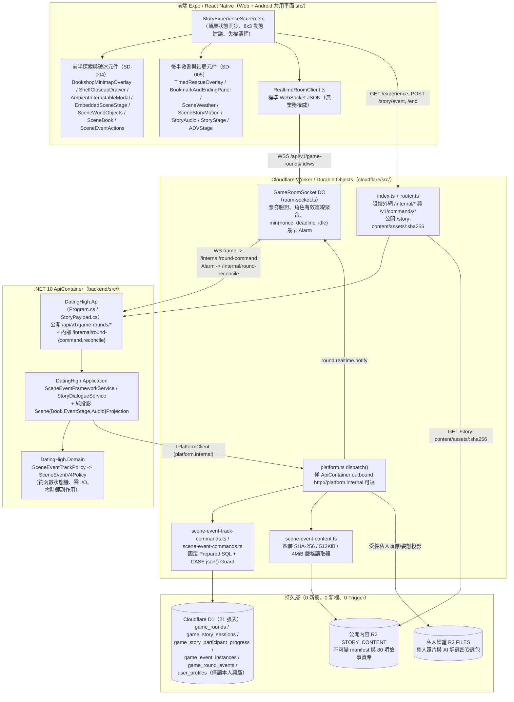

# SPEC-001-RainBookshopV4 — 系統設計

**來源 MVP／SPEC／BDD／TDD**：[MVP-001-LoveGameDatingApp.md](../../../requirements/MVP-001-LoveGameDatingApp.md)、[rain-bookshop-v4-draft.json](../../../requirements/rain-bookshop-v4-draft.json)、[SPEC-001-RainBookshopV4.md](../../../specs/SPEC-001-RainBookshopV4.md)、[SPEC-001-RainBookshopV4-RiskAudit.md](../../../specs/SPEC-001-RainBookshopV4-RiskAudit.md)、[SPEC-001-RainBookshopV4-BDD.md](../../../bdd/SPEC-001-RainBookshopV4-BDD.md)、[SPEC-001-RainBookshopV4-TDD.md](../../../tdd/SPEC-001-RainBookshopV4-TDD.md)
**文件包／AI／模型／批次／設計版本**：`datinghigh/docs/sd/SPEC-001-RainBookshopV4/final/`／AI：`Antigravity`／模型：`Gemini 4 Carbon (High)`／批次：`final`（決策整合日 `2026-11-26`）／設計版本：`1.0.0`（契約：`SD-contract-v2`）
**優先級／狀態／最後更新**：高／`Ready for carefully-done`（完整設計與全量桌面稽核通過，已獲使用者明確核准；尚未開發）／2026-11-26
**來源與程式基準／核准範圍**：見 [00-overview.md §來源、程式與設計基準](00-overview.md#來源程式與設計基準)（核准基準 commit `22c2da535a8da6e1a916bfa3e3dd6f7f57b87f00`，七份來源 SHA-256 與 `final/` 全套檔案快照指紋鎖定）

## 目標、範圍與現況差異

### 業務目標與範圍邊界

本設計將「心動迴路（DatingHigh）」首場雙人互動劇情由 V3 按鈕式單向推進（`rain-bookshop/v3`、`rain-bookshop-before-rain-stops/v1`，`scene-event.v2`）升級為第一人稱原位探索、雙向自然破冰、伺服器主動暴雨中斷、可配置 90 秒跨區手勢救書協作、四種差異化結局與《雨聲書店・今日借閱小票》記憶卡的完整 V4 體驗（`rain-bookshop/v4`、`rain-bookshop-before-rain-stops/v2`，`scene-event.v3`）。

- **唯一內容與文案權威**：`docs/requirements/rain-bookshop-v4-draft.json`（SHA-256 `b5c18f6762c87e25e1e83deb5769d19dc170c94a69bd6c1cdb15fe34b6809d95`，150,743 bytes）。全數 8 個區域、80 項素材規劃（18 項 V3 沿用＋62 項 V4 新增：1 項 `image-set`、58 項 `image`、21 項 `audio`）、20 本書（16 本公有領域經典原創自譯＋4 本牛皮紙盲書）、雙軌 28 個節點（Inviter 15、Acceptor 13）、9 個個人綁定、7 組共享模組（`questionCard`、`directorFloodInterrupt`、`rescueReadyGate`、`timedCoopRescue`、`clerkAftermath`、`bookmarkRitual`、`finalWish`）、4 個結局、8×3 動態聊天建議、借閱小票與 14 組 `uiCopy` 均須逐 Unicode scalar 無損保留，零刪減、零改寫、零佔位文案。
- **架構與資料庫硬約束**：維持現行 `0007_scene_event_tracks.sql` **21 張 D1 資料表、0 新增欄位、0 SQL Trigger、0 新增公開 HTTP 路由**；維持單一 manifest `<= 512KiB`、四層內容總和 `<= 4MiB`、單一素材 `<= 8MiB`、D1 JSON 欄位 `<= 16,384` 字元、狀態可達圖 `<= 50,000` states 之既有護欄，不放寬任何安全上限。
- **明確排除範圍**：iOS 平台（`D-052`）、無障礙專項（`D-051`）、完整 Puppet 骨架系統（`AC-005-35` 已取消，沿用 16 款免費全身四姿態×五表情與 AI 私人靜態四姿態包）、其餘九場劇情、`AffectionAndFeedback` 好感度與名片解鎖 SPEC、遠端／正式環境自動清理。

### 現況實作證據與目標系統設計差異對照

| 設計 ID | 來源需求／現況檔案與位置 | 沿用／調整／新增 | 必要性與白話理由 | 回歸影響／分項 SD |
|---|---|---|---|---|
| `SYS-001` | `RB4-AC-002`,`008`,`011`,`015`；`cloudflare/src/scene-event-{track-content,stage-content,presentation-schema,content}.ts`、`tools/{scene-event-content-policy,scene-event-publish-policy,rain-bookshop-v3-policy}.mjs` | 調整＋新增 `tools/rain-bookshop-v4-policy.mjs`、`contracts/rain-bookshop-v4.json`、`contracts/rain-bookshop-v4-rights.json` | 現行驗證器僅接受 `scene-event.v2`、speaker 僅 `旁白`/`店員・NPC`、動作 `params` 僅固定 ID。需新增 `scene-event.v3` 版本化嚴格契約與作者原稿逐 scalar 編譯器，同時保留 `v2` 讀取器使既有 V3 場次在 Gate B 前零中斷可讀 | V3 既有單元與發布整合測試保持全綠；由 [SD-001](plans/SD-001-V4內容契約與作者草案編譯器.md) 負責 |
| `SYS-002` | `RB4-AC-015`、`RA-10`；`cloudflare/src/scene-event-track-graph.ts`（現行第 77 行 `states.length >= 50000`） | 調整 | V4 含 20 本書預覽、重複環境彩蛋、雙題組與鎖扣步驟；若將純呈現與重複彩蛋納入圖展開會發生笛卡兒積狀態爆炸。須為 `v3` 建立保留收尾可達性的有界商狀態簽章，在 `50,000` 上限內證明 28 節點與 4 結局全可達且零死路 | `v2` 圖驗證原樣保留；由 [SD-001](plans/SD-001-V4內容契約與作者草案編譯器.md) 負責 |
| `SYS-003` | `RB4-AC-001`～`006`；`backend/src/DatingHigh.Domain/SceneEventTrackPolicy.cs`、`backend/src/DatingHigh.Application/{SceneBookProjection,SceneEventStageProjection,SceneAudioProjection,SceneAreaObservation}.cs` | 調整＋新增 `Domain/SceneEventV4Policy.cs` | 現行 Domain 僅支援單次動作 map 與靜態書目投影。須在不移動既有 Application 三個純靜態投影類別位置的前提下，新增 `SceneEventV4Policy` 承載 20 書／盲書揭封、本人興趣貼紙、黑膠／霧窗前景見證、同異書破冰、面紙近遠、留白反向主動、獨處退讓、提問卡雙盲揭曉與 8×3 動態建議規則 | 嚴守 Domain 零 I/O 與真實專案目錄結構；由 [SD-002](plans/SD-002-雙軌破冰與限時救書領域規則.md) 負責 |
| `SYS-004` | `RB4-AC-007`～`009`、`RQ-01`、`RA-01`/`03`～`05`；`Domain/SceneEventV4Policy.cs` | 新增（於純領域狀態機內） | 實作雙人前半節奏匯合觸發唯一一次主動暴雨導演、手電筒雙 Ready 啟動、讀取釘選 `durationSeconds`（預設 90 秒）建立權威 `deadlineAt`、15 秒斷線／閒置暫緩與無按鈕自動恢復（首次恢復只同步不計救書）、雙題組 4 步跨區傳書裝袋、後半反轉墊底、三態鎖扣錯序重置 `latchIndex=0` 及 S/A/B 權威結算 | 純函數注入 `nowMs` 與確定性種子，可 100% 單元測試毫秒邊界；由 [SD-002](plans/SD-002-雙軌破冰與限時救書領域規則.md) 負責 |
| `SYS-005` | `RB4-AC-006`,`010`,`011`、`RQ-02`/`03`；`Domain/SceneEventV4Policy.cs`、`Application/SceneBookProjection.cs` | 調整＋新增 | 實作阿澄 `S/A × 聊開/慢熟` 4 組事後回應、S/A 書籤儀式（每書 3 句＋選填 0–20 Unicode scalar 純文字，拒控制字元／HTML）、9 種雙人意願組合至 3 結局＋B 級專屬屋簷結局、結局 2 授權翻閱對方桌上書書籤，以及零真實個資／零自由輸入之今日借閱小票（含 `S_fast`/`S_normal`、同輪同版 `X/4` 與 4 印章） | 確保未授權結局與小票絕不外洩書籤自由輸入；由 [SD-002](plans/SD-002-雙軌破冰與限時救書領域規則.md) 負責 |
| `SYS-006` | `RB4-AC-007`～`009`,`012`、`RA-02`；`cloudflare/src/{scene-event-track-commands,scene-event-commands,platform}.ts`、`Application/{SceneEventFrameworkService,StoryDialogueService}.cs`、`Api/{Program,StoryPayload}.cs` | 調整 | 現行 `planTrackAction` 僅支援單一玩家提交且無系統時間結算命令。須先在真 Miniflare D1 實測交易內毫秒時鐘與 `SELECT CASE WHEN ... THEN 1 ELSE json('EVENT_STATE_CONFLICT') END` 同批回滾，再擴充 typed state 提交、單人 `own_profile` 興趣讀取與私有 `story.framework.system.reconcile`（`NULL` actor `operationIdentity`＋CAS 冪等），以及內部受信任 `/internal/round-reconcile` | 0 新表、0 新欄、0 新公開路由；由 [SD-003](plans/SD-003-權威計時交易與房間排程同步.md) 負責 |
| `SYS-007` | `RB4-AC-008`,`012`、`RA-09`；`cloudflare/src/room-socket.ts`（現行第 31、77 行固定 `setAlarm(Date.now()+31000)` 僅清 nonce） | 調整 | 現行新連線 `setAlarm(now+31000)` 會直接覆蓋更早的救書 `deadlineAt` 或 15 秒閒置檢查！須改為計算 `min(earliestNonceExpiry, rescueDeadlineAt, idleCheckDueAt)` 共用最早到期排程，並按角色聚合有效未過期 WS 連線與前景狀態，喚醒時觸發 `/internal/round-reconcile` 並廣播 `room.snapshot_hint` | 保留既有票券 HMAC、nonce 防重放與每房 8 連線上限；由 [SD-003](plans/SD-003-權威計時交易與房間排程同步.md) 負責 |
| `SYS-008` | `RB4-AC-001`～`011`；平面 `frontend/client/src/{scene-event-track,scene-stage,EmbeddedSceneStage,SceneWorldObjects,SceneBook,SceneEventActions,SceneWeather,SceneStoryMotion,StoryAudio,StoryStage,ADVStage,RealtimeRoomClient,StoryExperienceScreen}.tsx/.ts` | 調整＋新增 5 個平面元件檔 | 將 V4 前半（去按鈕化左右導覽、小地圖暖金點、首次呼吸光／長按掃視、橫滑書牆、盲書撕封、空間彩蛋、擦霧與前景見證、近遠面紙、提問卡）與後半（暴雨 7 步演出、單調倒數、雙向傳書／裝袋／鎖扣／快捷泡泡、書籤儀式、四結局與借閱小票、8×3 動態建議、失權清理）拆由兩包無重疊實作 | `SD-004` 寫前半與共用型別，`SD-005` 寫後半與 `StoryExperienceScreen` 組裝；零寫入衝突 |
| `SYS-009` | `RB4-AC-012`、`RA-11`/`12`；`tools/{test-android.ps1,test-scene-web.mjs}`、`contracts/scene-event-content.json`、`tests/` | 調整＋新增 V4 Live / Web / Android E2E 與 Gate A 稽核器 | 修復 `test-android.ps1` 路徑與新增 `scene-event-v4` suite，完成 80 素材解碼／遮罩／權利核對、真本地 Live 整合、正式 Web 與真實 Android 雙平台獨立 E2E、重複閒置恢復與記憶體／延遲量測，通過前段 321 項 TDD 技術 Gate A 並切換首場索引 | Web 與 Android 分別計證，不混充；由 [SD-006](plans/SD-006-跨系統整合雙平台E2E與技術GateA驗收.md) 負責 |
| `SYS-010` | `RB4-AC-013`～`015`、`RQ-04`、`RA-08`；`tools/local.mjs`、新增 `tools/rain-bookshop-v4-cleanup-policy.mjs`、`Verification.md`、`overview/` | 調整＋新增 | 嚴守本人實玩 Gate B（`RB4-T-295`）硬關卡；核准精確 V4 SHA 後，對已知 default local 停寫、備份、依真實 21 表 FK 拓樸與保護指紋清除舊版及具名 V4 驗收測試 Round、以剩餘引用集清理 R2 舊物件並移除無用 V3 檔案，再跑雙端 `CleanReplay` 與 337/337 深度稽核同步文件 | 9 張帳號／個資／媒體／配對條件表與私人 R2 100% 零變動；由 [SD-007](plans/SD-007-實玩GateB與Local清理結案交付.md) 負責 |

## 架構與資料流

### 跨服務分層架構與控制流



### 同步與非同步關鍵資料流與失敗路徑

1. **玩家原位探索／破冰／救書提交（HTTP 與 WS 完全對稱）**：
   - 客戶端由 `StoryExperienceScreen` 經 `RealtimeRoomClient.send('story.event.submit', clientRequestId, payload)`（或 HTTP `POST /api/v1/game-rounds/{roundId}/story/event`）送出本人意圖與預期 `expectedTrackRevision` / `expectedSharedRevision` / `expectedEventRevision`。
   - `.NET` `SceneEventFrameworkService.CommandAsync` 先查 `story.receipt`（若同 `(roundId, accountId, clientRequestId)` 且 canonical `requestPayload` 一致，直接冪等回傳原 `eventSeq`；payload 不同回 `409 EVENT_STATE_CONFLICT`）；接著檢查當前快照是否有已到期應結算之系統時間轉移，若有先執行一次 `story.framework.system.reconcile`；再呼叫純領域 `SceneEventV4Policy.Apply` 計算狀態轉移，最後透過 `story.framework.action.commit` 在單一 `db.batch` 原子寫入 `game_event_instances`、`game_story_participant_progress`、`game_story_sessions`、`game_round_events` 並同步 `game_rounds.last_event_seq`。
2. **主動暴雨導演、15 秒斷線／閒置暫緩與 90 秒救書結算（雙路徑保底）**：
   - **主喚醒路徑（DO Alarm）**：`GameRoomSocket` 維護房間內兩角色的連線與最後活動資訊，設定最早到期 `setAlarm(earliestDueMs)`。Alarm 觸發時呼叫容器內部 `/internal/round-reconcile`，由 `SceneEventFrameworkService.ReconcileSystemAsync` 讀取 D1 權威狀態與當前伺服器毫秒時間，若達 `deadlineAt` 或滿 `15,000ms` 無有效活動／無連線，即執行私有命令 `story.framework.system.reconcile` 同批提交並廣播 `room.snapshot_hint`。
   - **補償保底路徑（GET / POST Reconcile-on-Read/Write）**：即使 DO 休眠、冷啟動延遲或通知遺失，任一玩家發起 `GET /experience` 或 `POST /story/event` 時，Application 均先執行同一套冪等系統對帳（僅推進伺服器時間已跨越之權威轉移，絕不代玩家選擇），保證前端永遠讀到一致的權威結算結果。
3. **跨服務失敗與失權保護**：
   - R2 讀取失敗或內容 SHA 不符：拋出 `503 INVALID_STORY_CONTENT` / `DEPENDENCY_UNAVAILABLE`，D1 保持零寫入，前端暫停舞台操作但保留聊天室與安全退出可用。
   - 認證撤銷（`401`）、非成員（`403`）或任一方點擊確認「結束本輪互動」（`game.round.end`）：D1 同批將 `game_rounds.status` 設為 `'ended'`、刪除 `game_active_round_claims`、取消所有 `'active'` 之 `game_event_instances` 並關閉 `game_scene_visits`；前端立即清空記憶體中的盲書原文、提問卡答案、書籤短語、小票與角色圖片快取。

## DDD、業務耦合與資料權威

| 通用語言／業務邊界 | Aggregate／不變條件 | 資料權威與寫入責任 | 跨業務互動／一致性 | 對應設計 ID |
|---|---|---|---|---|
| **正式場景與雙軌劇本包**（`SceneTrackContent` v3：8 Area、20 書、80 資產、雙題組、時間設定） | Immutable Value Object；所有原文逐 Unicode scalar 等於作者原稿；單檔 `<=512KiB`、四層 `<=4MiB`、可達狀態 `<=50,000`；已發布同版 SHA 不可變 | R2 `STORY_CONTENT` 儲存位元組，D1 `content_story_catalog` / `content_scene_catalog` 釘選版本與 SHA；僅受控 `tools/local.mjs scene-publish` 寫入 | `game_story_sessions.catalog_id` 釘選當場版本；後續發布新版（如 120s 測試版）絕不影響進行中舊場次的時間或題組 | `SYS-001`、`SYS-002` |
| **雙人故事場次聚合**（`StorySession` + 雙 `ParticipantProgress` + `WorldState`） | 同一 `round_id` 最多一筆 `chapter_status='playing'`；`inviter`/`acceptor` 由原 `match_invitations.initiator_account_id` 永久決定；個人探索不代動對方 `current_node_id`/`current_area_id`；`world_state_json <= 16,384` 字元且禁存私密答案 | D1 `game_story_sessions` 與 `game_story_participant_progress` 為唯一權威；由 `story.framework.action.commit` 與 `system.reconcile` 同批 CAS 更新 | 僅從 `user_profiles` 唯讀查詢**登入者本人**之 `interests_json` 計算柔和貼紙，與配對／個資寫入完全解耦 | `SYS-003`、`SYS-006` |
| **有界事件與雙向救書實例**（`EventInstance`：個人探索、盲書、霧窗、提問卡、暴雨導演、`sv4-rescue-coop`、書籤、意願） | `UNIQUE(story_session_id, binding_id, track_scope)`；`state_json <= 16,384` 字元；救書 `phase` 嚴格遵循 `ready -> running <-> paused -> settled(S|A|B)`；第 4 本封箱須嚴格早於 D1 交易時刻 `deadlineAt` 才計 `S`；錯扣只重置 `latchIndex=0` 不扣已放書與已救數 | D1 `game_event_instances` 為唯一權威；每次轉移遞增 `revision` 並以 SQL `CASE ... json('EVENT_STATE_CONFLICT')` 強制同批原子成立 | 提問卡雙人提交前各自遮蔽對方選項；書籤自由短語僅在雙方意願導向 `ev4-02-book-recommendation` 完成後才對同伴翻書投影，永不進入借閱小票 | `SYS-004`、`SYS-005`、`SYS-006` |
| **房間事件流與即時喚醒**（`RoundEvent` + `GameRoomSocket`） | `sequence` 單調連續且等於 `game_rounds.last_event_seq`；真人事件必有 `(actor_account_id, client_request_id)`，系統事件兩者必同為 `NULL` 且以 `payload_json.operationIdentity` 去重；舞台快捷呼喊不寫入 `message.committed` 真人聊天 | D1 `game_round_events` 為事件與 receipt 唯一權威；`GameRoomSocket` 僅保存已消費票券 nonce 雜湊與最早喚醒排程提示，不持有遊戲狀態權威 | 聊天室 `message.send` 維持既有獨立通道；安全退出 `game.round.end` 擁有最高優先權，任何時刻（含救書暫緩中）皆可立即終止本輪並永久排除再次配對 | `SYS-006`、`SYS-007` |

## 發展彈性與共用界線

1. **版本分派共用而非分叉複製**：`cloudflare/src/scene-event-content.ts`、`Domain/SceneEventTrackPolicy.cs` 與前端 `scene-event-track.ts` 均以 `schemaVersion`（`'scene-event.v2' | 'scene-event.v3'`）做受控分派，共用認證授權、CAS 交易護欄、R2 不可變快取、鏡頭座標矩陣與多邊形 `hitMask` 命中演算法；不另起第二套故事引擎或新路由。
2. **時間與門檻配置化（`SPEC §6.4`）**：倒數總秒數 `durationSeconds`（初版 `90`）、水位播報秒數（`75/50/30/15`）、閒置寬限 `idleGraceSeconds`（`15`）與快速通關門檻 `fastClearRemainingSeconds`（`30`）統一宣告於釘選 Narrative manifest 內，Domain、D1 guard、DO 排程與雙端 UI 全數讀取同一釘選設定，零硬編碼 `90`，支援不改程式碼直接發布 `120` 秒版本。
3. **避免過度抽象**：本輪僅實作 V4 已確認之受控模組與手勢類型（橫滑特寫、撕封、擦霧見證、近遠拖放、跨區上滑傳遞、三態鎖扣、20 字書籤），不引入通用腳本語言、`eval`、完整骨骼動畫或未確認之未來章節欄位。

## 基礎設施與平台

| 執行平台／版本依據 | 儲存／快取／訊息／網路／外部服務 | 平台限制／容量／成本 | 部署責任／依賴／備援 |
|---|---|---|---|
| **Cloudflare Worker + Durable Objects**（`wrangler 4.155.0`、`miniflare 5.20261023.2-beta`、Node `24.x`） | D1 SQLite（`DB`）、公開內容 R2（`STORY_CONTENT`）、私人媒體 R2（`FILES`）、每房獨立 Hibernation DO（`GAME_ROOMS`）、容器橋接 DO（`API`） | D1 JSON 欄位 `<= 16,384` 字元；R2 manifest 單檔 `<= 512KiB`、四層 `<= 4MiB`、資產 `<= 8MiB`；WS 單房 `<= 8` 連線、單訊框 `<= 8KiB`、每秒 `<= 12` 訊框 | 本地唯一經 `tools/local.mjs` 操作已知 default local，嚴禁 `--remote`；R2 公開素材以 `/story-content/assets/:sha256` 搭配 `immutable` 快取供應 |
| **後端 .NET 10 容器**（`DatingHigh.slnx` 四層：Domain / Application / Infrastructure / Api） | 經 `http://platform.internal/v1/commands/*` 私有橋接存取 Worker；不直連外網資料庫；Gemini API 僅既有頭像／靜態姿態流程使用，**V4 劇情執行期 0 次 Gemini 呼叫** | 劇情請求 payload `<= 16,384` bytes、`JsonDocumentOptions.MaxDepth = 8`、遞迴拒絕重複鍵；`story_mutation.v1` 每帳號每分鐘 `120` 次限流 | 容器無狀態，重啟後所有場次進度、倒數 `deadlineAt` 與暫緩剩餘毫秒 100% 由 D1 重建 |
| **前端 Expo 58 / React Native 0.88.1**（`react-native-web` + Android Dev Client，`expo-audio`） | Web 使用 `HttpOnly` Cookie + Origin 防護；Android 使用 `SecureStore` Bearer Token；標準 WebSocket 子協定 `datinghigh.v1` | 排除 iOS 與無障礙專項；Web 與 Android 須分別通過真實手勢、音效背景停播、有界圖片／音訊快取與記憶體穩定驗證 | Web 經 `expo export --platform web` 靜態資產驗證；Android 經 `tools/build-android.ps1` 與修復後之 `tools/test-android.ps1` 實機／模擬器驗證 |

## 框架核心與重要邏輯

### CORE-01：作者原稿逐 Scalar 無損編譯與有界商狀態可達性驗證

- **責任、來源及目標檔案／區段**：`RB4-AC-002`,`008`,`011`,`015`、`RA-03`/`04`/`10`/`12`；目標檔案為 `tools/rain-bookshop-v4-policy.mjs`、`cloudflare/src/scene-event-track-content.ts`、`cloudflare/src/scene-event-track-graph.ts`、`cloudflare/src/scene-event-content.ts`（[SD-001](plans/SD-001-V4內容契約與作者草案編譯器.md)）。
- **輸入／輸出、前後置條件與錯誤語意**：輸入唯讀 `docs/requirements/rain-bookshop-v4-draft.json`、`contracts/rain-bookshop-v4-rights.json` 與 `contracts/story-assets/*` 實體位元組；輸出確定性 `contracts/rain-bookshop-v4.json`（`schemaVersion: 'scene-event.v3'`，`scene: rain-bookshop/v4`，`narrative: rain-bookshop-before-rain-stops/v2`）。任何欄位缺失、Unicode scalar 差異（含標點、換行、speaker）、未核實權利、缺素材、門檻越界或不可達分支一律拋出 `Error('INVALID_STORY_CONTENT')` fail-closed。
- **演算法／決策表／必要偽碼**：
  1. **逐 Scalar 原文守恆檢查**：建立原稿路徑映射表，逐一以 `[...draftStr]` 與 `[...compiledStr]` 比對全部 28 節點台詞、20 本書（書名、類別、推薦卡、3–4 頁摘錄、末頁便條、3 共鳴、3 書籤句、錯抽回饋）、5 項空間彩蛋、9 個人綁定、4 題提問卡、暴雨 7 步演出、雙題組各 4 本目標（保留 `set-a-starlight` 第 1 與第 3 本同在 `shelves` 不同取書位置，不強制四個不同 Area）、雙人各 6 句快捷呼喊、4 水位播報、阿澄 4 組回應、4 結局、8×3 聊天建議、小票稱號／印章與 14 組 `uiCopy`；禁止對原稿套用破壞首尾語氣之改寫。
  2. **時間設定不變條件校驗（`SPEC §6.4`）**：驗證 `Number.isSafeInteger(durationSeconds) && durationSeconds >= 20 && durationSeconds <= 3600`；`waterlineAlerts` 嚴格遞減且全部 `< durationSeconds` 及 `> 0`；`fastClearRemainingSeconds > 0 && fastClearRemainingSeconds < durationSeconds`；`idleGraceSeconds >= 5 && idleGraceSeconds < durationSeconds`；同時核對播報文案內嵌秒數與門檻數字一致，否則拒絕編譯發布。
  3. **有界商狀態壓縮（`validateTrackReachability` v3）**：
     - 將狀態劃分為「控制流影響投影 $\pi(S)$」與「純呈現／裝飾歷史」：純翻書頁碼、長按掃視、擦霧局部軌跡、黑膠重複切歌次數、留言冊翻閱、快捷呼喊泡泡與書籤自由文字不進入圖分叉；
     - 進入 canonical signature 的最小完備維度為：`(inviterArea, acceptorArea, relevantEnteredNodes, blindUnsealedMask, selectedBookEquivalence[none|same|diff], icebreakerMode[warm|respect|quiet], questionCompleted, directorTriggered, readyMask, rescueSet[A|B], rescueStep[0..4], substep[clue|picked|passed|bagged|placed|latch0..2], rescueOutcome[S|A|B], inviterWish, acceptorWish)`；
     - 對所有可達狀態執行正向 BFS 展開（硬上限 `states.length < 50000`）與由 4 個自然結局反向 BFS 回溯，斷言 `reachesEnd.size === states.length`、`seenEndings.size === 4` 且雙軌全部 `15 + 13 = 28` 個節點皆在 `seenNodes` 中！
- **狀態轉換、非法轉換及失敗恢復**：編譯與驗證為純無副作用離線／R2 讀取前程序；任一步驟失敗不寫入 R2、不更新 D1 Catalog。
- **交易邊界、併發、排序、冪等與重試**：`publishSceneEventBundles` 先以 `onlyIf: { etagDoesNotMatch: '*' }` create-only 寫入 R2 並逐檔讀回核對 SHA-256，通過後才在單一 D1 `batch` 更新 Catalog 索引；重複發布相同 SHA 完全冪等，同 key 不同 SHA 拋 `IMMUTABLE_CONTENT_CONFLICT`。
- **重要替代方案、採用理由與驗證**：不採用放寬 `50,000` 上限或刪減劇本分支；採用保留完整因果條件的商狀態等價類合併，由 `RB4-T-129`～`138`,`310`～`321`,`327`～`329`,`336` 驗證。

### CORE-02：雙軌探索、20 書盲書與興趣隔離、霧窗前景見證及雙向破冰領域模型

- **責任、來源及目標檔案／區段**：`RB4-AC-001`～`006`、`RQ-03`、`RA-06`/`07`；目標檔案為 `backend/src/DatingHigh.Domain/SceneEventV4Policy.cs`、`SceneEventTrackPolicy.cs` 及 `Application/{SceneBookProjection,SceneEventStageProjection,SceneAudioProjection,SceneAreaObservation}.cs`（[SD-002](plans/SD-002-雙軌破冰與限時救書領域規則.md)）。
- **輸入／輸出、前後置條件與錯誤語意**：輸入已編譯 `SceneTrackContent`、權威 `TrackState`、操作者 `actorAccountId`、本人興趣代碼集合 `ownInterestTags`（僅投影時傳入）與 `TrackActionRequest`；輸出不可變新 `TrackState`、`TrackTransition` 或 actor-scoped `JsonObject` 投影。越權角色拋 `RESOURCE_FORBIDDEN (403)`、過期 revision 或非法前置拋 `EVENT_STATE_CONFLICT (409)`、非法參數拋 `INVALID_STORY_REQUEST (400)`。
- **演算法／決策表／必要偽碼**：
  1. **盲書揭封與興趣貼紙隔離**：4 本盲書（`blind-its-okay` 等）在本人尚未執行 `unseal-blind-book` 前，`SceneBookProjection.Project` 僅輸出包裝封面 `prop-blind-kraft-v4` 與原稿 3 條牛皮紙線索標籤，完全剔除 `title`、`summary`、`pages`、`clerkCard`、`readerNote` 與撕封後 `assetId`；本人撕封事實記於本人個人 instance state，絕不自動替對方揭封。興趣貼紙僅比對登入者本人 `ownInterestTags` 與書籍 `interestTagIds` 交集，產生柔和推薦標記，對方興趣永不進入計算。
  2. **霧窗符號與前景實際呈現見證（`RQ-03` / `RA-06`）**：一方在 `window` 區提交 `draw-fog-symbol (symbolId in 4 enum)` 時，於 `world_state_json.fogSymbol` 寫入 `{symbolId, authorRole, symbolRevision, active: true}`（離窗仍保留，直到被新符號覆寫、暴雨導演轉場設 `active: false` 或章節結束）。另一方必須滿足：`me.Role != authorRole && me.AreaId == "window" && fogSymbol.active && request.Params["symbolRevision"] == fogSymbol.symbolRevision` 並由前景實際渲染元件送出 `witness-fog-symbol`，才在共享記憶狀態標記 `fogSymbolWitnessed = true`（重送同版本冪等不報錯；背景 `GET /experience` 絕不自動觸發見證！）。
  3. **同書／異書破冰、留白反向主動與提問卡雙盲揭曉**：
     - 雙方完成選書與共鳴後，領域規則比對雙方 `selectedBookId`：相等走同書命運對白分支，不等走異書反差分支；
     - 閱讀角面紙支援 `offer-tissue` 參數 `distance: "near" | "far"`；當 Inviter 選擇輕扶書籤或留白不打擾（`leave-space`）時，解鎖 Acceptor 的反向主動搭話動作；當 Acceptor 選擇想安靜獨處（`prefer-quiet`）時，Inviter 轉入專屬溫柔退讓節點 `iv4-respect`，全程零系統代發聊天訊息；
     - `warm` 路線進入 `questionCard` 時，依 `storySessionId` 確定性雜湊釘選 4 題之一；單方提交後 `currentQuestion` 僅回本人 `myOptionId` 與 `partnerSubmitted: true`（遮蔽對方選項），待第二方提交同批同時揭曉雙方答案並推進至 `iv4-warm` / `av4-warm`。
  4. **8 情境 × 3 句動態聊天建議**：依本人目前所在階段（入店探索、選書共鳴、黑膠霧窗、同異書破冰、雨天提問卡、暴雨救書中、S/A 收尾、屋簷或完場）從原稿 `dynamicChatSuggestions` 精確選出對應 3 句建議，僅供點擊填入聊天輸入框草稿或明確送出。

### CORE-03：主動暴雨導演、可配置權威倒數、15 秒暫緩自動恢復與雙向手勢救書狀態機

- **責任、來源及目標檔案／區段**：`RB4-AC-007`～`009`、`RQ-01`、`SPEC §6.4`、`RA-01`/`03`～`05`；目標檔案為 `Domain/SceneEventV4Policy.cs`（[SD-002](plans/SD-002-雙軌破冰與限時救書領域規則.md)）。
- **輸入／輸出、前後置條件與錯誤語意**：所有狀態轉移純以伺服器線性化毫秒時間 `nowMs` 計算，不讀取任何客戶端時間或分數。
- **演算法／決策表／必要偽碼**：
  1. **主動暴雨導演（Director Once）**：當 `inviter` 進入 `{iv4-warm, iv4-respect}` 且 `acceptor` 進入 `{av4-warm, av4-quiet}` 的最後一筆提交發生時（或由 `Reconcile` 補檢），同批自動建立 `directorFloodInterrupt` 完成事實、將黑膠狀態設為 `stopped`、天氣設為 `heavy`、霧窗符號設為非活躍、附帶原稿 7 步閃電斷電進水演出步驟，並初始化 `sv4-rescue-coop` 為 `phase = "ready_gate", readyRoles = []`。
  2. **雙 Ready 原子啟動與可配置 Deadline**：雙方各自在櫃檯／防洪點完成 `take-flashlight` 後，當 `readyRoles` 集滿 `["inviter","acceptor"]` 的同一交易：
     - 讀取釘選內容 `durationMs = durationSeconds * 1000`（V4 正式版為 `90,000`）；
     - 依 `storySessionId` 確定性雜湊釘選題組 `setId`（`set-a-starlight` 或 `set-b-rainlight`）；
     - 設定 `phase = "running"`、`startedAt = nowMs`、`deadlineAt = nowMs + durationMs`、`lastActivityAt = { inviter: nowMs, acceptor: nowMs }`、`stepIndex = 0`（第 1 本，共 0..3 四本）、`rescuedCount = 0`、`latchIndex = 0`。
  3. **15 秒斷線／閒置暫緩與無按鈕自動恢復（`RQ-01` / `RA-01`）**：
     - 令 `graceMs = idleGraceSeconds * 1000`（`15,000`）。在 `phase == "running"` 時，對任一角色 $r$，若其無有效連線起算時間或最後有效遊戲互動時間 `t_r` 滿足 `t_r + graceMs < deadlineAt` 且 `nowMs >= t_r + graceMs`：
       - 取最早越界時刻 `pauseEffectiveAt = min_r(t_r + graceMs)`（晚到 alarm 按應暫緩門檻時刻扣算，絕不多扣玩家秒數！）；
       - 若 `deadlineAt <= pauseEffectiveAt`，則已先到期，直接走結算 `A`（2–3 本）或 `B`（0–1 本），絕不允許遲到暫緩逆轉已到期結算！
       - 否則轉入 `phase = "paused"`、`pausedRemainingMs = deadlineAt - pauseEffectiveAt`、`pausedReasons = { inviter: isIdleOrOffline(inviter), acceptor: isIdleOrOffline(acceptor) }`、`pauseGeneration += 1`，完整保留當前 `holderRole`、`bagged`、`placedSlot`、`latchIndex` 與 `rescuedCount`。
     - 在 `phase == "paused"` 時：背景 `presence.ping` 或單純背景輪詢不解除暫緩；當原處於 `pausedReasons[r] == true` 的角色返回前景可操作畫面（針對斷線恢復）或提交一次前景場景互動（針對閒置恢復；該次互動僅標記本人已恢復參與、回傳最新快照，**不執行救書推進亦不計成果**），仍保持活躍之另一方無須額外點擊；一旦雙方皆為活躍可操作狀態，立即轉回 `phase = "running"`、`deadlineAt = nowMs + pausedRemainingMs`、重設雙方 `lastActivityAt = nowMs`。允許無限次重複暫緩與恢復。
  4. **4 步跨區救書、後半角色反轉與三態鎖扣（`RA-04` / `RA-05`）**：
     - 第 1、2 本（`stepIndex` 0, 1）：Acceptor 判讀暈開清單並執行 `share-wet-clue` → Inviter 在該書指定乾燥區（`set-a` 第 1、3 本同在 `shelves` 不同書台位置合法）執行 `pick-target-book` → `pass-book-up`（上滑傳遞）→ Acceptor 執行 `bag-and-place` 放入防潮櫃對應層位，`rescuedCount += 1`。錯抽非本步目標書時回傳該書專屬錯抽吐槽原文，不推進步數、不扣秒。
     - 第 3 本（`stepIndex == 2`，角色反轉＋墊底規則）：改由 Inviter 判讀清單、Acceptor 跨區取書傳回 Inviter 裝袋，且必須放置於 `bottom-shelf`（放錯層回原稿提示重放）。
     - 第 4 本（`stepIndex == 3`，頂層放置＋三態鎖扣）：放入 `top-shelf` 後，依序驗證鎖扣動作 `latch-left`（`latchIndex: 0 -> 1`）→ `latch-right`（`1 -> 2`）→ `latch-seal`（`2 -> 3`）。若順序錯誤（例如先按右扣或直接封箱），**僅將 `latchIndex` 重置為 `0` 並回傳 `wrongLockFeedback` 原文**，第 4 本已放置狀態與前 3 本 `rescuedCount = 3` 完整保留！
     - 當 `latch-seal` 在 `nowMs < deadlineAt` 完成：`rescuedCount = 4`、`phase = "settled"`、`grade = (deadlineAt - nowMs >= fastClearRemainingSeconds * 1000) ? "S_fast" : "S_normal"`，即刻進入 S 級收尾；若 `nowMs >= deadlineAt` 時仍未完成第 4 本封箱：`phase = "settled"`，`rescuedCount >= 2` 判為 `"A"`，`rescuedCount <= 1` 判為 `"B"` 並立即強制中斷救書直入屋簷結局 `ev4-04-eaves-shelter`！

### CORE-04：D1 同批 SQL Guard 原子交易、交易內毫秒時鐘與 GameRoomSocket 最早排程

- **責任、來源及目標檔案／區段**：`RB4-AC-008`,`009`,`012`、`RA-02`/`09`；目標檔案為 `cloudflare/src/scene-event-track-commands.ts`、`scene-event-commands.ts`、`room-socket.ts`、`platform.ts`、`Application/SceneEventFrameworkService.cs`（[SD-003](plans/SD-003-權威計時交易與房間排程同步.md)）。
- **輸入／輸出、前後置條件與錯誤語意**：所有 D1 狀態寫入均透過固定 prepared SQL `db.batch([...])` 執行；任一前置條件不成立時，由 SQL 內嵌 `SELECT CASE WHEN <cond> THEN 1 ELSE json('EVENT_STATE_CONFLICT') END` 觸發 SQLite statement 錯誤，使整個 D1 batch 交易 100% 原子回滾（絕不依賴 `await db.batch()` 返回後在 JS 檢查 `meta.changes === 0` 拋錯，因彼時 SQLite 早已提交前序語句！）。
- **演算法／決策表／必要偽碼**：
  1. **D1 交易內毫秒時鐘表達式（於 `SD-003-S01` 真 Miniflare D1 首步實測鎖定）**：
     ```sql
     -- 純整數擷取 SQLite 當下交易時刻 UTC 毫秒，無浮點誤差：
     (CAST(strftime('%s','now') AS INTEGER) * 1000 + CAST(substr(strftime('%f','now'), 4, 3) AS INTEGER))
     ```
     在正式環境救書動作提交（`story.framework.action.commit` 當目標為 `sv4-rescue-coop` running 推進時），同批 SQL guard 強制核驗：
     `MAX(?, (CAST(strftime('%s','now') AS INTEGER) * 1000 + CAST(substr(strftime('%f','now'), 4, 3) AS INTEGER))) < json_extract(i.state_json, '$.deadlineAt')`
     確保即使容器或網路排隊延遲，只要進入 SQLite 線性化執行時已達或超過 `deadlineAt`，該筆救書或封箱提交必定在同一交易內被 SQLite 原生回滾！
  2. **私有系統對帳命令 `story.framework.system.reconcile` 與 `NULL` Actor 冪等**：
     - 僅接受來自容器 `http://platform.internal/v1/commands/story.framework.system.reconcile` 之受控 schema：
       `{ roundId, storySessionId, episodeSeq, expectedSharedRevision, expectedInstanceRevision, operationIdentity, transitionKind, worldStateJson, instanceUpdate, progressUpdates, completed, endingId, eventId, completionEventId, presentationSteps }`。
     - SQL 批次先驗證：`EXISTS(active game_rounds with 2 valid game_active_round_claims)`、`game_story_sessions.chapter_status = 'playing' AND shared_revision = ?`、`game_event_instances.revision = ?`，以及去重條件：
       `fresh = NOT EXISTS(SELECT 1 FROM game_round_events WHERE round_id = ? AND actor_account_id IS NULL AND json_extract(payload_json, '$.operationIdentity') = ?)`，
       `replay = EXISTS(SELECT 1 FROM game_round_events WHERE round_id = ? AND actor_account_id IS NULL AND json_extract(payload_json, '$.operationIdentity') = ?)`。
     - 更新 `game_event_instances` / `game_story_sessions` / `game_story_participant_progress`（僅在 `WHERE ${fresh}` 下寫入，並緊跟 `guard('changes()=1 OR ' + replay)`），再插入 `game_round_events`（`actor_account_id = NULL, client_request_id = NULL`，`payload_json` 含 `operationIdentity`），同步 `game_rounds.last_event_seq`。若與另一 Worker 的重複 alarm 或玩家 `game.round.end` 發生競態，敗方因 revision CAS 或 active round guard 失敗而整批回滾，絕不產生重複事件或覆寫已結束狀態。
  3. **`GameRoomSocket` 最早到期排程與多分頁有效連線聚合**：
     - DO storage 維護：`nonce:<sha256> -> expiresAt` 及 `schedule:state -> { roundId, storySessionId, deadlineAt: number | null, nextIdleCheckAt: number | null }`。
     - 新增統一排程函式 `rescheduleEarliestAlarm()`：掃描所有未過期 `nonce:*` 的最小 `expiresAt`、`deadlineAt`、`nextIdleCheckAt`，取三者中 `> now` 的最小值（若已 `<= now` 則設 `now + 50` 立即喚醒）呼叫 `ctx.storage.setAlarm(earliest)`；徹底修復新 WebSocket 連線無條件 `setAlarm(Date.now() + 31000)` 延誤救書結算的問題！
     - 角色連線判定：遍歷 `this.ctx.getWebSockets(roundId)`，過濾 `attachment.expiresAt > now` 且會話仍有效之連線，按 `accountId` 聚合；同一帳號開啟 2 個瀏覽器分頁時，關閉其中 1 個分頁只要另 1 個分頁仍有效且前景活躍，該角色即不計為斷線；當權杖撤銷或全部連線關閉滿 15 秒，準時觸發暫緩對帳。

### CORE-05：四結局、書籤安全儀式、今日借閱小票與具名 Local 清理引擎

- **責任、來源及目標檔案／區段**：`RB4-AC-010`,`011`,`013`,`014`、`RQ-02`/`04`、`RA-07`/`08`；目標檔案為 `Domain/SceneEventV4Policy.cs`、`Application/SceneBookProjection.cs`、`Frontend/BookmarkAndEndingPanel.tsx`、`tools/rain-bookshop-v4-cleanup-policy.mjs`、`tools/local.mjs`（[SD-002](plans/SD-002-雙軌破冰與限時救書領域規則.md)、[SD-005](plans/SD-005-暴雨救書協作與四結局借閱小票前端UX.md)、[SD-007](plans/SD-007-實玩GateB與Local清理結案交付.md)）。
- **演算法／決策表／必要偽碼**：
  1. **書籤儀式與結局決策表**：
     - 僅 `S_fast` / `S_normal` / `A` 級進入書籤儀式：每位玩家從自己所選書的 3 句預設書籤句擇一，並可選填 `note`（以 `[...note]` Unicode scalar 計數 `0..20`，trim 後拒絕任何 `\p{Cc}` / `\p{Cs}` 控制或代理字元及 `<...>` HTML 標籤）。
     - 雙方各自私密提交 `finalWish`（`keep-talking` / `share-books` / `quiet-rest`）後：
       - 若任一方選 `quiet-rest` → `ev4-03-gentle-distance`（溫柔留白結局，不公開對方自填書籤 note）；
       - 否則若雙方皆選 `keep-talking` → `ev4-01-more-talk`（續聊結局）；
       - 否則（無人選 `quiet-rest` 且至少一方選 `share-books`）→ `ev4-02-book-recommendation`（《留下一本書的名字》，唯一授權在完成舞台原位翻開對方桌上書並呈現對方所夾牛皮書籤句與安全短語！）。
     - `B` 級（救出 `0..1` 本且時間到）跳過書籤與意願，直接完成為 `ev4-04-eaves-shelter`（《雨夜屋簷下的並肩》）。
  2. **今日借閱小票（`memoryReceipt`）零個資計算**：
     - 欄位僅含：本場黑膠最終曲目標題、雙方選書公開書名、救書冊數與等級稱號（`S_fast` / `S_normal` / `A` / `B` 對應原稿 4 稱號）、結局收集進度 `X/4`（查詢 D1 同 `round_id` 下 `catalog_id` 對應 `rain-bookshop-before-rain-stops@v2` 且 `chapter_status='completed'` 之歷史與本場 distinct `endingId` 數量，`1 <= X <= 4`，絕不混入 V3 或跨配對紀錄！）、4 枚彩蛋復古印章解鎖狀態（黑膠共聽、特調小黑板、霧窗符號見證、訪客留言冊）。**嚴禁包含帳號 Email、真實暱稱、頭像照片或玩家自由輸入之書籤短語**。
  3. **真實 21 表具名 Local 清理引擎（`SD-007`）**：
     - 僅允許 `APP_ENV === 'local'`、無 `remote: true` 之已知 default local instance，且必須先驗證：1) 無監聽中 `8787` writer；2) `Verification.md` 或簽認紀錄具備使用者本人對精確 V4 manifest SHA 之明確 Gate B 核准；3) 9 張保護表（`auth_accounts`、`auth_external_identities`、`auth_sessions`、`auth_refresh_tokens`、`auth_email_challenges`、`common_rate_limit_buckets`、`user_profiles`、`user_media_assets`、`match_conditions`）與私人 R2 `FILES` 計算清理前 SHA-256 指紋。
     - 預覽階段枚舉所有關聯舊版 Catalog（`rain-bookshop-last-order`、`rain-bookshop-before-rain-stops@v1`）及具名 V4 驗收測試 `round_id` 清單；若發現非具名測試 Round 混合引用舊版 Catalog 或存在未知 active Round，立即拋 `CLEANUP_MIXED_OR_UNPLANNED_REFERENCE` 拒絕執行。
     - 套用階段先執行完整 SQLite 備份，再於單一 D1 `db.batch` 依嚴格 FK 子至父順序刪除：`game_event_instances` → `game_story_participant_progress` → `game_scene_visits` → `game_story_sessions` → `game_round_events` → `game_active_round_claims` → `game_rounds` → `match_invitations`（含測試對 `declined` 邀請以解除測試帳號永久排除）→ 舊版 `content_story_catalog` → 舊版 `content_scene_category_links` → 舊版 `content_scene_catalog`；隨後計算保留之 V4 Catalog 全部引用資產 SHA 集合 `RetainedKeys`，僅自 `STORY_CONTENT` R2 刪除不在 `RetainedKeys` 內的舊版 key，最後重驗 9 張保護表與私人 `FILES` 指紋 100% 相符及 `PRAGMA foreign_key_check` 零違規。

## 契約與資料設計

| 契約 ID／版本 | API／DTO／schema／事件與欄位 | 驗證／錯誤／權限 | 相容性與使用端 | 資料權威／責任 SD |
|---|---|---|---|---|
| `CNT-001`／`scene-event.v3` | 四層公開內容 manifest：`scene`（8 `areas`、cameras、80 `assets`、`books[20]`、`ambientInteractables`、`stage`）、`narrative`（雙軌 28 `nodes`、`personalBindings[9]`、`sharedModules` 含 `durationSeconds`/`idleGraceSeconds`/`fastClearRemainingSeconds`/`waterlineAlerts`、`endings[4]`、`dynamicChatSuggestions[8]`、`memoryReceipt`、`uiCopy`）、`pool`、`events` | Zod `strictObject`＋逐 scalar 原稿校驗＋`50,000` graph states＋單檔 `512KiB`／總計 `4MiB`＋資產 `8MiB`；違規拋 `INVALID_STORY_CONTENT` | 與既有 `scene-event.v2` 並存分派；供 Worker、`.NET` Domain/Application 與前端型別共用 | R2 `STORY_CONTENT`＋D1 Catalog／[SD-001](plans/SD-001-V4內容契約與作者草案編譯器.md) |
| `CNT-002`／`story.event.submit` v3 動作白名單 | 沿用公開 `POST /api/v1/game-rounds/{roundId}/story/event` 與 WS `story.event.submit`：`{ storySessionId, bindingId, actionId, params, expectedTrackRevision, expectedSharedRevision?, expectedEventRevision? }`（HTTP body 另含 `clientRequestId`，WS 置於外層 frame） | 預設 `params` 僅允許固定受控 ID（`^[a-z][a-z0-9_-]{0,63}$`）；唯獨 `submit-bookmark` 之 `note` 允許 `0..20` Unicode scalar 純文字（禁控制／代理字元與 `<...>`）；越權 `403`、過期或競態 `409`、格式錯誤 `400` | 0 新增公開路由；HTTP 與 WS 100% 共享 `StoryDialogueService` -> `SceneEventFrameworkService` | D1 `game_event_instances` + `game_round_events`／[SD-002](plans/SD-002-雙軌破冰與限時救書領域規則.md)、[SD-003](plans/SD-003-權威計時交易與房間排程同步.md) |
| `CNT-003`／`GET /experience` v3 Actor-Scoped 快照 | 在既有 `TrackSnapshot` 基礎擴充 `schemaVersion: 'scene-event.v3'`、`minimap`（本人合法鄰接與暖金點）、`books`（盲書未撕封遮蔽全文、本人柔和興趣貼紙、結局 2 授權對方書籤）、`ambientState`（黑膠當前曲、霧窗共享符號與版本）、`questionCard`（雙盲提交與同時揭曉）、`timedModule`（`phase`、`serverNow`、`deadlineAt` 或 `pausedRemainingMs`、`rescuedCount`、`totalCount`、`waterStage`、本人視角題組步驟與鎖扣 `latchIndex`、快捷泡泡）、`endingSummary`、`memoryReceipt`、`uiCopy` | 嚴格依 `CurrentUser` 角色裁切：永不輸出原始 `targetSet` 完整解答、對方未公開興趣、未揭封盲書書名／內文、未揭曉對方提問卡選項或未授權書籤短語；`Cache-Control: no-store` | 前端 `isTrackExperience` 同時支援 `v2` 與 `v3`；V4 元件依 `v3` 結構渲染 | `.NET` Application 組裝自 D1 權威快照／[SD-002](plans/SD-002-雙軌破冰與限時救書領域規則.md)、[SD-003](plans/SD-003-權威計時交易與房間排程同步.md)、[SD-004](plans/SD-004-去按鈕化探索書牆與雙向破冰前端UX.md)、[SD-005](plans/SD-005-暴雨救書協作與四結局借閱小票前端UX.md) |
| `CNT-004`／私有 `story.framework.system.reconcile` 與 `/internal/round-reconcile` | 容器內部 `/internal/round-reconcile`（僅接受 `X-DatingHigh-Internal-Round-Transport: room-alarm`）與 Worker `platform.internal` 私有命令 `story.framework.system.reconcile`；寫入 `game_round_events` 時 `actor_account_id = NULL, client_request_id = NULL`，`payload_json` 含確定性 `operationIdentity` | `router.ts` 對外網 `/internal/*` 與 `/v1/commands/*` 一律回 `404 NOT_FOUND`；D1 同批核驗 active round、2 claims、session/instance revision CAS 與 `operationIdentity` 去重 | 供 `GameRoomSocket.alarm()` 主動喚醒與 `ExperienceAsync` / `CommandAsync` 補償對帳共用 | D1 原子批次／[SD-003](plans/SD-003-權威計時交易與房間排程同步.md) |

### 資料模型、索引與無遷移保證

- **零 Schema 變更**：完全沿用現行 `0001`～`0007` 已建立之 21 張表與既有索引（含 `idx_game_story_playing`、`UNIQUE(story_session_id, binding_id, track_scope)`、`UNIQUE(round_id, sequence)`、`CHECK((actor_account_id IS NULL AND client_request_id IS NULL) OR ...)`、`length(world_state_json) <= 16384`、`length(state_json) <= 16384`）。
- **容量有界驗證**：`world_state_json` 僅存物件位置狀態 ID、公開旗標、黑膠曲目 ID、霧窗符號 `{symbolId, authorRole, symbolRevision, active}` 與印章布林值（實際大小 `< 1.5KiB`）；`sv4-rescue-coop` 之 `state_json` 僅存題組 ID、階段、時間戳、4 本進度枚舉與鎖扣整數（實際大小 `< 2KiB`），遠低於 `16,384` 字元硬上限，並由 `RB4-T-336` 最壞合法序列整合測試強制驗證。
- **Rollback 與回復策略**：因不改 DB schema，Gate B 前 V3 與 V4 以獨立不可變 R2 key 及 Catalog 版本並存；若發布或驗證失敗，既有 V3 場次與索引毫髮無傷；Gate B 後之 Local 清理強制先寫入全新時間戳 SQLite 備份檔，任何失敗只還原至新隔離實例驗證，絕不覆寫原庫。

## 品質與維運

| 面向 | 已確認需求／限制 | 具體設計 | 實際驗證方法／預期結果 | 負責 SD |
|---|---|---|---|---|
| **安全／權限／隱私** | `RB4-AC-002`,`010`～`012`、`RA-06`/`07`；禁洩漏未揭封盲書、他人興趣、私密作答、未授權書籤或任何秘密 | SQL 只查本人 `user_profiles.interests_json`；DTO 白名單投影；`story.events.query` 遮蔽他人個人軌跡細節；書籤短語 20 scalar 過濾控制字元與 HTML 且不入小票；401/403/退出即刻清前端記憶體 | `SceneEventV4EndpointTests` 與 Live/E2E 雙連線攔截 HTTP/WS/R2 回應，斷言零私密字串外洩（`RB4-T-267`～`274`,`332`,`333`） | `SD-002`、`SD-003`、`SD-005`、`SD-006` |
| **韌性／效能／容量** | `RB4-AC-008`,`012`,`015`、`RA-01`/`02`/`09`～`11`；Graph `<=50k`、JSON `<=16,384`、雙端流暢不洩漏記憶體 | 真 D1 毫秒時鐘 guard 與 `CASE ... json()` 同批回滾；DO 最早到期排程＋HTTP 讀寫補償對帳；前端依當前與相鄰區域有界預載圖片／音效、失焦與離場釋放、背景立即停播音訊；0 次執行期 Gemini 呼叫 | 真 Miniflare 競態與斷線重連測試、Web/Android 連續場景切換與重連效能基線對照（`RB4-T-187`,`285`～`294`,`323`～`326`,`335`,`336`） | `SD-001`、`SD-003`、`SD-005`、`SD-006` |
| **可觀測性／可測試性／部署** | `RB4-AC-012`～`014`、`AGENTS.md`；禁記秘密日誌、禁 `--remote`、修復 Android 重跑限制 | 時鐘與隨機來源皆可於測試注入，同時保留真 SQLite 時間整合測試；修復 `tools/test-android.ps1` 路徑；提供具名 `scene-v4-cleanup-preview` / `apply` 本地工具與保護指紋核對 | `npm test`、`test:server`、`test:worker`、`test:client`、`check:foundation`、`test:live`、Web E2E、Android E2E 與清理前後指紋核驗 | `SD-001`～`SD-007` |

## 前端 UX

### 全場面、元件、手勢與雙平台狀態總覽（涵蓋全部 42 個 `@frontend` BDD 場景）

所有前端檔案統一放置於現行平面目錄 `frontend/client/src/`（遵循 repo 既有結構，不建立多餘子資料夾），Web 與 Android 共用同一套鏡頭矩陣 `cameraFrame`、多邊形 `containsSceneHitMask` 與伺服器權威狀態驅動流程：

| 頁面／元件責任與來源 | 操作／導覽／成功狀態 | Loading／空／錯誤／禁用狀態 | 平台差異／無障礙要求 | 實際操作驗證／SD |
|---|---|---|---|---|
| **入店與去按鈕化空間導覽**<br>`EmbeddedSceneStage.tsx`、`BookshopMinimapOverlay.tsx`、`scene-stage.ts`<br>（`RB4-BDD-001`～`004`） | Inviter 點門把、Acceptor 點傘桶原位入店；移除平鋪移動按鈕海與漂浮星號 `✧`，改為畫面左右極簡鄰接導引與右上可收合手繪小地圖（暖金微光點僅標示本人合法新事件或未探索彩蛋）；首次進入區域播放 1 次柔和邊緣呼吸光，長按空白處短暫浮現可互動物件輪廓，放開即收 | 素材未就緒時顯示「正在載入場景素材」並鎖定提交；動作送出中 `busy` 防重按；離區或滑出閾值自動取消手勢不誤送 | Web 滑鼠點擊／長按與 Android 觸控座標統一經 `localPoint` + `cameraFrame` 換算；依 `D-051`/`D-052` 不含 iOS 與無障礙專項 | Vitest 元件測試＋Web Playwright＋Android 真實手勢 E2E／`SD-004`、`SD-006` |
| **5 區橫滑書牆、20 本書與盲書撕封**<br>`ShelfCloseupDrawer.tsx`、`SceneBook.tsx`<br>（`RB4-BDD-005`～`008`） | 點擊 5 區書櫃／書台展開橫滑木書牆特寫，20 本書（16 經典＋4 牛皮紙盲書）依區散落；符合本人 Profile 興趣之書脊顯示柔和貼紙；盲書支援沿虛線封條滑動達門檻撕封（中途放開彈回不揭封）；開書呈現封面、阿澄推薦卡、3–4 頁原文與末頁讀者便條，翻頁純本地狀態，明確點擊才提交選書與 3 共鳴 | 未撕封盲書絕不渲染書名與內文；錯選非本人可見書或 `409` 時自動同步並提示；封面載入失敗觸發 `onMediaError` 安全降級保留聊天 | 橫滑書牆與垂直閱讀捲動、撕封滑動在 `PanResponder` 設明確方向角與位移門檻互斥，Web 拖曳與 Android 手指滑動一致 | Vitest＋Web/Android 逐區開書、撕封取消與重連驗證／`SD-004`、`SD-006` |
| **空間感官共振與非阻塞等待彩蛋**<br>`AmbientInteractableModal.tsx`、`StoryAudio.tsx`<br>（`RB4-BDD-009`～`012`,`020`） | 黑膠唱片機切換 3 曲風時雙方共享曲目即時同步並淡換（尊重各自靜音開關，絕不強開對方喇叭）；櫃檯特調小黑板查看今日布丁伏筆；閱讀角 5 則訪客留言冊翻閱；阿澄 3 話題閒聊；起霧雨窗支援手指擦霧純視覺觀測 3 階段雨勢、明確選留 4 種符號，以及同伴在窗區前景實際渲染該符號時自動完成權威見證 | 音訊預設靜音需本人點擊開啟，App 退背景或 Web `blur`/`visibilitychange` 立即暫停且回前景不自動恢復播放；所有彩蛋隨時可關、零阻塞主線 | Web 使用 DOM `visibilitychange`/`blur` + `expo-audio`，Android 使用 `AppState` + `expo-audio`；擦霧本地 Canvas/遮罩層不送網路請求 | Vitest＋Web/Android 雙視窗同步切歌、背景停播與跨端霧窗見證 E2E／`SD-004`、`SD-005`、`SD-006` |
| **閱讀角雙向破冰、提問卡與動態建議**<br>`SceneWorldObjects.tsx`、`SceneEventActions.tsx`、`StoryExperienceScreen.tsx`<br>（`RB4-BDD-013`～`019`） | 同書命運／異書反差專屬演出；面紙支援拖放至「近處桌面」或「遠處桌角」；借書搭話與輕扶書籤留白；Inviter 留白時 Acceptor 浮現主動互動選項；Acceptor 選獨處時 Inviter 呈現溫柔退讓文案；`warm` 軌道開啟 4 選 1 雨天提問卡，本人送出後顯示等待對方，雙方齊備同時揭曉；聊天抽屜隨 8 階段動態切換 24 句口語建議 | 拖放未落入合法區域彈回原位並顯示溫和提示；單方提交提問卡期間鎖定重選但不阻塞聊天與安全退出；絕不把劇情選項偽裝成真人聊天訊息 | 鍵盤彈出時自動壓縮舞台高度保留聊天輸入框可見（Web 寬窄視窗與 Android 軟鍵盤 `KeyboardAvoidingView` 各自適配） | Vitest＋Web/Android 同異書、留白反向主動、獨處與提問卡雙盲 E2E／`SD-004`、`SD-005`、`SD-006` |
| **主動暴雨、90 秒雙向手勢救書與 15 秒暫緩**<br>`TimedRescueOverlay.tsx`、`SceneWeather.tsx`、`SceneStoryMotion.tsx`<br>（`RB4-BDD-021`～`037`） | 雙方達前半節奏點自動播放 7 步閃電、斷電、黑膠驟停、門縫進水與阿澄防洪託付；雙方點擊接過手電筒就位後啟動單調倒數（`ceil(remainingMs/1000)`）與 4 階段水位線；依釘選題組執行暈開清單分享→乾燥區抽書→上滑傳遞→防潮袋裝櫃→第 3 本墊底→第 4 本頂層＋左扣→右扣→封箱三態點擊，支援雙人各 6 句舞台快捷呼喊泡泡 | 錯抽書顯示專屬吐槽、錯扣重置三扣燈號保留已救書；斷線或 15 秒無操作顯示 `pausedNotice` 凍結水位與秒數，當閒置／斷線方回前景操作即無縫自動繼續（無額外恢復按鈕）；0–1 本到期立即強制撤離 | 倒數以進入狀態時記錄之 `performance.now()` 單調差值推算顯示，不受本機系統調錶影響，且 `0` 秒僅顯示等待結算不自行判定勝負 | Vitest＋Web/Android 雙端跨區傳書、錯扣重試、重複閒置恢復與 S/A/B E2E／`SD-005`、`SD-006` |
| **四結局、夾書籤儀式與今日借閱小票**<br>`BookmarkAndEndingPanel.tsx`、`SceneBook.tsx`、`ADVStage.tsx`、`StoryExperienceScreen.tsx`<br>（`RB4-BDD-038`～`046`） | 阿澄依 `S/A × 聊開/慢熟` 致謝（S 附私藏布丁、A 附拿鐵毛巾）；S/A 選書籤句（3 選 1）與選填 `0–20` 字純文字短語，再選 3 種最終意願導向 3 結局（B 級直入屋簷結局，4 結局具獨立鏡位、光色與人物距離）；《留下一本書的名字》完成後可點擊原位翻開對方桌上書看見牛皮書籤；底部呈現《今日借閱小票》（黑膠、書名、救書統計、稱號、`X/4`、4 印章），維持自由聊天、雙同意下一場與安全退出 | 書籤輸入即時顯示 `N / 20` 並阻擋控制字元與 `< >`；非結局 2 絕不開放翻閱對方書籤；收到 `401`/`403` 或結束互動立即清空全數私有狀態並導離 | Web 與 Android 皆驗證完整小票渲染、結局 2 原位翻書、雙同意進入下一場重抽及安全退出確認對話框 | Vitest＋Web/Android 四結局、小票 `X/4`、失權清理與乾淨重玩 E2E／`SD-005`、`SD-006`、`SD-007` |

## 改動合理性、整合與驗證

1. **最小必要改動與精確沿用**：
   - 資料庫 `0001`～`0007` SQL、認證授權（`AuthApplication`、`PlatformAuthentication`）、配對（`MatchingSessionService`）、頭像與靜態四姿態生成／採用（`AvatarService`、`AvatarExpressionService`、`AvatarReadService`）、私人媒體儲存（`PrivateMediaStore`）**100% 原封不動沿用**。
   - 後端維持既有專案結構（純規則在 `DatingHigh.Domain`，三個純靜態場景投影留在 `DatingHigh.Application`，Payload 讀取留在 `DatingHigh.Api`），不搬移既有檔案、不製造平行重複類別。
   - 前端維持 `frontend/client/src/` 平面檔案組織，僅針對 V4 新增 5 個職責明確的覆疊／互動元件並擴充既有舞台元件。
2. **全包檔案 100% 單一寫入責任（Single-Writer Ownership）**：
   - 每一份實際新增、修改或於 Gate B 後刪除之檔案，在 `SD-001`～`SD-007` 中皆有且僅有**唯一一個負責寫入的 SD 分項**（完整反向對照見 [02-traceability.md §檔案與 Todo 反向追溯](02-traceability.md#檔案與-todo-反向追溯)）。
   - 尤其前端由 `SD-004` 唯一寫入 `scene-event-track.ts`、`scene-stage.ts` 與前半元件，`SD-005` 唯讀引用上述型別與元件並唯一寫入後半元件、`StoryStage.tsx`、`ADVStage.tsx` 與 `StoryExperienceScreen.tsx`；索引檔 `contracts/scene-event-content.json` 由 `SD-006` 於 Gate A 驗證通過時唯一寫入切換，零跨包覆寫衝突。
3. **關鍵依賴鏈與分階段驗證**：
   - 開工首步先跑 `SD-003-S01` 真 Miniflare D1 毫秒時鐘與同批回滾探針 → `SD-001` 完成權利核實、62 新素材、原稿無損編譯、有界圖驗證與隔離發布 → `SD-002`（.NET 領域與純投影）與 `SD-004`（前端前半）可安全隔離並行 → `SD-003`（D1 系統對帳、DO 最早排程、API 雙傳輸）→ `SD-005`（前端後半與頂層組裝）→ `SD-006`（單一序列獨佔 `8787` 與 ADB 跑完基礎回歸、Live、Web E2E、Android E2E 與前段 321 項 Gate A 總檢）→ `SD-007`（等待**使用者本人 Gate B `RB4-T-295`** → 具名 Local 清理 → 雙端 `CleanReplay` → 全案 337/337 深度稽核與 `Verification`/`overview` 同步）。

## 風險與人工確認紀錄

| 風險／設計變更 | 證據與白話案例 | 選項／建議／影響來源及 SD | 使用者決策／版本 | 失效證據與恢復條件 |
|---|---|---|---|---|
| `RA-01`：15 秒閒置／斷線暫緩死鎖與晚到 Alarm 多扣秒 | 若暫緩拒絕一切請求又要求有效動作才恢復會永久卡死；DO 休眠晚喚醒若以喚醒時刻扣秒會偷走玩家剩餘時間 | 採受控前景重入／首次操作僅解除暫緩同步、仍活動方免重按、晚到 Alarm 按應暫緩之 `15,000ms` 門檻時刻扣算並先比對 `deadlineAt`（影響 `SD-002`、`SD-003`、`SD-005`、`SD-006`） | 已確認 `RQ-01=A`、`RA-Q1=A`（回寫於 `SPEC §6.2–6.3`） | 若實作偏離此狀態機，相關 `RB4-T-174`～`186`,`322`～`324` 證據立即失效，須修正重驗 |
| `RA-02`：D1 交易內毫秒時鐘、同批回滾與 `NULL` Actor 系統事件去重 | `db.batch` 後在 JS 拋錯無法回滾已提交 SQLite 語句；`NULL` `client_request_id` 在 SQLite `UNIQUE` 不互斥 | 開工首步 `SD-003-S01` 先在真 Miniflare D1 實測 SQLite 毫秒時間表達式與 `CASE ... json()` 同批回滾；系統事件以 `payload_json.operationIdentity`＋revision CAS 去重（影響 `SD-003`） | 已確認 `RA-Q4=A`（`SPEC §3.7, §6.3`） | 若真 Miniflare D1 無法證明交易內毫秒比較或同批回滾，**必須立即停止開發並向使用者提出最小替代方案**，禁私自擴表或降標 |
| `RA-03` / `RA-04` / `RA-05`：倒數配置邊界、題組 A 同區雙書台、鎖扣錯序重置 | 縮短時長可能越過 75s 播報；`set-a` 兩本書同在 `shelves`；按錯鎖扣不應清空前 3 本成果 | 編譯期強制核對時長與門檻一致性（支援 90s/120s 且舊場釘選不變）；保留 `set-a` 原稿雙位置；錯扣只重置 `latchIndex=0`（影響 `SD-001`、`SD-002`、`SD-005`） | 已確認 `RA-Q2=A`、`RA-Q3=A`、`SPEC §6.4` | 任何修改原稿文字或移動書籍區域之行為均屬違規，須退回重編譯 |
| `RA-06` / `RA-07`：霧窗見證防偽與盲書／提問卡／書籤私密隔離 | 背景輪詢不應白拿見證印章；未撕盲書、未揭曉答案或非結局 2 書籤短語不可從 DTO/WS/R2 洩露 | 見證須同伴在 `window` 前景實際渲染當前 `symbolRevision` 後送出；SQL 僅讀本人興趣、DTO 白名單裁切、小票禁含自由輸入（影響 `SD-002`～`SD-006`） | 已確認 `RQ-03=A`、`RA-Q4=A` | 任一 API/E2E 洩密測試失敗即阻斷 Gate A |
| `RA-08`：混合版本 Round 與共用 R2 素材誤刪風險 | 粗暴刪除或 prefix 刪除可能破壞非測試配對或 V4 沿用之 18 項共用素材 | Gate B 本人核准精確 SHA 後，僅對已知 default local 停寫備份，依真實 21 表 FK 拓樸、混合輪阻斷、9 張保護表指紋與 `RetainedKeys` 差集清理（影響 `SD-007`） | 已確認 `RQ-04=A`、`RA-Q4=A` | 未取得本人 Gate B 核准前，`SD-007-S03` 硬性阻斷不得執行 |
| `RA-10` / `RA-11` / `RA-12`：50,000 圖上限、Android 腳本路徑、16 經典與素材權利 | 狀態展開超限、搬移前路徑或版權不明將阻斷正式發布與雙端 Gate A | `SD-001-S01` 先逐項核實 16 經典與 62 新素材權利；`SD-001-S05` 驗證有界商狀態圖；`SD-006-S01` 修復 `test-android.ps1`；缺 Android 實機／模擬器時如實記 `Deferred` 不代簽 | 已確認 `RA-Q4=A` | 權利不明或圖超限時立即停止回報使用者，禁私改劇本或拔除 `50,000` guard |
| **本 `final` 設計包人工核准關卡** | 候選包自評或先前草稿均不構成對整合後 `final` `1.0.0` 的核准 | 請使用者審閱本 `final/`（版本 `1.0.0`）全部 11 份文件與決策取捨，明確核准後才將狀態轉為 `Ready for carefully-done` | **已獲使用者明確確認核准（`2026-11-26`，基準 commit `22c2da535a8da6e1a916bfa3e3dd6f7f57b87f00`；轉為 `Ready for carefully-done`）** | 核准關卡已解除，可由 `/carefully-done` 開工；後續若需改動已記載設計仍須先停工確認並升版 |

## 相關文檔與生成資訊

- [SD 總覽](00-overview.md)
- [需求追溯矩陣](02-traceability.md)
- [設計決策](03-design-decision.md)
- 分項設計：[SD-001](plans/SD-001-V4內容契約與作者草案編譯器.md)、[SD-002](plans/SD-002-雙軌破冰與限時救書領域規則.md)、[SD-003](plans/SD-003-權威計時交易與房間排程同步.md)、[SD-004](plans/SD-004-去按鈕化探索書牆與雙向破冰前端UX.md)、[SD-005](plans/SD-005-暴雨救書協作與四結局借閱小票前端UX.md)、[SD-006](plans/SD-006-跨系統整合雙平台E2E與技術GateA驗收.md)、[SD-007](plans/SD-007-實玩GateB與Local清理結案交付.md)
- 架構與契約入口：[01-system-overview.md](../../../../overview/01-architecture/01-system-overview.md)、[02-layer-boundary.md](../../../../overview/01-architecture/02-layer-boundary.md)、[04-module-map.md](../../../../overview/01-architecture/04-module-map.md)、[01-api-contracts.md](../../../../overview/03-contracts/01-api-contracts.md)、[02-data-contracts.md](../../../../overview/03-contracts/02-data-contracts.md)

**生成者／最後更新／狀態**：`Antigravity`（模型：`Gemini 4 Carbon (High)`）／2026-11-26／`Ready for carefully-done`（設計版本 `1.0.0`，未開發）
