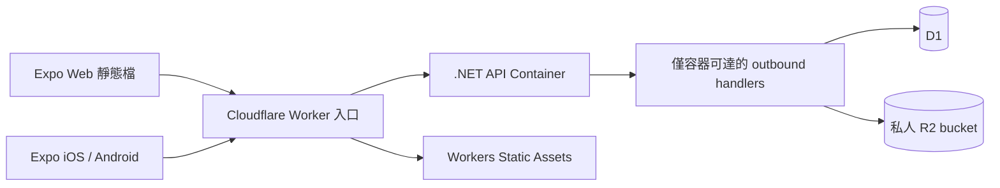

# SPEC-001-PlatformFoundation: 跨平台應用、使用者身分與 Cloudflare 資料基礎

**功能 ID**: SPEC-001-PlatformFoundation
**關聯需求**: [MVP-001-LoveGameDatingApp](../requirements/MVP-001-LoveGameDatingApp.md)
**優先級**: 高
**負責人**: 後續由 `well-done` 承接實作；產品方案由使用者確認
**狀態**: 原 SDD 及 D-017～D-028 修訂已確認；2026-10-29 使用者以「同意目前版本」確認現行文件包，Ready for well-done；未實作
**最後更新**: 2026-10-29（現行版本確認與開發交接；親密度／名片責任邊界維持）
**建議實作順序**: 本 MVP 第 1 順位
**前置 SPEC**: 無
**本輪邊界**: 本份 SDD 已由使用者確認，本輪續作同名 BDD／TDD 與實作前風險稽核；風險確認與交接後停止，不自動進入其他 SPEC。
**本次修訂**: 2026-10-27 使用者要求「全套精簡」，依認證設計審查落實 MVP D-019～D-028：Access 改 HS256 單一秘密、Refresh 加 30 秒寬限窗、單一登入取消 Web 單分頁、移除並行 marker／constraint guard、Google 首次登入直接建帳、provider 欄位縮減、連結不需密碼不踢登出、驗證碼投遞簡化、限流單一 HMAC 秘密且不預建未來政策、傳輸判定縮為兩條規則。先前已確認的 Email 驗證碼、忘記密碼、Google、UUIDv7、auth_／common_ 前綴及不使用 ASP.NET Core Identity／Entity Framework 維持不變。PF-AC 編號不重編。

## 功能概述

為戀愛養成交友平台建立可在 `iOS`、`Android`、Web 運行的應用入口、穩定的帳號身分、私人資料存取邊界，以及 `.NET`／Cloudflare Workers／Containers／D1／R2 的資料與部署基礎。讓後續配對、劇情與好感度功能共用同一個可信的使用者身分與持久化機制。

本份實作完成的可見成果為同風格的開始畫面、Email 密碼／Google 登入、Email 驗證碼註冊、忘記密碼與重設、Google 綁定管理、帳號頁及登出，並能在 Access Token 到期後透過 Refresh Token 延續登入；開發者能在自己的磁碟保存、查詢、修改及匯出本地 D1 資料，並有實際 Cloudflare 測試部署與收信證據。完整交友流程的跨平台驗收仍須待其餘七份 SPEC 完成。

### 需求追溯與責任邊界

| MVP 故事／驗收 | 本份責任 | 對應本份驗收 |
|----------------|----------|--------------|
| `US-013`／`AC-013-01` | Expo 三平台專案、基本帳號流程、Web 匯出及行動版建置入口；完整交友流程由後續 SPEC 擴充 | `PF-AC-001`、`PF-AC-002`、`PF-AC-018` |
| `US-013`／`AC-013-02` | 提供與原型一致的視覺基礎、共用 API 與身分；本份不實作配對、好感度或退出業務規則 | `PF-AC-002`、`PF-AC-003` |
| `US-014`／`AC-014-01`、`AC-014-02` | 本地 D1／SQLite 磁碟狀態、查改、匯出／還原與重啟保存 | `PF-AC-010`、`PF-AC-011`、`PF-AC-012` |
| `US-015`／`AC-015-01`、`AC-015-02` | `.NET` 容器、Worker 入口與 D1／R2；測試環境實際部署，正式環境配置及發布操作說明 | `PF-AC-013`、`PF-AC-014`、`PF-AC-015` |
| MVP「使用者識別、資料歸屬與互動參與權限」基礎配套 | 註冊／登入／復原、Session、本人資料授權與未來參與者檢查介面 | `PF-AC-004` 至 `PF-AC-009`、`PF-AC-016`、`PF-AC-017` |
| `US-002`、`AC-006-02`、`AC-006-03` 的權限基礎 | 提供本人身分、私人檔案介面與預設拒絕的授權契約；照片／分數的實際 DTO 及規則仍由所屬 SPEC 完成 | `PF-AC-009`、`PF-AC-014`、`PF-AC-016` |
| 使用者新增／MVP `US-016`、`AC-016-01` 至 `AC-016-04` | 三平台 Google OAuth／OIDC、後端驗證、SDK 取消；首次登入直接建帳、連結不需密碼；有效 Google ID Token 可重用 | `PF-AC-019` 至 `PF-AC-022`、`PF-AC-035` |
| 使用者新增／MVP `US-017`、`AC-017-01` 至 `AC-017-04` | 短效 Access Token、Refresh Token 輪替（30 秒寬限）／重放偵測、過期恢復與撤銷 | `PF-AC-005` 至 `PF-AC-008`、`PF-AC-023` 至 `PF-AC-026` |
| 使用者新增／MVP `US-018`、`AC-018-01` 至 `AC-018-04` | Email 唯一註冊、驗證碼、本地 log／server 真寄送與第三方 Email 衝突 | `PF-AC-004`、`PF-AC-027` 至 `PF-AC-029`、`PF-AC-031`、`PF-AC-032` |
| 使用者新增／MVP `US-019`、`AC-019-01` 至 `AC-019-03` | 忘記密碼寄碼、單次重設與撤銷登入 | `PF-AC-008`、`PF-AC-028`、`PF-AC-030`、`PF-AC-031` |
| MVP 決策 D-015 | 系統共用固定視窗限流（`common_` 表與 `IRateLimiter`）；本份只交付認證政策，不為尚不存在的功能預建政策 | `PF-AC-017`、`PF-AC-036` |
| MVP 決策 D-016 | 自有表依功能前綴分類，auth_ 用於帳號認證、common_ 用於共用基礎設施 | `PF-AC-037` |

本份不能單獨將 `US-013`、`US-002` 或 `US-006` 標記為全數完成。正式產品發布也不能以測試環境部署代替；實作報告須區分本地、雲端測試與正式發布證據。

### 本份範圍

1. `React Native + Expo`／Web 應用骨架、路由、共用視覺、帳號畫面及 API client。
2. 使用 Email＋密碼註冊／登入，註冊與忘記密碼皆有驗證碼流程；Google OAuth／OIDC 使用同一個平台 Account 與 Email 唯一規則，不要求真名或電話。
3. 平台 Access Token（HS256）／Refresh Token、Web HttpOnly Cookies 與行動版 Bearer／SecureStore、權杖輪替（30 秒寬限）／重放偵測、本人資料授權、修改密碼及登出撤銷。
4. `.NET` 業務分層、Worker 入口、固定指令的 D1／R2 存取橋接。
5. 本地環境、Schema migration、測試種子資料、資料查改與備份／還原操作。
6. Cloudflare 測試部署、正式環境設定範本、健康檢查及發布／回復程序。
7. 本地後端專用驗證碼 log sender；staging／production 經 Cloudflare Email Service 實際發送註冊與重設密碼信，不以 log sender 代替雲端寄送。

化身生成與照片上傳流程、交友欄位、候選對象、聊天室、分數、問卷、遊戲、活動與告白由後續 SPEC 承接。此處不預先建立其業務資料表或可被誤認為完成的模擬頁面。

2026-10-29 MVP D-029～D-031 將原總體好感度更名為「親密度」（仍為雙方個人好感度平均），並新增 `US-020`／`AC-020-01..06`：25 分顯示交換名片入口、引用配對前已輸入資料、雙方同意後揭露、邀請可重送及拒絕不改分。名片欄位由 `SPEC-001-AvatarAndPreferences` 提供，交換／揭露由 `SPEC-001-AffectionAndFeedback` 承接，終止邊界沿用 `SPEC-001-StoryDialogueAndExit`；不擴大本份帳號 DTO 或登入 Email 的可見範圍。本份 PF-AC／API／Schema 不因此新增名片業務，既有 BDD／TDD 不代表已覆蓋 US-020。

## 現況與設計依據

### 已讀取的既有內容

| 來源 | 實際觀察 | 設計影響 |
|------|----------|----------|
| `proposals/prototypes/prototype.v2/package.json` | `Next.js 15.4.11`、`React 19.2.6`；沒有 Expo 或後端依賴 | 建立新的正式應用專案，以原型為視覺參考 |
| 原型 `app/page.tsx`、`engine.ts`、`content.ts` | 全程模擬資料、固定配對對象、單一好感度與 40／75 門檻 | 不複製其狀態模型為平台基礎 |
| 原型 `app/prototype.module.css`、`assets.ts`、`layout.tsx` | 粉玫瑰／深紫色、半透明面板、場景與人物圖、繁體中文入口 | 共用設計 token 與素材清單；以 React Native 可用元件重新實現 |
| `datinghigh/docs/` | 此前只有四份 MVP，無同名進行中／已歸檔 SPEC 文件包 | 本份是新的第一順位 SPEC，不覆寫歷史規格 |

### 開發環境與版本策略

| 項目 | 規劃選擇與已知狀態 |
|------|--------------------|
| `.NET` | 目標 `net10.0`／ASP.NET Core 10；目前可用 SDK `10.0.204`。實作時固定 SDK 與受支援的 10.0 servicing runtime／容器映像 digest，不能只以浮動 `latest` 建置 |
| 資料與身分機制 | 一般 .NET services／repositories、BCL 密碼學、ASP.NET Core JWT middleware（HS256）與 D1 prepared SQL；不導入 ASP.NET Core Identity／Entity Framework |
| Expo | 採已發布的 SDK 58 與其相容的 React Native／React／Router 套件組；以 `expo install` 解析相容依賴並提交 lockfile。採 development build，不依賴商店版 Expo Go 已更新 |
| Node.js | 目前 `24.11.1`，符合 SDK 58 的 Node 24.3+ 要求；專案固定 Node 24 主版本及 lockfile |
| Cloudflare | Wrangler 4，最低 `4.136.0` 以支援 Durable Object scheduling 的本地容器；使用自有 Dockerfile。實作開始時固定實際 patch、Containers SDK 與 `compatibility_date = 2026-10-24`，提交鎖檔，不使用未鎖定的全域 CLI |
| 本地容器 | Docker Server `29.1.3` 已回應；已找到 Android `adb` 與 JDK 17。這不代表新專案已通過容器建置或 Android 編譯 |
| 本地資料 | SQLite CLI `3.44.3`、Python SQLite `3.50.4` 可用，已確認磁碟寫入後可重開讀取；專案預設使用 D1 本地環境，以其 SQL 與 binding 行為驗收 |
| iOS | Windows 無法本機使用 Xcode 編譯；需 macOS／Xcode 的 development build 與 iOS 執行證據，或經選定的雲端建置服務產生可驗證 build。尚未選定／驗證此環境，不得宣稱 iOS 已通過 |

SDK、CLI 或映像在實作時若已不能支援本設計，須記錄相容性差異並修訂本份；不能無紀錄地改用另一個 SDK 主版本。雲端帳號、付費方案、實際資源 ID、網域與行動版簽署憑證留在部署設定或安全憑證庫，不填入虛構值。

## 功能設計

### 架構與信任邊界



- Web 明確設定 `expo.web.output = "single"`，以 `expo export --platform web` 匯出 client SPA，由同一個 Worker 的 Static Assets 提供；API 使用同源 `/api/v1/*`，避免正式 Web 依賴第三方 Cookie。SDK 58 範本可能預設 server output，不沿用該預設部署。
- Worker 先處理 `/api/*`、`/health/*` 與被拒絕的 `/internal/*`；未知 API 回 JSON 404，不得落入 SPA 的 HTML fallback。其他合法前端路由由 SPA 接手。
- `.NET` 使用 Linux 容器、監聽容器內 `8080`；Worker 僅經容器 binding 轉送。初期每環境一個邏輯容器 `api-v1`，不按使用者分容器；Session 與資料不依賴容器記憶體。
- 容器的 Durable Object wrapper 只負責容器生命週期及路由；D1 是本份應用資料的權威，不額外引入另一份 DO SQLite 使用者資料。
- `.NET` 經虛擬 host `http://platform.internal` 呼叫 outbound handler；handler 的固定指令才可存取 D1／R2 bindings。此虛擬 host 不建立公開 DNS；公網 Worker 不提供對應內部路由。
- Worker 清除外部送入的 `X-DatingHigh-Internal-*` 信任標頭，再建立 request ID、環境、可信代理 IP（`X-DatingHigh-Internal-Client-Ip`，僅 Worker 設定）等內部 context。`X-DatingHigh-Client` 是經檢查的公開傳輸／CSRF 標記，不是身分憑證。使用者 ID 仍須由 `.NET` 驗證 Access Token 與 D1 Session family，不能信任外部身分標頭。
- 公開 HTTP API 一律 HTTPS；本地迴圈位址可使用 HTTP。私人憑證、Cloudflare API token、D1 SQL 與 R2 管理權限皆不進入 Expo bundle。

### 預計專案配置

以下均為後續實作時新增的程式路徑；本輪只產出規劃文件包：

```text
datinghigh/
  apps/client/                     Expo Router、三平台畫面與 API client
  server/DatingHigh.sln
  server/src/DatingHigh.Domain/
  server/src/DatingHigh.Application/
  server/src/DatingHigh.Infrastructure/
  server/src/DatingHigh.Api/
  server/tests/
  cloudflare/src/                  Worker、Container wrapper、固定資料指令
  cloudflare/migrations/
  cloudflare/wrangler.jsonc
  cloudflare/.wrangler/state/      預設本地 D1／R2 磁碟狀態，不納入 Git
  scripts/                        本地啟動、查改、備份、部署與 smoke 操作
  .local/instances/                還原時建立的新本地 instance，不納入 Git
  .local/backups/                  本地備份，不納入 Git
```

所有命令以 `datinghigh/` 為工作根目錄；本地 wrappers 將根目錄解析成絕對路徑，避免從另一個 cwd 啟動時產生第二套資料。新增專案的依賴與命令限於 `datinghigh`。

### DDD 與應用分層

| 層級 | 元件／契約 | 責任 |
|------|------------|------|
| Domain | `Account` Aggregate Root、`ExternalIdentity`、`EmailChallenge` | 已驗證且唯一的 Email、可選本地密碼、狀態及憑證版本；provider＋subject 唯一歸屬與目的綁定驗證碼 |
| Domain | `AccountId`、`EmailAddress`、`CredentialVersion` | 不可變使用者身分、Email 正規化與憑證版本；Email 是私人登入識別，不是化身暱稱 |
| Application | `RequestRegistrationCode`、`ConfirmRegistration`、`RequestPasswordReset`、`ResetPassword`、`CreateSession`、`RefreshSession`、`CompleteExternalSignIn`、`LinkExternalIdentity`、`ChangePassword`、`RevokeSession` | Email／密碼／第三方 adapter 驗證、Email 單次挑戰、核發／輪替平台權杖、控制結果與錯誤 |
| Application | `IEmailChallengeStore`、`IEmailCodeSender`、`ICurrentUser`、`IAccountRepository`、`IAuthSessionStore`、`IExternalCredentialValidator`、`IPasswordHashService`、`IAccessTokenIssuer`、`IRateLimiter`、`RateLimitPolicies` | 本地 log 與 server 真寄信 adapters；條件式帳號更新、family／refresh、第三方驗證 adapters 及跨容器限流（政策為靜態常數） |
| Application | `IPrivateObjectStore`、`IResourceAccessPolicy` | 私人檔案存取與資源參與者檢查介面；未知資源種類／未提供授權實作時拒絕 |
| Infrastructure | `CloudflarePlatformClient`、repository／object-store adapters | 呼叫固定的 outbound handler 指令；不拼接外部 SQL 或將秘密交給 client |
| API | ASP.NET Core Minimal API、JWT authentication＋Session family 驗證、ProblemDetails | HTTP／第三方 credential 提交契約、Web／行動端傳輸、授權、輸入長度與錯誤投影 |
| Worker | `PublicRouter`、`PlatformCommandDispatcher` | 同源資產與 API 路由、可信代理 context、固定 SQL／R2 操作、環境與資料操作約束 |
| Client | `SessionProvider`、`ApiClient`、平台憑證儲存 adapter | 登入狀態恢復、失效回登入、三平台共用 DTO；不作為資料權限的權威 |

`Account` 與其 Session 是本份的身分邊界。未來 `MatchSession` 的參與者名單由 `SPEC-001-MatchingSessions` 提供，不能在本份用「所有登入者皆可」的 stub 取代；照片及分數存取須引用已驗證的 `AccountId`，不以 client 送入的 owner ID 授權。

### Email 身分、唯一性與密碼

1. 所有帳號必須有已驗證的 `email_normalized`，無論由 Email 或任一已啟用第三方 provider 建立，都共用 `auth_accounts.email_normalized` 的 UNIQUE 約束。先查詢提供明確錯誤，提交時再以索引處理競態；不能分開用「本地帳號表」與「第三方帳號表」各自去重。
2. 本版接受 ASCII addr-spec Email（不含 display name／註解），trim 外側空白並對整個地址以 invariant lowercase 正規化，最長 254 bytes、local-part 最長 64 bytes；格式由同一 server 元件驗證。此為產品採大小寫不敏感的登入規則，不刪除 `+tag` 或 Gmail 的點，也不推測不同字面地址的 alias 等價。
3. Email 註冊若地址已由任何登入方式註冊，回 409 `EMAIL_ALREADY_REGISTERED`，不新建帳號、不寄註冊碼；任一 provider 的新 subject 使用已存在的同一 Email 亦不得另建帳號，提示先使用原有方式登入再明確連結。相同 Email 不是自動合併或自動連結的授權。
4. Email 是私人登入與通知資訊；本人帳號頁可見，配對對方的資料／畫面與 JWT 不含 Email。公開暱稱仍由化身 SPEC 管理，本份不提供修改 Email，以免把地址變更與帳號合併混在登入流程。
5. 密碼為 12–128 個 Unicode scalar values、最多 512 UTF-8 bytes；不 trim／改大小寫／正規化，拒絕NUL、控制字元及孤立surrogate；UTF-8採嚴格編碼，不用replacement fallback替換輸入。密碼由獨立 `IPasswordHashService` 使用 .NET BCL `Rfc2898DeriveBytes.Pbkdf2` 的 PBKDF2-HMAC-SHA256（600000 次、每筆 16-byte CSPRNG salt、32-byte derived key）處理；以 `CryptographicOperations.FixedTimeEquals` 比對。password_hash 保存版本／演算法／成本／salt／derived key 的自描述字串，parser 僅接受支援的格式與受限參數；保留等價密碼的條件 rehash。依使用者指示，不使用 ASP.NET Core Identity／其 PasswordHasher、UserManager／EF 或自動 Identity 資料表。
6. 只有驗證碼確認成功後才建立 Active Account、`email_verified_at` 與初始 token family；未確認的註冊只存在限時 challenge，不可登入、不可取得平台 token，也不長期占用 Email。註冊時密碼在最終確認才傳至後端雜湊，challenge 不保存明文密碼。
7. 僅第三方登入的帳號可無本地密碼；帳密登入仍回通用 `INVALID_CREDENTIALS`。本人可透過下述 Email 重設流程設定本地密碼；第三方綁定保留。已存在本地密碼的正常修改仍要求目前密碼。

### Email 驗證碼與註冊流程

1. `POST /email-registrations` 送出 Email，檢查格式／限流與全域重複後建立 `register_email` challenge，回 `challengeId, flowToken, expiresAt, resendAfter`。flowToken 為 32 bytes 隨機值，D1 只存 SHA-256，用於把碼綁定原發起流程，不能只靠可猜的 Email／challenge ID 嘗試驗證。
2. 驗證碼為 CSPRNG 產生的六位數字，保留前導零、有效 10 分鐘，最多 5 次錯誤，60 秒後可重寄。每 challenge 絕對 30 分鐘內有效；重寄產生新 generation、使舊碼失效，不重設累計錯誤次數，不延長絕對期限。
3. D1 保存 `HMAC-SHA256(EMAIL_CODE_HMAC_KEY, challengeId|purpose|normalizedEmail|generation|code)`，不保存明文碼／可離線窮舉的裸 SHA-256。MAC 僅由 .NET 計算與 constant-time 比對：UTF-8 無 BOM，欄位依序以 ASCII `|` 串接（小寫 UUID D 格式 challengeId、purpose 固定字面、canonical Email、無前導零十進位 generation、原六位 ASCII code），key 由 Base64 解碼，輸出 64 字元 lowercase hex。驗證檢查 purpose、Email、flowToken、generation、期限、次數與一次性狀態；註冊碼不能拿去重設密碼，反向亦然。`EMAIL_CODE_HMAC_KEY` 輪替時未完成的挑戰作廢，使用者重新請求寄碼。
4. 使用者輸入碼與密碼，呼叫 `POST /accounts`。同一個 D1 batch 在「challenge 仍為 active 且 generation／code MAC 相符、Email 尚未存在」的共同前置條件下建立已驗證 Account、family 與 generation 0 Refresh，最後一句才將 challenge 標為 consumed；任何失敗不得消耗未完成的碼或留下半套帳號。並行 Email／Google 確認同地址，最多一份 Account 成功（UNIQUE `email_normalized` 為最終防線）。
5. 寄碼流程：先持久化新 generation 與 code MAC，再呼叫 sender（逾時 10 秒）。sender 成功才回 202；Email 註冊與其重寄遇 sender 失敗或逾時，回 503 `EMAIL_DELIVERY_FAILED`，challenge 保留，冷卻後重寄會產生新 generation，因此未送達的舊碼自然失效；忘記密碼的失敗處理見下節。不盲目重送舊碼。
6. `POST /email-challenges/{id}/resend` 需 flowToken，不能改目的／收件人；重寄開始使舊 generation 失效。建立／重寄回應不含 code。

### 忘記密碼與重設

1. `/forgot-password` 輸入 Email，`POST /password-reset-requests` 對已註冊地址建立 `reset_password` challenge，固定 Account ID 與當前 `credential_version`；僅第三方登入已驗證帳號亦可使用，完成後可透過 Email＋新密碼登入。
2. 不存在 Email 也回相同 202、challenge 形式與「若此 Email 可處理，將收到驗證碼」文案；不寄信、不回 404 或揭露登入方式。該虛擬 challenge 無 Account，無論輸入任何碼都不能重設；正常必要I/O完成即回覆，不加人為固定延遲；不承諾已知／未知地址同時長，依MVP D-018接受時間差剩餘風險。錯誤不回顯地址是否存在。
3. `/reset-password` 輸入六位碼、新密碼與確認密碼，提交 `POST /password-resets` 的 `challengeId, flowToken, code, newPassword`；前端確認欄位不需重複送 API。碼的期限／重寄／錯誤上限沿用前節，後端不依前端「已通過驗證」布林值授權。
4. 驗證成功後，同一個 D1 batch 先在「challenge 仍 active 且 generation／code MAC 相符、Account cv 相符」的條件下更新 password hash 並增加 `credential_version`，最後一句消耗 challenge；所有舊 Access／Refresh family 立即失效，其他重設 challenge 因綁定舊 cv 也失效。不解除任何第三方綁定、不自動登入；提示使用新密碼重新登入。
5. 錯碼、過期、超次數、用途錯誤、flowToken 不符、無帳號、已消耗或 cv 改變，均不能修改密碼。重設提交結果不明時先嘗試新密碼登入，不重放已可能消耗的碼，也不回滾已提交的新密碼。
6. reset request／resend 即使 sender 失敗亦回相同通用 202 文案，不在回應內容直接揭露帳號存在性（時間差不保證消除）；後台 log 記錄發送失敗，使用者於 60 秒冷卻後可重寄新 generation。全域設定缺失／服務明確未就緒可在查帳號前對所有請求一致回 503。

### 本機 log 與 server 寄信

| 環境 | 寄送方式 | 必須遵守的邊界 |
|------|----------|----------------|
| 明確 `APP_ENV=local` 且 `EmailDeliveryMode=Log` | `.NET LocalEmailCodeSender` 在後端終端的專用 `LocalEmailVerification` category 輸出 purpose、challenge ID、收件 Email、generation、code、到期時間 | 這是使用者明確要求的本機 log 例外；不回前端、不進一般 access log、不送雲端 telemetry、不連正式寄信。可用同一輸出測試註冊／忘記密碼 |
| 自動化 test | 受控 fake sender／收件測試介面 | 只供測試，不列為 server 真信驗收證據 |
| staging／production 等全部 server 環境 | `.NET CloudflareEmailCodeSender` 經內部 outbound handler 使用 `EMAIL.send()`，寄到實際收件 Email | 使用 Cloudflare Email Service 的已驗證寄件網域／from、固定註冊或密碼重設範本；不可使用 Email Routing 的既有驗證收件人限制代替一般註冊收件人寄送 |

- server 若設定 Log mode、缺 sender binding／verified domain／必要秘密，ready 失敗；不自動降級 log、不將 raw code 寫入 server logs／response／URL。一般日誌只記 challenge ID、用途、發送結果、provider message ID 與 trace ID，收件地址遮罩。
- 寄信 handler 僅接受有效 challenge 的既定收件人與固定用途範本，不接受 client 任意 from／to／HTML／subject，避免成為公開寄信端點。發送時不把密碼或 Access／Refresh Token 放進 Email。
- provider 接受不代表已送達信箱。staging 需以實際收到註冊及重設碼並完成流程作驗收，保存去除 raw code／token 的 message ID／時間與結果；不以 202／message ID 代替收信證據。
- 目前官方 Email Service 發信能力標示 Beta，需 Cloudflare DNS 的已 onboard 寄件網域。實作先檢查帳號是否可用與配額／sender 狀態；不可用時列真寄信未驗收並修正方案，不以假寄送結案。

### 第三方登入共用模型與 provider 邊界

- 資料表、共用 API、Application 用例與 DTO 使用通用 `provider` 欄位；本份實際實作並驗收 `google` adapter。未啟用的 provider（包含未來 `facebook`）回 400 `UNSUPPORTED_PROVIDER`，不呼叫任意外部網址。未來 provider 需另加入 adapter／設定與驗收。
- 每個 provider 由一個 `IExternalCredentialValidator` 實作負責，以 provider 字串經 DI 解析；可用 provider 與 client／app 設定來自伺服器配置，client 不能提供 issuer／JWKS URL／audience／app ID 擴大信任範圍。登入或連結由 endpoint 決定，不接收 client 指定 owner。
- `IExternalCredentialValidator` 輸入 clientPlatform 與 credential，輸出 `VerifiedExternalIdentity(Provider, Subject, EmailNormalized)`。Google adapter 在後端驗 ID Token；未來 provider 的 access token／code 等證明由自己的 adapter 驗證，不一律當 Google JWT。
- 穩定身分唯一鍵為 `(provider, subject)`，subject 保留大小寫、不預設數字或 GUID、不信任 client profile。Google 的 issuer 於驗證時固定檢查，不另存 namespace 欄位；未來 provider 若 subject 僅在租戶／app 內唯一，再以新增 migration 補欄位。
- 沒有專用 `auth_challenges` 表：App／SDK 管理當次登入互動、重複提交與取消，後端直接驗證第三方 credential；沒有第三方挑戰 ID／flowToken、5 分鐘期限、預先綁定原 Session 或 credential 單次消耗紀錄。第三方首次登入也不使用 Email 驗證碼挑戰（D-023）；`auth_email_challenges` 只有 `register_email`、`reset_password` 兩種用途。
- 每 Account 每 provider 最多一個身分，以 `UNIQUE(account_id, provider)` 保護；`(provider, subject)` 唯一 owner。全域 Email 防重與最後登入方式限制適用所有 provider。
- `AccountDto.linkedProviders` 為集合，例如 `["google"]`，可擴充其他 provider；無平台專屬 linked 布林欄位。

### Google adapter 的 OAuth／OIDC 與帳號綁定

Web 使用 Google Identity Services popup／JavaScript callback，iOS／Android 使用 Expo development build 內的 `react-native-nitro-google-signin`。SDK 直接取得 ID Token，只取登入身分與 Email，不要求 Google offline access 或額外 API scopes。原生 URL scheme／Google client 設定依 SDK 完成。

1. Client 直接啟動 SDK 登入；以本機操作序號／進行中旗標管理一次互動，只接受目前操作的 SDK 結果。取消、登出或切換帳號時使舊操作失效。這些 client 檢查改善正常操作；後端仍獨立執行必要身分及權限驗證。
2. SDK／client 平台 adapter 按所選登入模式處理自己的回傳關聯及所需 state／nonce。後端不產生或保存預期 nonce。有效 SDK cached ID Token 可送後端驗證，不要求 token 必須為本次新產生；過期／無效 token 必須重新由 SDK 取得。
3. Google 成功後，登入呼叫 `POST /sessions/external/google`，連結呼叫 `POST /me/identities/google`，body 皆只有 `credential, clientPlatform`。Web 使用本站 JS callback 再送 JSON，套用精確 Origin、自訂 header、SameSite Cookie／CORS；不啟用 Google 直接表單 POST 的 login_uri 或跨站 callback GET 例外。
4. `.NET` 使用成熟 Google／JWT 驗證元件與 Google JWKS，驗證 RS256 簽章、合法 issuer、本環境精確 audience、必要的 azp、exp／iat、非空 sub、`email_verified=true` 與 Email 格式／正規化。Google 合法 issuer 驗證後固定視為 `https://accounts.google.com`；以大小寫敏感 sub 識別身分，不接受 client 自報身分／Email。
5. **Email 可信規則**：僅在 Email 網域為 `gmail.com`，或 ID Token 的 `hd` claim 等於 Email 網域時，才信任該 Email；否則回 401 `EXTERNAL_EMAIL_UNTRUSTED`，不建帳也不登入。
6. 既有 `(google, sub)` 身分：驗證 token 的 Email 與 Account 相同（不同回 `EXTERNAL_EMAIL_CHANGED`，不自動改 Email、搬資料或合併），經帳號狀態檢查後以 `session.create` 登入，回 200 與平台 Access／Refresh。新 sub 且 Email 未註冊：同一個 D1 batch 建立 Account（password NULL、`email_verified_at` 為建立時間）、identity、family 與 generation 0 Refresh，回 201（D-023；Email 可信度由上一點規則與 Google 的 `email_verified` 保證，不再要求 Email 收件碼）。新 sub 但 Email 已存在：回 409 `EMAIL_ALREADY_REGISTERED`，提示先用既有方式登入再於帳號頁連結；相同 Email 不是自動合併或自動連結的授權。JWKS／驗簽在 D1 交易之外，依賴失敗不假裝登入成功。
7. 同一份仍有效的 Google ID Token 可再次通過驗證並再登入，這是已接受的簡化；每次成功登入仍依單一登入規則撤銷舊 family，驗證失敗不撤銷原有效登入。`(provider, subject)`／Email UNIQUE 仍防重複建帳或搬移身分；Email 驗證碼保持單次使用，平台 Refresh Token 單次輪替（含 30 秒寬限）。
8. Google ID Token 僅暫存應用記憶體，以 HTTPS body 傳輸，處理後清除，不進 sessionStorage／SecureStore／URL／日誌／D1。server 不需 Google client secret、不取 Google Refresh Token；Google credential 不能作平台業務 API 憑證。Google 姓名／頭像不保存或公開為化身。

**連結與解除規則**：

- 連結 `POST /me/identities/google`：需提交當下有效的平台 Access 與 family（Account Active／cv 相符）；provider 驗證後的 Email 必須等於本人 Email，否則 `EXTERNAL_EMAIL_MISMATCH`（D-025）。**不需要目前密碼，不增加 cv，不撤銷任何 family，不要求重新登入**。成功回 200 `{provider, linked: true}`；同 Account 同 identity 重複連結亦回 `linked: true`，不重複寫入。identity 已屬其他 Account 回 409 `EXTERNAL_IDENTITY_IN_USE`；寫入以條件 `INSERT … SELECT`（Account active 且 cv 與提交時 Access 相同）加上 UNIQUE 約束完成，零列代表未寫入並回 409 `CREDENTIAL_CHANGED`。
- 解除 `DELETE /me/identities/{provider}`：需有效 Access 與目前本地密碼；帳號沒有本地密碼（`password_hash IS NULL`）時回 409 `LAST_LOGIN_METHOD`，因此不能刪除最後登入方式。成功時同一 batch 條件增加 cv 並刪除 identity，所有舊 family 失效，要求重新登入。
- 僅第三方登入的帳號沒有可連結或可解除的項目；要新增本地密碼走忘記密碼的 Email 重設流程。
- SDK 取消／失敗／晚回的舊結果由 App 忽略；無效／過期 credential、Web CSRF／Origin 不符、無本人授權均由後端拒絕。登入／連結 HTTP 已送出時禁重複提交及開始帳號切換；回應不明不自動重送寫入，以唯讀 `GET /session`、`GET /me/identities` 確認結果，無法確認時顯示重新登入／操作提示。
- Google 設定缺失時顯示暫不可用，帳密仍可運作；Google 驗收保持未完成，不以 mock 代替。

### Access Token／Refresh Token 與 Session family

`AuthSession` 定義為某次裝置登入的 **refresh token family**；撤銷此 family 會使其全部 Access／Refresh Token 失效。

#### 單一登入（MVP D-017／D-021）

- 同 Account 最多一個未撤銷 family；不同裝置只能先後使用。新裝置完成帳密／Google 驗證且新登入交易成功時，舊 family 的所有 Access／Refresh 立即於後端失效，沒有雙登入寬限。不同 Account 仍可各有一個有效 family。
- `session.create` 為同一個 D1 batch，所有步驟共用同一前置條件「Account 為 active 且 `credential_version` 等於登入驗證時讀到的值」：① 條件撤銷該 Account 全部 `revoked_at IS NULL` 的舊列（含已過期者），reason=`replaced_by_login`；② 條件 INSERT 新 family；③ INSERT generation 0 Refresh（依新 family 存在）。前置條件不成立時三步皆零列、未寫入任何東西，回 409 `CREDENTIAL_CHANGED`；新 family 與並行登入競爭時，`UNIQUE(account_id) WHERE revoked_at IS NULL` 使整批回滾，可重讀後最多重試一次，仍衝突回 409。新登入驗證、token 隨機值與 JWT 簽署等前置工作在 commit 前完成，憑證 commit 前不曝光。正常登入不寫 `auth_accounts`、不增加 cv。
- 首次 Email／Google 建帳的 family 亦受同一 partial UNIQUE 約束。歷史已撤銷 family 與 Refresh lineage 按保留期保存。
- 同 Account 的 Email／Google 登入並行，以成功 commit 先後判定：最後一個成功交易是唯一有效登入，先成功者即使 HTTP 晚回也已失效；不依 client 點擊時間或 HTTP 回應順序判定。
- 「新登入失敗保留舊登入」指驗證、SQL 在 commit 前失敗；commit 成功但回應遺失時，舊 family 已撤銷，不假裝回滾。舊端下一次 API 或回前景重驗時清私人畫面，顯示「帳號已在其他裝置登入，請重新登入」；後端撤銷立即生效，不承諾離線／閒置畫面同毫秒更新，不新增 push 端點。
- 舊 family 的 refresh／重放撤銷／logout 僅作用於其識別的 family，不能撤銷或復活新 family。
- **Web 不限制分頁數**：同一瀏覽器的多個分頁共用 Cookie，即同一個 family。client 於分頁 focus／pageshow／visibilitychange 與每次已登入回應，比對回應標頭 `X-DatingHigh-Session`（目前 family ID，非秘密，CORS 暴露）與畫面所屬 family；不符或收到 401 `SESSION_REVOKED` 即清除私人畫面，唯讀 `GET /session` 重驗後回登入。**已知接受風險**：同瀏覽器另一分頁以不同帳號登入後，舊分頁在重驗前送出的請求會帶新 Cookie 以新帳號執行；本份受保護寫入（改密碼、解除連結）皆需目前密碼，連結／登出僅影響本人，因此不新增請求前置條件。後續含敏感寫入的 SPEC 須自行加上前置條件。

| 項目 | 契約 |
|------|------|
| Access Token | 平台簽發 **HS256** JWT，單一環境秘密 `ACCESS_TOKEN_SECRET`，header `typ=at+jwt`，最長 10 分鐘；claims 為 `iss, aud, sub(AccountId), sid(familyId), cv, jti, iat, nbf, exp`，不含 Google profile 或私人分數。固定 issuer／audience／演算法／typ，拒絕 `none`、非 HS256、錯 audience／issuer 及 token 類型混用；JWT 時間驗證偏差最多 30 秒，family 到期／撤銷則以伺服器時間嚴格判定 |
| Refresh Token | 平台產生 32 bytes 隨機 opaque token（Base64URL 43 字元），D1 只存 SHA-256、family、generation 與使用／替代關係。只能用於 refresh／logout，不能直接呼叫業務 API |
| Family 期限 | 登入起絕對 30 日，閒置上限 7 日；每次成功 refresh 才更新 idle expiry，不能延長絕對期限。Access `exp` 不超過 family 的絕對／當前 idle expiry |
| Access 驗證 | 驗簽及時間通過後，每次在 D1 primary 檢查 family 未撤銷、期限未到、Account Active、`cv` 相符；不因 JWT 尚未到期而忽略登出／停用／憑證修改。family 撤銷或 cv 不符皆回 `SESSION_REVOKED` |
| 簽署秘密 | `ACCESS_TOKEN_SECRET` 至少 32 bytes 隨機值，僅在伺服器秘密設定，跨容器重啟穩定。輪替或洩漏時直接更換：既有 Access 全數失效，client 以 Refresh 補發，不需要 overlap |

**Refresh rotation 與 30 秒寬限窗**（MVP D-020）：

- 每次成功 refresh 原子消耗目前 generation 的 Refresh Token，建立唯一後繼並簽發新 Access Token。D1 batch：① CAS 更新 family（`current_generation = g` → `g+1`、更新 idle expiry；條件為 family 未撤銷、未到期、cv 相符）；② 以 `INSERT … SELECT` 插入 generation `g+1` 的後繼 token，`UNIQUE(session_id, generation)` 為最終線性化點，並行輸家在此因 UNIQUE 衝突使整批回滾；③ 標記前 token `consumed_at`／`replaced_by_token_id`。CAS 零列不核發 pair。
- 出示**已消耗** token 時，以其 `consumed_at` 與世代判斷：
  1. 距 `consumed_at` 30 秒內，且該 token 為緊接目前 head 的前一代（`generation = current_generation − 1`）：視為回應遺失或並行刷新落敗，不撤銷；從目前 head 再輪替一次（消耗 head、簽發新後繼與新 Access），回 200。
  2. 距 `consumed_at` 30 秒內但不符上述（例如已被寬限重試再輪替超過一代）：回 409 `REFRESH_RETRY`，不撤銷；client 改用最新儲存的 Refresh（原生為 SecureStore，Web 為最新 Cookie）重試一次。
  3. 超過 30 秒重放：回 401 `REFRESH_TOKEN_REUSE`，持久撤銷整個 family（含較新的後繼）。

  未知隨機 token 不影響任何 family；舊 family 的重放不能撤銷新 family。已消耗 token 的 hash／替代關係保留至 family 絕對到期後 7 日。
- 伺服器不保存明文 Refresh Token，因此寬限重試是「再發新後繼」而非回傳原後繼。已知接受風險：竊取者須在合法 client 使用該 token 後 30 秒內重放，才能取得一組新 pair，之後合法 client 的下一次使用會落入情形 1／2／3 之一。
- Web 的兩個 Cookie 在多分頁間共享，分頁並行刷新由寬限窗吸收，不需要跨分頁鎖；單一分頁內的多個請求仍以 single-flight 合併為一次 refresh，原生同理。
- 若刷新已提交但回應遺失，client 可用同一 token 於 30 秒內重試（情形 1）；超過 30 秒原生需重新登入，Web 可先以目前 Cookie 做一次唯讀 `GET /session` 確認。
- 一般 API 只有 `ACCESS_TOKEN_EXPIRED`／`ACCESS_TOKEN_MISSING` 可觸發一次 refresh；成功後最多重送一次原請求，且該 401 必須在業務 handler 前產生，保證原動作未執行。網路結果不明／一般業務 401 不自動重放寫入。refresh 401 直接回登入，不遞迴 refresh。

### Web／行動版傳輸、恢復與登出

- Web 使用 `__Host-datinghigh_access` 與 `__Host-datinghigh_refresh` 兩個 Cookie，皆為 `HttpOnly; Secure; SameSite=Strict; Path=/`、無 Domain；Max-Age 分別依權杖有效期。Web JSON 僅回 expiresAt 等 metadata，不含任一 raw token，不使用 localStorage／sessionStorage 保存平台 token。
- 原生 Access Token 只存記憶體，Refresh Token 及 family ID 存 SecureStore；啟動／記憶體 Access 遺失時以 Refresh 取得新 pair。輪替後先確保新 Refresh 成功寫入安全儲存，再對外恢復請求；寫入失敗清除本機登入狀態並要求重新登入。
- **傳輸判定只有兩條規則**（D-028）：① 帶 `Origin` 的請求一律視為 web 傳輸，`clientPlatform` 不是 `web` 回 400，且須精確 Origin＋`X-DatingHigh-Client: web`＋JSON；② `clientPlatform=web` 只讀平台 Cookie（忽略 Authorization 與 body 的 refreshToken），`ios`／`android` 只讀 Bearer／body `refreshToken`（忽略 Cookie）。refresh endpoint 只讀 Refresh、業務 API 只讀 Access，不接受 Access 冒充 Refresh。平台欄位不授予資料權限。
- Web 非安全方法精確比對設定的 Origin，要求 JSON 與 `X-DatingHigh-Client: web`；註冊／登入／refresh／登出／連結／解除／復原皆適用，第三方 credential 提交也適用，無跨站 GET 寫入或 callback 例外。
- 正式 Web 同源；本地 origin 列明白名單，禁止 wildcard credentialed CORS。OPTIONS 僅放行指定來源／方法／header（含暴露 `X-DatingHigh-Session`），不要求 Access Token。開發 HTTP 使用獨立 `datinghigh_access_dev`／`datinghigh_refresh_dev`；雲端平台 Cookie 一律 Secure。
- 登出以任一仍可識別 family 的平台憑證處理：有效 Access JWT，或該 family 的 Refresh（含過期／已消耗者，僅供撤銷）。兩者指向不同 family 時拒絕。撤銷持久化後才清本次對應憑證；舊裝置的 logout 只撤舊 family，不能影響後來已接手的新 family。
- 登出撤銷與 refresh 同時發生時，以 D1 的原子有效性檢查決定先後；撤銷提交後，不論 refresh 是否先回應，該 family 的新舊 Access／Refresh 都不可使用。改密碼、Email 重設密碼、Google 解除或停用使所有舊 family 失效（cv 不符）。
- 登出連線失敗可隱藏本機私人畫面，保留只供撤銷重試的憑證並顯示尚未完成伺服器登出；下次啟動不得先自動 refresh 待撤銷 family。登出不登出 Google 本身，也不自動解除 Google 綁定。

### 固定資料操作、交易與一致性

Cloudflare 文件允許容器經 outbound handlers 使用 D1／R2 bindings。本份採此方式；不導入 Entity Framework／ASP.NET Core Identity，repositories 經固定 command 與 prepared SQL 使用 D1。

| 固定 command | 輸入與資料邊界 | 原子性／回傳規則 |
|---------------|----------------|------------------|
| `rate-limit.consume` | `.NET` 依靜態 `RateLimitPolicies` 選政策，傳入 policy_key、subject_type、已計算的 subject_hash 與視窗；handler 驗證 policy／subject_type 組合在固定表內 | 同 batch UPSERT 適用政策並 RETURNING 計數，回 RateLimitDecision；超限先提交計數，呼叫端停止受保護動作，HTTP 回 429；不接受 client 自訂 bucket／限額 |
| `email.challenge.create/resend/fail-attempt` | 固定 Email／purpose（`register_email`、`reset_password`）／flow hash／code HMAC／generation／cv | 原子建立／更新挑戰，重寄 CAS、錯誤次數原子累加；不接受 client 改收件人或 purpose |
| `email.code.send` | 已持久化挑戰 ID／generation 與當次 code；僅 `.NET` 可信 sender 可呼叫 | Worker 驗證當前 challenge／收件人／用途，使用固定範本與 EMAIL binding；不將寄信 API 開放至公網。local mode 由 `.NET` log sender 處理，不走 server send |
| `account.register-email` | 有效 flow／code 挑戰、目前 Email、Account／family／Refresh ID 及 password hash | 同 batch 在 challenge 仍 active 的前置條件下建立 Account／family／Refresh，最後一句消耗挑戰；UNIQUE Email 最終防重 |
| `account.register-external` | `.NET` 已驗證的 provider／subject／Email、Account／identity／family／Refresh ID；無挑戰 | 同 batch 建立 Account（password NULL）／identity／family／Refresh；UNIQUE Email／(provider, subject) 衝突使整批回滾並回 409 |
| `account.lookup-credentials` | 正規化 Email，僅可信 handler | 固定私有欄位供密碼驗證，不能投影至公開 DTO |
| `session.create` | 已驗證 Account ID／cv、新 family／Refresh hash | 同 batch 條件撤銷該 Account 全部 `revoked_at IS NULL` 舊 family、條件建新 family 與 Refresh；Account active／cv 不符則零列且未寫入、不曝光 pair；並行登入競爭時 partial UNIQUE 使整批回滾 |
| `session.validate`、`session.revoke` | `.NET` 已驗簽的 Access claims；撤銷亦可用 Refresh hash 識別 family | primary 讀取 Account／family 與 cv；撤銷為單句持久更新，已撤銷／不存在回冪等成功；Refresh 不具一般授權效力 |
| `session.refresh` | Refresh hash、預期 generation、新 Refresh hash／ID；平台與原 family 相符 | 依前述 Refresh rotation batch；CAS 零列或 UNIQUE 衝突不核發 pair，重讀後依 30 秒寬限規則處理 |
| `account.change-password` | 已驗簽 Access claims、Account ID、預期 cv、新 password hash | 單句條件更新（`WHERE cv = 預期`）並 cv+1，使所有舊 family 失效；零列回 409 `CREDENTIAL_CHANGED` |
| `account.reset-password` | reset challenge／flow／code 驗證結果、固定 Account ID／cv、新 password hash | 同 batch：先在 challenge 仍 active 且與 code MAC／cv 相符的條件下更新密碼並 cv+1，再依該更新結果消耗挑戰；兩次確認、cv 已改或用途錯誤皆不得重設 |
| `account.rehash` | 本人有效 Access、舊 password_hash 值、等價新 hash | 條件式 rehash（`WHERE password_hash = 舊值`）不增加 cv，不覆寫競態中的新密碼 |
| `identity.external.link` | 已驗證本人 Access／family 與 provider credential 的 `VerifiedExternalIdentity`；固定 Account ID／cv | 條件 `INSERT … SELECT`（Account active 且 cv 相符），UNIQUE 防止搬移；不增加 cv；同 identity 已連結回冪等成功 |
| `identity.external.unlink` | 本人有效 Access、已驗證的本地密碼、預期 cv | 同 batch：先條件 cv+1（需 `password_hash IS NOT NULL`），再依其結果刪除指定 provider identity；零列不刪除 |
| `platform.cleanup` | Worker scheduled handler的受信時鐘／固定清理種類／batch≤1000 | 直接執行受限D1清理實作，依期限及FK順序分批；不經公開HTTP、不依賴container timer，記錄backlog／可重試 |
| `platform.ready` | build 預期 migration／必要 schema 與環境 R2 probe key | 查 D1 migration history／schema、probe digest、受信任 Worker 執行設定；不讀寫平台 metadata 表、不寫使用者資料 |
| `object.private.put`、`object.private.get`、`object.private.delete` | 已驗簽 Access claims、受限用途、隨機 object ID；put 另含受限長度的 bytes／metadata | handler 檢查 Access exp／family／cv 並衍生 owner，組合 `private/{accountId}/{purpose}/{objectId}`；Refresh／Google token 不可替代 Access；本份只有內部 adapter，沒有公開媒體 API |

- 指令 endpoint 為內部 `POST http://platform.internal/v1/commands/{command}`，要求符合 DTO 的 JSON；未知 command、額外權限欄位或任意 SQL／table／bucket 名稱皆拒絕。
- 所有 SQL 使用 prepared statements。D1 一般查詢走 primary；本份不啟用 read replication，也不發送手寫 `BEGIN`／`COMMIT` 嘗試維持跨 HTTP 交易。
- `credential_version`（cv）是唯一的樂觀並行欄位：改密碼／Email 重設密碼／解除第三方綁定時增加；登入、連結、等價 password rehash 不增加。cv 變更使綁舊 cv 的重設 challenge 與全部舊 family 一併失效。
- `batch()` 中「SQL 成功但更新 0 列」不是衝突例外。handler 必須檢查影響列數，並依下述原子性原則設計每句 SQL 的條件。

**原子性原則**（取代舊版 marker／constraint guard，MVP D-022）：同一 batch 內，每一句 SQL 都把前置條件寫進自己的 `WHERE`／`EXISTS`——第一句條件是共同前置條件（challenge 仍 active 且 generation／code MAC 相符、帳號 active 且 cv 相符等），後續語句的條件引用前一句已寫入的結果（例如帳號已是新 cv 與新 password hash、新 Account 已存在）；消耗 challenge 一律是 batch 最後一句。D1 batch 是單一 transaction，因此前一句零列則後續自然零列：零列代表整批未寫入任何東西，handler 回對應的 409／410，不需要 marker；真正的 UNIQUE 衝突使整批回滾。不使用 `last_mutation_id`、`row_version` 或故意違反 CHECK／NOT NULL 的 guard。驗錯計數與鎖定單獨原子提交，不能因對 client 回錯誤就把失敗次數回滾。

- 認證後的寫入當下檢查 Access 的 exp、family、Account cv，避免登入檢查與登出／改密碼之間的競態。handler 是受信任伺服器介面，不能讓外部傳入未驗簽 claims；Worker 清除相關外部 header。一般讀取可線性化於驗證時間；後續業務寫入須沿用原子授權慣例。
- 無法確定寫入結果的註冊確認／改密碼／重設不自動重送；先嘗試 Email＋新密碼或既有 Google 登入。驗證碼提交與寄送結果不能互相推定；只有純讀取或已定義冪等撤銷可限次重試。

## API 設計

### 共通契約

- 公開 API 前綴 `/api/v1`；健康檢查使用絕對路徑 `/health/*`。JSON 使用 camelCase，時間為 UTC ISO 8601，平台實體 ID 為 UUIDv7（Sequential GUID）；敏感回應為 `Cache-Control: no-store`。Google 登入亦使用相同 JSON 規則，不設伺服器 OAuth callback。
- 認證端點 body 上限 16 KiB；超過回 413，錯誤格式與其他 API 一致。未知欄位、錯誤型別、重複 JSON 屬性與超出規則的輸入回 400，不靜默忽略權限相關欄位。
- `clientPlatform` 僅允許 `web`、`ios`、`android`；Session 建立回應採平台相應傳輸（判定規則見傳輸章節的兩條規則）。`/me` 不接受 query／body 指定另一個 owner。
- 所有錯誤以 `application/problem+json` 回傳 `type`、`title`、`status`、穩定 `code` 與 `traceId`；400 可帶欄位驗證錯誤，不回傳原始密碼／token／內部例外。
- ASP.NET Core明確建立`PlatformAccess` policy（JWT＋D1 family／Account檢查）並對`GET /session`、`GET /me`、`PUT /me/password`、`POST /me/identities/{provider}`、`GET /me/identities`、`DELETE /me/identities/{provider}`的route group呼叫`RequireAuthorization`。不能只註冊JWT middleware就宣稱端點受保護。
- 註冊／請碼／重寄／登入／Google登入／reset及health明列匿名入口，仍執行各自challenge、credential、Origin與限流。refresh／logout為自訂憑證處理，不套一般Access policy以免拒絕合法過期／已消耗Refresh撤銷；OPTIONS只依CORS規則處理。未知`/api/*`由明確JSON404 catchall處理，不被fallback auth變401或SPA HTML；新業務端點須有明確授權metadata，缺失時文件／路由測試失敗。
- 已登入回應（含登入／建帳／refresh 成功與 `GET /session`）附 `X-DatingHigh-Session`（目前 family ID，非秘密），CORS 暴露此 header，供 client 偵測 stale 分頁；不要求任何請求前置標頭。family 撤銷或 cv 不符回 401 `SESSION_REVOKED`。

| 方法與路徑 | 認證 | Request | 成功回應 | 主要失敗 |
|------------|------|---------|----------|----------|
| `POST /email-registrations` | 無；Web Origin 檢查 | `email, clientPlatform` | 202：註冊 `challengeId, flowToken, expiresAt, resendAfter` | 400、409 `EMAIL_ALREADY_REGISTERED`、429、503 `EMAIL_DELIVERY_FAILED`／sender 未就緒 |
| `POST /accounts` | register_email 挑戰；Web Origin 檢查 | `challengeId, flowToken, code, password, clientPlatform` | 201：已驗證 `account, session, tokens` | 400、409 `EMAIL_ALREADY_REGISTERED`、410、429、503 |
| `POST /email-challenges/{id}/resend` | 該挑戰 flowToken；Web Origin 檢查 | `flowToken`；平台由挑戰固定 | 202：新 `expiresAt, resendAfter`；reset 用途僅通用訊息 | 400、410、429、503（註冊用途 sender 失敗為 `EMAIL_DELIVERY_FAILED`；reset 用途不洩漏，只回未就緒 503） |
| `POST /sessions` | 無；Web Origin 檢查 | `email, password, clientPlatform` | 201：`account, session, tokens` | 400、401 `INVALID_CREDENTIALS`、409 `CREDENTIAL_CHANGED`、429、503 |
| `POST /session/refresh` | Web Refresh Cookie；原生 body Refresh，禁止 Authorization | `clientPlatform`；原生另傳 `refreshToken` | 200：新 `session, tokens`；輪替 Refresh，Web 更新兩個 Cookie | 400、401 `REFRESH_EXPIRED/INVALID/REVOKED` 或 `REFRESH_TOKEN_REUSE`、409 `REFRESH_RETRY`、429、503 |
| `GET /session` | 有效 Access＋family | 無 | 200：`account, session, tokenMetadata`；不回 raw token | 400、401、503 |
| `DELETE /session` | Web pair／原生 Access 或 body Refresh，允許識別已失效 family | Web 空 JSON；原生 `{}` 或 `{refreshToken}`；Web Origin 檢查 | 204，撤銷 family 後清除兩種憑證；無憑證／已撤銷亦 204 | 400、403、503 |
| `GET /me` | 有效 Access＋family | 無 | 200：`AccountDto`，含登入方式摘要 | 401、503 |
| `PUT /me/password` | 有效 Access＋family | `currentPassword, newPassword` | 204；全部舊 family 失效，清除兩個 Web Cookie | 400、401、409 `PASSWORD_NOT_SET/CREDENTIAL_CHANGED`、429、503 |
| `POST /password-reset-requests` | 無；Web Origin 檢查 | `email, clientPlatform` | 202：通用訊息與同形 `challengeId, flowToken, expiresAt, resendAfter`，不表示是否已註冊／寄達 | 400 格式錯誤、429、查帳號前一致的全域未就緒 503 |
| `POST /password-resets` | reset_password 挑戰；Web Origin 檢查 | `challengeId, flowToken, code, newPassword` | 204：密碼更新，全部舊 family 失效；不自動登入 | 400 `INVALID_OR_EXPIRED_CODE`、409 `CREDENTIAL_CHANGED`、429、503 |
| `POST /sessions/external/{provider}` | Google／provider credential；Web JSON／Origin／header 檢查 | `credential, clientPlatform` | 既有身分 200、首次建帳 201：皆為 `account, session, tokens` | 400 `UNSUPPORTED_PROVIDER`、401 `EXTERNAL_CREDENTIAL_INVALID/EXTERNAL_EMAIL_UNTRUSTED`、409 `EMAIL_ALREADY_REGISTERED/EXTERNAL_EMAIL_CHANGED/CREDENTIAL_CHANGED`、429、503 |
| `POST /me/identities/{provider}` | 提交當下有效 Access＋family，並驗 provider credential；Web Origin 檢查 | `credential, clientPlatform` | 200：`provider, linked`；不增加 cv、不撤銷 family；已連結同 identity 亦回 `linked: true` | 400、401、409 `EXTERNAL_EMAIL_MISMATCH/EXTERNAL_IDENTITY_IN_USE/CREDENTIAL_CHANGED`、429、503 |
| `GET /me/identities` | 有效 Access＋family | 無 | 200：`hasLocalPassword, identities:[{provider, linkedAt}]`，不回 provider subject／Email | 401、503 |
| `DELETE /me/identities/{provider}` | 有效 Access＋目前本地密碼；provider 需啟用 | `currentPassword` | 204；解除指定 provider 並使全部舊 family 失效；不得刪最後登入方式 | 400、401、409 `LAST_LOGIN_METHOD`、429、503 |
| `GET /health/live` | 無 | 無 | 200：`status: alive`，僅檢查服務存活 | 503／504 容器無法啟動 |
| `GET /health/ready` | 無 | 無 | 200：ready；D1／schema／R2 probe、secrets 與該環境 sender 設定正常 | 503：只回 unavailable 與 traceId，不為每次健康檢查寄信 |

`account` 為 `AccountDto`；`session` 含 `sessionId, absoluteExpiresAt, idleExpiresAt`。建立／刷新時 `tokens` 於原生含 `tokenType: Bearer, accessToken, accessExpiresAt, refreshToken, refreshExpiresAt`；Web 僅回 `accessExpiresAt, refreshExpiresAt` 並設兩個 HttpOnly Cookie。GET 的 `tokenMetadata` 只含期限。無帳號與錯密碼使用同一錯誤碼；reset 的無帳號／錯碼均不能回顯存在性。任何回應都不回 raw 驗證碼。

### 請求／回應範例

第三方登入直接送 SDK credential，不先建立 server 登入挑戰：

```http
POST /api/v1/sessions/external/google
Content-Type: application/json
X-DatingHigh-Client: web

{"credential":"<Google SDK ID Token>","clientPlatform":"web"}
```

此 Web 請求仍須符合精確 Origin 檢查；既有身分回 200 平台登入，首次建帳回 201 並直接建立 Account、identity、family 與平台權杖（不需再收 Email 驗證碼）。連結另使用有效平台 Access 及 `POST /me/identities/google` 的 `credential, clientPlatform`（不需密碼）。

Web 先請求註冊碼，`Origin` 必須等於部署的實際前端 origin：

```http
POST /api/v1/email-registrations
Content-Type: application/json
X-DatingHigh-Client: web

{"email":"reader@example.com","clientPlatform":"web"}
```

```json
{"challengeId":"<此次挑戰UUIDv7>","flowToken":"<僅原發起流程持有的隨機值>","expiresAt":"2026-10-24T06:10:00Z","resendAfter":"2026-10-24T06:01:00Z"}
```

使用者從本機後端 log 或實際 Email 取得六位碼後，送出確認：

```http
POST /api/v1/accounts
Content-Type: application/json
X-DatingHigh-Client: web

{"challengeId":"<此次挑戰UUIDv7>","flowToken":"<原流程值>","code":"<使用者收到的六位碼>","password":"<使用者輸入的密碼>","clientPlatform":"web"}
```

```json
{
  "account": {
    "accountId": "01a16c7e-9f00-7001-8000-000000000001",
    "email": "reader@example.com",
    "emailVerified": true,
    "hasLocalPassword": true,
    "linkedProviders": [],
    "createdAt": "2026-10-24T06:00:00Z"
  },
  "session": {
    "sessionId": "01a16c7e-9f00-7002-8000-000000000002",
    "absoluteExpiresAt": "2026-11-23T06:00:00Z",
    "idleExpiresAt": "2026-10-31T06:00:00Z"
  },
  "tokens": {"accessExpiresAt":"2026-10-24T06:10:00Z","refreshExpiresAt":"2026-10-31T06:00:00Z"}
}
```

此回應另設 Access／Refresh 兩個 HttpOnly Cookie 與 `X-DatingHigh-Session` 標頭；範例 UUID／時間只表示格式，不是已存在帳號或可登入憑證。原生登入的 `tokens.accessToken` 只存記憶體，`tokens.refreshToken` 存 SecureStore。Google 完成登入與帳密登入採相同 DTO／權杖規則。

本人資料：

```http
GET /api/v1/me
Authorization: Bearer <原生裝置的平台Access Token>
```

```json
{"accountId":"01a16c7e-9f00-7001-8000-000000000001","email":"reader@example.com","emailVerified":true,"hasLocalPassword":true,"linkedProviders":[],"createdAt":"2026-10-24T06:00:00Z"}
```

錯誤範例：

```json
{"type":"urn:datinghigh:problem:invalid-credentials","title":"Email 或密碼不正確","status":401,"code":"INVALID_CREDENTIALS","traceId":"<此次請求識別碼>"}
```

### 系統共用限流與失敗處理

#### 共用元件定位

限流是固定時間視窗的嘗試次數限制，以 `common_` 前綴表與 `IRateLimiter` 介面交付（D-015／D-016），目前只服務本份的認證政策。本份不為尚不存在的功能（化身產生、配對、訊息）預先定義政策、範例或驗收；第二個使用者出現時，新增政策常數並沿用同一個表與介面即可，必要時以新 migration 擴充 `subject_type` 約束。

| 項目 | 契約 |
|------|------|
| 資料表／模型 | `common_rate_limit_buckets`／`RateLimitBucket`；第一欄 `bucket_id` 為 UUIDv7，共七個欄位 |
| Application 介面 | `Application.RateLimiting.IRateLimiter.TryConsumeAsync`；不依賴 ASP.NET Core Identity 或 EF |
| 政策來源 | 靜態常數 `RateLimitPolicies`，定義 `policy_key`、允許的 `subject_type`、`windowMs`、`limit`；無政策資料表／公開管理 API |
| 輸入 | 受信任後端用例選擇的政策及可信對象，可一次列多項限制 |
| 回傳 | `RateLimitDecision(Allowed, RetryAfterSeconds)`；未通過則呼叫端停止業務動作，HTTP adapter 投影為 429＋Retry-After；儲存失敗為依賴故障，不回 Allowed |
| 持久化 command | 受保護的內部 `rate-limit.consume`，固定 prepared SQL／batch，不公開給 client 指定政策、對象或額度；handler 拒絕不在固定表內的 policy／subject_type |
| 責任 | 每次嘗試先原子取得額度，再執行受保護動作；限流元件計數與判斷，業務用例負責在正確入口呼叫並遵守拒絕結果 |

同一對象、不同 policy_key 各自計數，互不占用額度；刻意共用額度的操作使用同一個 policy_key，例如不同寄碼流程共用 `email_code_send.v1`。計數對象僅保留 HMAC。本元件計算固定視窗內的每次嘗試，失敗不退回額度；成功次數配額、付費點數、同時執行工作數或滑動視窗需另定業務／計數規則，不屬於本份。

#### common_rate_limit_buckets 的關聯與限制規則

這張表是「同一對象，在同一段時間，做同一類操作的共用計數器」。它不靠外鍵綁 Account：未註冊 Email、未登入來源 IP 也要能限制；透過固定規則與同一對象的 HMAC 結果，讓每次請求找到同一筆計數。主鍵 `bucket_id` 只是紀錄 ID，不是辨識限制對象的 key。

| 欄位 | 意義／來源 |
|------|-----------|
| bucket_id | 第一欄 UUIDv7 主鍵；首次建立時計數器取得 ID，後續累加保留原 ID |
| policy_key | 後端固定規則，如 email_code_send.v1；不由 client 指定，包含政策版本 |
| subject_type | 限制對象：email／ip／account／session |
| subject_hash | 對象的 HMAC-SHA256；相同正規化對象在同環境會算出相同值，不存原始 Email／IP |
| window_start | 由 server UTC 時鐘計算的固定視窗起點：floor(nowMs / windowMs) × windowMs |
| attempt_count | 該規則／對象／視窗已保留的嘗試次數；後端原子增加 |
| expires_at | 此視窗結束時間；到期進入下一視窗，由受控 cleanup 清除舊筆 |

以下為本份啟用的認證政策；windowMs／limit 為 `RateLimitPolicies` 靜態常數，D1 僅保存計數：

| policy_key | subject_type | 視窗／上限 | 套用的操作 |
|------------|--------------|------------|------------|
| email_code_send.v1 | email | 1 小時／5 次 | Email 註冊、忘記密碼的首次寄碼及重寄全部共用 |
| email_code_send.v1 | ip | 1 小時／30 次 | 同上；同 IP 換 Email 仍累計 |
| email_code_verify.v1 | email | 15 分鐘／10 次 | 跨用途／challenge／generation 的驗碼提交共用；計每次提交，不只錯碼，避免併發先驗後計數超額 |
| password_login.v1 | email | 15 分鐘／10 次 | Email＋密碼登入，不分帳號存在與否 |
| password_login.v1 | ip | 15 分鐘／60 次 | 同上；更換 Email 仍累計 IP |
| external_credential.v1 | ip | 15 分鐘／30 次 | 第三方登入／連結 credential 提交，跨 provider 共用 |
| credential_change.v1 | account | 15 分鐘／10 次 | 已登入改密碼與解除第三方綁定；每個 HTTP 操作各算一次 |
| session_refresh.v1 | session | 1 分鐘／10 次 | 驗明 Refresh 歸屬後，以原 family ID 計數，不用每次變動的 Refresh hash |
| session_refresh.v1 | ip | 1 分鐘／120 次 | 所有 refresh 嘗試，含無效 Refresh；先套 IP 限制再解析／查歸屬 |

另保留每 EmailChallenge 重寄至少 60 秒、整個挑戰最多輸錯 5 次的限制，紀錄於 auth_email_challenges；重寄不清空錯碼次數。全域 bucket 限制與單挑戰限制都必須通過。

**對象怎麼決定**：Email 使用共用正規化函式；寄碼／帳密登入在查帳號前就可取得 Email，無帳號也使用相同形式的 bucket。resend／驗碼先核對 flowToken 並從既有 challenge 取固定 Email，不採 client 另填地址。IP 僅由 Worker 從可信 Cloudflare／本地代理取得並 canonicalize（IPv4／IPv6，IPv4-mapped IPv6 統一為 IPv4），以內部標頭 `X-DatingHigh-Internal-Client-Ip` 傳給 .NET（Worker 先清除外部同名標頭）；.NET 雜湊後使用，不記錄原始 IP，不信任 client 任意 X-Forwarded-For。Account／session 只取有效登入或已驗明 Refresh 歸屬的結果，不接受 body 指定他人 ID。

`subject_hash = lowercaseHex(HMAC-SHA256(RATE_LIMIT_HMAC_KEY, UTF8("v1|" + APP_ENV + "|" + subject_type + "|" + canonical_subject)))`。前三個欄位固定且不含 `|`，串接沒有歧義；Email／IP／Account／session 的 type 分隔防止混用；provider／challenge ID 不放入寄碼 subject，避免更換用途、provider 或新開挑戰就重置額度。政策另由 policy_key 分隔。`RATE_LIMIT_HMAC_KEY` 各環境獨立、跨容器／重啟一致（Base64 解碼，不在啟動時隨機重建）。**金鑰輪替直接更換並接受額度重置**：最長視窗為 1 小時，重置只讓攻擊者多得一個視窗的嘗試，不引入新舊雙 key 候選。Account／family ID 使用小寫 UUID D 格式。

**實際例子**：`reader@example.com` 於 10:00～10:59 的寄碼請求，無論從 Email 註冊或忘記密碼發起，都找 `email_code_send.v1 + email + HMAC(reader@example.com) + 10:00`。第 1～5 次取得額度；第 6 次回 429 且不呼叫 sender。換一個 challenge ID、Email 大小寫或換裝置，都不能換掉這個 Email 計數器。若同一 IP 改填其他 Email，仍會命中該 IP 共用 30 次的計數器。這只是固定視窗額度；例如 10:59 與 11:00 屬不同視窗，不宣稱任意滾動一小時皆最多 5 次。

#### 原子計數與拒絕執行

1. 後端根據固定 policy 與可信對象取得適用 bucket；先 IP 預檢一次，取得可信 Email／Account／family 後只消耗尚未計過的 bucket，同一 HTTP 操作每個自然 bucket 只計一次（duplicate descriptor 先去重）。任一項超限即拒絕；IP 已超限不解析有成本／敏感歸屬，所有已取得計數保持 commit，不因後續拒絕退回。
2. 對適用 bucket 使用 prepared UPSERT，衝突鍵為 `UNIQUE(policy_key, subject_type, subject_hash, window_start)`，不是新產生的 UUID。多個新請求同時帶不同候選 bucket_id，仍只會建立一筆，後來者累加原筆並保留原 ID。禁止「先 SELECT 再由應用程式 count+1」以免遺失並行次數。

```sql
INSERT INTO common_rate_limit_buckets
  (bucket_id, policy_key, subject_type, subject_hash, window_start, attempt_count, expires_at)
VALUES (?, ?, ?, ?, ?, 1, ?)
ON CONFLICT (policy_key, subject_type, subject_hash, window_start)
DO UPDATE SET attempt_count = MIN(common_rate_limit_buckets.attempt_count + 1, ?)
RETURNING bucket_id, attempt_count, expires_at;
```

最後一個參數為 server policy 的 `limit + 1`，使超限後計數飽和、避免無限增長；只要 RETURNING 的 count > limit 就拒絕。多個適用政策使用同一 D1 batch 執行並讀取各自結果，不因其中一個超限回滾其他已記次數。

3. **先提交限流結果，再執行受保護的業務動作**；本份包括寄信、密碼／驗碼驗證、第三方 credential 驗證或 Refresh 輪替。只有取得額度的請求才繼續；額度不因操作失敗而退回，限流計數與後續業務 transaction 分開，回 429 也不能回滾計數。寄碼的 Email 額度先於寄信取得，不能寄完才加一。
4. 命中任一限制回 429，`Retry-After = ceil((expiresAt - nowMs) / 1000)`，多項超限取最晚到期值，至少 1 秒。D1／限流寫入不明時回 503，不繼續受保護操作。後端跨容器共用 D1 計數，不能以 client 按鈕倒數或單容器記憶體代替。

**已識別 Refresh 重放例外**：仍先套 IP gate；IP 放行且 token hash 已查明為 consumed 且超過 30 秒寬限窗時，持久撤銷該 family 屬安全處置，不因 session 輪替 quota 耗盡而跳過，不以 429 取代既定重放撤銷。寬限窗內的重試與正常未消耗 token 才取得 family 額度並輪替。未知 token 不撤銷任何 family，舊 family 重放亦不能撤新 family。

5. Worker scheduled handler 每小時呼叫固定 cleanup command，不依賴會休眠的 container timer；每批最多 1000，於執行預算內分多批處理並記 backlog／可重試。僅刪過期 bucket；新視窗由新的 window_start 區分，不必等 cleanup 才解除限制。這個功能限制各對象的嘗試額度；更換所有識別的分散式流量仍需由邊緣流量保護處理，不宣稱單表可阻擋所有濫用。

#### 其他失敗處理

- Access 驗證錯誤區分 `ACCESS_TOKEN_MISSING`、`ACCESS_TOKEN_EXPIRED`、`ACCESS_TOKEN_INVALID`、`SESSION_REVOKED`；只有前兩者觸發 refresh。第三方 credential／本地憑證與平台 Access／Refresh 不可混用。
- 密碼錯誤與不存在帳號皆走受限密碼驗證路徑，使用 dummy hash；憑證／body 不寫 access log，Trace 不含 query 或 body。
- D1／R2／bridge 逾時回 503 `DEPENDENCY_UNAVAILABLE`；容器啟動超時回 504 `STARTUP_TIMEOUT`。未知錯誤回 500，client 只顯示可重試提示與 trace ID。
- client 一般等待上限 30 秒；首次容器啟動可等至 45 秒並顯示載入狀態。唯讀請求最多重試一次；註冊／重設／改密碼等結果不明不能盲目重送。

## 資料結構

### Domain／DTO

| 名稱 | 欄位 | 不變條件 |
|------|------|----------|
| `Account` | `Id, EmailNormalized, EmailVerifiedAt, PasswordHash?, Status, CredentialVersion, CreatedAt, UpdatedAt` | Email 全域唯一且已驗證；僅第三方登入者可無密碼；`CredentialVersion` 為唯一樂觀並行欄位 |
| `ExternalIdentity` | `Id, AccountId, Provider, Subject, CreatedAt` | UUIDv7 主鍵；`(provider, subject)` 唯一 owner，每 Account 每 provider 最多一筆；不以 Email 合併 |
| `AuthSession` | `Id, AccountId, ClientPlatform, CredentialVersion, CurrentGeneration, CreatedAt, AbsoluteExpiresAt, IdleExpiresAt, RevokedAt, RevocationReason` | 表示一個裝置的 refresh family；期限／撤銷／cv 決定全 family 有效性 |
| `RefreshTokenRecord` | `Id, SessionId, TokenHash, Generation, CreatedAt, ExpiresAt, ConsumedAt, ReplacedById` | token hash 與 family＋generation 唯一；消耗後 30 秒寬限重試，逾時重放撤銷 family |
| `EmailChallenge` | `Id, Purpose, EmailNormalized, ClientPlatform, FlowTokenHash, CodeMac, Generation, FailedAttempts, AccountId?, BoundCredentialVersion?, State, CreatedAt, ExpiresAt, AbsoluteExpiresAt, ResendAfter, ConsumedAt?` | UUIDv7 主鍵；purpose 僅 `register_email`／`reset_password`；用途／收件人固定，期限／次數／單次消耗原子檢查 |
| `RateLimitBucket` | `Id, PolicyKey, SubjectType, SubjectHash, WindowStart, AttemptCount, ExpiresAt` | UUIDv7 主鍵；四欄 UNIQUE 決定同一計數器，無須 Account 外鍵；原子累加、到額度先拒絕副作用 |
| `CurrentUser` | `AccountId, SessionId, CredentialVersion` | 僅可由 Session 驗證結果建立，不能由外部 DTO model binding 建立 |
| `AccountDto` | `AccountId, Email, EmailVerified, HasLocalPassword, LinkedProviders[], CreatedAt` | Email 只給本人；不含密碼 hash、code／MAC、provider profile／subject 或 raw token |
| `PrivateObjectRef` | `OwnerAccountId, Purpose, ObjectId, ContentType, ByteLength, Sha256` | 擁有者來自已驗證 context；不直接向 client 暴露任意 R2 key |

### D1 Schema（第一個 migration）

#### 功能前綴命名規則

SQLite 的 schema-name 為 `main`、`temp` 或 ATTACH 的資料庫別名，不提供 SQL Server／PostgreSQL 式的同資料庫 `CREATE SCHEMA` 功能分類。本專案的 SQLite／D1 自有資料表統一以名稱前綴分類，在同一資料庫內使用 `<功能分類>_<複數實體名>`，共用基礎設施以 `common_` 開頭。這是命名分類，資料權限仍由既有授權與資源檢查處理。

| 功能分類 | 資料表 | 用途 |
|----------|--------|------|
| auth | auth_accounts | 平台帳號、密碼與憑證版本 |
| auth | auth_external_identities | 第三方身分與平台帳號關聯 |
| auth | auth_sessions | 平台登入 Session／Refresh family |
| auth | auth_refresh_tokens | Refresh 輪替與重用偵測 |
| auth | auth_email_challenges | 註冊／忘記密碼的 Email 驗證碼流程 |
| common | common_rate_limit_buckets | 系統各功能共用的限流計數 |

`auth_` 五表依其帳號認證職責歸類；`common_` 用於可跨功能重用的基礎機制。後續 SPEC 新表沿用所屬功能前綴，同目的資料表採相同前綴；實際屬於共用能力的表採 `common_`。索引命名採 `idx_<完整表名>_<欄位或用途>`，外鍵一律引用完整表名；SQLite／Wrangler 自行管理的內部表沿用工具命名。

資料表實體名稱與 HTTP resource、Domain 類別及本地查詢 alias 分開管理；wrapper 的 `--view accounts`／`--view sessions` 分別查 `auth_accounts`／`auth_sessions`，不得將任意 alias 當 SQL 表名拼接。

移除 auth_challenges、將限流定位為共用 common_rate_limit_buckets，並依 D-019～D-028 精簡認證欄位後，共六張自有資料表、54 個欄位（原 66 欄）。

**主鍵統一規則（使用者已指定）**：本份與後續 SPEC 的所有自有資料表，第一欄皆為單欄 Sequential GUID 主鍵，採 RFC 9562 UUIDv7，由 `.NET Guid.CreateVersion7()` 產生，D1 存小寫標準 36 字元 `D` 格式 TEXT、BINARY 比對，API／外鍵使用同一格式。不得用自然鍵／複合鍵當主鍵；業務防重仍以 UNIQUE 約束保留。Wrangler 自行管理的 migration history 屬工具內部表，沿用官方結構，不改寫。

UUIDv7 為時間排序的 GUID；同毫秒、不同容器或系統時鐘回調時，不承諾全域嚴格遞增，也不拿 ID 判斷交易先後。業務時間保留獨立欄位，排序用明確時間及 ID。所有主鍵由受信任後端建立，client 不指定；UUIDv7 只作識別，Email flowToken／Refresh Token 仍用獨立 32-byte 密碼學隨機值；SDK／client 所需 nonce 依官方 API 安全產生，不能以可預測值代替。這些值不能改用 GUID 代替。

| 自有資料表 | 第一欄 UUIDv7 主鍵 | 另保留的主要 UNIQUE |
|------------|-------------------|----------------------|
| auth_accounts | account_id | email_normalized |
| auth_external_identities | identity_id | provider＋subject；account_id＋provider |
| auth_sessions | session_id | account_id WHERE revoked_at IS NULL（partial UNIQUE，單一未撤銷family） |
| auth_refresh_tokens | token_id | token_hash；session_id＋generation |
| auth_email_challenges | challenge_id | flow_token_hash |
| common_rate_limit_buckets | bucket_id | policy_key＋subject_type＋subject_hash＋window_start |

時間以 UTC Unix milliseconds 儲存；高熵 token 雜湊為小寫 SHA-256、驗證碼為帶秘密 key 的 HMAC-SHA256，密碼以自描述 PBKDF2 版本字串保存（格式 `pbkdf2-sha256$v1$600000$<base64-salt>$<base64-derived-key>`）。以下是尚未落地的第一份 migration 資料契約：

```sql
CREATE TABLE auth_accounts (
  account_id TEXT NOT NULL PRIMARY KEY,
  email_normalized TEXT NOT NULL UNIQUE,
  email_verified_at INTEGER NOT NULL,
  password_hash TEXT,
  status TEXT NOT NULL DEFAULT 'active' CHECK (status IN ('active', 'disabled')),
  credential_version INTEGER NOT NULL DEFAULT 1 CHECK (credential_version >= 1),
  created_at INTEGER NOT NULL,
  updated_at INTEGER NOT NULL
);

CREATE TABLE auth_external_identities (
  identity_id TEXT NOT NULL PRIMARY KEY,
  account_id TEXT NOT NULL REFERENCES auth_accounts(account_id),
  provider TEXT NOT NULL CHECK (length(provider) BETWEEN 1 AND 64),
  subject TEXT NOT NULL COLLATE BINARY CHECK (length(subject) BETWEEN 1 AND 512),
  created_at INTEGER NOT NULL,
  UNIQUE (provider, subject),
  UNIQUE (account_id, provider)
);

CREATE TABLE auth_sessions (
  session_id TEXT NOT NULL PRIMARY KEY,
  account_id TEXT NOT NULL REFERENCES auth_accounts(account_id),
  client_platform TEXT NOT NULL CHECK (client_platform IN ('web', 'ios', 'android')),
  credential_version INTEGER NOT NULL CHECK (credential_version >= 1),
  current_generation INTEGER NOT NULL DEFAULT 0 CHECK (current_generation >= 0),
  created_at INTEGER NOT NULL,
  absolute_expires_at INTEGER NOT NULL CHECK (absolute_expires_at > created_at),
  idle_expires_at INTEGER NOT NULL CHECK (idle_expires_at > created_at AND idle_expires_at <= absolute_expires_at),
  revoked_at INTEGER,
  revocation_reason TEXT
);
CREATE INDEX idx_auth_sessions_account ON auth_sessions(account_id);
CREATE UNIQUE INDEX idx_auth_sessions_single_active ON auth_sessions(account_id) WHERE revoked_at IS NULL;
CREATE INDEX idx_auth_sessions_expiry ON auth_sessions(absolute_expires_at);

CREATE TABLE auth_refresh_tokens (
  token_id TEXT NOT NULL PRIMARY KEY,
  session_id TEXT NOT NULL REFERENCES auth_sessions(session_id),
  token_hash TEXT NOT NULL UNIQUE CHECK (length(token_hash) = 64),
  generation INTEGER NOT NULL CHECK (generation >= 0),
  created_at INTEGER NOT NULL,
  expires_at INTEGER NOT NULL CHECK (expires_at > created_at),
  consumed_at INTEGER,
  replaced_by_token_id TEXT REFERENCES auth_refresh_tokens(token_id),
  UNIQUE (session_id, generation)
);

CREATE TABLE auth_email_challenges (
  challenge_id TEXT NOT NULL PRIMARY KEY,
  purpose TEXT NOT NULL CHECK (purpose IN ('register_email', 'reset_password')),
  email_normalized TEXT NOT NULL,
  client_platform TEXT NOT NULL CHECK (client_platform IN ('web', 'ios', 'android')),
  flow_token_hash TEXT NOT NULL UNIQUE CHECK (length(flow_token_hash) = 64),
  code_mac TEXT CHECK (code_mac IS NULL OR length(code_mac) = 64),
  generation INTEGER NOT NULL DEFAULT 0 CHECK (generation >= 0),
  failed_attempts INTEGER NOT NULL DEFAULT 0 CHECK (failed_attempts BETWEEN 0 AND 5),
  account_id TEXT REFERENCES auth_accounts(account_id),
  bound_credential_version INTEGER,
  state TEXT NOT NULL CHECK (state IN ('active', 'consumed', 'locked', 'expired')),
  created_at INTEGER NOT NULL,
  expires_at INTEGER NOT NULL,
  absolute_expires_at INTEGER NOT NULL CHECK (absolute_expires_at > created_at),
  resend_after INTEGER NOT NULL,
  consumed_at INTEGER,
  CHECK (expires_at > created_at AND expires_at <= absolute_expires_at)
);
CREATE INDEX idx_auth_email_challenges_email_purpose ON auth_email_challenges(email_normalized, purpose);
CREATE INDEX idx_auth_email_challenges_expiry ON auth_email_challenges(absolute_expires_at);

CREATE TABLE common_rate_limit_buckets (
  bucket_id TEXT NOT NULL PRIMARY KEY,
  policy_key TEXT NOT NULL,
  subject_type TEXT NOT NULL CHECK (subject_type IN ('email', 'ip', 'account', 'session')),
  subject_hash TEXT NOT NULL CHECK (length(subject_hash) = 64),
  window_start INTEGER NOT NULL,
  attempt_count INTEGER NOT NULL CHECK (attempt_count >= 1),
  expires_at INTEGER NOT NULL CHECK (expires_at > window_start),
  UNIQUE (policy_key, subject_type, subject_hash, window_start)
);
CREATE INDEX idx_common_rate_limit_buckets_expiry ON common_rate_limit_buckets(expires_at);
```

- Email canonical form／長度／已驗證條件亦由受限 command handler 檢查；資料庫使用 UNIQUE `email_normalized` 統一防重，第三方 `(provider, subject)` 的唯一性另由 UNIQUE 約束維護。SQLite 外鍵依 D1 啟用，不透過關閉約束匯入無效資料。
- 已移除 `platform_metadata`。Schema 相容性依 Wrangler migration history 與必要表／索引／欄位檢查；環境依受信任 Worker 配置與部署前核對 Cloudflare account／D1 ID／R2 binding，local instance 依 wrapper 解析後的 config／磁碟路徑識別，不再寫入資料庫環境標籤。只有 schema 相同不能證明資料庫環境正確，資源接線核對是部署必要步驟。
- Wrangler 自行維護 migration history；不另建 `.NET` EF migration history。`PlatformFoundation` 不建立配對、分數、問卷或媒體業務表，後續各 SPEC 以新的 migration 擴充。
- 本份尚未實作／落地，因此直接修訂第一份 Schema，不假設舊單一 token 表已部署；實作若已有真實資料，必須新增向前 migration，不能清空代替升級。
- 實作cleanup由Worker scheduled handler驅動，每批最多1000筆並於預算內分批清積壓；container休眠仍可執行，失敗記錄backlog並重試；EmailChallenge 於絕對到期後 24 小時內移除，僅留遮罩後發送結果／trace，不長期保存待註冊 Email。Refresh lineage／family 保留至絕對到期後 7 日；依 Refresh self-reference／records、family 順序清理。沒有第三方登入挑戰的清理或 family 外鍵依賴。
- 註冊與 reset 的最後提交在同一 D1 batch 內把消耗 challenge 放在最後一句，並讓前置寫入與其共用同一條件（D-022），不能先消耗 challenge 再於另一個 transaction 建帳／重設。驗錯計數與鎖定單獨原子提交，不能因對 client 回錯誤就把失敗次數回滾。

### R2 契約

- `FILES` binding 指向該環境私人 bucket，不啟用公開 bucket URL。帳號原始照片與生成化身的公開策略留待 `SPEC-001-AvatarAndPreferences` 明確設計。
- 第一份只交付私人 object adapter 與儲存探針；不新增使用者的任意檔案庫 UI／公開上傳 API。
- probe 為 `_system/foundation/probe.txt`，內容固定 UTF-8 `datinghigh-foundation-v1`，其預期 SHA-256 由部署程式計算並與讀回值比對。此物件只允許內部 probe 程序讀寫，不作私人媒體存取的授權捷徑。
- 初始化寫入後，從 `.NET` 經 handler 讀回同一物件；容器重啟後須仍讀到相同內容。本地／staging 各自驗證，不把 local emulator 結果當作雲端持久化證據。
- 私人 adapter 的授權負例以 A／B 兩帳號及測試 object 驗證；公開媒體的簽名 URL、照片上傳上限與媒體 metadata 由後續 SPEC 定義。

## UI 與操作流程

### 共用視覺與平台互動

| 項目 | 規格 |
|------|------|
| 設計 token | 原型 `rose #ff7aa2`、`roseDeep #ff4f86`、`gold #ffd27a`、`ink #2a1730`、`plum #3a1a48`；深紫底、人物／場景氛圍與半透明卡片 |
| 元件 | `SceneBackground`、`GlassPanel`、`PrimaryButton`、`FormField`、`InlineNotice`、`LoadingOverlay`，以 React Native 元件實作並支援 Web |
| 版面 | 小螢幕單欄，可捲動、避開安全區與鍵盤；Web 大螢幕置中內容，保留原型氛圍，不沿用原型固定最小 700px 的高度裁切 |
| 可操作性 | Web 可鍵盤操作並有可見 focus；欄位有 accessibility label；錯誤不只靠顏色；遵循減少動態偏好 |
| 產品文案 | 僅說明帳號與登入狀態；D1、SQL、Docker、binding 等開發資訊放開發文件，不出現在一般帳號操作流程 |

### 畫面與狀態

| 畫面／路由 | 操作與成功狀態 | 失敗／返回行為 |
|-----------|----------------|---------------|
| `/` | 同風格開始畫面，選擇 Email 註冊／登入或 Google；可用 Access／Refresh 恢復帳號頁 | Google 未就緒顯示暫不可用；不以本機布林值宣稱已登入 |
| `/register` | 輸入 Email，檢查後請求註冊碼 | 已註冊／第三方同 Email 顯示改用原方式登入與連結提示，不能再建帳；寄送失敗顯示稍後重試 |
| `/verify-email` | 遮罩 Email、六位碼、有效期及重寄倒數，並填寫密碼／確認欄位（僅供 Email 註冊） | 錯碼／過期／超次數就地提示，重寄舊碼失效；確認成功後才進帳號頁 |
| `/login` | Email＋密碼與 Google 按鈕、忘記密碼入口 | 不分未註冊或錯密碼；Google 取消回原頁；Google 首次登入直接建帳進帳號頁 |
| `/forgot-password` | 輸入 Email，顯示「若此 Email 可處理，將收到驗證碼」，轉重設頁 | 不暴露地址是否存在／只有第三方登入，冷卻後可重寄 |
| `/reset-password` | 輸入六位碼、新密碼及確認密碼；成功提示重新登入 | 錯碼／過期／超次數／重放不得更新；結果不明先嘗試新密碼 |
| `/account` | 顯示本人的 Email、已驗證狀態與 Google 綁定，提供改密碼／設定密碼、連結管理及登出 | Access 到期先一次 refresh；僅第三方登入設密碼走 Email 寄碼重設，不再有離線復原碼入口 |
| `/account/password` | 有本地密碼時驗證目前密碼再更新；成功回登入並說明全部裝置需重新登入 | 錯密碼、版本衝突、依賴故障分別提示；不假裝已更新 |
| `/account/connections` | 已登入帳號連結同 Email 的 Google（不需再填密碼、不踢登出）；已有本地密碼者可驗證目前密碼後解除 Google | Email 不同／identity 已占用／最後登入方式不可解除有明確訊息，不搬移或自動合併 |

前端對寄碼／確認／登入／重設在請求中禁止重複提交，冷卻以 server 時間為準；切頁不取消已提交交易。碼／密碼不進分析事件、錄影或持久草稿；Email 流程的 flowToken／challenge metadata 僅於有效期內存 Web sessionStorage／原生 SecureStore，完成／到期後移除。一般畫面不顯示 D1／Docker／Log mode 等實作資訊，開發者在後端終端讀取本機碼。

Google 按鈕遵守品牌要求；SDK 結果經後端驗證並完成登入／建帳才算成功。Web 不限制分頁數；Client 使用進行中旗標及本機操作序號；取消／登出／換帳號使舊 SDK 結果失效，送出連結前核對原本機 Account／Session。HTTP 已送出時等待完成或結果確認，不以忽略回應假設 server 或 Cookie 未改；失敗／到期 credential 重新取 SDK 證明，不建立 server 第三方挑戰。

## 本地開發與資料操作

### 單一持久化目錄與啟動模式

1. 預設使用整合模式：從 `datinghigh` 以專案鎖定的 Wrangler 啟動 Worker 與 `.NET` container。所有 wrappers 固定以 `<datinghigh>/cloudflare` 作 cwd，使用該處 config 與 Wrangler 預設 `.wrangler/state`，因此預設資料位於 `<datinghigh>/cloudflare/.wrangler/state`。啟動、migrate、execute 與 export 不混用額外 persist 目錄，避免匯出另一套空資料庫。
2. `npm run dev:platform`將Worker綁定`127.0.0.1:8787`，Web的公開API URL固定`http://localhost:8787`；Expo Web使用`http://localhost:8081`，同site但不同origin，須明列credentials及CORS白名單（並暴露 `X-DatingHigh-Session`）。已匯出的 SPA 可由同一 Worker 提供，供同源整合驗收。
3. `npm run dev:client` 啟動 Expo；原生以其執行環境可達的 API origin 設定連線。Android emulator 可使用 host 對應位址；真機需要明確的開發 LAN／HTTPS 入口，不能把手機的 localhost 當成本機 Windows。
4. LAN 開發入口須顯式開啟並限制在開發環境；D1／R2 command handler、資料管理命令與容器管理介面不因開啟手機測試而成為公網端點。
5. 可另提供 `.NET dotnet watch` 模式，但其 bridge adapter 必須仍指向相同本地 D1／R2，且只在 loopback 暴露、使用開發秘密；正式設定不得啟用此內部 HTTP bridge。此模式是便利工具，不作為替代雲端接線驗收的捷徑。
6. Web Google 本地測試登記精確的 localhost JavaScript origin，以 GIS popup 回 JS；原生設定 Google Android package／簽章 fingerprint、iOS bundle ID／SDK URL scheme 及對應 client IDs，使用 development build。SDK 與後端 audience／azp allowlist、挑戰及資料庫必須屬同一環境；原生可使用可達的本地 API 或 staging HTTPS API，不混用不同環境的挑戰。mock Google 僅驗故障案例，不能取代真登入。
7. 本機 Log sender 仍完整執行 challenge／限流／驗證／重設，只替換寄送 adapter；啟動說明列出後端 terminal 的 `LocalEmailVerification` log。staging／production 不啟用 log adapter，真收信證據各自記錄。

### 預計開發命令契約

以下命令須由後續實作提供，目前尚不存在。資料命令顯式傳 `--local` 並使用相同 cwd／config／binding；相應 dev 命令固定本地模式。wrappers 僅接受已知的本地 instance 名稱，預設為 `default`，不能透過輸入旗標選取 remote、production 或任意 config 路徑。任何 SQL input 以工具參數／stdin／檔案傳遞，不拼成 shell 命令字串。

| 命令 | 行為與驗收 |
|------|------------|
| `npm run db:migrate:local` | 對本地 `DB` 執行 migrations；重跑不重建既有帳號 |
| `npm run db:seed:local` | 只對本地／test 建立可重現的測試資料；不提供可用於雲端的固定公開密碼 |
| `npm run db:query:local -- --view accounts` | 固定唯讀 view 只接受 `accounts`、`sessions`；預定 SELECT 回非秘密 JSON，不接受自訂 SQL／多句 statement；需要自訂 SQL 時用 execute 命令 |
| `npm run db:execute:local -- --file <change.sql>` | 顯式寫入本地資料；開發者可修改狀態等資料進行測試，SQL 受版本／約束限制。此工具是開發操作，不等同公開產品可繞過業務規則 |
| `npm run db:backup:local -- --name <backup-name>` | 以同一 cwd／config 執行 `wrangler d1 export DB --local --output <absolute-output>`，輸出至 `.local/backups/<backup-name>.sql`；名稱限安全檔名、不得覆寫既有檔。先暫停本地寫入取得一致快照，完成後恢復，不能只複製活躍 WAL 檔 |
| `npm run db:restore:local -- --file <backup.sql> --target <new-instance>` | 新名稱限 `[a-z0-9-]{1,32}` 且不得存在；在 `.local/instances/<new-instance>/` 建立純本地 config，cwd 固定於該處並匯入其預設 `.wrangler/state`。保留原 instance，驗證 schema／約束與資料；instance 由 config／目錄識別，所有 wrappers 以相同 `--instance <name>` 切換 |
| `npm run storage:probe:local` | 初始化／讀回固定本地 R2 probe、核對 digest，並用測試物件驗證私人 adapter 的權限 |
| `npm run check:foundation` | 組合本份的必要建置、測試及文件鏈檢查，結果分平台與環境輸出 |

查詢 view：`accounts` 回 ID／測試 Email／驗證時間／狀態／版本，`sessions` 回 family／Account ID／generation／期限／撤銷時間；不回 password／Refresh hash、code MAC、flowToken hash 或 provider subject。migration／instance 資訊由開發命令與 config 顯示，無 metadata view。自訂 SQL 用 execute，備份可能含私人開發資料，只存忽略目錄。

原生 SQLite CLI／DB Browser 可查看從本地備份另建的 `.db` 副本；不直接修改正在運作的 D1 emulator 私有 WAL／資料檔，也不讓 `.NET` 與 emulator 同時各持一份可寫的使用者資料庫。本地資料仍實際存於使用者自己的磁碟。

## 部署、設定與觀測

### 環境與必要設定

| 設定 | local／test | staging／production |
|------|------------|--------------------|
| `APP_ENV` | local wrapper 固定 local／test，與 Worker 執行模式及解析後的本地 binding／路徑核對 | staging／production 由對應 Worker 配置固定注入；部署前核對 Cloudflare account、D1 ID 與 R2 binding |
| `DB` | 本地 D1 狀態、固定 persist 路徑 | 每環境獨立 D1 ID |
| `FILES` | 本地 R2 狀態 | 每環境獨立私人 bucket |
| `ASSETS` | Expo 匯出目錄，或白名單中的開發 origin | 部署版本的 Expo Web 匯出產物 |
| Container | 本地 Dockerfile 與 Docker Engine | 固定 image digest、Linux runtime、內部 port 8080、空閒 10 分鐘休眠 |
| `WEB_ORIGIN` | 明確列出的 loopback／開發入口 | 精確 HTTPS origin；不從未驗證 Host 標頭推導 |
| `RATE_LIMIT_HMAC_KEY` | 本地忽略的單一 Base64 秘密（至少 32 bytes） | Cloudflare secret；各環境分離，跨容器重啟穩定；輪替直接更換並接受額度重置 |
| `EMAIL_CODE_HMAC_KEY` | 本地生成且持久保存的單一 Base64 秘密（至少 32 bytes） | 環境專用 secret；跨容器重啟穩定；輪替時未完成挑戰作廢 |
| `EmailDeliveryMode` | 明確 Log，僅允許 local execution＋受信任 Worker 的本地執行設定 | 固定 Cloudflare；server 設 Log 拒絕 ready，不因寄信未就緒降級 |
| `EMAIL`／`EMAIL_FROM` | local 不連真 binding，test 用 fake | Cloudflare Email Service binding 與已 onboard、可發送的固定 sender domain／from，staging／production 都寄真信 |
| `ACCESS_TOKEN_ISSUER`／`ACCESS_TOKEN_AUDIENCE` | 本地專用明確值 | 精確環境值；與 Google ID Token 的 issuer／audience 分開 |
| `ACCESS_TOKEN_SECRET` | 本地產生且持久保存的單一 HS256 秘密（至少 32 bytes） | Cloudflare secret 注入容器；不在 repository 或 Expo bundle；輪替時既有 Access 失效由 Refresh 補發 |
| `GOOGLE_WEB_CLIENT_ID`／`GOOGLE_ALLOWED_CLIENTS` | 本地 Google Web client、精確 localhost JS origin；後端明確列平台 audience／azp 組合 | 環境專用 Web client、HTTPS JS origin 與後端 allowlist；不由 request 提供 audience，不需 Google client secret |
| Google native client 設定 | Android package／開發簽章 fingerprint；iOS bundle ID／client ID／SDK URL scheme，development build | 與發行 package／bundle／簽章相符的 Google client 設定；原生配置中只含公開 client IDs，不放秘密 |
| `PUBLIC_API_ORIGIN` | 原生可達的開發 API origin | 行動版所用公開 HTTPS API origin；不是秘密 |
| `EXPECTED_MIGRATION`／`BUILD_ID` | build 預期 migration identifier 與必要 schema | 不可變 build 與相容 migration 基準；由現有 migration history／schema 查驗，不存另一份版本表 |

`.dev.vars`、`.env.local`、SQLite 狀態、備份與秘密不納入 Git；提交無秘密的範例。server 啟動若發現開發 Session 繞過、loopback bridge、Log sender、缺少 HTTPS origin 或 local binding，拒絕啟動／就緒。

### 發布與回復順序

1. 建置 `.NET` 映像與 Expo Web 靜態產物，記錄 lockfile、映像 digest、build ID 與 migration 範圍；開發種子帳密不打包進正式產物。
2. 對目標環境核對 D1／R2／origin；備份或記錄可恢復的 D1 checkpoint，再執行僅向前、相容的 migrations。某份 migration 失敗時不繼續發布，已成功的前置 migration 不假設自動回退。
3. 寫入／核對 R2 probe，部署 Worker、容器與 Web assets；依健康檢查確認 D1 schema、環境與 R2 存取。
4. staging 實際收取 Email 註冊／忘記密碼信並完成流程，驗證 Google 首次建帳／既有登入／連結、Email 去重、Access 刷新／Refresh 寬限與重放撤銷、本人資料及登出／重設失效；重啟後 Account／family／有效 EmailChallenge／probe 保留。核對 sender domain、Google SDK client／origin／簽章設定及 HMAC secrets，不以 API 200／202 或 provider message ID 替代結果。
5. 問題版本先回復可相容的 Worker／映像與靜態產物，不自動清空資料或還原整個 D1。資料庫還原需有具體目標／損失範圍的操作方案，不能以程式版本 rollback 代替。
6. production 使用相同流程；實際發布以已授權的具體版本為準。本份規劃不執行資源建立或發布，也不要求使用者在對話提供 token／密碼。

### 健康檢查與日誌

- `platform.cleanup`為Worker scheduled handler直接呼叫的固定內部command實作，不公開HTTP路由、不依賴container喚醒；參數僅受信任時鐘／固定種類與最大1000列batch，執行預算內分批、記錄backlog及失敗可重試。保留期／Refresh self-reference順序沿Schema約束，不能因清理方便刪仍有效資料。
- live 只表示程序啟動；ready 驗證 migration／必要 schema、受信任 Worker 執行設定、R2 probe、HMAC secrets 與該環境 email sender，不讀寫 metadata 表。部署前另核對 D1／R2 真實資源接線；ready 不藉每次寄信作探針，sender 真投遞以 staging 收信與投遞監測驗收。
- 公開健康回應不暴露 DB／bucket／SQL／Email／系統路徑／secret。本人 API 可回自己的 Email；營運日誌記 trace、build、結果碼、依賴分類、遮罩發送 metadata，不記 body／Cookie／Bearer／code。唯一 raw code log 例外為明確本地執行設定的 `LocalEmailVerification`；不得被 server telemetry 或一般 request logging 收集。
- 容器 cold start 期間顯示「連線中」；超時依 API 契約處理。服務不承諾本份尚未實測的高可用 SLA 或水平擴充能力。

## 驗收標準

所有條件尚未執行。每筆 BDD／TDD 須回鏈下列完整 ID（編號不重編），並標示平台、local／staging／production 與實際結果。

| ID | 可驗收條件 |
|----|------------|
| `PF-AC-001` | 新建 Expo 三平台與 `net10.0` 分層專案，鎖定相容版本；Web 可匯出，Android／iOS 有可追溯 development build 與基本流程執行證據，不能用 Web 代替原生驗收 |
| `PF-AC-002` | 三平台提供開始、Email 註冊／驗證碼、Email／Google 登入、忘記密碼／重設、本人帳號、改密碼與登出；延續原型風格，小螢幕／鍵盤不遮住操作，Web 支援鍵盤／focus |
| `PF-AC-003` | 同帳號在不同裝置先後登入讀同 Account ID，但僅最後成功 commit 的 family 有效；帳密／Google 各路徑共用撤舊建新原子 batch 及 partial UNIQUE，並行不留兩個有效 family。新登入 commit 前失敗不撤舊，不以 client 自報 ID／demo／記憶體冒充正式結果 |
| `PF-AC-004` | Email 格式／正規化與密碼規則由 server 判定；未完成碼驗證無 Account／token；同 Email 並行 Email／Google 建帳只建立一次，另一個 409，失敗批次不留下消耗碼／孤立 identity／family |
| `PF-AC-005` | Web 使用兩個受保護 HttpOnly Cookie 且 JSON 無 raw Access／Refresh；原生 Access 只存記憶體、Refresh 存 SecureStore；傳輸依兩條規則判定（帶 Origin 必須 web；web 只讀 Cookie、原生只讀 Bearer／body），Origin／CORS／CSRF 缺失與 token 類型混用被拒絕 |
| `PF-AC-006` | family 絕對 30 日／idle 7 日、登出／帳號停用／cv 變更皆生效；即使 Access JWT 未到期也拒絕已撤銷 family；容器重啟不復活舊 family、不遺失仍有效 family 或簽署秘密 |
| `PF-AC-007` | 改密碼成功後全部舊 Access／Refresh family 失效；建立／刷新與改密碼／登出競態不可繞過撤銷；舊裝置 logout／refresh 只對應舊 family，不能撤銷新裝置的有效 family；0 列更新不核發 token，撤舊建新失敗全回滾 |
| `PF-AC-008` | 正確 Email reset 碼可更新／設定本地密碼，原子消耗並增加 cv；僅第三方登入亦可設定密碼且保留綁定；所有舊 Access／Refresh 立即不可用，同一碼並行重設只成功一次 |
| `PF-AC-009` | A／B 兩帳號不可冒用對方身分；`/me` 不接受 owner 覆寫；未知資源授權預設拒絕，私人 adapter 的跨 owner／path traversal 負例失敗 |
| `PF-AC-010` | 預設 D1／R2 emulator 狀態存於固定磁碟位置；從不同 cwd 啟動使用同一個解析後目錄；停止、重啟、重建容器後帳號及 probe 保留 |
| `PF-AC-011` | 本地 migration、seed、固定 view 查詢與明確修改命令可用；view 不洩漏 credential hash、不接受自訂 SQL，修改本地帳號測試狀態可被應用讀到；任意 config／remote 旗標被拒絕，雲端資料不受影響 |
| `PF-AC-012` | 本地備份不覆寫既有檔，還原至新 instance 後 schema、帳號與約束一致；原 instance 保留；正式資源與本地狀態不會被 local wrapper 選中 |
| `PF-AC-013` | staging 實際以 Worker → `.NET` container → outbound handler → D1／R2 運行；公網無法直接呼叫內部 command／SQL，也不能用外部信任標頭冒用身分 |
| `PF-AC-014` | R2 bucket 私有，probe 經 `.NET` 接線讀回且 digest 正確；staging 容器重啟後 D1 帳號與 R2 probe 仍存在，不能用容器內檔案替代 |
| `PF-AC-015` | 環境設定與 D1／R2 binding 分離，部署 preflight 核對目標資源，錯執行設定／不相容 migration／schema／依賴故障使 ready 失敗；無 metadata 表或 view；未知 API 回 JSON 404，不落入 SPA fallback |
| `PF-AC-016` | DTO／Web 回應／打包資產／一般 log 不含密碼 hash、code／MAC、flow hash、Cloudflare 秘密；Email 不給配對對方；明文 code 僅按明確 local 專用 log 例外處理 |
| `PF-AC-017` | 限流用 policy／subject type／subject hash／window 唯一鍵跨容器原子計數；同 Email 跨 challenge／用途共用寄碼額度，限額 5 時第 6 次不得呼叫 sender，併發不超額；429 附 Retry-After，D1 故障 fail closed |
| `PF-AC-018` | 本地操作、三平台 build／執行、staging 實測與 production 發布狀態分別記錄；iOS 或雲端資源不可用時明列未驗收，不得以模擬或設定檔存在宣稱全部完成 |
| `PF-AC-019` | Web GIS popup／iOS／Android SDK 皆完成真 Google 登入與後端 ID Token 驗證；無自建 broker／handoff。Google ID Token 僅暫存記憶體與 HTTPS body，平台 token 不在 URL；Google 憑證不寫 D1／一般 log，姓名／頭像不作公開化身 |
| `PF-AC-020` | 無效簽章／issuer／audience／azp／期限／provider credential 均被後端拒絕；Web JSON／Origin／header 防護與 App 重複操作／取消／切換帳號／晚回 SDK 結果有驗收。有效 Google ID Token 重複提交可核發替代 family，依單一登入規則撤舊；不要求 server nonce、五分鐘登入挑戰或 proof 單次使用 |
| `PF-AC-021` | 同一 Google sub 於不同裝置先後登入回同 Account，僅最新成功 family 有效，且 verified Email 須仍相符；新 sub 與任何既有 Account 同 Email 時回 409 EMAIL_ALREADY_REGISTERED，不自動合併；雙重唯一約束與本人連結授權均有並行負例 |
| `PF-AC-022` | 第三方 identity 不搬至他人；連結時後端驗當下有效 Access／family 與相同 Email（不需目前密碼、不增加 cv、不踢登出）；解除綁定驗有效 Access 與目前本地密碼並增加 cv 使舊 family 失效，最後登入方式不可刪 |
| `PF-AC-023` | Access 為最長 10 分鐘 HS256 JWT（單一環境秘密），必驗所有必要 claims／時間與 D1 family／cv；Refresh opaque 隨機且 D1 只存 hash；Google ID／Access Token、Refresh 不能呼叫平台業務 API |
| `PF-AC-024` | 每次成功 refresh 消耗前 token 並建立唯一後繼（`UNIQUE(session_id, generation)`），D1 故障原子回滾；已消耗 token 於 30 秒內且為緊接前一代時從 head 再輪替回 200，30 秒內並行落敗回 409 REFRESH_RETRY，超過 30 秒重放回 401 REFRESH_TOKEN_REUSE 並撤銷整個 family |
| `PF-AC-025` | Web 多分頁共用 Cookie 可操作，並行刷新由 30 秒寬限吸收；stale 分頁以回應 `X-DatingHigh-Session` 比對與 401 SESSION_REVOKED 清除私人畫面並回登入；單一分頁／原生內多請求合併單次 refresh；只重送 handler 前缺失／到期 Access 一次，安全儲存失敗回登入 |
| `PF-AC-026` | HMAC 秘密、Session 與 EmailChallenge 跨容器重啟保持有效；SDK 本機流程重啟重新開始；staging 真測 Google／Refresh 寬限與重放／登出競態及跨平台恢復 |
| `PF-AC-027` | auth_accounts 有唯一 email_normalized；Email 大小寫／外側空白正規化後在 Email／Google 所有建帳路徑共用去重，已存在回 EMAIL_ALREADY_REGISTERED；未驗挑戰不永久占用 Email，禁止靠另一種登入方式再建一份 |
| `PF-AC-028` | 六位碼 10 分鐘／challenge 絕對 30 分鐘、60 秒重寄、5 次錯誤鎖定及 Email 共用限流皆由 D1 原子處理；舊 generation／錯 flow／錯 purpose／過期／消耗／並行均無法繞過；DB 無明文碼或裸 code SHA |
| `PF-AC-029` | 本機啟動在 `.NET` 專用 log 看到註冊／重設碼並能完成流程；staging／production 寄到真 Email 且實際收碼完成。server Log mode／缺 binding／網域未就緒拒絕 ready，不回 raw code 或降級假寄送 |
| `PF-AC-030` | 忘記密碼涵蓋已註冊／未知／僅第三方登入；request／resend 回同形通用 202，正常必要 I/O 完成即回覆，不加人為固定等待，接受剩餘時間差。未知挑戰永不能重設；錯／過期／重用碼／舊 cv 不改密碼，正確確認後要求新密碼登入 |
| `PF-AC-031` | Email 註冊與其重寄遇 sender 失敗回 503 EMAIL_DELIVERY_FAILED，挑戰保留且冷卻後重寄新 generation 使舊碼失效；忘記密碼 sender 失敗仍回同形通用 202 並記內部 log。前端／一般 server log／URL 無 code，只有已授權 local category 可顯示 |
| `PF-AC-032` | 首次 Google SDK 登入經後端驗證（含 gmail.com 或 hd 等於網域的 Email 可信檢查，不符回 401 EXTERNAL_EMAIL_UNTRUSTED），Email 未註冊時直接原子建立 Account（無密碼）／identity／family／Refresh 並回 201，不需收件碼；重複有效 Google proof 不產生重複 Account |
| `PF-AC-033` | 所有自有表第一欄單欄 UUIDv7 主鍵，包含 auth_external_identities 與 common_rate_limit_buckets；UUID 格式／版本／非 NULL 由後端檢核，外鍵格式一致；自然唯一約束仍防並行重複，nonce／flow／Refresh 不以 GUID 替代 |
| `PF-AC-034` | 第三方身分／DTO／共用 API 使用 provider＋subject 通用結構；`(provider, subject)` 唯一、Account 每 provider 一筆。每 provider 獨立 `IExternalCredentialValidator`，未知／停用 provider 或其他 app token 不可使用；Facebook 無假支援宣告 |
| `PF-AC-035` | 無 auth_challenges 表／store／建立 API；登入／連結只送 credential／clientPlatform。有效 Google ID Token 可重用且新登入成功依單一登入撤舊，Email code 單次、Refresh 單次輪替（含 30 秒寬限）；不使用 ASP.NET Core Identity 或 EF，密碼由 BCL PBKDF2 adapter 驗證與條件 rehash |
| `PF-AC-036` | `RateLimitPolicies` 靜態常數與 `rate-limit.consume` handler 驗證認證政策：同一對象不同 policy 計數隔離、同 policy 跨入口共用，拒絕未知 policy／不允許的 subject_type／client 自訂額度；跨容器原子計數與 429 行為沿用 PF-AC-017；不為尚不存在的功能預建政策 |
| `PF-AC-037` | 六張自有表（54 欄）依命名表採 auth_／common_ 前綴，所有 schema、固定 SQL、索引、外鍵及 wrapper 查詢映射一致；後續 migration 沿用同目的相同前綴／共用 common_ 規則，仍維持第一欄 UUIDv7 主鍵 |

## 測試策略

本份定義測試策略；SDD 已確認，詳細案例見 [BDD](../bdd/SPEC-001-PlatformFoundation-BDD.md) 及 [TDD](../tdd/SPEC-001-PlatformFoundation-TDD.md)（數量以精簡後各文件現況為準）。文件追溯不是測試通過，實作進度為 0%。

| 層級 | 主要測試內容 | 必須使用的真實邊界 |
|------|--------------|------------------|
| Domain／Application 單元 | Email canonicalization、密碼、code HMAC／目的／generation／期限／次數、HS256 JWT／family、已驗證第三方身分（含 gmail／hd 規則）、UUIDv7／provider validator／限流常數／decision／subject HMAC、錯誤投影 | 固定 clock／random adapter；不據此宣稱 D1／Email／Google 通過 |
| API／handler 合約 | Access Cookie／Bearer、Refresh Cookie／body、兩條傳輸規則、Origin／CSRF／Google SDK token 提交、連結／解除授權与 Email 單次挑戰、token 類型、嚴格 JSON、DTO／URL 不外洩 | ASP.NET API 與 Worker contract，錯簽／錯 issuer／Google JWT 冒充均有負例 |
| 本地整合 | Email／Google 同 Email 及 subject 競態、驗碼／重寄／reset 的 batch、錯誤計數、refresh 寬限／撤銷、local log sender／sender 失敗 | 真 D1／R2 emulator；Google／Email fake 僅驗故障，不取代真服務 |
| 容器整合 | Worker 轉送、內部 outbound handler、持久化、錯環境、故障與重啟 | 本地 Docker＋Wrangler；不得 mock 整段 bridge |
| 前端與端到端 | Email 註冊／重寄／重複、Google 首次直接建帳／既有登入／取消／連結、忘記密碼／重設、Refresh 寬限與並行／stale 分頁偵測 | Web、Android／iOS development build；碼由指定 local log 或真收信取得 |
| 雲端 smoke | 真註冊／重設收信、Google OAuth、D1／R2、Refresh／撤銷、重啟、server 禁 log 的負例 | 實際 Cloudflare sender／網域、收件信箱與 Google 帳號；保留去敏 message ID／時間／結果，不存 code |
| 開發工具 | local wrapper 路徑／環境防護、固定唯讀 view、匯出／新 instance 還原 | 本地真磁碟及 emulator；不對 production 執行破壞性負例 |

後續測試依 TDD 文件執行；本份先規定必要邊界，不把預期測試數或未執行測試寫成 Passed。

## 風險與已確認的 SDD 決策

下表是本份 SDD 的初步風險，並非已完成的 `pre-implementation-risk-gap-audit`。2026-10-25 已完成同名 [實作前風險稽核](SPEC-001-PlatformFoundation-RiskAudit.md)，並於 2026-10-27 依 D-017～D-028 重新評估（詳見該檔）。

| ID | 實際影響 | 本份處理方式 |
|----|----------|--------------|
| `PF-R-001` | 忘記密碼時依賴註冊 Email 收件權；Google／Email 同地址若分開去重會產生重複或錯帳號 | 全域 Email UNIQUE、Google `(provider, subject)` 獨立唯一、Email 僅信任 gmail.com 或 hd 相符；忘記密碼以有效 code 重設，不自動合併第三方帳號 |
| `PF-R-002` | 本機 SQLite 可運行不代表 D1／容器接線已可用 | 以 D1 本地環境作主要開發資料庫，先驗證 `.NET` outbound bridge、版本與交易；提供明確 SQL 查改／匯出操作 |
| `PF-R-003` | Windows 環境缺 iOS 原生編譯條件，可能只做出 Web／Android 證據 | 實作驗收前配置 macOS／Xcode 或選定雲端 build；未具備時保留 iOS 未驗收，不減少三平台要求 |
| `PF-R-004` | Cloudflare Containers／D1／R2 的帳號、配額或付費方案未就緒時無法完成雲端 smoke | 在實作環境 preflight 檢查可用資源；本地可先開發，但雲端驗收不可被略過。實際資源資訊從安全設定取得 |
| `PF-R-005` | D1 有不同於本機 SQLite 驅動的存取與交易形式；憑證修改競態會影響安全 | 固定指令、prepared statements、同 batch 條件式 SQL（消耗 challenge 放最後一句、UNIQUE 衝突回滾）與 `credential_version` 樂觀並行檢查 |
| `PF-R-006` | SDK 58／Container API 的版本與本地工具相容性影響建置 | 採正式發布版本與 development build；固定 lockfile／映像，實作先跑真容器與原生 build 的必要檢查 |
| `PF-R-007` | 程式回復不能回復已改變的 schema 或使用者密碼 | 先採相容 migration、保留 checkpoint；回復程式與還原資料分開，結果不明時提供登入／復原後續路徑 |
| `PF-R-008` | Refresh 輪替下，並行／遺失回應若無寬限會使正常使用者被登出 | 採 30 秒寬限窗（D-020）：緊接前一代於 30 秒內重試從 head 再輪替、並行落敗回 409 REFRESH_RETRY、逾 30 秒才撤銷 family；接受「30 秒內被竊重放」剩餘風險 |
| `PF-R-009` | Google SDK／client／origin／原生簽章設定不符會阻斷登入；有效 proof 可重用，但成功新登入依 D-017 撤舊 | 取消專用 auth_challenges 與 proof 單次性；SDK 管理互動、後端驗簽／期限／audience／gmail 或 hd、Web CSRF、連結驗有效登入與同 Email；憑證不寫日誌／持久化 |
| `PF-R-010` | HMAC 秘密或 Session／Email 挑戰資料在重啟遺失會使 token／驗碼失效 | `ACCESS_TOKEN_SECRET`、`EMAIL_CODE_HMAC_KEY`、`RATE_LIMIT_HMAC_KEY` 放環境秘密；Session／EmailChallenge 存 D1；ready 檢查完整性，不在啟動時隨機重建 |
| `PF-R-011` | server sender 未開通／網域未就緒或發送失敗時無法完成註冊／重設 | 採 Cloudflare Email Service，確認帳號資格／DNS／sender 與真收件證據；註冊發送失敗回 503，禁止改用 log 假裝完成 |
| `PF-R-012` | 本機 log 是刻意可見的驗證碼；若 server 誤啟或 telemetry 收集會洩漏碼 | 僅 local execution＋受信任 Worker 的本地執行設定可載入專用 sender，server 拒絕 Log mode，測日誌與 response／URL 負例 |
| `PF-R-013` | 六位碼短、重寄與 reset 競態或跨用途重用會影響帳號安全 | keyed HMAC、flowToken、目的／Email／cv 綁定、錯誤上限、全域限流及單次原子消耗 |

### SDD 確認紀錄（2026-10-25）

2026-10-25 使用者確認原版 SDD（Email 註冊／驗證碼、本機 log／server 真寄送、Email 防重、忘記密碼、Google OAuth、Access／Refresh、UUIDv7、auth_／common_ 前綴、禁用 Identity／EF）。其中「首次 Google 建帳也需收件碼」等複雜設計已於 2026-10-27 依下節精簡決策調整。

### 2026-10-27 修訂紀錄（單一登入、無固定等待與認證機制精簡 D-017～D-028）

- **D-017／D-021 單一登入**：同帳號最多一個未撤銷 family，新裝置成功登入原子撤銷舊 family（partial UNIQUE）；取消 Web 單分頁鎖與請求前置標頭，Web 不限分頁數，stale 分頁以回應 `X-DatingHigh-Session` 與 401 `SESSION_REVOKED` 處理。
- **D-018 無固定等待**：忘記密碼正常必要 I/O 完成即回，不加人為固定延遲，接受剩餘時間差風險。
- **D-019 Access HS256**：改單一 `ACCESS_TOKEN_SECRET` 簽發 HS256 JWT，仍每請求查 D1 family／Account／cv。
- **D-020 Refresh 30 秒寬限窗**：緊接前一代於消耗後 30 秒內重試從 head 再輪替回 200，30 秒內並行落敗回 409 `REFRESH_RETRY`，超過 30 秒重放才撤銷 family。
- **D-022 原子性簡化**：移除額外 marker／version 欄位與故意違反約束的 guard，改為同 batch 寫入共用前置條件、消耗挑戰放最後一句。
- **D-023～D-025 Google 與第三方簡化**：首次 Google 登入（Email 為 gmail.com 或 hd 相符）直接建帳回 201，不再收驗證碼；identity 僅 `(provider, subject)`、每 provider 一個 validator；連結不需密碼、不增加 cv、不踢登出，解除仍需密碼並增加 cv。
- **D-026～D-028 驗證碼、限流與傳輸簡化**：移除投遞狀態機（註冊寄送失敗回 503，忘記密碼仍回通用 202）、單一 `EMAIL_CODE_HMAC_KEY` 與 `RATE_LIMIT_HMAC_KEY`、限流政策改靜態常數且不預建未來業務政策、傳輸判定縮為兩條規則。六表合計由 66 欄降為 54 欄。
- 本次修訂已回寫；2026-10-29 使用者以「同意目前版本」完成修訂版及已記錄風險取捨的確認，交接為 `Ready for well-done`；未實作、未執行應用測試。

## 相依、後續文件與階段狀態

- 來源 MVP 已於 2026-10-24 確認需求與八份切分，並於 2026-10-27 同步回寫 D-001～D-028。
- 所有後續功能依賴本份的 `AccountId`、`CurrentUser`、UUIDv7 第一欄主鍵與功能前綴命名規則、provider 通用模型、私人資料契約、本地環境、`IRateLimiter` 介面及部署方式；不得用共用 `SPEC-001` 編號混淆文件包。
- 本份完成後的下一個實作依賴為 `SPEC-001-AvatarAndPreferences`，但本輪不自動產出其 SDD。
- 已同步更新 [BDD](../bdd/SPEC-001-PlatformFoundation-BDD.md)、[TDD](../tdd/SPEC-001-PlatformFoundation-TDD.md) 及 [RiskAudit](SPEC-001-PlatformFoundation-RiskAudit.md)；37 條 PF-AC（編號不變）與精簡後的 92 個 BDD／227 個 TDD 具測試規劃追溯。2026-10-29 現行版本已確認，狀態為 `Ready for well-done`，規劃阻斷項為無，由 `well-done` 接手本份實作與驗收。
- 本輪只更新規劃 Markdown，未建立應用程式碼、資料表、雲端資源，未執行應用測試或部署。

## 參考資料

以下官方文件於 2026-10-24 至 2026-10-27 查核；產品／API 能力與本份選擇的參數分開看待，具體版本於實作 lockfile／映像記錄。

- [來源 MVP](../requirements/MVP-001-LoveGameDatingApp.md)、原型 `proposals/prototypes/prototype.v2/app/`。
- [Expo SDK 58 發布說明](https://expo.dev/changelog/sdk-58)、[本地原生建置](https://docs.expo.dev/guides/local-app-development/)、[Web 發布](https://docs.expo.dev/guides/publishing-websites/)、[SecureStore](https://docs.expo.dev/versions/latest/sdk/securestore/)：SDK／Node、development build、Web 匯出與原生秘密儲存。
- [.NET 版本與支援](https://learn.microsoft.com/en-us/dotnet/core/releases-and-support)、[BCL PBKDF2](https://learn.microsoft.com/en-us/dotnet/api/system.security.cryptography.rfc2898derivebytes.pbkdf2?view=net-10.0)：目標 runtime 與密碼元件。
- [Cloudflare Containers](https://developers.cloudflare.com/containers/)、[本地容器開發](https://developers.cloudflare.com/containers/guides/local-dev/)、[Workers Bindings 接線](https://developers.cloudflare.com/containers/configuration/workers-connections/)、[Static Assets 路由](https://developers.cloudflare.com/workers/static-assets/routing/worker-script/)、[Containers FAQ](https://developers.cloudflare.com/containers/faq/)：容器部署、outbound handlers、API 優先路由與持久化限制。
- [D1 Database API](https://developers.cloudflare.com/d1/worker-api/d1-database/)、[D1 本地開發](https://developers.cloudflare.com/d1/best-practices/local-development/)、[D1 Wrangler 命令](https://developers.cloudflare.com/d1/wrangler-commands/)、[SQLite partial indexes](https://www.sqlite.org/partialindex.html)、[SQLite UPSERT](https://www.sqlite.org/lang_upsert.html)：prepared／batch、單一未撤銷 family partial UNIQUE 與原子累加。
- [Google ID Token 後端驗證](https://developers.google.com/identity/gsi/web/guides/verify-google-id-token)、[GIS JS API](https://developers.google.com/identity/gsi/web/reference/js-reference)、[Expo Google 登入](https://docs.expo.dev/guides/google-authentication/)、[原生 SDK 文件](https://github.com/react-native-nitro-google-sign-in/google-signin)：後端驗證簽章／issuer／audience／hd 與三平台 SDK。
- [RFC 9700](https://www.rfc-editor.org/rfc/rfc9700.html)、[RFC 8725](https://www.rfc-editor.org/rfc/rfc8725.html)、[Guid.CreateVersion7](https://learn.microsoft.com/en-us/dotnet/api/system.guid.createversion7?view=net-10.0)、[RFC 9562](https://www.rfc-editor.org/rfc/rfc9562.html)：Refresh rotation／重放撤銷、JWT 驗證與 UUIDv7。
- [Cloudflare Email Service](https://developers.cloudflare.com/email-service/)、[Email Sending Workers API](https://developers.cloudflare.com/email-service/api/send-emails/workers-api/)、[寄件網域設定](https://developers.cloudflare.com/email-service/get-started/send-emails/)：server 真信 binding 與寄件網域條件。
- [OWASP Password Storage](https://cheatsheetseries.owasp.org/cheatsheets/Password_Storage_Cheat_Sheet.html)、[OWASP 忘記密碼](https://cheatsheetseries.owasp.org/cheatsheets/Forgot_Password_Cheat_Sheet.html)：PBKDF2 成本與忘記密碼回應建議（不加固定等待為 D-018 決策）。
